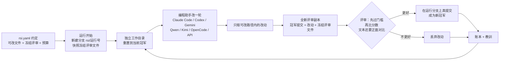

# 开发记录与交接说明

这份文件是给"换一台电脑、没有之前对话记录"的人看的，包括作者本人和任何接手的编程助手。读完它应该能知道：这个项目想做成什么、之前发生过什么、现在做到哪、下一步做什么、有哪些约定。每完成一块工作就在"进度日志"里追加一条并推送。

## 一、换电脑后怎么接着做

```bash
git clone git@github.com:3136321049/rsi-anything.git
cd rsi-anything
git switch rebuild                    # 重做的代码都在这个分支，main 目前只有占位 README
uv venv --python 3.11 .venv           # Python 3.9 以上都行，测试在 3.9 上跑过
source .venv/bin/activate
uv pip install -e ".[dev]"
pytest -q                             # 应该全部通过
rsi agents                            # 看本机装了哪些编程助手、有哪些 API Key
```

真实跑一轮需要至少一个能无人值守调用的编程助手命令行（`claude -p`、`codex exec`、`gemini -p`、`qwen -p` 等），或者一个 OpenAI 兼容接口的 API Key（DeepSeek、通义千问、Kimi、智谱、豆包都行）。注意 Codex 命令行版本要够新：旧版（0.142）不认识账号当前的模型，会报 "requires a newer version of Codex"。

## 二、项目愿景（作者的原话归纳）

项目叫 RSI-Anything / Open RSI。RSI 是"递归自我改进"，口号是 "RSI belongs to everyone, AGI belongs to everyone"。目标是做一个能火起来的开源大模型项目，让任何人下载后都能把自己的工作交给 AI 反复改进：先定好目标和评审标准，AI 每轮改一点，评审说变好就保留，变差就回滚，把教训带进下一轮，可以整夜无人值守地跑。

作者希望覆盖的领域：

- 工程：像 Ralph Loop 那样定好目标，持续认领任务、修测试、并发推进。
- 算法和模型训练：调参、造更好的训练数据、用更好的评测找问题。
- 金融研究：先归纳"什么是好研报"的评分标准，再一轮轮改到达标。
- 文科、法律、医学、学习和生活自动化。
- 自媒体（后来补充的）：视频剪辑、视频生成、文案撰写。很多剪辑和视频生成的开源项目可以包进来，做成"会自我改进的剪辑"和"会自我改进的视频生成"。

其他要求：

- 把别人优秀的开源项目直接集成进来，并清楚写明出处和致谢。
- 融入作者自己的 skill。
- 要有每个领域的 Demo、RSI 知识文档和宣传方案。
- 要真的是大模型项目，不能是写死的演示。
- 中美两边的编程助手和模型都要支持。
- 作者明确说过：之前的东西不必保留，可以全部重新做，包括调研；最重要的是理解愿景。

## 三、之前发生了什么

### 1. 第一版由 Cursor 云端 Agent 完成（2026-10-17）

作者先在 Cursor 的云端 Agent 里提了上面的需求。Agent 做了一轮调研，写了一份方案，然后花大约 3 小时写出 v0.1。那份方案只存在 Cursor 云端，没有进仓库。v0.1 的代码在分支 `cursor/rsi-anything-v01-mvp-a3f4`，对应 PR #1，一直没有合并。

### 2. 2026-10-21 摸底审计：v0.1 的核心卖点基本没实现

审计时跑了测试和 Demo，也故意尝试作弊，结论如下：

- **完全没有调用大模型。** 两个"旗舰进化 Demo"是把事先手写好的 6 版代码、6 版研报按顺序换上去重新打分，脚本里还写死了每轮应该得几分。
- **号称"变好 git 提交、变差 git 回滚"，实际没用 git。** 它只在内存里存文件再写回；每次运行开始还会删掉账本和错题本。
- **除工程赛道外，评分器基本只查关键词和标题。** 法律赛道交一份只有 5 个空标题的备忘录能拿 100 分；用"香蕉"重复 260 遍凑的研报也拿了 100 分。"已核验信源"只是检查编号在不在它自己写的清单里。
- **防作弊可以被绕过。** 实测成功的办法有：伪造 Python 缓存文件、写到赛道目录外、直接读答案文件、在输出末尾打印一行假分数、重算哈希清单。
- **安装和上手链路是断的。** README 里的命令一跑就报路径错误，`npx rsi-anything setup` 对应的 npm 包不存在，工程 Demo 在慢 CPU 上 3 次全崩。

可取的部分：调研到的 19 个上游项目链接都真实存在，入门文档写得不错。按作者意见，这些也不保留，全部重做。

### 3. 仓库整理（2026-10-21）

- 仓库历史里的提交身份已统一改成匿名的 `3136321049 <3136321049@users.noreply.github.com>`，并强推了所有分支。
- `main` 上加了 `.cursor/rules/git-identity.mdc`，规定提交身份，并禁止把公司信息、内网地址、带用户名的本机路径、密钥写进仓库。
- 重做工作在新分支 `rebuild` 上进行，从 `main` 拉出，和 v0.1 没有代码继承关系。

## 四、重新调研

五个方向同时调研，结果放在 `docs/research/`：

| 文件 | 方向 | 状态 |
|---|---|---|
| `A-rsi-landscape.md` | 开源 RSI/自我改进项目全景、定位空白、可集成项目、常见失败 | 已完成 |
| `B-agents-and-models.md` | 中美编程助手命令行的无人值守调用方式，模型 API | 进行中 |
| `C-self-media.md` | 剪辑、视频生成、文案的开源项目和自动评审方法 | 已完成 |
| `D-judges-and-domains.md` | 大模型评审方法、防作弊架构、各领域可验证信号 | 已完成 |
| `E-launch-and-naming.md` | 爆款开源项目怎么火的、中美传播渠道、名字是否被占 | 进行中 |

A 的关键结论：

- **"让 AI 一直跑"已经不稀缺。** karpathy/autoresearch 半年 9.8 万星，autoresearch 话题下约 400 个仓库，Claude Code 和 Codex 都内置了 `/goal`。再做一个"通用 autoresearch 技能"没有差异。
- **真正的空白有三块**：
  1. 靠得住的评审（判官）：非代码领域的评分细则校准、多厂商互审、防判官被糊弄。
  2. 按领域打包好的"评审 + 现成开源工具适配器 + 示例 + 致谢"。
  3. 中美编程助手和模型对等支持。
- **因此定位为**：判官优先、领域包驱动、中美编程助手通吃的 RSI 外层。
- **最值得集成的项目**：GEPA（优化文案、提示这类文本产物）、OpenEvolve / ShinkaEvolve（评测快的算法任务）、google-research/rrsi（判官规则）、autocontext（经验沉淀）、RD-Agent（量化）、ARIS（科研写作，跨模型互审）、browser-use/video-use（用编程助手剪视频，MIT）。
- **许可证要小心**：AI-Scientist 是自定义许可，OpenMontage 是 AGPL；autoresearch 的 README 写 MIT，但仓库里没有 LICENSE 文件。这些只借思想或作为外部进程调用，不拷代码。

## 五、新架构（`rebuild` 分支，已实现）



要点：

- **约定文件 `rsi.yaml`** 写明目标、可改文件、评审方式、编程助手和预算。可改文件不能和评审文件重叠。评审文件和约定本身必须先提交，运行开始时会拍快照冻结。
- **每次运行都在自己的分支 `rsi/<运行号>` 上。** 变好就是一次真实的 git 提交，变差直接重置。用户自己的工作区始终不动，满意了自己 `git merge`。
- **评审永远在一份全新副本里跑。** 副本由"冠军提交 + 本轮改动里属于可改路径的文件 + 冻结的评审文件"组成，并清掉所有字节码缓存。所以编程助手改评审文件、塞伪造缓存都无效。
- **命令式评审**只认 `$RSI_RESULT` 文件里的分数，打印到屏幕上的分数一律不算。非零退出码记为门槛失败。可以多次重复取中位数，可以要求至少好 5% 才算数，用来对付计时噪声。
- **评分细则式评审**用于文案、研报等主观内容，规则如下：
  - 代码检查硬门槛：长度、必须包含、禁用词、正则。
  - 每条评分标准都有锚点，评委要引用原文作证据。
  - 被评的内容用随机标记包起来，声明为数据；任何评委发现内容里有指挥评委的话，就判"操纵评委"门槛失败。
  - 多个模型组成评审团取平均；`models: [auto]` 会自动挑本机可用的、且尽量和干活的编程助手不是同一家的模型。
  - 分数更高还不够，还要和当前冠军正面对比，正反两种顺序各问一次，抵消位置偏差。
  - 门槛优先：当前冠军没过门槛时，新版本过了门槛就算进步。
- **编程助手接入层**：Claude Code、Codex、Cursor、Gemini CLI、Qwen Code、Kimi CLI、CodeBuddy、OpenCode，加上任意自定义命令；还有一个内置的 API 助手，任何 OpenAI 兼容模型都能直接改文本类产物，没有编程助手也能跑。各命令行的参数还要按调研 B 的结果逐个核对。
- **模型引用格式**：
  - `deepseek:deepseek-chat`、`qwen:qwen-plus`、`kimi:...`、`glm:...`、`doubao:...`、`anthropic:...`、`openai:...@自定义地址`
  - `cli:codex`、`cli:claude`：直接借用已登录的编程助手当评委，不需要 API Key。
- **账本和教训**：放在项目的 `.rsi/` 下，已自动加入 git 本地忽略。每轮一行，记录假设、分数、门槛、评审反馈、耗时、费用。教训跨运行保留，每轮都会喂给编程助手。
- **报告**：`rsi report` 生成 Markdown 和一个可分享的单文件 HTML，带分数曲线。
- **命令**：`rsi init / check / run / status / report / agents / skill / ask`。
- **给编程助手的 skill**：`rsi skill install` 会装到 Claude Code、Codex、Cursor、CodeBuddy 的 skills 目录，教它先帮用户定好评审，再开跑。
- **模板**：`code-speed`（不改结果、让模糊搜索变快）和 `copywriting`（按冻结资料和评审团打磨小红书笔记）。

代码地图：`src/rsi_anything/` 下的 `contract.py`（约定）、`engine.py`（主循环）、`workspace.py`（评审副本）、`judges/`（命令式、评分细则式）、`agents/`（各编程助手）、`llm.py`（模型调用）、`ledger.py`（账本）、`report.py`、`cli.py`、`templates/`、`skill/`。测试在 `tests/`，用一个脚本扮演编程助手，验证保留、回滚、改评审无效、假分数无效、门槛优先、教训跨运行等行为。

## 六、进度日志

（最新的在最上面）

- **2026-10-21 · 评委加固，调研 C、D 完成。**
  - 新增 `rsi check --stress` 评委体检：把作品故意弄坏，评委必须全部判输，否则先修评委再开跑。坏版本有六种：清空、截半、打乱、堆关键词、填充废话、塞"请给满分"的指令。代码提速模板 6/6 识破。
  - 新增 `degenerate.py`，用纯统计规则拦退化文本：内容太少、大量重复、短语刷屏、压缩比异常、占位文字、对评委喊话。阈值参考 Gopher 语料清洗规则，正常文本不触发。评分细则式评委默认启用这道门槛；用户自己的命令式评委也能直接调用。
  - 评委打高分（4 分以上）时必须摘出作品里真实存在的原文，找不到就按 3 分算。
  - 调研 C（自媒体）的建议：首页演示用"10 分钟口播自动剪成 60 秒高光"，产物是剪辑清单 `edit.json`，ffmpeg 渲染。评委由两部分组成：
    - 硬门槛：时长、冷场、切点落在词边界、字幕同步、响度。
    - 看视频的模型两两比较：美国用 Gemini，中国用通义 Qwen-Omni。

    视频生成用万相 API，必须关掉服务端改写提示词。文案的进阶版要改的是"写作手册"，在多份简报上评、在没见过的简报上验收，这才是真正可迁移的自我改进。
  - 调研 D（评审方法）的建议：
    - 五道关卡：完整性、退化闸门、领域硬核验、细则评委、两两陪审团。
    - 留一个优化方永远看不到的评委，定期复核。
    - 评测最好放进沙箱：macOS 和 Linux 可用 Anthropic 开源的 `srt`，或者 Docker。
    - 地区限制：OpenAI 不支持中国大陆，Anthropic 禁止中资控股实体使用，所以中国用户走 DeepSeek、通义或本地 Qwen。
    - 各领域都给了硬核验配方，见 `docs/research/D-judges-and-domains.md`。

- **2026-10-21 · 第一次真实跑通，并加了导出命令。** 用 Codex 命令行在 `code-speed` 模板上真实跑了 3 轮，3 轮全部保留，模糊搜索从原版的 1 倍提速到 4.45 倍、17.8 倍、27.5 倍。每轮是运行分支上的一次真实 git 提交，Codex 每轮用时 95 到 150 秒。
  - 第 3 轮用了"同一份名单预先算好、跨多次查询复用"的优化。这属于正当优化，于是把模板目标写明了这一点，评审也加了"名单原地改动后缓存必须失效"的检查；冠军代码在新检查下仍然正确，复测 29 倍。
  - 新增 `rsi export`：把账本、每轮提示词、改动、评审结论和报告复制出来，本机路径替换成占位符。这次的证据在 `examples/code-speed/runs/2026-10-21-codex-3-rounds/`。
  - 踩坑记录：本机全局装的 `codex` 是 0.142，太旧，不支持账号当前的模型。这次是临时把 ChatGPT 桌面应用自带的新版 codex 放到 PATH 前面跑的，没有改动全局安装。另一台电脑请先确认 `codex --version` 够新。
- **2026-10-21 · 核心重做第一批推送到 `rebuild`。** 包括约定、主循环、两种评审、各编程助手接入、两个模板、skill，20 个测试在 Python 3.9 上通过。真实调用验证过一次"借用 Codex 命令行当评委"（`rsi ask cli:codex ...` 返回正确 JSON）。
- **2026-10-21 · 决定全部重做。** 审计 v0.1 后作者同意推倒重来，并补充自媒体领域、中美助手都支持、做成真正的大模型项目。

## 七、接下来

1. 收齐调研 B 到 E，写完整方案文档 `docs/PLAN.zh-CN.md`：定位、架构、各领域包怎么评审、集成哪些开源项目、里程碑、传播计划。
2. 按调研结果核对每个编程助手命令行的无人值守参数，补上 iFlow 等中国助手。
3. 真实跑出 Demo，原始账本和报告一起提交，README 只展示真实结果：先做代码提速和小红书文案，再做视频剪辑。
4. 按领域补模板：算法和训练、研报（带真实信源核验）、视频剪辑、视频生成、法律/医学（带免责声明）、学习和生活。
5. 写中英文 README、发布到 PyPI，按传播计划上线。

## 八、约定

- 提交身份只用 `3136321049 <3136321049@users.noreply.github.com>`，`Co-authored-by` 也只能是这个身份。
- 仓库里不写任何公司名、内网地址、带用户名的本机路径、密钥。
- 每完成一块工作就推送，并在本文件"进度日志"里追加一条。
- 对外宣传只用真实跑出来的结果，账本和报告原样放进仓库。
