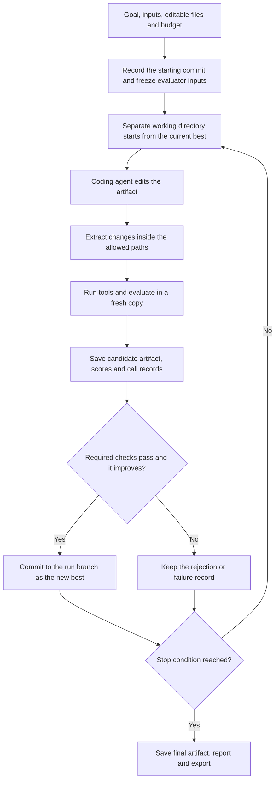

# Open RSI architecture and design

[简体中文](PLAN.zh-CN.md)

Updated: 2026-10-24. The first-release scope and resource exceptions are defined in the [release brief (Chinese)](GOAL-FIRST-RELEASE.zh-CN.md); live work status is in the [progress tracker (Chinese)](GOAL-PROGRESS.zh-CN.md). This document describes the implementation as it currently stands.

## Goal

Use one local loop to let AI repeatedly edit code, text, configuration and media production methods against a clear goal and evaluation. The first version emphasizes real calls, visible artifacts and the full process: it shows users what changed, what the tools actually did, why something was kept or rejected, and what they can take away at the end.

There are currently 15 domains and 16 templates. D01–D06 and D08–D14, 13 domains in all, have saved complete multi-round runs, final artifacts and independent verification; D05 covers both a single post and a reusable guide. D07 keeps a partial measured generation run limited by the service, and D15 keeps an entry point awaiting a measured GPU run. These two resource exceptions don't count toward measured passes. Evaluation uses the basic program checks each task needs plus whatever model feedback is available; sophisticated calibration, strong adversarial isolation and advanced search aren't prerequisites for the first release.

## Main loop

Each run uses an `rsi/<run-id>` branch. Candidates come only from the paths listed in `artifact`; evaluator inputs come from the starting Git commit. Generated files are listed in `outputs` and saved with each round. The original development directory is kept separate from the agent's working directory; users can review the run branch and merge it themselves.

Each round produces only one formal candidate, and the next round continues from the current best. Past feedback and lessons learned help the agent adjust its direction. There is currently no model weight training and no multi-candidate population search.

## Evaluation

Command evaluation runs a fixed program, such as tests, CPU training, a backtest or a student model answering questions; the score is written to a dedicated result file. Repeated measurement, the median and a minimum improvement threshold can be configured.

Model evaluation uses fixed material and a scoring rubric, checks evidence in the artifact's own text, and records each comment. Text tasks can turn on a head-to-head comparison of the new version against the current best, run in both orders before voting; with image or video inputs, this comparison is currently skipped. The video judge only sees sampled frames; full motion, sound and the editing experience are covered by playback checks.

Required checks take priority over the score. When the current best doesn't pass them, fixing the checks can count as real progress on its own. A higher-scoring candidate can still be rejected by the head-to-head comparison. `rsi check --stress` provides an optional check with degraded inputs; it doesn't fully prove that the judge is reliable, and it isn't a required startup step for every demo.

A service or environment failure that produced no artifact isn't recorded as a quality score of 0. The prepare step can report this case with `quality_result: "unknown"` in `out/error.json`, and the engine records it as an evaluation failure with no score. D07's old ledger keeps the original failure codes; the showcase reads the derived verification, which is tied to the original ledger's hash, and shows the last two rounds as quality unknown.

`holdout` is evaluated separately at the start and the end, and its results are listed on their own; it doesn't directly decide whether the final version is reverted. Held-out files are removed from the regular agent directory, but shared Git history isn't a strictly confidential environment.

## Files and call records

| File or directory | Purpose |
|---|---|
| `config/rsi.yaml`, `config/execution.json` | The original config, and the resolved agent, model, budget and output settings |
| `config/frozen/` | Frozen material and evaluator code |
| `ledger.jsonl` | Each round's decision and formal score |
| `run.json` | Status, phase, starting and current-best commits, and stop reason |
| `artifacts/baseline/`, `artifacts/final/` | Starting and final artifacts, manifests and evaluations |
| `rounds/rNNN/` | Prompt, changes, results, call records and candidate snapshot |
| `report.md`, `report.html` | Readable report for a single run |

`rsi export` keeps media bytes unchanged, replaces local machine paths in text and updates the hashes of exported files. Linked external material isn't copied automatically; each domain's notes must cover the licenses for the original material and data. `scripts/build_showcase.py` builds the local collection page from the domain catalog, original records and independent verification; a project without a finished status, a valid multi-round run, a final artifact or independent verification can't be marked as accepted.

The [35-second showcase clip](../examples/showcase-media/openrsi-demo.mp4) strings together saved results from code repair, the writing guide, the speech cut and classifier mistakes, and its [source record](../examples/showcase-media/demo-video.json) lists the material and the media checks. It's a showcase edit of existing results, not a new optimization experiment.

Model records distinguish the requested model from the model the service reports; usage and cost stay unknown when they aren't returned. The source code provides several agent and model backends, but real-run coverage comes mainly from a personal Codex account; the number of adapters isn't the number that has been verified.

## Interruptions and resources

Run state is written phase by phase. The saved baseline and best artifact can be recovered, and each round's results are written to disk on their own before being added to the ledger. A round stopped midway is marked explicitly; if the run branch has changed but the ledger doesn't match it yet, the program asks you to check first so results aren't misread. The time budget accumulates across resumes, each step is still bound by its own timeout, and the total budget is checked between rounds.

Video generation also has a persistent cache that records requests, event IDs, finished videos and hashes; resuming a wait or a download doesn't generate again. When it's unclear whether a submission was accepted, it isn't resent automatically. Service failures are listed separately as quality unknown.

D07 obtained videos for the starting artifact and round 1; the last two rounds got no artifact, and one short-prompt diagnostic also received `error/null`. The current API call order hasn't changed, and the specific remote cause is still unknown. The inputs, the clips already generated and the cache recovery entry point are kept, and the cause isn't rewritten based on guesses about quota or length.

D15 currently has no personal GPU. It provides a Softmax template based on public sources, a probe command and a starting point for whoever picks it up; actual performance is blank. Under the brief's resource exception, this doesn't block the rest of the first release. CPU or simulated data can't stand in for a measured GPU run.

## Implementation limits and next steps

Evaluator commands still run on the host machine, and linked material has no OS-level enforced read-only protection. The current mechanism reduces common accidental edits, but it isn't a sandbox for running unknown malicious code. Model scores depend on the judge and the task; repeated optimization against a fixed validation set may overfit to that set.

Further improvements should be driven by real runs: stricter permission isolation, independent validation data, judge calibration, explicit cost caps, multi-candidate search, and integrating GEPA or OpenEvolve where needed. For the 13 existing complete runs, the priority is maintaining reproduction, the showcase and the user onboarding path; D07 and D15 will get new measured-run records once their resource conditions are met.

See the [extension guide](EXTENDING.md) for how to plug in a task, and [components and sources](OPEN-SOURCE.md) for dependencies and what was borrowed.
