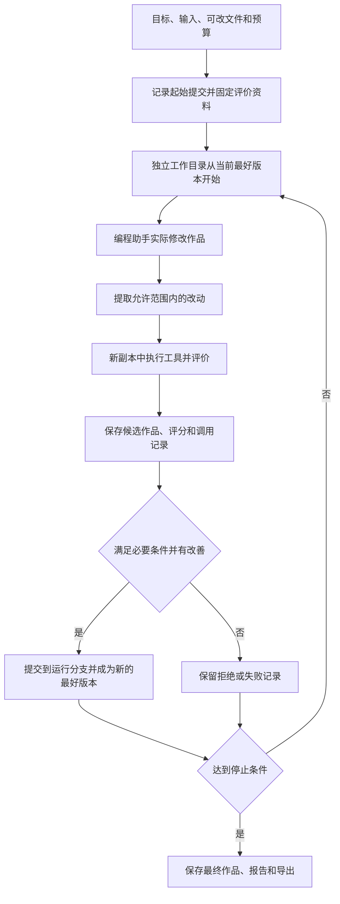
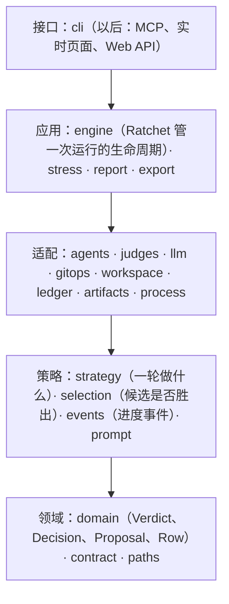

# Open RSI 当前架构与设计

[English](PLAN.md)

更新日期：2026-10-29。首发范围和资源例外以[任务书](GOAL-FIRST-RELEASE.zh-CN.md)为准，实时工作状态见[执行表](GOAL-PROGRESS.zh-CN.md)。本文说明当前保留的实现。

## 目标

用一个本地循环，让 AI 在明确目标与评价下反复修改代码、文本、配置和媒体制作方法。首版强调真实调用、可见作品和完整过程：给用户看到改了什么、工具实际做了什么、为什么保留或拒绝，以及最终可以拿走什么。

当前为 15 个领域、16 个模板，其中 D01–D06、D08–D14 共 13 个领域已保存完整多轮、最终作品和独立验证；D05 同时包含单篇文案与可复用手册。D07 保留服务受限的部分生成实测，D15 保留待 GPU 实测入口，两项资源例外不计实测通过数量。评价采用任务所需的基本程序检查与可用模型反馈；复杂校准、强对抗隔离和高级搜索不是首发前置条件。

## 主流程

每次运行使用 `rsi/<运行号>` 分支。候选只来自 `artifact` 指定的路径；评价资料来自起始 Git 提交。生成文件由 `outputs` 指定并随轮次保存。原始开发目录与助手工作目录分开，用户可以查看运行分支后自行合并。

单轮只产生一个正式候选，下一轮从当前最好版本继续。历史反馈与教训帮助助手调整方向；当前没有模型权重训练，也没有多候选种群搜索。

## 代码分层

依赖只能由外向内；`tests/test_architecture.py` 检查每个模块所在的层，新增模块必须先归入某一层。

- **搜索策略**（`strategy.py`）：引擎每轮交给策略一个 `Arena`，可以从当前最好版本提出候选、在干净副本中评分、请选择规则判断、提交胜者。现有做法是 `Greedy`（每轮一个候选）；每轮多个候选或种群搜索在这里新增，不改引擎。
- **选择规则**（`selection.py`）：评委只负责打分，是否保留由选择规则决定。`GatesThenScore` 先看门槛再看提升幅度；`HeadToHead` 叠加在上面，要求候选在正反两次比较中胜出。`Ratchet` 可以传入任何带 `decide()` 的对象。
- **事件流**（`events.py`）：每次运行在账本旁写 `events.jsonl`（run_started、round_started、agent_finished、judged、round_finished、run_finished、run_failed）。终端进度行由同一事件生成，实时页面可以直接跟随运行。
- **记录格式**：新运行的 `run.json` 带 `schema: 1` 和 `strategy`；没有这两个字段的旧记录按版本 1 读取，已保存的实验记录不改写。

## 评价

命令式评价执行固定程序，例如测试、CPU 训练、回测或学生模型答题；分数写入专用结果文件。可以设置重复测量、中位数和最小提升幅度。

模型评价使用固定资料和评分细则，检查作品原文证据，并记录每项意见。可启用新旧两两比较，交换顺序后投票；图像和视频抽帧也一并提供，并标明属于哪个版本，视觉任务同样经过这道检查。分数相同默认拒绝；设置 `ties: compare` 后由同样的比较决定，适合评分表较粗、真实改进落在同一总分的任务。视频评委只看抽帧，完整运动、声音与剪辑体验由播放检查补充。

必要条件优先于分数。当前最好版本不满足条件时，修复条件本身可以构成有效进步。高分候选仍可能被新旧比较拒绝。`rsi check --stress` 提供可选的退化输入检查，它不等于全面证明评委可靠，也不是每次 Demo 的必需启动步骤。

没有获得作品的服务或环境失败不记作质量 0 分。准备步骤可以通过 `out/error.json` 的 `quality_result: "unknown"` 报告这种情况，引擎将其记为无分数的评审失败。D07 的旧账本保留原失败编码，展示读取关联原账本哈希的派生核验，把后两轮显示为质量未知。

`holdout` 在开始和结束时另行评价，结果单列；它不直接决定是否撤销最终版本。留出文件在常规助手目录中被移除，但共享 Git 历史不是严格保密环境。

## 文件与调用记录

| 文件或目录 | 用途 |
|---|---|
| `config/rsi.yaml`、`config/execution.json` | 原始配置及实际展开的助手、模型、预算和输出设置 |
| `config/frozen/` | 固定资料与评分代码 |
| `ledger.jsonl` | 每轮决定与正式分数 |
| `run.json` | 状态、阶段、起始和当前最好提交、停止原因 |
| `artifacts/baseline/`、`artifacts/final/` | 初始和最终作品、清单、评价 |
| `rounds/rNNN/` | 提示词、改动、结果、调用记录和候选快照 |
| `report.md`、`report.html` | 单次运行的可读报告 |

`rsi export` 保留媒体原字节，替换文本中的本机路径，并更新导出文件的哈希。外部素材链接不自动复制；原素材及数据许可需由领域说明交代。`scripts/build_showcase.py` 根据领域目录、原始记录和独立验证生成本地集合页面；没有结束状态、有效多轮、最终作品或独立验证的项目不能标为已验收。

[35 秒展示短片](../examples/showcase-media/openrsi-demo.mp4) 将已保存的代码修复、写作手册、口播剪辑与分类错例串起来，[来源凭证](../examples/showcase-media/demo-video.json)列明素材与媒体验证。它是现有结果的展示剪辑，不属于新的优化实验。

模型记录区分请求型号和服务端返回型号；调用量、费用没有返回时保持未知。源代码提供多家助手和模型后端，但真实运行覆盖主要来自个人 Codex，不能把适配器数量当成验收数量。

## 中断与资源

执行状态按阶段写入，已保存的基线和最好作品可恢复，轮次结果独立落盘后再汇总账本。中途停止的轮次会明确标记；若运行分支已改变但账本尚未对应，程序要求先检查，避免误认结果。时间预算续跑时累计，单步仍由自己的超时约束；总预算在轮次之间检查。

视频生成另有持久缓存：记录请求、事件编号、成片与哈希；恢复等待或下载时不重复生成。提交是否受理不明时不自动重发。服务失败单列为质量未知。

D07 已取得初始和第 1 轮视频，后两轮未取得作品，一次短描述诊断也收到 `error/null`。当前接口顺序没有变化，具体远端原因仍未知；保留输入、已生成片段与缓存恢复入口，不以猜测的额度或长度问题改写归因。

D15 当前无个人 GPU，提供公开来源的 Softmax 模板、探测命令和接手入口，实际性能为空。按任务书的资源例外，这不阻挡其他首发成果；不能用 CPU 或模拟数据代替 GPU 实测。

## 实现边界与后续方向

评分命令仍在宿主机运行，素材链接也没有操作系统层面的强制只读保护。当前机制减少常见误改，但不是运行未知恶意代码的沙箱。模型分数受评委和任务影响；固定验证集反复优化可能迎合该集合。

后续增强应由实际案例推动：更严格的权限隔离、独立验证数据、评委校准、明确费用上限、多候选搜索，以及按需接入 GEPA 或 OpenEvolve。已有 13 个完整案例优先维护复现、展示与用户上手路径；D07/D15 等资源条件满足后另开实测记录。

具体接法见[扩展说明](EXTENDING.zh-CN.md)，依赖与借鉴关系见[来源说明](OPEN-SOURCE.zh-CN.md)。
