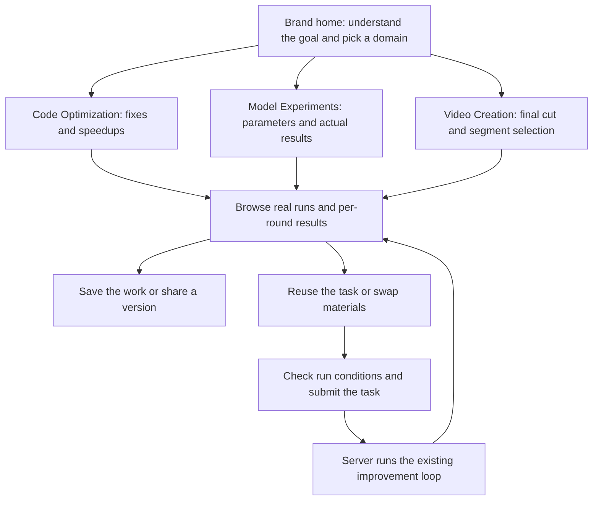

# Open RSI Product Direction and First Web Pages Plan

Updated: 2026-10-25. The brand home page, Code Optimization, Model Experiments, Video Creation, and the usage guide are complete, supporting real-result browsing, version comparison, media playback, and downloads. The first three domains are implemented per this plan. The service for creating, queuing, and running new experiments from the web is still to be built; new experiments currently run from the command line.

## What the product should let people do

Visitors first understand that AI can keep trying toward a clear goal, then pick a domain that interests them and look directly at the actual work and what changed each round. After seeing a case, those willing to try can reuse the default task or swap in a little of their own material and let the same pipeline process their content.

We first serve developers, technical creators, and research enthusiasts who are willing to try AI ways of working. The home page should be easy to understand and easy to share; domain pages should answer practical questions; the run entry should require minimal configuration. The shared value is linking goal, attempts, checks, feedback, version selection, and final work into one inspectable process.

## Page structure

The home page uses research-lab-style brand expression; domain pages arrange content by type of work and share navigation, status meanings, sharing, and run records. Each domain keeps using the existing loop; display layouts may differ.

The first page paths are `/`, `/labs/code/`, `/labs/experiments/`, `/labs/video/`. Each run has its own link, and the URL stores the version and comparison target. These paths map to standalone static pages; the build directory can be previewed on the server, and the official public entry is `https://www.riseai.top/darwin/`.

## Home page content and visuals

The first screen shows the Open RSI brand, a clear product sentence, a short animation of real results, and buttons that lead straight into cases. The site brand is DARWIN, with the tagline "An evolution lab by RiseAI."; the Chinese copy is "用真实反馈，持续改进作品。" ("Keep improving work with real feedback."). The supporting text covers the three directions (code, model experiments, video) and that each round's work and judgment can be inspected.

The primary button is "Choose a domain", which jumps to the three domain entries; the first screen also allows going straight into a real case. The secondary entry is "Watch short demo". Visitors don't have to finish an animation or video to continue, and need no login or model key.

Page order:

1. Brand and a one-line product claim.
2. Three entries: Code Optimization, Model Experiments, Video Creation; each has a real work preview, a concrete result, who it suits, and "View case".
3. A short process explanation: give a goal, AI edits, tools check, useful versions are kept.
4. Representative attempts and work snippets that link into their runs; show one rejection with its reason.
5. More cases, usage guide, project origin, and code entry.

Suggested visual direction: light warm background, dark body text, large enough headings and work areas, thin rules, and restrained accent color. Small parameters and round numbers can use tabular figures; Chinese body text prioritizes readability. Home page motion centers on real version changes; content is interactive as soon as it loads. Domain pages carry the brand but may have their own layouts for a dark video screening area, a code comparison area, and an experiment chart area.

First-round design references: the typography and research narrative of [Periodic Labs](https://periodic.com/), the dynamic showcase and experience entry of [General Intuition](https://www.generalintuition.com/), and the concrete results catalog of [Physical Intelligence](https://www.pi.website/). Research notes are in `docs/research/G-project-ui-review.md`.

## First three domains

| Domain entry | First real task | Existing evidence | Focus of the standalone page |
|---|---|---|---|
| Code Optimization | Fuzzy search speedup; ledger bug fix as a second example in the same domain | Three rounds of historical speedups: 4.45x, 17.83x, 27.45x; the fix went from 6/15 to 15/15 tests | Speedup curve, correctness, per-round changes, run conditions, source diff |
| Model Experiments | CPU handwritten digit classifier | Validation accuracy 46.889%→99.333%, misclassifications 239→3; no formal changes in the last two rounds | Experiment parameters, accuracy, misclassified images, confusion matrix, attempt log |
| Video Creation | Cut a short from existing talk or explainer footage | Four rounds of real edits, subtitles, audio tracks, and render evidence | Large player, rough cut/candidate/final switching, segment selection and order, duration and reasons |

These three can be built from current results, offer different viewing modes, and don't depend on a new text-to-video API or a GPU. Existing copywriting, handbook, report, and schedule cases stay in the full case directory and can later get dedicated pages on the shared run data.

### Code Optimization page

The first screen shows the task goal, initial and kept results, correctness checks, and the speedup. Clicking a round switches the corresponding curve point, code change, and explanation together. Readers can expand the exact timings, input size, hardware, and evaluation rules.

The fuzzy search 27.45x is a historical measurement on an existing fixed task; it must not be labeled as neural network inference speedup, and re-measurements on the new server must not be mixed into the original curve. Reuse the saved measurements first. A new task gets a separate run once its input, correctness conditions, and timing method are defined.

The next material could be an understandable real search, text processing, or data processing task, where the original implementation runs, results are verifiable, and runtime has stable room to improve. Don't manufacture a pretty comparison by adding meaningless waits.

### Model Experiments page

The first screen shows the currently kept configuration, actual accuracy, and initial/final misclassifications; below, rounds tie together model and parameter changes. Selecting an experiment lets you compare configuration, model output, and check results.

The existing classifier only produced a formal improvement in round one; the following two rounds made no formal new changes. Metrics use real discrete points, and kept versions can show step changes; unjudged rounds show their status, with no filled-in scores and no interpolation faking a training process. There is currently no training loss series or large-model training record; those charts come with real tasks.

The project references the improvement loop of `autoresearch`, but the source does not include the upstream training engine. The public name should be "Model Experiments" or "Automated Experiments", with the CPU classification task stated explicitly. If real training tasks are added later, record the fixed training budget, validation metrics, model configuration, and device, then add training loss and validation curves.

### Video Creation page

The first screen gives the final cut ample space, with direct switching between rough cut and final; users start audio themselves. Edited versions differ in length, so comparison can align on the same source sentence, avoiding treating two different timestamps as the same content. Next to the player, show the segments removed, kept, and reordered this round, with reasons.

Current scoring mainly looks at the post-cut text, so the page should show content structure, sentence selection, actual duration, and listening results. Visual quality, natural audio, and cut experience need their own checks or human review; they can't be inferred from existing text scores.

The suggested first branded material is a public or approved project explainer, product demo, or tutorial: fix the source footage and transcript, then let RSI select and reorder segments. Existing historical talks can serve as development and validation input. Write target length, aspect ratio, subtitles, and audience into a brief first, then set up the new experiment.

## Home page promo video vs. video domain experiments

The home page short explains the product and can be composed of existing work, UI recordings, text animation, and charts. It is saved as a standalone promotional asset with source notes; it does not itself count as an RSI improvement result.

Having a coding assistant use video skills to generate animation code and then render it is a viable production path. [Remotion's official docs](https://www.remotion.dev/docs/ai/coding-agents) provide the approach and skills. Choose between the existing HyperFrames, Remotion, or FFmpeg based on the shots needed; new production dependencies go in a separate media project. Use whichever personal assistant/API is available and approved at the time; the home page does not depend on a model that isn't ready yet.

Having RSI itself iterate on animation design needs a separate task: allow edits to storyboard, layout, or animation code; fix the render steps, facts, and assets; check readability, occlusion, duration, shots, and audio. This capability is not done yet, and a one-off human-assisted promo video must not be presented as automated multi-round video optimization.

## Reducing user effort

| User stage | What the page should provide directly | Interruptions to avoid |
|---|---|---|
| Just arrived | One concrete use, a real preview, three clickable domains | Signup walls, forced playback, heavy jargon |
| Viewing a case | Initial and final work preselected, clickable rounds, readable reasons | Requiring understanding of directories, run IDs, and model config first |
| Wants the same thing | Prepared input and evaluation reused, one step to task confirmation | Starting from a blank config file |
| Swapping in own material | Only goal, material, and time/rounds; domain shows relevant fields | Repeated entry, mixing options from all domains |
| Waiting on a task | Current stage, completed rounds, latest work, stop control | Fake percentages, task lost on refresh |
| Getting results | Kept version by default, downloadable files, shareable comparison link | Only a total score, having to dig through raw logs |

Browsing real historical results calls no model and is clearly labeled "Experiment replay". "Start new task" appears only when the service is available and the run method is clear; otherwise, provide usable templates and run instructions. The path to successfully viewing a case always stays independent of accounts and run configuration.

Advanced options such as model, judge, parameters, and file formats default to domain presets and can be expanded. Before submission, a short summary states what will change, how it's judged, the attempt limit, and known cost; if cost is unknown, show unknown. When a personal service connection is needed, configure it once and reuse it afterward; credentials never enter public display data.

On mobile, show the kept work first, use tabs to switch between initial and candidate, and expand source and logs on demand. Motion respects reduced-motion settings, and videos load a poster first, fetching the full file when the user wants it; for support details see [MDN on reduced motion](https://developer.mozilla.org/en-US/docs/Web/CSS/Reference/At-rules/@media/prefers-reduced-motion) and [the video element docs](https://developer.mozilla.org/en-US/docs/Web/HTML/Reference/Elements/video).

## Connecting pages to the server

Development and preview center on this project's directory on the authorized server, continuing to use topic branches. Public pages only read a reviewed release directory; raw experiment directories, Git metadata, virtual environments, and account config are never the site root.

Phase one keeps using Python to aggregate experiment data and generate the home page and three domain pages. Shared styles, navigation, and loading logic are extracted into small common assets, while each domain organizes its own display. The first screen loads only the catalog summary and the current case; text, images, and video are fetched on demand. These pages need no persistent frontend service or new model backend.

Suggested export data in two kinds: a lightweight domain/case index, and per-run details. Domain pages share fields such as task goal, input, rounds, decisions, scores, work, and source; video time segments, code patches, and classifier misclassifications keep their own structures. Existing acceptance rules continue to determine status; the frontend doesn't compute "success" on its own.

Phase two adds a small Python run service and a single-task worker process. Task registration can use SQLite, while formal experiments still treat the existing run directories and ledgers as the source of truth. No extra message broker for now. Web dependencies are added as an optional install only when a networked service is needed.

| New capability | How it connects to the existing implementation |
|---|---|
| Create task | Accept supported templates and specified fields; initialize in a separate task directory and freeze input and evaluation |
| Queue and run | Persist task IDs; start only one task at a time, calling the existing run entry |
| Progress display | Read stage and ledger from `run.json`, update via low-frequency polling; add event push only when finer progress is needed |
| Duplicate-submit protection | The same submit request returns the same task ID; refreshes or repeated clicks don't start duplicates |
| Stop | Add an explicit stop request and process management, keeping completed rounds; show the interrupted current round separately |
| Resume | Use existing resume capability, verifying config and run branch; changed materials create a new experiment |
| File access | Serve only work registered to the task; forbid reading arbitrary server paths |
| Sharing | Generate a reviewed public snapshot; private inputs and full assistant logs are private by default |

Run control, auth, queuing, and handling browser disconnects are not implemented yet. The first open runs target project maintainers or a small set of approved users, with limited templates and resources. Local scoring currently executes code; a public service running arbitrary uploaded code needs separate execution isolation and must not be opened directly on the shared server host.

Before launch, check available disk, memory, concurrency, and log and media retention policies. Keep raw experiments; temporary render files follow a clear lifecycle. Configure access separately for public browsing and private task runs, so one model call can't slow home page loading for all visitors.

## Validating reach and real demand

Research suggests that concrete before/after results, a public process, and an enterable demo are worth testing as sharing formats; there is currently no evidence that any particular visual style guarantees growth. The first round produces material for each of the three cases:

- Code: one real change paired with one speedup, linking straight to that round.
- Model: initial vs. final misclassifications, linking to parameters and the full attempts.
- Video: same-content clips from rough cut and final, linking to actual playback and edit reasons.

Each piece answers one concrete question and offers one matching case entry. Produce a shareable result card, a short demo, and a link that can target a specific round; the short can be edited, but the full record stays inspectable. Material for technical communities focuses on reproduction and changes; material for creators focuses on the final cut and edit steps. Any publishing is done separately.

First observe conversion from home page to domain page, domain page to version comparison, comparison to template use, and template use to task completion. Record only necessary events and durations; never collect work content, keys, or private logs. No analytics service is installed yet, and no such metrics have been collected.

Suggest first having a few real target users do one viewing and trial, recording: whether they can explain the purpose in their own words, whether they found the case they wanted, where they dropped off, whether they actually got a usable file, and whether they came back with a new task. Numeric thresholds should be set after a baseline exists; imagined conversion rates must not be treated as actual performance.

## Phased delivery and completion criteria

| Phase | Deliverables | Completion criteria |
|---|---|---|
| 1. Home page and domain entries (done) | Full home page, three domain previews, real snippets, short explanation, project entry | Domains are clearly selectable on desktop and mobile; results viewable without model calls; every button has a real destination |
| 2. Three domain pages (done) | Code diff and curve, model parameters and misclassifications, video playback and segment notes | Clicking a round links work and reasons; rejections, no-change, and failures display accurately; links restore comparison state |
| 3. Main case material | Three clear task briefs, sources, formal runs, and showcase assets | Each new result has saved work, evaluation, and full attempts; reviewable, without overwriting historical experiments |
| 4. Server runs | Default tasks, minimal input form, queue, status, stop and resume | Refresh doesn't lose tasks, repeated clicks don't double-run, failures are traceable, outputs downloadable |
| 5. Limited trial and launch prep | Usage observation, issue fixes, share pages, and promotional material | Viewing, running, and getting results actually work end to end; server capacity and public file scope are checked |

Phases one and two are done; build and acceptance methods are in `web/README.md`. Real GPU testing and new animation generation tasks each have their own dependencies and are not prerequisites for launching the home page and existing case showcase. Before external deployment, settle the domain, public file directory, and access method, avoiding changes to other projects on the server.

## Basis for this round

Project baseline is `2f6df82`. The current site reuses the formal runs for code speedup, code fix, classifier, and video editing. The new site checks and full regression pass; exact results are in `release/site-validation.json`. No new model calls were made this round. Design sources are in [Project review and design research](research/G-project-ui-review.md).
