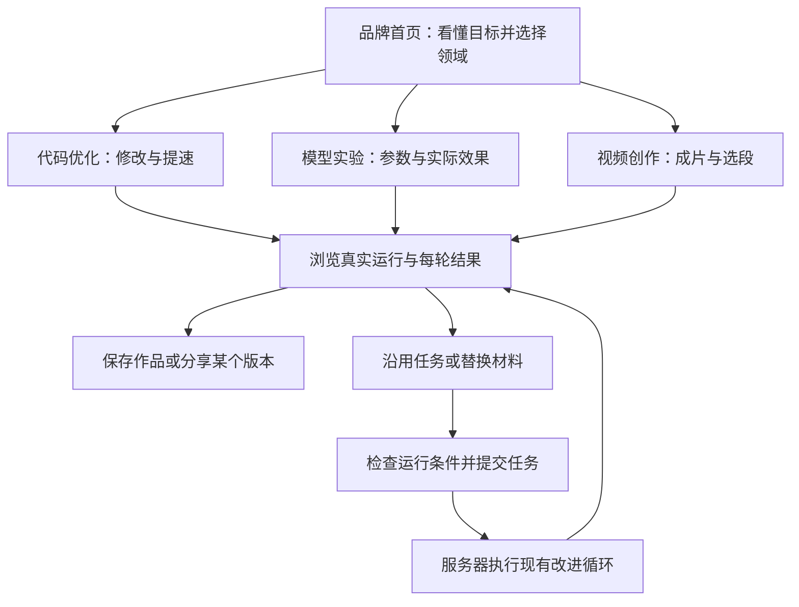

# Open RSI 产品方向与首批网页方案

更新日期：2026-10-25。品牌首页、代码优化、模型实验、视频创作和使用说明已完成，支持真实结果浏览、版本比较、媒体播放和下载。首批三个领域已按本方案实现。网页创建、排队和运行新实验的服务仍待开发；当前新实验通过命令行执行。

## 产品要让人完成什么

访客先理解 AI 能围绕明确目标持续尝试，再选择自己感兴趣的领域，直接查看实际作品和每轮变化。看过案例后，愿意试用的人可以沿用默认任务，或替换少量材料，让同一套流程处理自己的内容。

首先服务愿意尝试 AI 工作方式的开发者、技术创作者和研究爱好者。首页要容易理解、能传播；领域页面要能回答实际问题；运行入口要让使用者少做配置。共同的价值是把目标、尝试、检查、反馈、版本选择与最终作品连成一条可查看的过程。

## 页面关系

首页使用研究实验室式的品牌表达，领域页根据作品类型安排内容，共用导航、状态含义、分享方式和运行记录。每个领域继续使用现有循环，展示布局可以不同。

首批页面路径为 `/`、`/labs/code/`、`/labs/experiments/`、`/labs/video/`。具体运行有独立链接，地址保存版本和比较对象。这些路径对应独立静态页面；构建目录可在服务器预览，正式展示入口为 `https://www.riseai.top/darwin/`。

## 首页内容与视觉

首屏展示 Open RSI 品牌、清楚的产品句子、一段真实结果的短动态，以及直接进入案例的按钮。网站品牌为 DARWIN，品牌说明为“An evolution lab by RiseAI.”，中文文案为“用真实反馈，持续改进作品。”说明文字交代代码、模型实验和视频三个方向，以及每轮的作品与判断可查。

主要按钮为“选择一个领域”，直接定位三个领域入口；首屏同时允许直接进入一个真实案例。次要入口为“观看短演示”。访客不必看完动画或视频才可继续，也不需要登录或提供模型密钥。

页面顺序：

1. 品牌与一句产品主张。
2. 代码优化、模型实验、视频创作三个入口；每个入口有真实作品预览、具体结果、适合谁和“查看案例”。
3. 一段简短的过程说明：给出目标，AI 修改，工具检查，留下有用版本。
4. 代表性尝试和作品片段，能进入对应运行；展示一次有理由的拒绝。
5. 更多案例、使用说明、项目来源和代码入口。

视觉方向建议采用浅暖底、深色正文、足够大的标题和作品区域、细边线与克制的强调色。小尺寸参数和轮次可用等宽数字，中文正文优先清晰阅读。首页动效围绕真实版本变化；内容加载后即可操作。领域页延续品牌，但允许视频深色放映区、代码比较区和实验图表区有各自的布局。

首轮设计参考为 [Periodic Labs](https://periodic.com/) 的排版与研究叙述、[General Intuition](https://www.generalintuition.com/) 的动态展示和体验入口，以及 [Physical Intelligence](https://www.pi.website/) 的具体成果目录。研究记录见 `docs/research/G-project-ui-review.zh-CN.md`。

## 首批三个领域

| 领域入口 | 先使用的真实任务 | 已有证据 | 独立页面的重点 |
|---|---|---|---|
| 代码优化 | 模糊搜索提速；记账修复作为同领域的第二例 | 三轮历史加速 4.45、17.83、27.45 倍；修复有 6/15→15/15 项测试 | 加速曲线、正确性、每轮修改、运行条件、源码比较 |
| 模型实验 | CPU 手写数字分类器 | 验证正确率 46.889%→99.333%，错分 239→3；后两轮无正式改动 | 实验参数、准确率、错例图片、混淆矩阵、尝试记录 |
| 视频创作 | 从已有讲话或讲解素材剪短片 | 四轮真实剪辑、字幕、音轨与渲染凭证 | 大播放器、初剪/候选/成片切换、选段与顺序、时长与理由 |

这三项能使用当前成果建立页面，具有不同的观看方式，也不以新增文生视频接口或 GPU 为前提。现有文案、手册、报告和日程继续放在完整案例目录，可沿共用运行数据扩展专用页面。

### 代码优化页

首屏展示任务目标、初始与保留结果、正确性检查及加速变化。点击某一轮时，曲线上对应点、代码变化和解释一起切换。读者可以展开具体计时、输入规模、硬件和评价规则。

模糊搜索的 27.45 倍属于已有固定任务的历史测量，不能标成神经网络推理加速，也不能把新服务器上的复测混成原来的曲线。先复用保存的测量记录。新任务明确输入、正确性条件、计时方法后另开运行。

下一份素材可选实际可理解的搜索、文本处理或数据处理任务，要求原实现可运行、结果可核对、耗时有稳定改善空间。不能靠刻意增加无意义等待制造漂亮对比。

### 模型实验页

首屏显示当前保留配置、实际正确率和初始/最终错例；下面以轮次串起模型与参数变化。选中实验可比较配置、模型输出和检查结果。

现有分类器只有第一轮产生了正式改善，之后两轮没有正式新改动。指标使用真实离散点，保留版本可显示阶梯变化；没有评审的轮次显示状态，不补分，不插值制造训练过程。当前没有训练损失序列或大型模型训练记录，这些图表随真实任务补齐。

当前项目参考了 `autoresearch` 的改进循环，源码未引入上游训练引擎。对外名称宜为“模型实验”或“自动实验”，具体说明 CPU 分类任务。后续如接入真正的训练任务，应记录固定训练预算、验证指标、模型配置与设备，再增加训练损失和验证曲线。

### 视频创作页

首屏给成片充足空间，初剪与最终片可以直接切换；用户自行播放声音。剪辑版本长度不同，比较可以按相同原始句子定位，避免把两个不同时间点误当成同一内容。播放器旁边放本轮删去、保留、重排的片段及理由。

现有评分主要看剪后文字，页面应显示内容结构、句子选择、实际时长和试听结果。视觉美观、声音自然、剪切体验需要对应检查或人工评价，不能由已有文字分数推导。

首份品牌化素材建议是一段公开或获准的项目讲解、产品演示或教程，固定原片与转写后，让 RSI 选择与重排片段。现有历史讲话可作为开发和验证输入。新片长、画幅、字幕和目标观众先写成简报，再建立新实验。

## 首页宣传片与视频领域实验

首页短片用于解释产品，可以由现有作品、界面录制、文字动效和图表组成。它保存为独立的宣传素材，有来源说明；它本身不计作 RSI 的改进结果。

编程助手配合视频技能生成动画代码，再渲染成片，是可行的制作路径。[Remotion 官方资料](https://www.remotion.dev/docs/ai/coding-agents)提供对应方式与技能。具体采用现有 HyperFrames、Remotion 或 FFmpeg，按要制作的镜头选择；新的制作依赖放在独立媒体工程中。模型使用当时可用且获准的个人助手/API，首页不依赖某个尚未准备好的型号。

若希望 RSI 本身迭代动画设计，需要另建任务：允许修改分镜、排版或动画代码，固定渲染步骤、事实与素材，检查可读性、遮挡、时长、镜头及音频。该能力尚未完成，不能把一次人工辅助制作宣传片当作自动多轮视频优化。

## 降低用户操作负担

| 用户所处阶段 | 页面应该直接提供 | 需要避免的中断 |
|---|---|---|
| 刚进入 | 一句具体用途、真实预览、三个可点击领域 | 注册墙、强制播放、大量术语 |
| 看案例 | 默认选好初始与最终作品，轮次可点，原因易读 | 先要求理解目录、运行号和模型配置 |
| 想用同款 | 沿用已准备的输入与评价，一步进入任务确认 | 从空白配置文件开始 |
| 换自己的材料 | 只填目标、材料和时间/轮数；领域显示相关字段 | 重复填写、混合所有领域的选项 |
| 等待任务 | 当前阶段、已完成轮次、最近作品、停止入口 | 虚假百分比、刷新后任务丢失 |
| 拿到结果 | 默认保留版本、可下载文件、可分享比较链接 | 只能看总分、必须翻原始日志 |

浏览真实历史结果不调用模型，明确标为“实验回放”。“开始新任务”只在服务可用、运行方式明确时出现；未具备条件时提供可用的模板与运行说明。成功观看案例的路径始终独立于账号和运行配置。

模型、评委、参数和文件格式等高级选项默认采用领域预设并可展开。提交前用短摘要明确此次改什么、如何判断、尝试上限和已知费用；费用不明就显示未知。需要个人服务连接时，配置一次并在之后复用，凭据不进入公开展示数据。

手机上默认先看保留作品，用标签切换初始与候选，按需展开源码和记录。动效支持减少运动设置，视频先加载封面，用户需要时再取完整文件；具体支持方式见 [MDN 的减少运动说明](https://developer.mozilla.org/en-US/docs/Web/CSS/Reference/At-rules/@media/prefers-reduced-motion)和[视频元素文档](https://developer.mozilla.org/en-US/docs/Web/HTML/Reference/Elements/video)。

## 页面如何接到服务器

开发与预览以已授权服务器上的本项目目录为主，继续使用主题分支。公开网页只读取审查过的发布目录；原始实验目录、Git 元数据、虚拟环境和账号配置不作为网站根目录。

第一阶段沿用 Python 汇总实验数据，生成首页和三个领域页面。将公共样式、导航和读取逻辑提取为小型共用资源，领域各自组织展示。首屏只加载目录摘要和当前案例，文本、图片、视频按需获取。无需为了这些页面建立常驻的前端服务或新的模型后台。

建议导出数据分成两类：轻量领域/案例索引，以及某次运行的详情。领域页面共享任务目标、输入、轮次、决定、分数、作品和来源等字段；视频的时间片段、代码补丁和分类错例仍保留各自结构。已有验收规则继续决定状态，前端不另算“成功”。

第二阶段增加一个小型 Python 运行服务和单任务执行进程。任务登记可以使用 SQLite，正式实验仍以现有运行目录和账本为准。暂不引入额外消息中间件。需要联网服务时再将 Web 依赖作为可选安装项加入。

| 新增能力 | 如何与现有实现连接 |
|---|---|
| 创建任务 | 接受已支持模板和规定字段，在独立任务目录初始化、冻结输入与评价 |
| 排队与执行 | 持久记录任务编号；一次只启动一个任务，调用现有运行入口 |
| 进度展示 | 读取 `run.json` 的阶段与账本，通过低频轮询更新；需要更细进度时再增加事件推送 |
| 防重复提交 | 同一提交请求返回同一个任务编号，刷新或连续点击不重复启动 |
| 停止 | 增加明确停止请求与进程管理，保留已完成轮次；中断的当前轮单独显示 |
| 恢复 | 使用现有恢复能力，核对配置和运行分支；改资料后创建新实验 |
| 文件访问 | 只提供任务已登记的作品，禁止任意服务器路径读取 |
| 分享 | 生成经过核查的公开快照；私人输入与完整助手日志默认不公开 |

运行控制、鉴权、排队和浏览器断线后的管理尚未实现。首次开放运行先面向项目维护者或小范围获准使用者，限定模板和资源。当前本机评分会执行代码；公众上传任意代码的运行服务需要独立执行隔离，不能直接在共享服务器宿主环境开放。

上线前核对可用磁盘、内存、并发、日志与媒体保留策略。保留原始实验，临时渲染文件按明确生命周期处理。公共浏览和私有任务运行分别配置访问方式，避免一次模型调用影响所有访客加载首页。

## 如何验证传播和真实需求

研究资料显示，具体前后结果、公开过程和可进入的演示，是值得测试的传播形式；目前没有证据能证明某种视觉一定带来增长。首轮围绕三个案例分别制作材料：

- 代码：一段真实修改配一次加速变化，直接进入对应轮次。
- 模型：初始错例与最终错例对照，进入参数和完整尝试。
- 视频：初剪与成片的同内容片段对照，进入实际播放和剪辑理由。

每条内容回答一个具体问题，并提供一个对应案例入口。制作一张可分享的结果卡、一段短演示和一个可定位到轮次的链接；短片可以剪辑，但完整记录始终可查。技术社区材料重点放复现与改动，创作者材料重点放成片与编辑步骤。任何发布均另行执行。

先观察首页到领域页、领域页到版本比较、比较到模板使用、模板使用到完成任务的转化。只记录必要的事件与耗时，不采集作品正文、密钥或私人日志。当前没有安装分析服务，也没有积累这些指标。

建议先请少量真实目标用户完成一次观看与试用，记录：能否用自己的话解释用途、是否找到想看的案例、在哪一步退出、是否真的得到可用文件，以及之后是否带着新任务回来。数值阈值应在获得基线后设定，不能把想象的转化率当成已有表现。

## 分批实施与完成条件

| 阶段 | 具体交付 | 完成条件 |
|---|---|---|
| 1. 首页与领域入口（已完成） | 完整首页、三个领域预览、真实片段、简短说明、项目入口 | 桌面和手机能清楚选择领域；无需模型调用即可看成果；所有按钮有真实去向 |
| 2. 三种领域页面（已完成） | 代码比较与曲线、模型参数与错例、视频播放与片段说明 | 点击轮次能联动作品和理由；拒绝、无修改、失败显示准确；链接可恢复比较状态 |
| 3. 主案例素材 | 三份清楚的任务简报、来源、正式运行与展示素材 | 每项新结果有保存的作品、评价与完整尝试；能复查，不覆盖历史实验 |
| 4. 服务器运行 | 默认任务、最少输入表单、队列、状态、停止与恢复 | 刷新不丢任务，重复点击不重复执行，失败可定位，产物可下载 |
| 5. 小范围试用与发布准备 | 使用观察、问题修复、分享页和传播材料 | 实际走通观看、运行与拿到结果；服务器容量和公开文件范围经过检查 |

第一、二阶段已完成，构建与验收方法见 `web/README.md`。GPU 实测和新的动画生成任务各有独立依赖，不作为首页和已有案例展示的启动条件。对外部署前明确域名、公开文件目录和访问方式，避免改动服务器上的其他项目。

## 本轮依据

项目基线为 `2f6df82`。当前网站复用代码提速、代码修复、分类器和视频剪辑的正式运行。新增网站检查与完整回归通过，具体结果见 `release/site-validation.json`。本轮没有新增模型调用。设计来源见 [项目复核与设计研究](research/G-project-ui-review.zh-CN.md)。
