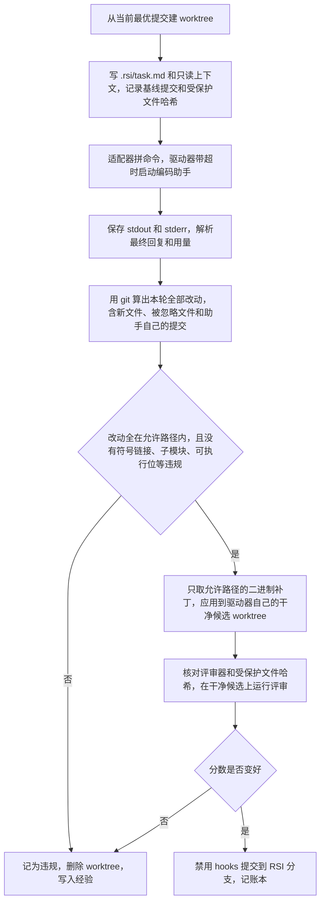

# B. 编码 Agent CLI 与评审模型接入调研（RSI-Anything / Open RSI）

调研日期：2026-10-21。用途：RSI-Anything 的循环驱动器每一轮要在隔离的 git worktree 里，以无人值守的方式调用用户机器上已有的编码 Agent（下文统称"编码助手"），让它提出一处修改；评审器（judge）给修改打分，分数变好就提交，变差就回滚。主观领域（报告、文案、视频）的评审器还要直接调大模型或视觉模型的 API。目标用户同时包括美国和中国大陆。

## 0. 调研方法、版本记录和限制

- **来源**：优先官方文档、GitHub README、源码、npm / PyPI 元数据。每张表都附来源链接。没能在一手来源上核实的内容一律标 **UNVERIFIED**。
- **本地核实**：对调研机器上已安装的几个命令行只运行了 `--help` / `--version`，没有启动任何会话、没有登录、没有给任何模型发 prompt。Claude Code 的参数以官方文档为准。
- **版本号快照**（npm / PyPI，2026-10-21 查询）：

| 包 | 版本 | 备注 |
|---|---|---|
| `@anthropic-ai/claude-code` | 2.1.306 | license 字段 `SEE LICENSE IN README.md`（闭源商业条款） |
| `@openai/codex` | 0.163.0 | Apache-2.0；调研机器 0.142.1 |
| `@google/gemini-cli` | 0.65.0 | Apache-2.0 |
| `@qwen-code/qwen-code` | 0.25.3 | Apache-2.0（GitHub） |
| `@tencent-ai/codebuddy-code` | 2.171.0 | 调研机器 2.97.3 |
| `opencode-ai`（OpenCode 1） | 1.19.3 | MIT；OpenCode 2 是 `@opencode/cli` 2.1.2 |
| `@github/copilot` | 1.0.101 | 闭源 |
| `@anthropic-ai/sandbox-runtime`（`srt`） | 0.0.81 | Apache-2.0，研究预览版 |
| `openai`（Python SDK） | 3.35.1 | Apache-2.0 |
| `litellm` | 1.107.0 | MIT 主体 + `enterprise/` 另授权 |
| `any-llm-sdk` | 1.39.0 | Apache-2.0 |
| `mini-swe-agent` | 2.4.6（2026-07-23） | MIT，依赖 litellm |

- **限制**：本轮共享的 WebSearch 配额中途用完，后半段只能直接抓取已知的官方 URL 和源码。所以"没找到"只代表在这些路径上没找到，不等于确定不存在。部分调研由三个并行子任务完成，它们的完整明细原文附在本文末尾附录 A、B、C，主文只放结论、对比表和设计。

## 1. 可无头驱动的编码助手 CLI

"无头"指不开交互界面、一条命令跑完一轮任务后退出。对驱动器来说，关键是五件事：能否自动批准工具调用、能否输出机器可读的结果（最好是一个 JSON，里面有最终回复和 token / 费用）、能否续接会话、能否把写操作限制在指定目录、能否把模型指向任意 OpenAI / Anthropic 兼容端点（这决定国内用户能不能用）。

### 1.1 无头能力对比

| 工具 | 版本 / 日期 | 无头调用 | 机读输出与最终回复 | 用量 / 费用 | 续接会话 | 自动批准与权限 | 预算控制 | 来源 |
|---|---|---|---|---|---|---|---|---|
| **Claude Code** | 2.1.306（npm，2026-10-21） | `claude -p`（prompt 可走 stdin，上限 10MB） | `--output-format json` 取 `.result`；`stream-json --verbose` 的最后一行是 `result` 消息；`--json-schema` 时取 `.structured_output` | `total_cost_usd`（客户端估算）、`usage`、`modelUsage`、`num_turns`；`subtype` 有 `success` / `error_max_turns` / `error_during_execution` / `error_max_budget_usd` / `error_max_structured_output_retries` | `-r <id 或 transcript 路径>`、`-c`、`--session-id <uuid>`、`--fork-session`；`--no-session-persistence` 不落盘 | `--permission-mode default\|acceptEdits\|plan\|auto\|dontAsk\|bypassPermissions`；`--allowedTools` / `--disallowedTools` / `--tools`；`--permission-prompts none`（v2.1.259+，无人应答时直接拒绝）；`--restricted`（v2.1.248+，文件工具限定在工作目录、去掉执行命令的工具）；v2.1.302 起 `-p` 默认是 Manual 模式 | `--max-turns`、`--max-budget-usd` | https://code.claude.com/docs/en/cli-reference ，https://code.claude.com/docs/en/headless ，https://code.claude.com/docs/en/agent-sdk/typescript |
| **OpenAI Codex CLI** | 0.163.0（npm，2026-10-20）；调研机器 0.142.1 | `codex exec [PROMPT]`，`-` 或不给时从 stdin 读 | 默认 stdout 只打印最终回复；`--json` 输出 JSONL 事件（`thread.started` 带 `thread_id`、`turn.completed`、`item.*`、`error`）；`-o/--output-last-message <FILE>` 写最终回复；`--output-schema <FILE>` | `turn.completed.usage`：`input_tokens`、`cached_input_tokens`、`output_tokens`、`reasoning_output_tokens`；无美元 | `codex exec resume <SESSION_ID>` / `--last`；`--ephemeral` 不落盘 | `--sandbox read-only`（exec 默认）`\|workspace-write\|danger-full-access`；`approval_policy` 取 `on-request` / `never`（可用 `-c approval_policy="never"`）；`--add-dir`；`--dangerously-bypass-approvals-and-sandbox`。**注意 `-p` 是 `--profile` 不是 prompt**；`--full-auto` 已不再支持 | 无（只能靠驱动器超时） | 调研机器 `codex exec --help`；https://learn.chatgpt.com/docs/non-interactive-mode ，https://learn.chatgpt.com/docs/config-file/config-advanced |
| **Cursor CLI** | 调研机器 2026.10.01-e373342（命令 `cursor-agent`，同时装了 `agent`） | `cursor-agent -p "..."` | `--output-format json` 取 `.result`（另有 `session_id`、`duration_ms`）；失败时不输出 JSON、非零退出；`stream-json` 有 `system/init`、`assistant`、`tool_call`、`result` | **不报告** token 和费用 | `--resume [chatId]`、`--continue`、`create-chat` | 不加 `--force`（别名 `--yolo`）时修改只"提议"不落盘；`--sandbox enabled\|disabled`；`~/.cursor/cli-config.json` 和项目 `.cursor/cli.json` 的 `permissions.allow/deny`（`Shell()`、`Read()`、`Write()`、`WebFetch()`、`Mcp()`，deny 优先）；`--trust`；`--workspace <path>` | 无 | 调研机器 `cursor-agent --help`；https://cursor.com/docs/cli/headless ，https://cursor.com/docs/cli/reference/output-format ，https://cursor.com/docs/cli/reference/permissions ，https://cursor.com/docs/cli/reference/configuration |
| **OpenCode 1** | 1.19.3（2026-10-16） | `opencode run "..."` | `--format json`：JSONL，最后一个 `type=="text"` 事件是最终回复 | 每个 `step_finish` 的 `part.cost`（美元）和 `part.tokens{input,output,reasoning,cache}`，累加得一轮总量 | `-c`、`-s <id>`、`--fork` | `--auto` 批准所有未显式 deny 的请求（**包括写项目外目录**，要用 `OPENCODE_PERMISSION='{"external_directory":"deny"}'` 堵住）；不加 `--auto` 时权限请求自动拒绝 | 无 | 附录 B §3.3 |
| **Qwen Code** | 0.25.3（2026-10-19） | `qwen -p "..."` | `-o json` 输出一个**数组**，取 `.[-1].result`；`stream-json` | `usage`、`stats.models`（token），无美元 | `--continue`、`--resume [id]` | `--approval-mode plan\|default\|auto-edit\|auto\|yolo`（或 `--yolo`）；`permissions.allow/ask/deny`；`-s/--sandbox`（macOS Seatbelt 有断网配置，Linux bwrap 可 `network: closed`） | `--max-session-turns`、`--max-wall-time`、`--max-tool-calls`；退出码 53 轮数到顶、55 超预算 | 附录 A §3.2 |
| **CodeBuddy Code**（腾讯） | 2.171.0（2026-10-20） | `codebuddy -p "..." -y` | 参数照搬 Claude Code：`--output-format json` 取 `.result` | 文档确认 `.total_cost_usd`、`.session_id` | `-c`、`-r [id]`、`--session-id`、`--fork-session` | 文档写明无头模式**必须**加 `-y`；`--permission-mode`；工具白/黑名单；Bash 沙箱（Seatbelt / bubblewrap） | `--max-turns` | 附录 A §3.1 |
| Gemini CLI | 0.65.0（2026-10-20） | `gemini -p "..."` | `-o json` 取 `.response`；`stream-json` | `.stats`（token），无美元；退出码 0/1/42/53 | `-r latest\|<index>\|<session-id>` | `--approval-mode yolo`（`--yolo` 已废弃）；Policy Engine，无头下 `ask_user` 视为 deny；`-s` 沙箱 | 无（53 = 超轮数） | 附录 B §3.1 |
| Kimi Code CLI | 2.3.0（2026-10-21） | `kimi -p "..."` | 只有 `--output-format stream-json`（JSONL），无单个结果对象 | 未文档化（UNVERIFIED） | `-c`、`-S [id]` | `-p` 模式本身不请求人工批准，按 `auto` 执行；**没有工作目录参数**，要把进程 cwd 设到 worktree | 无 | 附录 A §3.3 |
| Qoder CLI（阿里） | 1.1.75（2026-10-20） | `qoder -p "..." --yolo` | `-o json\|stream-json`，字段未文档化（UNVERIFIED） | UNVERIFIED | `-c`、`-r`、`--session-id` | `--permission-mode`、`--allowed-tools`；`-w/--cwd` | `--max-turns` | 附录 A §3.4 |
| GitHub Copilot CLI | 1.0.101（2026-10-20） | `copilot -p "..." --allow-all-tools` | `--output-format json`（JSONL，事件 schema 未成文）；`-s` 只输出回复 | OTel 文件导出（`COPILOT_OTEL_FILE_EXPORTER_PATH`） | `--resume`、`--continue`、`--session-id <uuid>` | `--allow-tool` / `--deny-tool`、`--allow-url` / `--deny-url`、`--add-dir`、`--sandbox`、`--no-ask-user` | 无 | 附录 B §3.2 |
| Goose | v1.55.0（2026-10-16） | `goose run -t "..."` | `--output-format json` 取 `messages` 最后一条；`stream-json` | `metadata` 里 token 和 `cost_usd` | `-n <name> -r`；`--no-session` | `GOOSE_MODE=auto`（默认就是 auto）；无 OS 沙箱 | `--max-turns` | 附录 B §3.5 |
| Amp | `@ampcode/cli`（2026-10-21） | `amp -x "..."` | `--stream-json`，格式刻意兼容 Claude Code | `result.usage`（可选） | `amp threads continue` | 默认不询问就执行工具 | 无 | 附录 B §3.6 |
| Cline CLI | 3.0.73（2026-10-17） | `cline --json "..."` | `run_result` 行的 `.text` | `run_result.usage`（内部字段未文档化） | `--id <id>` | `--auto-approve` 默认 `true`；无命令级白名单 | `-t/--timeout` | 附录 B §3.8 |
| Kilo Code CLI | 7.8.15（2026-10-19） | `kilo run --auto "..."` | `--format json`（OpenCode 分叉，字段推测一致，UNVERIFIED） | 同上 UNVERIFIED | `kilo -c` | 不加 `--auto` 时自动拒绝并退出码 1 | 退出码 124 = 超时 | 附录 B §3.7 |
| Factory Droid | 0.245.1（2026-10-21） | `droid exec "..."` | `-o json` 取 `.result` | 无 usage | `-s <id>`、`--fork` | `--auto low\|medium\|high`；默认只读 | 无 | 附录 B §3.11 |
| Aider | 0.86.2（PyPI，2026-02-12） | `aider --message "..." --yes-always` | **无 JSON**，只有终端文本 | 解析 `Tokens: … Cost: $… session.` 文本行 | `--restore-chat-history` | 无工具级权限、无沙箱 | 无 | 附录 B §3.4 |
| Charm Crush | 0.98.1（2026-10-09） | `crush run "..."` | **无 JSON**，纯文本 | 无 | `-C`、`-s <id>` | `crush run` 自动批准全部请求 | 无 | 附录 B §3.10 |
| 百度 Zulu CLI | 1.7.21（2026-09-22） | `zulu run --query "..." --license <key>` | `--display record`（JSON 轨迹）等 | `tokenUsage` 是上下文占用不是费用 | `--conversation <id>` | 默认 Turbo 模式直接执行所有命令，无沙箱 | 无 | 附录 A §3.6 |
| Trae Agent（字节） | 无 Release，最后提交 2026-02-05 | `trae-cli run "..." --working-dir <dir>` | 轨迹 JSON 文件 | UNVERIFIED | 不支持 | 全自动，无审批 | `--max-steps` | 附录 A §3.7 |
| Mistral Vibe | 3.0.1（2026-10-20） | `vibe -p "..."` | `--output json\|streaming` | `--max-price` 说明有成本统计，字段 UNVERIFIED | `-c`、`--resume` | `--auto-approve` | `--max-turns`、`--max-price` | 附录 B §3.15 |
| 已停服 / 不维护 | — | iFlow CLI（2026-04-17 停服，官方让迁到 Qoder）；Roo Code（2026-05-15 停服归档）；旧版 Python kimi-cli（2026-09-23 归档）；OpenHands CLI（README 写明不再积极维护） | — | — | — | — | — | https://cli.iflow.cn/ ，附录 A、B |

### 1.2 安装、自定义端点、国内可用性和许可证

| 工具 | 安装 | 能否指向自定义端点 | 国内大陆可用性 | 许可证 |
|---|---|---|---|---|
| **Claude Code** | `curl -fsSL https://claude.ai/install.sh \| bash`；`brew install --cask claude-code`；`npm install -g @anthropic-ai/claude-code`（Node 22+，npm 包内含原生二进制） | 能：`ANTHROPIC_BASE_URL` + `ANTHROPIC_AUTH_TOKEN`（或 `ANTHROPIC_API_KEY` / `apiKeyHelper`），只认 Anthropic Messages 格式。官方声明不支持经网关把 Claude Code 路由到非 Claude 模型，但智谱、Kimi、DeepSeek、MiniMax、阿里百炼、火山方舟都在自家文档里给了接法（见 1.3） | Anthropic 官方服务不覆盖中国大陆（安装文档把"位于支持国家"列为系统要求）。实际可行路线是只把它当"外壳"，模型走国产 Anthropic 兼容端点；安装脚本域名 `claude.ai` 国内能否直连 UNVERIFIED，npm 方式可走国内镜像（未实测） | 闭源（Anthropic 商业条款） |
| **Codex CLI** | `curl -fsSL https://chatgpt.com/codex/install.sh \| sh`；`npm install -g @openai/codex`；`brew install --cask codex` | 能：`~/.codex/config.toml` 的 `[model_providers.<id>]`（`base_url`、`env_key`、`wire_api`、`http_headers` 等），或 `openai_base_url`。**但从源码看 `wire_api = "chat"` 已被移除，只剩 `"responses"`**，所以只能接支持 OpenAI Responses API 的端点；项目级 `.codex/config.toml` 不能设 provider | OpenAI 账号国内不可用；接国产模型要找有 Responses 接口的厂商：Moonshot 官方给了 Codex 配置示例，智谱 Coding Plan、阿里百炼（业务空间域名）、火山方舟文档写了支持 Responses | Apache-2.0 |
| **Cursor CLI** | `curl https://cursor.com/install -fsS \| bash` | **不能**：配置里没有模型 base URL 或 BYOK 的键，`--endpoint` 指的是 Cursor 自己的服务地址，`HTTP(S)_PROXY` 只改代理 | 必须有 Cursor 账号（`CURSOR_API_KEY`）。国内可用模型范围 UNVERIFIED | 闭源 |
| OpenCode | `curl -fsSL https://opencode.ai/install \| bash`；`npm i -g opencode-ai` | 能：`provider.<id>.options.baseURL`，OpenAI 兼容和 Anthropic 都行；内置 DeepSeek、Moonshot、Z.AI、MiniMax | 不需要海外账号；`OPENCODE_DISABLE_MODELS_FETCH` 可禁止联网拉模型列表 | MIT |
| Qwen Code | `curl -fsSL https://qwen-code-assets.oss-cn-hangzhou.aliyuncs.com/installation/install-qwen-standalone.sh \| bash`；`npm i -g @qwen-code/qwen-code@latest`（Node 22+） | 能：OpenAI（`OPENAI_BASE_URL`）、Anthropic（`ANTHROPIC_BASE_URL`）、Gemini 三种协议 | 安装脚本放在阿里云 OSS，国内直连；Qwen OAuth 免费额度 2026-04-15 已停，要用百炼等的 Key | Apache-2.0 |
| CodeBuddy Code | `npm install -g @tencent-ai/codebuddy-code`；`curl -fsSL https://www.codebuddy.cn/cli/install.sh \| bash` | 能，但只支持 OpenAI 格式：`~/.codebuddy/models.json` | 有国内版（codebuddy.cn），内置国产模型 | 实际闭源（npm 只发打包产物） |
| Gemini CLI | `npm install -g @google/gemini-cli` | 只说 Gemini 协议；源码读 `GOOGLE_GEMINI_BASE_URL`，只能经 LiteLLM 这类协议转换网关绕道 | Gemini API 不对中国大陆和香港开放；个人免费 / Google One 用户 2026-06-18 起被迁到 Antigravity CLI，付费 API Key 仍可用 | Apache-2.0 |
| Kimi Code CLI | `curl -fsSL https://code.kimi.com/kimi-code/install.sh \| bash`；`npm i -g @moonshot-ai/kimi-code` | 能：`[providers.*]` 的 `type` 可选 `openai`、`openai_responses`、`anthropic` 等 | 国内可用 | MIT |
| Qoder CLI | `curl -fsSL https://qoder.com/install \| bash`；国内版 `curl -fsSL https://qoder.com.cn/install \| bash` | BYOK 只能在 `/model` 向导里配，且只限个人版；没有文档化的 base URL 写法 | 有国内版，命令名两处文档说法不一（`qoderclicn` / `qodercn`），需实测 | 闭源 |
| Copilot CLI | `npm install -g @github/copilot` | BYOK：`COPILOT_PROVIDER_BASE_URL`、`COPILOT_PROVIDER_TYPE=openai\|azure\|anthropic` | BYOK 加 `COPILOT_OFFLINE=true` 时完全不连 GitHub | 闭源 |
| Goose | 官方 `download_cli.sh` | 能：OpenAI / Anthropic 兼容自定义 provider | 不需要海外账号 | Apache-2.0 |
| Aider | `pip install aider-install && aider-install` | 能：`--openai-api-base`（底层 litellm） | 不需要海外账号 | Apache-2.0 |
| Amp / Droid / Auggie / Warp oz | 各自安装脚本 | Amp、Droid 有 BYOK，Auggie 没有 | 都必须有厂商账号 | 闭源 |

来源同 1.1；Claude Code 安装见 https://code.claude.com/docs/en/setup ，网关说明见 https://code.claude.com/docs/en/llm-gateway ；Codex 安装见 https://github.com/openai/codex ，`wire_api` 见源码 https://raw.githubusercontent.com/openai/codex/main/codex-rs/model-provider-info/src/lib.rs （错误信息原文：`` `wire_api = "chat"` is no longer supported. `` 并提示改成 `responses`）。

### 1.3 国产模型接入编码助手的端点（各厂商官方文档）

| 厂商 / 套餐 | Anthropic 兼容地址（给 Claude Code） | OpenAI 兼容地址 | Claude Code 鉴权变量 | 来源 |
|---|---|---|---|---|
| 智谱 GLM Coding Plan（国内） | `https://open.bigmodel.cn/api/anthropic` | Chat：`https://open.bigmodel.cn/api/coding/paas/v4`；Responses：`https://open.bigmodel.cn/api/v1` | `ANTHROPIC_AUTH_TOKEN` | https://docs.bigmodel.cn/cn/coding-plan/tool/claude ，https://docs.bigmodel.cn/cn/coding-plan/tool/others |
| Z.ai（国际） | `https://api.z.ai/api/anthropic` | Chat：`https://api.z.ai/api/coding/paas/v4`；Responses：`https://api.z.ai/api/v1` | `ANTHROPIC_AUTH_TOKEN` | https://docs.z.ai/devpack/tool/claude |
| Moonshot 开放平台 | `https://api.moonshot.cn/anthropic` | `https://api.moonshot.cn/v1`（Codex 用 `wire_api = "responses"`） | `ANTHROPIC_AUTH_TOKEN` | https://platform.kimi.com/docs/guide/claude-code-kimi ，https://platform.kimi.com/docs/guide/codex-kimi |
| Kimi Code 会员 | `https://api.kimi.com/coding/` | `https://api.kimi.com/coding/v1`（UNVERIFIED） | `ANTHROPIC_API_KEY` | https://www.kimi.com/code/docs/third-party-tools/claude-code.html |
| DeepSeek | `https://api.deepseek.com/anthropic` | `https://api.deepseek.com` | `ANTHROPIC_AUTH_TOKEN` | https://api-docs.deepseek.com/guides/anthropic_api |
| MiniMax 国内 / 国际 | `https://api.minimax.cn/anthropic` / `https://api.minimax.io/anthropic` | `https://api.minimax.cn/v1` / `https://api.minimax.io/v1` | `ANTHROPIC_AUTH_TOKEN` | https://platform.minimax.cn/docs/token-plan/claude-code |
| 阿里百炼 Coding Plan | `https://coding.dashscope.aliyuncs.com/apps/anthropic` | `https://coding.dashscope.aliyuncs.com/v1` | `ANTHROPIC_AUTH_TOKEN` | https://help.aliyun.com/zh/model-studio/claude-code-coding-plan |
| 阿里百炼按量 | `https://{WorkspaceId}.cn-beijing.maas.aliyuncs.com/apps/anthropic` | `https://dashscope.aliyuncs.com/compatible-mode/v1` | `ANTHROPIC_AUTH_TOKEN` | https://help.aliyun.com/zh/model-studio/claude-code |
| 火山方舟 Coding Plan | `https://ark.cn-beijing.volces.com/api/coding` | `https://ark.cn-beijing.volces.com/api/coding/v3` | `ANTHROPIC_AUTH_TOKEN` | https://docs.volcengine.com/docs/82379/1928262 |

几个容易踩的坑：各家 Coding Plan 的 Key 只能在官方认可的编码工具里用，不能拿去当评审模型，也不能和按量计费的 Key、地址混用；Kimi Code 会员文档还提醒篡改客户端 User-Agent 属于违规。智谱文档建议同时设 `API_TIMEOUT_MS=3000000` 和 `CLAUDE_CODE_DISABLE_NONESSENTIAL_TRAFFIC=1`（后者关掉 Claude Code 发往 Anthropic 的遥测等非必要流量）。DeepSeek 的 Anthropic 端点会把 `claude-opus*` 映射到 `deepseek-v4-pro`、`claude-sonnet*` / `claude-haiku*` 映射到 `deepseek-flash`，不支持 MCP 相关内容块。

### 1.4 小结

无头质量最好、同时最普及的是 **Claude Code**：一个 JSON 里同时给最终回复、会话 ID、费用和 token，还有轮数上限、美元上限、结构化输出和细粒度权限模式。**Codex CLI** 是开源里沙箱最扎实的：exec 默认只读，`workspace-write` 下默认断网，但它不报美元、没有预算参数，而且现在只认 Responses API。**Cursor CLI** 用户多，但 JSON 里没有用量，也不能换模型端点。开源、能接任意端点、不需要海外账号的通用选择是 **OpenCode**（JSON 里带美元和分项 token）和 **Qwen Code**（预算参数最细、国内直连安装）。国产闭源里 **CodeBuddy Code** 的参数和输出几乎照搬 Claude Code，适配成本最低。

## 2. 评审用的模型 API

### 2.1 厂商接入地址和能力（节选，完整表见附录 C）

| 厂商 | OpenAI 兼容 base URL | Anthropic 兼容 | 文档示例的视觉模型 | 视频怎么传 | 结构化输出 | 中国大陆 | 来源 |
|---|---|---|---|---|---|---|---|
| OpenAI | `https://api.openai.com/v1` | 无 | `gpt-6.1-sol`、`gpt-6-astra`、`gpt-6-luna` 都能看图 | 不支持，只能抽帧 | `json_schema` | 不支持中国内地、香港、澳门 | https://developers.openai.com/api/docs/models ，https://developers.openai.com/api/docs/supported-countries |
| Anthropic | 兼容层 `https://api.anthropic.com/v1/`（官方说只适合测试，会忽略 `response_format`） | 原生 | `claude-opus-5-5`、`claude-sonnet-5-5` 等都能看图 | 不支持，只能抽帧 | 原生 `output_config.format` | 不支持，且排除中资控股公司 | https://platform.claude.com/docs/en/api/openai-sdk ，https://www.anthropic.com/supported-countries |
| Google Gemini | `https://generativelanguage.googleapis.com/v1beta/openai/` | 无 | `gemini-4-argon`、`gemini-3.8-flash` | 原生 API 最强（File API / inline / YouTube，可设 `fps`）；兼容层能否传视频 UNVERIFIED | `json_schema` | 不支持 | https://ai.google.dev/gemini-api/docs/openai ，https://ai.google.dev/gemini-api/docs/video-understanding |
| DeepSeek | `https://api.deepseek.com` | `https://api.deepseek.com/anthropic` | 只有 `deepseek-flash` 能看图 | 文档没提 | 只有 `json_object`，偶尔返回空 | 国内直连 | https://api-docs.deepseek.com/guides/vision ，https://api-docs.deepseek.com/guides/json_mode |
| 阿里百炼 Qwen | 北京 `https://dashscope.aliyuncs.com/compatible-mode/v1`；国际用业务空间域名（新加坡 / 美国） | `https://{WorkspaceId}.cn-beijing.maas.aliyuncs.com/apps/anthropic` | `qwen3.8-max`、`qwen3.8-flash`、`qwen3-vl-plus`、全模态 `qwen3.8-omni-flash` | `video_url`（`fps` 与 `video_url` 平级），或帧列表；URL 最大 2GB | 纯文本 `json_schema`；**带图片或视频时自动降级为 `json_object`** | 国内直连；Key 和地域绑定，跨地域 401 | https://help.aliyun.com/zh/model-studio/vision ，https://help.aliyun.com/zh/model-studio/json-mode |
| Moonshot Kimi | `https://api.moonshot.cn/v1`（国际 `.ai`） | `https://api.moonshot.cn/anthropic` | `kimi-k3`、`kimi-k2.6` | 必须先上传，用 `ms://<file-id>` 引用；图片不收公网 URL | `json_schema` | 国内直连；充值前须实名认证 | https://platform.kimi.ai/docs/guide/use-kimi-vision-model.md |
| 智谱 GLM | `https://open.bigmodel.cn/api/paas/v4`（国际 `https://api.z.ai/api/paas/v4`） | `https://open.bigmodel.cn/api/anthropic` | `glm-5.3-flash`、`glm-5v-turbo`、`glm-4.6v` 等 | `video_url` 只收 URL | 只有 `json_object`，且视觉模型不支持 | 国内直连 | https://docs.bigmodel.cn/cn/guide/start/model-overview.md |
| MiniMax | `https://api.minimax.cn/v1`（国际 `.io`） | `https://api.minimax.cn/anthropic` | `MiniMax-M3`、`MiniMax-M3.1-Flash` | `video_url`（URL / base64 / `mm_file://`） | 文档未写（UNVERIFIED） | 国内直连 | https://platform.minimax.io/docs/api-reference/text-chat-openai.md |
| 火山方舟豆包 | `https://ark.cn-beijing.volces.com/api/v3`（BytePlus 国际 `https://ark.ap-southeast.bytepluses.com/api/v3`） | 按量端点未找到（UNVERIFIED） | `doubao-seed-2-1-pro-260915`、`doubao-seed-2-1-lite-260915` | `video_url`（`fps` 写在 `video_url` 里面）；最大 512MB（Files API） | `json_schema` strict（beta） | 国内直连 | https://ark.volcengine.com/region:cn-beijing/docs/video-understanding |
| 硅基流动 | `https://api.siliconflow.cn/v1`（国际 `.com`） | `https://api.siliconflow.cn`（`/v1/messages`） | `zai-org/GLM-5.3-Flash`、`Qwen/Qwen3.8-27B` 等 | 视觉指南没提视频 | 看模型 | 国内直连 | https://docs.siliconflow.cn/docs/userguide/capabilities/vision |
| OpenRouter | `https://openrouter.ai/api/v1` | `https://openrouter.ai/api`（`/v1/messages`） | 看上游 | `video_url`，看上游 | `json_schema` + `require_parameters` | 官方没说国内能否直连（UNVERIFIED）；条款禁止用 VPN 绕过地区限制 | https://openrouter.ai/docs/quickstart ，https://openrouter.ai/terms |

对评审设计影响最大的两点：第一，结构化输出各家差别很大，不能指望厂商兜底，要按"`json_schema` → `json_object` → 提示词约束"降级，最后一律在客户端用 Pydantic 校验、失败重试；第二，Claude 4.7 及以后的模型 temperature 小于 1 会报 400，Kimi K3 采样参数固定，MiniMax M3 忽略 temperature，所以评审稳定性只能靠多次采样取中位数或多数票，不能靠 temperature 0。

### 2.2 抽象库对比

| 库 | 形态 / 许可证 | 成熟度（2026-10-21） | 依赖重量 | 国内厂商支持 | 多模态 | 结论 |
|---|---|---|---|---|---|---|
| **官方 `openai` SDK + `base_url`** | Apache-2.0 | 3.35.1，发版频繁 | 6 个依赖，很轻 | 所有 OpenAI 兼容厂商都能用 | 由厂商决定 | **核心依赖** |
| LiteLLM | SDK + Proxy；MIT 主体 | 61.7k stars，1.107.0，一天多版 | 重（23 个基础依赖，含 tokenizers、boto3 等） | dashscope、moonshot、zai、volcengine、deepseek、minimax、openrouter 原生；SiliconFlow 走通用兼容 | 图片；视频只文档化 Gemini | 只做可选扩展，锁版本加哈希。2026-03 PyPI 投毒：1.82.7、1.82.8 被植入窃取凭据的代码（GHSA-5mg7-485q-xm76，Critical，已核实）；Proxy 另有 CVE-2026-42208、CVE-2026-42271 进入 CISA KEV |
| any-llm（Mozilla） | Apache-2.0 | 2.2k stars，1.39.0 | 中等 | dashscope、moonshot、zai、deepseek、minimax；无 volcengine、siliconflow | 图片部分厂商支持 | 可观察，不作默认 |
| OpenRouter | 托管路由（2026-08 宣布被 Stripe 收购） | — | 零依赖（用 openai SDK） | 托管 Qwen、GLM、Kimi、DeepSeek 等 | 图片、`video_url` | 作为一条预设，不当抽象层 |
| Pydantic AI | MIT | 20.8k stars | `pydantic-ai-slim` 较轻 | Alibaba（默认国际站）、DeepSeek、moonshotai、zai | `VideoUrl` 只少数后端支持 | 框架偏重，不需要 |
| LangChain | MIT | `langchain-community` 2026-05 宣布停止维护、06 归档（国产集成都在里面） | 偏重 | 弱 | 看集成 | 不用 |
| Instructor | MIT | 14.0k stars | 中等 | 无国产 provider | — | 自己写 Pydantic 校验即可替代 |
| Vercel AI SDK | Apache-2.0，TypeScript | 27.4k stars | — | 有 alibaba、deepseek、moonshotai、zai、minimax | — | 技术栈不符 |
| new-api / one-api | Go 网关；new-api 是 AGPL-3.0，one-api 2025-02 后无提交 | — | 要单独部署 | 国内渠道最全 | 看上游 | 不嵌入；文档里建议用户自部署后用 `base_url` 接入 |

来源见附录 C 第 5 节表格的来源列和 5.1 节。

### 2.3 评审层推荐

核心只依赖官方 `openai` Python SDK，靠 `base_url` 接所有厂商，配一张"厂商 + 地域"预设表。每条预设除了 `base_url`、读 Key 的环境变量名、默认文本模型、默认视觉模型，还要带能力标记：结构化输出支持到哪一级（`json_schema` / `json_object` / `json_object_text_only` / `none`）、视频传法（`frames` / `dashscope` / `ark` / `minimax` / `zhipu_url` / `kimi_upload` / `gemini_native`）、图片能否给 URL、单图大小上限、能否调 temperature。视频默认抽帧当多张图传，图片默认缩到长边 2048px 转 base64 JPEG，这样所有能看图的模型都能用；原生视频只是可选优化。可选扩展三个：`[anthropic]` 走原生 SDK 调 Claude（兼容层会忽略 `response_format`），`[gemini]` 走 `google-genai` 做原生视频理解，`[litellm]` 给想要上百家厂商的用户，但必须锁死版本并 `pip install --require-hashes`，只用 SDK 不用 Proxy。

默认组合：海外文本评审 `gpt-6.1-sol` 或 `gemini-3.8-flash`，视频评审 Gemini 原生；国内文本和视觉评审都用阿里百炼 `qwen3.8-max`，备选火山方舟 `doubao-seed-2-1-pro-260915`（两家都能原生传视频、支持 `json_schema`）。所有默认模型 ID 都必须允许用户覆盖，运行日志要记下实际请求的 `provider`、`base_url`、`model` 和响应里返回的 `model` 字段，因为 2026 年内 Kimi、MiniMax、DeepSeek 都有模型下线或被悄悄映射到新模型的情况。完整预设表见附录 C 第 6.2 节。

## 3. 驱动器的适配器设计建议

### 3.1 首批支持哪几个

建议第一批做 6 个，兼顾美国 / 中国、用户量和无头质量：

| 顺序 | 工具 | 为什么选 | 主要短板 |
|---|---|---|---|
| 1 | **Claude Code** | 无头能力最完整（JSON 带费用、`--max-budget-usd`、`--max-turns`、`--json-schema`、权限模式）；美国用户最多；国内可通过国产 Anthropic 兼容端点使用，六家厂商有官方接入文档 | 闭源；Anthropic 不官方支持接非 Claude 模型，升级可能打破兼容 |
| 2 | **Codex CLI** | Apache-2.0；自带 OS 级沙箱且默认断网；`-o` 直接写最终回复文件；token 用量清楚 | 不报美元、无预算参数；只认 Responses API，国内能接的厂商有限 |
| 3 | **OpenCode** | MIT、星数最高的开源编码助手；任意 OpenAI / Anthropic 兼容端点；JSON 里有美元和分项 token；内置多家国产 provider；顺带覆盖它的分叉 Kilo | OpenCode 2 正在换代，v2 的 `run` 参数还没文档，适配器要按版本分支 |
| 4 | **Qwen Code** | Apache-2.0，国产开源；三种协议都能接；预算参数最细（轮数、墙钟时间、工具调用次数）；安装脚本在阿里云，国内体验最好；和 Gemini CLI 同源，后续接 Gemini CLI 成本低 | JSON 无美元；第三方文档说无头时默认审批模式下需要确认的调用会直接失败（UNVERIFIED），适配器应显式给 `--approval-mode` |
| 5 | **Cursor CLI** | 美国开发者常用；有 `json` / `stream-json` | 无用量、不能换模型端点、必须 Cursor 账号；国内不适合当默认 |
| 6 | **CodeBuddy Code** | 腾讯国内版免翻墙、内置国产模型；参数和 JSON 结构照搬 Claude Code，和第 1 个共用解析器，几乎零成本 | 闭源；必须加 `-y` 才能无头写文件 |

第二批：Gemini CLI（个人免费通道已关，国内不可用，但开源且 JSON 规整）、Kimi Code CLI（MIT，只有 JSONL 流）、Qoder CLI（字段未文档化）、Goose、Copilot CLI（BYOK 可离线）、Aider（只能解析文本）。不建议适配：iFlow、Roo Code（已停服），Trae Agent（基本停更、不能续接）。

实现上不必每个工具写一套，按输出格式归成几族就够：Claude 族（Claude Code、CodeBuddy，以后的 Qoder、Amp 也基本兼容）、Codex 族、OpenCode 族（OpenCode、Kilo）、Gemini 族（Gemini、Qwen，结构略有差别）、纯文本族（Aider、Crush，只能拿 stdout 和 git diff）。

### 3.2 通用接口

驱动器只认一个最小接口，具体工具的差异全部关在适配器里。建议用 Python（v0.1 已是 Python）：

```python
@dataclass
class AgentTask:
    workdir: Path                 # 本轮 worktree 根目录，也是子进程的 cwd
    prompt_file: Path             # 驱动器写好的完整指令（目标、上下文、经验教训），放在 worktree 之外
    context_files: list[Path]     # 只读参考材料，复制到 worktree 内的 .rsi/context/ 并在 prompt 里列出路径
    allowed_paths: list[str]      # 允许修改的 glob（相对 workdir），驱动器事后强制检查
    denied_paths: list[str]       # 额外禁止的 glob，默认含评审器、.rsi/、各助手配置目录
    timeout_s: int                # 墙钟超时，驱动器负责杀进程
    max_turns: int | None         # 工具支持时透传
    max_cost_usd: float | None    # 工具支持时透传（目前只有 Claude Code 原生支持）
    model: str | None             # 透传给工具；None 表示用工具自己的默认
    env: dict[str, str]           # 端点和 Key，例如 ANTHROPIC_BASE_URL
    run_dir: Path                 # 本轮日志目录：stdout、stderr、解析结果都写在这里
    network: Literal["default", "model_only", "off"]  # 期望的网络策略，尽力而为

@dataclass
class AgentResult:
    status: Literal["ok", "agent_error", "timeout", "max_turns", "budget_exceeded",
                    "auth_error", "not_installed", "killed"]
    exit_code: int | None
    final_text: str | None        # 最终回复（可能为空，例如 Aider）
    session_id: str | None
    usage: Usage | None           # input/output/cached tokens、cost_usd，以及来源：reported / estimated / none
    duration_s: float
    transcript_path: Path         # 原样保存的 stdout（JSON / JSONL / 文本）
    stderr_path: Path
    agent: str
    agent_version: str | None
    model_reported: str | None

class AgentAdapter(Protocol):
    name: str
    binaries: list[str]           # 例如 ["cursor-agent", "agent"]
    family: str                   # claude / codex / opencode / gemini / text
    capabilities: Capabilities    # json_output, cost, tokens, resume, native_sandbox, custom_endpoint, max_turns, budget
    def detect(self) -> Detection: ...                     # 是否安装、版本、登录状态（只用不花钱的命令）
    def build(self, task: AgentTask) -> Invocation: ...    # argv、额外环境变量、stdin 来源
    def parse(self, stdout: Path, stderr: Path, exit_code: int | None) -> AgentResult: ...
```

改了哪些文件不由适配器报告，而是驱动器事后用 git 算（见 3.5），这样所有工具一视同仁。进程管理也统一放在驱动器里：子进程放进新的进程组，stdin 接 prompt 文件或 `/dev/null`，超时先发 SIGINT（Claude Code 文档说 SIGINT 会正常结束当前回合，SIGTERM 会以 143 退出、不记录结果），等 10 秒再 SIGTERM，最后 SIGKILL 整个进程组。

首批工具的命令映射（只用本次核实过的参数）：

| 工具 | 命令模板（cwd = worktree） | 取最终回复 | 取用量 |
|---|---|---|---|
| Claude Code | `claude -p --output-format stream-json --verbose --permission-mode acceptEdits --permission-prompts none --allowedTools "<用户声明的测试命令>" --max-turns N --max-budget-usd X [--model M] < prompt.md`；用 API Key 或第三方端点时加 `--bare`（跳过项目 hooks、MCP、CLAUDE.md，但不读订阅登录态，`ANTHROPIC_AUTH_TOKEN` 在 bare 下是否生效 UNVERIFIED） | 最后一行 `type=="result"` 的 `.result` | 同一行的 `total_cost_usd`、`usage`、`num_turns` |
| Codex CLI | `codex exec --json -o <run_dir>/last.txt --sandbox workspace-write -c approval_policy="never" -C <worktree> [-m M] - < prompt.md` | `last.txt` | 所有 `turn.completed.usage` 相加；美元由驱动器按价目表估算或标 none |
| OpenCode 1 | `OPENCODE_PERMISSION='{"external_directory":"deny"}' opencode run --format json --auto --dir <worktree> [-m provider/model] "<短指令：请先读 .rsi/task.md>"` | 最后一个 `type=="text"` 事件 | 所有 `step_finish` 的 `part.cost`、`part.tokens` 相加 |
| Qwen Code | `qwen -p "<短指令>" -o json --approval-mode auto-edit 或 yolo --max-session-turns N --max-wall-time 20m [-m M]` | `.[-1].result` | `.[-1].usage`、`stats.models` |
| Cursor CLI | `CURSOR_API_KEY=… cursor-agent -p --output-format json --force --trust --workspace <worktree> [--sandbox enabled] [--model M] "<短指令>"` | `.result` | 无，只能记 `duration_ms` |
| CodeBuddy Code | `codebuddy -p "<短指令>" -y --output-format json --max-turns N [--model M]` | `.result` | `.total_cost_usd` |

prompt 较长时，统一的做法是把完整指令写到 worktree 里的 `.rsi/task.md`（加进 `.git/info/exclude`，并在事后检查里确认它没被改），命令行只传"请先阅读 .rsi/task.md 再动手"这样的短指令。这样避开了各家对 stdin 支持不一、命令行长度上限这些差异。

### 3.3 一轮的完整流程



### 3.4 怎么探测用户装了什么

1. **找命令**：用 `shutil.which` 按适配器的 `binaries` 列表找，例如 `claude`、`codex`、`cursor-agent` / `agent`、`opencode`、`qwen`、`codebuddy` / `cbc`、`gemini`、`kimi`、`qodercli` / `qoder`、`goose`、`copilot`、`aider`。`agent` 这种通用名要用 `--version` 的输出格式再确认一次是不是 Cursor；`kimi` 要区分已归档的 Python 版 kimi-cli 和新的 Kimi Code（看主版本号）。
2. **查版本**：跑 `<cmd> --version`，stdin 接 `/dev/null`，10 秒超时；超时或输出不认识就标"已安装但未确认"，绝不让探测阻塞主循环。实际遇到过第三方包装脚本在 `--version` 上卡死的情况。
3. **查登录状态，只用不花钱的命令**：`claude auth status`（输出 JSON，已登录退出码 0、未登录 1，`authMethod` 字段能区分订阅、API Key 和 `third_party`）、`codex login status`、`cursor-agent status`。其他工具只检查环境变量和配置文件是否存在（例如 `OPENAI_BASE_URL`、`~/.qwen/settings.json`、`~/.codebuddy/models.json`）。探测阶段不向任何模型发 prompt。
4. **可选冒烟测试**：`rsi doctor --smoke` 在用户明确同意后，用一个只读小任务实际跑一次，验证 JSON 解析和鉴权都通，同时告知会消耗少量 token。
5. **选择**：按用户在配置里写的偏好顺序选第一个"就绪"的；没写时按 3.1 的顺序；用户可以 `--agent` 指定。

### 3.5 不依赖各家 CLI 的"只改允许路径"保证

各家的权限系统粒度和可靠性差别很大（Cline、Crush、Goose、Amp、OpenHands 无头时默认全放开；OpenCode 的 `--auto` 默认也放行项目外目录），所以驱动器要自己兜底，分三层：

**第一层：事后 git 检查（必做，所有工具通用）。** 助手结束后，在 worktree 里用 `git status --porcelain=v2 -z --untracked-files=all --ignored=matching` 拿到所有改动，包括新文件和被 `.gitignore` 忽略的文件；如果 HEAD 变了（助手自己提交了），再用 `git diff --name-status -z <基线提交>` 把已提交的改动也算进来。逐个路径检查：必须匹配 `allowed_paths`、不能匹配 `denied_paths`；重命名的新旧两个路径都要检查；拒绝新建符号链接、子模块变更、文件权限变成可执行（除非允许）、超过大小上限的文件。默认禁止的路径包括评审器和评测数据、`.rsi/`、`.git*` 相关文件（`.gitattributes`、`.gitmodules`）、各助手的项目配置目录（`.claude/`、`.codex/`、`.gemini/`、`.qwen/`、`.cursor/`、`.opencode/`、`.codebuddy/` 等）。最后这一条很重要：Claude Code 文档写明，不加 `--bare` 时 `claude -p` 会执行项目 `.claude/settings.json` 里的 hooks、连接 `.mcp.json` 里的服务，而且不弹信任提示，所以如果允许助手改这些文件，它这一轮写进去的东西下一轮就会被执行。

**第二层：评审只在干净的候选上跑。** 检查通过后，驱动器只取允许路径的二进制补丁（`git diff --binary`），应用到它自己新建的干净 worktree 上，再在那里跑评审。这样助手在 worktree 里留下的未跟踪文件、缓存、被忽略文件都影响不了分数。驱动器自己的 git 命令一律加 `-c core.hooksPath=/dev/null`，提交加 `--no-verify`。还有一个 worktree 特有的坑：所有 worktree 共用主仓库的 `.git` 目录（hooks、config 都在里面），助手如果没被沙箱限制，可以通过相对路径改到它们。所以每轮前后要对主仓库 `.git/config`、`.git/hooks/` 和评审器文件做哈希比对，变了就中止整个运行。

**第三层：写到 worktree 之外的防护（按能力选用）。** git 看不到 worktree 外的写入，这一层只能靠沙箱：

- 优先打开各家自带的限制：Codex `--sandbox workspace-write`（默认断网）、Claude Code 的 `acceptEdits` 加 Bash 沙箱设置（`--settings '{"sandbox":{"enabled":true,"allowUnsandboxedCommands":false,"failIfUnavailable":true}}'`，沙箱只管 Bash，文件工具受权限规则约束）、Qwen Code / Gemini CLI 的 Seatbelt 或 bwrap 沙箱、OpenCode 的 `external_directory: deny`、Cursor 的 `--sandbox enabled`。
- 通用外层沙箱（可选）：Anthropic 开源的 `srt`（`@anthropic-ai/sandbox-runtime`，Apache-2.0，研究预览版）能给任意命令套上 macOS Seatbelt 或 Linux bubblewrap，默认禁写、默认断网，用 `filesystem.allowWrite` 和 `network.allowedDomains` 放行。用它包编码助手时，要放行 worktree、助手自己的状态目录（如 `~/.claude`、`~/.codex`）和临时目录，网络要放行模型 API 的域名，否则助手连模型都连不上。另外 README 写明沙箱里默认不能再创建用户命名空间，嵌套的沙箱工具会失败，所以外层用了 `srt` 时，助手自带的沙箱很可能要关掉（例如 Codex 改用 `danger-full-access`），这一组合需要实测（UNVERIFIED）。
- 最强也最重：Docker / Podman 容器里只挂载 worktree 可写。跨平台一致，但国内用户拉镜像需要镜像源，作为高级选项。

默认建议是"第一层 + 第二层必开，第三层用各家自带限制"，`--isolation srt|docker` 留给要求更严的用户。

### 3.6 预算、超时和续接

只有 Claude Code 原生支持美元上限，Qwen Code 和 Claude Code 支持轮数上限，其他工具一律靠驱动器的墙钟超时。驱动器自己维护一个运行级账本：工具报告了费用就累加费用，只报告 token 的按用户可选的价目表估算，什么都不报（Cursor、Droid、Crush）的就只按轮数和时间计。默认每轮新开会话，不续接，这样每轮的上下文干净、结果可复现；会话 ID 记进账本，只在"上一轮因超时被打断、想接着做完"时才用续接参数。

### 3.7 用户一个编码助手都没有怎么办

建议内置一个极简的"补丁助手"，但不要做成完整的工具调用型编码助手。它的做法是：驱动器把允许修改的文件内容（在 token 上限内）、目标、经验教训一起放进 prompt，用和评审层同一套 `openai` SDK 预设调一次模型，要求它只返回 SEARCH/REPLACE 块或小文件的整文件替换；驱动器应用修改，应用失败就把错误回给模型重试一次。它不执行 shell、不联网（除了模型 API 本身），大约两三百行代码。

值得做，原因有四个：一是国内用户只要有一个 DeepSeek 或百炼的 Key 就能跑起来，不用装任何 Node 工具；二是项目强调的主观领域（报告、文案、提示词、配置）本来就不需要助手去跑命令、翻代码库，一次调用改几个文件正合适；三是可以接一个假模型做确定性的端到端测试；四是可以当所有编码助手的对照基线。不值得做的是自带 bash 循环、上下文管理、沙箱的完整编码助手，这些 OpenCode 和 Qwen Code 都已经做好了，而且开源、能接任意端点。代码类任务就在文档里给出"一行装 OpenCode 或 Qwen Code、配 DeepSeek / 百炼 Key"的引导。如果确实想要 Python 内置、能跑命令的小助手，可以加一个 `mini-swe-agent` 适配器（MIT，2.4.6，核心约 100 行，只用 bash 一个工具，`mini -t <task> -y -o <trajectory>`，另有 `-l` 费用上限和 `--exit-immediately`），但它依赖 litellm，要按 2.2 节的要求锁版本。

### 3.8 中国大陆的注意事项

1. **官方服务不覆盖**：OpenAI、Anthropic、Gemini 的 API 都不支持中国内地、香港、澳门，Anthropic 还排除中资控股公司；Claude Code 安装文档把"位于支持国家"列为系统要求；Gemini CLI 个人通道已关。项目文档不应教用户翻墙，OpenRouter 条款也禁止用 VPN 绕过地区限制。
2. **国内的可行路线是"海外工具外壳 + 国产模型端点"或"国产工具"**：Claude Code 接 1.3 节的 Anthropic 兼容端点；Codex 只能接有 Responses API 的厂商；OpenCode、Qwen Code、Kimi Code、Goose、Aider 接任意 OpenAI 兼容端点；CodeBuddy 国内版、Qoder 国内版开箱即用。Cursor、Amp、Gemini CLI、Auggie 不适合国内默认。
3. **Anthropic 不官方支持把 Claude Code 接到非 Claude 模型**，各家兼容层随 Claude Code 升级可能出问题（比如 DeepSeek 不支持 MCP 内容块、忽略 `cache_control`），驱动器要记录助手版本，必要时让用户锁版本（Claude Code 支持 `DISABLE_AUTOUPDATER=1` 和安装指定版本）。
4. **Coding Plan 的 Key 不能当评审 Key**：编码套餐限定在官方认可的工具里用，评审要用按量计费的 Key；Kimi 会员还禁止篡改 User-Agent。
5. **国内站和国际站是两套账号两套 Key**，阿里百炼跨地域用 Key 会 401；预设表必须按"厂商 + 地域"拆开。阿里云开通可能要求实名，Kimi 国内站充值前要实名认证。
6. **安装源**：Qwen Code 安装脚本在阿里云 OSS，CodeBuddy、Qoder 国内版有国内安装地址；npm 包在国内可以走镜像源（未实测）；`claude.ai`、`chatgpt.com` 上的安装脚本国内能否直连 UNVERIFIED。
7. **模型 ID 变化很快**：所有默认模型都要能被用户覆盖，日志要记实际模型。

## 4. 待实测 / 未核实清单

- Claude Code `--bare` 下 `ANTHROPIC_AUTH_TOKEN`（第三方端点常用变量）是否生效；`auto` 权限模式在第三方端点上是否可用。
- Codex 接智谱、百炼、方舟 Responses 端点的实际效果；exec 下 `approval_policy` 的默认值；`--approve-for-me`（文档有，调研机器 0.142.1 没有）从哪个版本开始。
- Cursor CLI 无头时是否必须 `--trust`；中国大陆账号可用的模型范围。
- OpenCode 2（`@opencode/cli`）的 `run` 参数和 JSON 事件是否与 v1 一致；Kilo 的 JSON 字段。
- Qoder 国内版命令名；Qoder、Kimi Code 的 JSON 结果字段和用量。
- `srt` 包裹 Codex / Claude Code 时与它们自带沙箱的嵌套冲突。
- Gemini 兼容层能否传视频；MiniMax 的 `response_format`；火山方舟按量端点有无 Anthropic 兼容接口；OpenRouter 国内直连情况。
- 附录 A、B、C 各自末尾还列了更细的待核实项。

## 5. 主要来源（主文）

- Claude Code：https://code.claude.com/docs/en/cli-reference ，https://code.claude.com/docs/en/headless ，https://code.claude.com/docs/en/agent-sdk/typescript ，https://code.claude.com/docs/en/sandboxing ，https://code.claude.com/docs/en/llm-gateway ，https://code.claude.com/docs/en/setup
- Codex：调研机器 `codex --help` / `codex exec --help` / `codex login --help`（0.142.1）；https://learn.chatgpt.com/docs/non-interactive-mode ；https://learn.chatgpt.com/docs/config-file/config-advanced ；https://github.com/openai/codex ；https://raw.githubusercontent.com/openai/codex/main/codex-rs/model-provider-info/src/lib.rs
- Cursor：调研机器 `cursor-agent --help`（2026.10.01）；https://cursor.com/docs/cli/headless ；https://cursor.com/docs/cli/reference/output-format ；https://cursor.com/docs/cli/reference/permissions ；https://cursor.com/docs/cli/reference/configuration
- 沙箱：https://github.com/anthropics/sandbox-runtime ；npm `@anthropic-ai/sandbox-runtime`
- 补丁助手参考：https://github.com/SWE-agent/mini-swe-agent ；https://mini-swe-agent.com/latest/usage/mini/ ；https://pypi.org/pypi/mini-swe-agent/json
- 抽查核实：https://github.com/advisories/GHSA-5mg7-485q-xm76 （LiteLLM 投毒）；https://cli.iflow.cn/ （iFlow 停服公告）；https://developers.googleblog.com/an-important-update-transitioning-gemini-cli-to-antigravity-cli/ （Gemini CLI 迁移）
- 其余工具和厂商的来源见附录 A、B、C 各节。

---

# 附录 A：国产编码助手 CLI 与国内接入方式明细（子任务原文）

## 国产编码 Agent CLI 与国内可用的接入方式调研

调研日期：2026-10-21。用途：RSI-Anything 循环驱动器要在隔离的 git worktree 里，每轮用一个 prompt 以无头方式调用用户机器上的编码 Agent CLI，而且要让中国大陆用户能用。

调研方法：优先看官方文档、GitHub README、npm/PyPI 元数据和调研机器已安装的 CodeBuddy（只跑了 `codebuddy --help` 和 `codebuddy --version`）。版本号和发布时间主要来自 `npm view` / PyPI JSON，抓取时间都是 2026-10-21。凡是没能在一手来源上核实的内容，都标了 **UNVERIFIED**。本次没有安装任何东西、没有登录、也没有向任何模型发 prompt。

说明：调研中途 WebSearch 配额用完了，后面的内容只能直接抓取已知 URL 和查 npm registry，所以第 5 节里“没找到”的条目只代表这几条路径上没找到，不等于确定不存在。

### 1. 总表

| 工具 | 厂商 | 最新版本 / 日期 | 无头调用 | 机读输出 | 自动批准 | 续接会话 | 自带模型以外的端点 | 开源 / License | 国内可用性 | 状态 |
|---|---|---|---|---|---|---|---|---|---|---|
| CodeBuddy Code（`codebuddy` / `cbc`） | 腾讯 | npm `2.171.0`，2026-10-20（调研机器装的是 `2.97.3`） | `codebuddy -p "..." -y` | `--output-format json` / `stream-json`，`--input-format stream-json`，`--json-schema` | `-y` / `--dangerously-skip-permissions`（文档写明无头模式必须加），`--permission-mode bypassPermissions` | `-c`、`-r [sessionId]`、`--session-id <uuid>`、`--fork-session` | `~/.codebuddy/models.json`，只支持 OpenAI 格式（也支持 `openai-responses`） | 不开源：npm 只发布打包产物，`LICENSE.txt` 是 MIT 文本 | 有国内版（`CODEBUDDY_INTERNET_ENVIRONMENT=internal`，codebuddy.cn），内置国产模型 | 活跃 |
| Qwen Code（`qwen`） | 阿里通义 | npm `0.25.3`，2026-10-19 | `qwen -p "..." --yolo` | `-o json`（数组）/ `stream-json`，`--input-format stream-json` | `--yolo` / `--approval-mode yolo`（另有 `plan`/`default`/`auto-edit`/`auto`） | `--continue`、`--resume [sessionId]` | OpenAI、Anthropic、Gemini 三种协议都能配自定义 base URL | Apache-2.0，约 28.6k stars | 安装脚本放在阿里云 OSS；Qwen OAuth 免费额度 2026-04-15 已停，现在要用百炼 Coding Plan 等的 Key | 活跃 |
| Kimi Code CLI（`kimi`） | 月之暗面 | npm `@moonshot-ai/kimi-code` `2.3.0`，2026-10-21 | `kimi -p "..."` | 只有 `--output-format stream-json`（JSONL），没有单个 JSON 结果 | `-p` 模式本身就不问人，按 `auto` 策略执行；`-p` 不能和 `--yolo`/`--auto`/`--plan` 一起用 | `-c`/`--continue`、`-S`/`--session [id]` | `config.toml` 的 `[providers.*]`，`type` 可选 `kimi`/`openai`/`openai_responses`/`anthropic`/`google-genai`/`vertexai` | MIT，约 8.0k stars | Kimi Code OAuth 或 Moonshot 开放平台 Key，国内可用 | 活跃（替代已归档的 kimi-cli） |
| Qoder CLI（`qoder`，npm bin 里还有 `qodercli`）/ Qoder CN CLI | 阿里 | npm `@qoder-ai/qodercli` `1.1.75`，2026-10-20 | `qoder -p "..." --yolo` | `-o json` / `stream-json`，`--input-format stream-json` | `--yolo`，等同于 `--permission-mode bypass_permissions` | `-c`、`-r [id]`、`--session-id` | BYOK 只能在 `/model` 向导里配，且只有个人版能用；没有文档化的 base URL 配置 | 闭源，没声明开源 License | 国际版走 qoder.com；国内另有 Qoder CN CLI（qoder.com.cn），命令名见第 3.4 节 | 活跃 |
| Zulu CLI（`zulu`）/ `comatecli` | 百度文心快码 Comate | `@comate/zulu` `1.7.21`，2026-09-22；`@comate/comatecli` `2.0.0`，2026-09-16 | `zulu run --query "..." --license <key>` | `--display task`（带 frontmatter 的 Markdown）/`record`（JSON）/`legacy`（JSON）/`event-stream`、`record-stream`（JSONL） | 默认就是 Turbo 模式、黑名单为空，命令直接执行 | `--conversation <id>` | 没有自定义模型端点，只有 `HTTP_HOST` 可以改服务地址 | npm 标注 MIT，但源码仓库是百度内网 icode | 默认连 `https://comate.baidu.com`，国内服务；需要 Comate License | 活跃 |
| Trae Agent（`trae-cli`） | 字节 | 没有 GitHub Release；最后一次提交 2026-02-05 | `trae-cli run "..." --working-dir <dir>` | 轨迹 JSON 文件（`--trajectory-file`）；补丁文件（`--patch-path`） | 没有审批环节，全自动 | 无 | `--model-base-url`、`OPENAI_BASE_URL`、`DOUBAO_BASE_URL` 等 | MIT，约 12.2k stars | 可以接豆包（火山方舟），需要 GitHub + uv | 基本停更 |
| iFlow CLI（`iflow`） | 阿里心流 | npm `0.5.19`，2026-04-25 | — | — | — | — | — | MIT，约 5.1k stars | **2026-04-17 已停止服务**，官方让迁到 Qoder | 已停服 |
| kimi-cli（旧版，Python） | 月之暗面 | PyPI `1.52.0`，2026-09-22 | — | — | — | — | — | Apache-2.0，约 11.4k stars | 已归档，现有安装会失效 | 2026-09-23 归档 |

智谱、MiniMax、火山方舟、DeepSeek 都**没有核实到**官方的编码 Agent CLI。它们给国内用户的主要路径是 Anthropic 兼容端点（接 Claude Code）和 OpenAI 兼容端点（接 Codex / OpenCode 等），具体见第 4 节。

### 2. 对 RSI-Anything 的结论

无头能力最完整的是 **CodeBuddy Code**、**Qwen Code** 和 **Qoder CLI**。这三个的参数基本照着 Claude Code 设计，都有 `-p`、`json`/`stream-json`、按会话 ID 续接、工具白名单/黑名单。CodeBuddy 还会在 JSON 结果里给出 `total_cost_usd`，自带 `--worktree` 和 `--max-turns`。Qwen Code 的预算控制最细（`--max-session-turns`、`--max-wall-time`、`--max-tool-calls`，并有专门的退出码），沙箱也最可控（Seatbelt 有断网配置、Linux 用 bwrap）。Qoder 有 `-w/--cwd` 和 `--worktree`，但 JSON 字段没有文档说明。

Kimi Code CLI 的无头模式能用，但只输出 JSONL 流，没有单个结果对象，token 用量也没文档。另外它没有指定工作目录的参数，驱动器得把进程的 cwd 设到 worktree 里。

百度 Zulu 的 `record` / `task` 输出适合拿来评测和留轨迹，但默认无条件执行所有命令，没有沙箱，也不能接自定义模型。

Trae Agent 是研究型实现（面向 SWE-bench），全自动、能输出轨迹，但不能续接会话，而且从 2026-02 起几乎没有更新。

对国内用户来说，最省事的做法是：**用 Claude Code（或 Codex / OpenCode），把 base URL 指向国产模型的 Anthropic / OpenAI 兼容端点**。智谱、Kimi、DeepSeek、MiniMax、阿里百炼、火山方舟都在官方文档里给了 Claude Code 的配置方法（第 4 节）。

### 3. 逐个工具的细节

#### 3.1 腾讯 CodeBuddy Code

**版本与安装**

- npm 包 `@tencent-ai/codebuddy-code`，latest `2.171.0`，发布于 2026-10-20T17:27Z。bin 有 `codebuddy`、`cbc`、`codebuddy-code`、`codebuddy-lowmem`、`cbc-prewarm`。来源：`npm view @tencent-ai/codebuddy-code`（2026-10-21）。
- 调研机器 `codebuddy --version` 输出 `2.97.3`，比 npm latest 旧很多。下文的参数是从这个版本的 `--help` 里看到的。
- 安装命令（国内文档页）：`npm install -g @tencent-ai/codebuddy-code`、`brew tap Tencent-CodeBuddy/tap && brew install codebuddy-code`、`curl -fsSL https://www.codebuddy.cn/cli/install.sh | bash`、`irm https://www.codebuddy.cn/cli/install.ps1 | iex`。用 npm 装需要 Node.js 18.20 以上；Homebrew 和原生二进制不需要 Node。来源：https://www.codebuddy.cn/docs/cli/installation
- 文档地址：`copilot.tencent.com/docs/cli/*` 会 302 跳到 `https://www.codebuddy.cn/docs/cli/*`；国际版在 `https://www.codebuddy.ai/docs/cli/*`，`https://www.workbuddy.ai/docs/cli/*` 上也有同样内容。文档侧边栏列出的最新 release note 是 v2.162.0。

**无头调用（调研机器 `codebuddy --help`，2.97.3）**

- `-p, --print`：打印结果后退出。
- `--output-format <format>`：`text`（默认）/ `json`（单个结果）/ `stream-json`（实时流），只在 `--print` 下生效。
- `--input-format <format>`：`text` / `stream-json`。
- `--json-schema <schema>`：按 JSON Schema 校验结构化输出。
- `--include-partial-messages`：输出原始 SSE 增量消息，只配合 `stream-json`。
- `-y, --dangerously-skip-permissions`：跳过所有权限检查。
- `--permission-mode <mode>`：`acceptEdits` / `bypassPermissions` / `default` / `plan`。
- `--tools <value>`、`--allowedTools <tools...>`、`--disallowedTools <tools...>`：限制或放行工具，例如 `"Bash(git:*) Edit"`。
- `--add-dir <directories...>`、`--max-turns <number>`、`--effort <level>`、`--model <model>`、`--fallback-model <model>`（只在 `--print` 下生效）。
- `--system-prompt`、`--system-prompt-file`、`--append-system-prompt`、`--settings <file-or-json>`、`--setting-sources`、`--mcp-config`、`--strict-mcp-config`。
- `-c, --continue`、`-r, --resume [sessionId]`、`--session-id <uuid>`、`--fork-session`。
- `-w, --worktree [name]`、`--worktree-branch <branch>`：新建 git worktree 并在里面启动会话。
- `--sandbox [url]`：`container`（Docker/Podman）或 E2B API URL；另有 `--sandbox-new`、`--sandbox-kill`、`--sandbox-id`。
- `--acp`：ACP（Agent Client Protocol，编辑器和 Agent 之间的通信协议）模式；`--serve`：HTTP 服务。
- `-H, --header <headers...>`：给模型请求加自定义 HTTP 头。
- 调研机器安装的是企业定制版，`--model` 候选列表不代表国内公开版，这里不列出。

**官方文档对无头模式的说明**

- “`-y`（或 `--dangerously-skip-permissions`）是非交互模式的必需参数”。不加的话，读写文件、执行命令、联网这类需要授权的操作会被拦下。国际版文档补充说，即使加了 `-y`，HIGH/CRITICAL 级别的危险命令仍可能弹提示。来源：https://www.codebuddy.cn/docs/cli/headless 、https://www.codebuddy.ai/docs/cli/headless 、https://www.workbuddy.ai/docs/cli/headless
- 拿最终结果：`json` 模式读 `.result`（`jq -r '.result'`），文档示例里还有 `.total_cost_usd` 和 `.session_id`；`stream-json` 以一条 `init` system 消息开头，以一条带统计信息的 `result` 消息结尾。
- 调研机器 2.97.3 的打包代码里能搜到 `total_cost_usd`、`num_turns`、`duration_api_ms`、`is_error`、`permission_denials` 这些字段名，说明结果结构和 Claude Code 很像。不过文档只确认了 `result`、`total_cost_usd`、`session_id`，其他字段 **UNVERIFIED**。

**权限与沙箱**

- Bash 沙箱：用 `/sandbox` 或 `settings.json` 的 `sandbox.enabled` 打开，相关键还有 `sandbox.autoAllowBashIfSandboxed`、`sandbox.excludedCommands`、`sandbox.network.httpProxyPort`、`sandbox.network.socksProxyPort`。默认只能读写当前目录及子目录；网络经代理按域名放行。macOS 用 Seatbelt，Linux 用 bubblewrap，Windows 还不支持。来源：https://www.codebuddy.cn/docs/cli/bash-sandboxing
- 文档里没找到“完全断网”的专用配置键，**UNVERIFIED**。

**模型与鉴权**

- 自定义模型写在 `~/.codebuddy/models.json`（用户级）或 `<project-root>/.codebuddy/models.json`（项目级，同 id 时覆盖用户级）。字段有 `id`、`name`、`vendor`、`apiKey`、`url`、`api`、`maxInputTokens`、`supportsToolCall` 等。`url` 必须写完整接口路径，一般以 `/chat/completions` 结尾；只有 `api` 设为 `openai-responses` 时可以只填 base URL。文档原话是“目前仅支持 OpenAI 接口格式的 API”，不支持 Anthropic 格式。`apiKey` 和 `url` 可以写 `${VAR_NAME}` 引用环境变量。另有 `CODEBUDDY_SMALL_FAST_MODEL`、`CODEBUDDY_BIG_SLOW_MODEL`、`CODEBUDDY_CODE_SUBAGENT_MODEL`，以及白名单 `availableModels`。来源：https://www.codebuddy.cn/docs/cli/models
- 鉴权：`CODEBUDDY_API_KEY`。`CODEBUDDY_INTERNET_ENVIRONMENT` 按版本取值：国际版不设，国内版 `internal`，iOA 版 `ioa`，专属版 `cloudhosted`，私有化版 `selfhosted`。企业 OAuth 用 `CODEBUDDY_AUTH_TOKEN`（需要 Premium）。Key 控制台：国际版 https://www.codebuddy.ai/profile/keys ，国内版 https://copilot.tencent.com/profile/ 。SDK 包是 `@tencent-ai/agent-sdk`（npm）和 `codebuddy-agent-sdk`（PyPI）。来源：https://www.workbuddy.ai/docs/cli/sdk
- 打包代码里还有 `CODEBUDDY_BASE_URL` 这个字符串，但文档没写，**UNVERIFIED**。

**License 与国内可用性**

- npm 的 license 字段是 `SEE LICENSE IN README.md`；包里的 `LICENSE.txt` 是 MIT 文本（“Copyright 2023 Tencent Cloud”）。但 npm 上只有打包压缩后的 `dist`，产品主页 https://cnb.cool/codebuddy/codebuddy-code 主要用来提 issue，没看到公开源码，所以实际上按闭源看待。
- 国内版是 codebuddy.cn / copilot.tencent.com，安装脚本也放在 codebuddy.cn，不用翻墙。具体支持哪些登录方式（微信、手机号等），文档页没写，**UNVERIFIED**。

#### 3.2 Qwen Code（QwenLM/qwen-code，从 Gemini CLI 分叉而来）

**版本与安装**

- npm `@qwen-code/qwen-code` latest `0.25.3`，2026-10-19 发布；还有 `preview` 版 `0.25.4-preview.1`。bin 是 `qwen`。来源：`npm view`。
- GitHub 约 28.6k stars，License Apache-2.0。GitHub Releases 页最新的是 `v0.25.4-preview.1`（10 月 20 日）。来源：https://github.com/QwenLM/qwen-code 、https://github.com/QwenLM/qwen-code/releases
- 安装：`curl -fsSL https://qwen-code-assets.oss-cn-hangzhou.aliyuncs.com/installation/install-qwen-standalone.sh | bash`（脚本在阿里云杭州 OSS 上，国内直连没问题）、`npm install -g @qwen-code/qwen-code@latest`（需要 Node.js 22+）、`brew install qwen-code`。

**无头调用**（来源：https://qwenlm.github.io/qwen-code-docs/en/users/features/headless/ ）

- `--prompt`/`-p`；`--output-format`/`-o`：`text`/`json`/`stream-json`；`--input-format stream-json`（要求输出也是 `stream-json`）；`--include-partial-messages`。
- `--yolo`/`-y`；`--approval-mode`：`plan`、`default`、`auto-edit`、`auto`、`yolo`。`--yolo` 不能和 `--approval-mode` 同时用。
- `--continue`（续接当前项目最近一次会话）、`--resume [sessionId]`。
- 预算控制：`--max-session-turns`、`--max-wall-time`（例如 `30s`、`5m`、`1.5h`）、`--max-tool-calls`。退出码：53 表示轮数到顶，55 表示超预算，130 表示 SIGINT。
- 其他：`--system-prompt`、`--append-system-prompt`、`--model`/`-m`、`--include-directories`、`--exclude-tools`、`--safe-mode`。
- JSON 输出：`--output-format json` 会等会话结束后一次性输出一个**数组**，里面依次是 `system`（`session_start`，带 `session_id`、`model`）、`assistant`（带 `message.usage`）和 `result`（带 `is_error`、`duration_ms`、`result`、`usage`）。最后一项还有 `stats.models`（按模型统计 token）和 `stats.tools`。取最终回复用 `jq -r '.[-1].result'`。**没有费用字段**。工具结果在 JSON 里最多保留 65,536 字节。
- 第三方镜像文档说，在 `default` 审批模式下，需要确认的工具调用在无头模式里会直接失败，所以自动化场景要用 `yolo` 或 `auto-edit`。官方英文页没找到原话，**UNVERIFIED**。

**权限与沙箱**

- `settings.json` 里有 `permissions.allow`、`permissions.ask`、`permissions.deny`，优先级是 deny > ask > allow。旧的 `tools.allowed`、`tools.exclude` 已废弃。命令行可以用 `--allowed-tools`。来源：https://qwenlm.github.io/qwen-code-docs/en/users/configuration/settings/
- 沙箱：`-s`/`--sandbox`/`--sandbox=<provider>`，或环境变量 `QWEN_SANDBOX=true|false|docker|podman|sandbox-exec`（优先级最高），或 settings 里的 `tools.sandbox`。macOS Seatbelt 默认用 `permissive-open` 配置，只限制往项目目录外写文件；`permissive-closed` 和 `restrictive-closed` 会**断网**，通过 `SEATBELT_PROFILE` 选择。Linux 有一套 bwrap 工具沙箱，`network: closed` 可以断网，`filesystem` 可选 `read-only` 或 `workspace-write`。来源：https://qwenlm.github.io/qwen-code-docs/en/users/features/sandbox/
- 文档特别提醒：YOLO 不会自动开沙箱。

**模型与鉴权**（来源：https://qwenlm.github.io/qwen-code-docs/en/users/configuration/auth/ ）

- **Qwen OAuth 免费额度 2026-04-15 已经停了**，`/auth` 菜单里也不能再选。
- OpenAI 兼容：`OPENAI_API_KEY`、`OPENAI_BASE_URL`、`OPENAI_MODEL`（别名 `QWEN_MODEL`）。
- Anthropic 兼容：`ANTHROPIC_API_KEY`、`ANTHROPIC_BASE_URL`、`ANTHROPIC_MODEL`。Gemini：`GEMINI_API_KEY`、`GEMINI_MODEL`。
- 阿里云百炼 Coding Plan：`BAILIAN_CODING_PLAN_API_KEY`，北京 `https://coding.dashscope.aliyuncs.com/v1`，国际 `https://coding-intl.dashscope.aliyuncs.com/v1`。
- 百炼 Token Plan：`BAILIAN_TOKEN_PLAN_API_KEY`，北京 `https://token-plan.cn-beijing.maas.aliyuncs.com/compatible-mode/v1`，新加坡 `https://token-plan.ap-southeast-1.maas.aliyuncs.com/compatible-mode/v1`。
- DashScope 按量：`DASHSCOPE_API_KEY`，`https://dashscope.aliyuncs.com/compatible-mode/v1`。
- QwenCloud：`QWENCLOUD_API_KEY` / `QWENCLOUD_TOKEN_PLAN_API_KEY`，国内 `https://maas.qianwenaiapi.com/compatible-mode/v1`、`https://token-plan.maas.qianwenaiapi.com/compatible-mode/v1`。
- `/auth` 里内置了 DeepSeek、MiniMax、Z.AI、Kimi、ModelScope、OpenRouter 等，也能选 Custom Provider。
- `settings.json` 里用 `modelProviders.{openai|anthropic|gemini}[]` 配多个供应商，每项有 `id`、`baseUrl`、`envKey`，再用 `model.name` 指定其中一个 `id`。

#### 3.3 Kimi Code CLI（MoonshotAI/kimi-code）和旧版 kimi-cli

**版本与安装**

- npm `@moonshot-ai/kimi-code` `2.3.0`，2026-10-21 发布，MIT，bin 是 `kimi`。GitHub 约 8.0k stars，从仓库工具链看是 TypeScript。来源：`npm view`、https://github.com/MoonshotAI/kimi-code
- 安装：`curl -fsSL https://code.kimi.com/kimi-code/install.sh | bash`（官方说这个脚本不需要 Node.js）、`brew install kimi-code`、`npm install -g @moonshot-ai/kimi-code`。

**旧版 kimi-cli**

- Python 实现，Apache-2.0，约 11.4k stars。**2026-09-23 已归档**，README 说现有安装会失效，可以用 `kimi migrate` 把数据迁到 Kimi Code CLI（凭据、MCP 授权、插件不会迁移）。PyPI 最后一版 `1.52.0`，2026-09-22。来源：https://github.com/MoonshotAI/kimi-cli 、https://pypi.org/pypi/kimi-cli/json

**无头调用**（来源：https://www.kimi.com/code/docs/en/kimi-code-cli/reference/kimi-command.html ）

- `-p, --prompt <prompt>`：执行单个 prompt，不打开 TUI。
- `--output-format <format>`：`text`（默认）或 `stream-json`，只能和 `--prompt` 一起用。`stream-json` 每行一个 JSON 对象：普通回复是一条 assistant 消息；调用工具时先出一条带 `tool_calls` 的 assistant 消息，再出对应的 tool 消息。思考内容不写进 JSONL。
- 回复正文走 stdout；思考过程、工具进度和“resuming session”提示走 stderr。
- 权限：“In `-p` mode, no human approval is requested”，也就是 `-p` 模式不会请求人工批准，普通工具调用按 `auto` 策略执行，但配置里的静态 deny 规则仍然生效。`--prompt` 不能和 `--yolo`、`--auto`、`--plan` 同时用。
- 续接：`-c/--continue`（当前目录最近一次会话）、`-S/--session [id]`（隐藏别名 `-r/--resume`），两者互斥。
- **没有**指定工作目录的参数（只有 `--add-dir`），会话就在当前目录开。`-p` 的退出码、token 用量、最终消息的字段，文档里都没写，**UNVERIFIED**。
- 子命令：`login`（设备码 OAuth，不进 TUI）、`acp`、`web`、`doctor`、`export`、`migrate`、`provider`、`vis` 等。

**配置**（来源：https://www.kimi.com/code/docs/en/kimi-code-cli/configuration/config-files.html 、https://www.kimi.com/code/docs/en/kimi-code-cli/configuration/providers.html ）

- 配置文件是 `~/.kimi-code/config.toml`，可以用 `KIMI_CODE_HOME` 换目录。
- `default_permission_mode` 可选 `manual`/`yolo`/`auto`；权限规则写在 `[[permission.rules]]`，字段有 `decision`（allow/deny/ask）、`pattern`（比如 `Bash(rm -rf*)`）、`scope`；`KIMI_CODE_DANGEROUS_COMMAND_GUARD=false` 可以关掉危险命令防护。
- 和无头运行相关的环境变量：`KIMI_CODE_BACKGROUND_PRINT_MAX_TURNS`、`KIMI_CODE_BACKGROUND_PRINT_WAIT_CEILING_S`、`KIMI_LOOP_MAX_STEPS_PER_TURN` 等。
- 供应商：`[providers.<name>]` 的 `type` 可以是 `kimi`（OpenAI 兼容，默认 `https://api.moonshot.ai/v1`）、`openai`（改 `base_url` 就能接 DeepSeek、Qwen 等兼容服务）、`openai_responses`、`anthropic`、`google-genai`、`vertexai`。凭据写 `api_key`，或者用 `api_key_env` 指定一个环境变量；**普通的 shell 环境变量（比如 `KIMI_API_KEY`）不会被自动读取**。`KIMI_MODEL_*` 可以临时定义一个只在内存里的供应商。
- 登录：TUI 里 `/login`，可以选 Kimi Code OAuth 或 Moonshot 开放平台 API Key。

**国内可用性**：安装和登录都走 kimi.com / moonshot.cn 的域名，国内能用。

#### 3.4 Qoder CLI（阿里）和 Qoder CN CLI

**国际版**

- npm `@qoder-ai/qodercli` `1.1.75`，2026-10-20 发布，bin 有 `qoder` 和 `qodercli`；npm 没写 license。文档页脚的版权方是 “BRIGHT ZENITH PRIVATE LIMITED”，应该是闭源商业产品（具体条款 **UNVERIFIED**）。
- 安装：`curl -fsSL https://qoder.com/install | bash`、`irm https://qoder.com/install.ps1 | iex`；npm 安装被标为 legacy。来源：https://docs.qoder.com/cli/installation
- 无头参数（来源：https://docs.qoder.com/cli/run-in-scripts 、https://docs.qoder.com/cli/cli-reference ）：
  - `-p, --print`；`-o, --output-format`：`text`/`json`/`stream-json`；`--input-format`：`text`/`stream-json`。
  - `--permission-mode`：`default`/`plan`/`auto`/`bypass_permissions`/`accept_edits`/`dont_ask`；`--yolo` 等同于 `--permission-mode bypass_permissions`。
  - `--allowed-tools`（例如 `'Read,Bash(git status)'`）、`--disallowed-tools`、`--add-dir`、`--max-turns`、`-m, --model`、`-w, --cwd`、`--worktree [name]`。
  - `-c, --continue`、`-r, --resume [id]`、`--session-id`。
- JSON 输出：文档只说 `json` 会返回一个包含结果和元数据的对象，字段名没写，**UNVERIFIED**。
- CI 鉴权用 `QODER_PERSONAL_ACCESS_TOKEN`。npm README 里还列了一组和启动参数对应的环境变量：`QODER_MODEL`、`QODER_WORKING_DIR`、`QODER_SESSION_ID`、`QODER_PERMISSION_MODE`、`QODER_MCP_CONFIG`。
- 自带模型以外的模型（BYOK）：只能在 `/model` 的 Custom 向导里加，文档不建议手改 `settings.json`，而且只有个人版能用。文档没有给出自定义 base URL 的写法。来源：https://docs.qoder.com/cli/custom-models

**Qoder CN CLI（国内版）**

- 安装：`curl -fsSL https://qoder.com.cn/install | bash`、`irm https://qoder.com.cn/install.ps1 | iex`。来源：https://help.aliyun.com/zh/lingma/qoder-cli-cn-get-started-quickly
- **命令名两处说法不一样**：阿里云帮助中心写的是 `qoderclicn`，新文档站 docs.qoder.cn 的示例和参数参考里写的是 `qodercn`。装好后要用 `--version` 实际确认一下。来源：https://docs.qoder.cn/cli/run-in-scripts 、https://docs.qoder.cn/cli/cli-reference
- 参数和国际版一样（`-p`、`-o json|stream-json`、`--yolo`、`--permission-mode`、`-w/--cwd`、`-c`、`-r`、`--worktree` 等）。CI 鉴权用 `QODERCN_PERSONAL_ACCESS_TOKEN`。登录可以走浏览器，也可以用 personal access token；是不是用阿里云账号登录，文档没写，**UNVERIFIED**。

#### 3.5 iFlow CLI（阿里心流）

- cli.iflow.cn 首页公告原文：“iFlow CLI 将于2026年4月17日（北京时间）正式停止服务，请大家迁移至 Qoder”。GitHub README 也挂了停服说明。来源：https://cli.iflow.cn/ 、https://github.com/iflow-ai/iflow-cli
- npm 最后一版 `0.5.19`，发布于 2026-04-25（在停服之后）；README 写的是 MIT；GitHub 约 5.1k stars。
- 停服之前的能力（仅作历史参考）：有 `iflow --resume`，配置在 `~/.iflow/settings.json`（`baseUrl` 示例为 `https://apis.iflow.cn/v1`）。**不建议 RSI-Anything 再支持它。**

#### 3.6 百度文心快码：Zulu CLI 和 comatecli

- `@comate/zulu` `1.7.21`（2026-09-22），bin 是 `zulu`，描述为 “AI Coding Agent”，npm 标注 MIT，仓库地址是百度内网 `icode.baidu.com`（看不到公开源码）。维护者和 `@comate/comatecli` 是同一批人。来源：`npm view @comate/zulu`
- 安装：`npm install -g @comate/zulu`（需要 Node.js 18+；ripgrep 没装的话会自动下载）。
- 无头调用（下面都来自 npm README）：
  - `zulu run --query="..." --license=<key>`，`--license` 必填。
  - 其他参数：`--cwd`、`--model`/`-m`、`--mode`（`Agent`/`Ask`/`Plan`）、`--conversation`/`-c <id>`（多轮对话，同一会话会串行排队）、`--retry` 加 `--retry-query`、`--force`、`--attach-file`、`--activate-skill` 等。
  - 输出用 `--display`：`task`（默认，带 frontmatter 的 Markdown，frontmatter 里有 `conversationId`、`status`，正文是最后一轮文本）；`legacy`（完整 JSON，消息里有 `tokenUsage`，但那是上下文占用，不是费用）；`record`（扁平 JSON 轨迹，节点类型有 REASON/TEXT/TOOL/EXCEPTION）；`event-stream`、`record-stream`（每行一个 JSON）。
  - 另有 `zulu list-model`、`zulu inspect` 输出 JSON。
  - README 原话：“`Zulu CLI` 使用 `Turbo` 模式，黑名单为空，这意味着默认会执行模型产生的指令”。没有审批，也没有沙箱。
  - 网络：默认请求 `https://comate.baidu.com`，可以用 `HTTP_HOST` 改成其他 Zulu 支持的服务地址。不能接任意 OpenAI 或 Anthropic 端点。
- `@comate/comatecli` `2.0.0`（2026-09-16），MIT，bin 是 `comatecli`。直接运行是交互 TUI；`comatecli run -q "..." --display event-stream` 是无头流式 JSON；还有 `serve`、`list-model` 等子命令。README 里写的安装命令是 `npm install -g comatecli`，和 npm 上的包名 `@comate/comatecli` 对不上，**UNVERIFIED**。
- 国内可用：百度国内服务。License key 怎么获取、怎么登录，没在 comate.baidu.com 官方页面上核实，**UNVERIFIED**。

#### 3.7 字节 Trae Agent（bytedance/trae-agent）

- MIT，约 12.2k stars，没有 GitHub Release，最近一次提交是 2026-02-05（“fix(openai): persist tool outputs in message history (#369)”），再往前一次是 2025-09-24。来源：https://github.com/bytedance/trae-agent 、https://github.com/bytedance/trae-agent/commits/main
- 安装：`git clone https://github.com/bytedance/trae-agent.git && cd trae-agent && uv sync --all-extras && source .venv/bin/activate`。没有发到 PyPI（PyPI 上查不到 `trae-agent`）。
- `trae-cli run` 的参数（来源：https://raw.githubusercontent.com/bytedance/trae-agent/main/trae_agent/cli.py ）：
  - 任务可以作为位置参数，也可以用 `-f/--file` 从文件读。
  - `-p/--provider`、`-m/--model`、`--model-base-url`、`-k/--api-key`、`--max-steps`。
  - `-w/--working-dir`（会自动转成绝对路径）、`-mp/--must-patch`、`-pp/--patch-path`、`-t/--trajectory-file`、`--config-file`（默认 `trae_config.yaml`，环境变量 `TRAE_CONFIG_FILE`）、`-ct/--console-type simple|rich`、`-at/--agent-type trae_agent`。
  - Docker 相关：`--docker-image`、`--docker-container-id`、`--dockerfile-path`、`--docker-image-file`、`--docker-keep`，前四个互斥。
- 输出：结束时打印 “Trajectory saved to: …”。轨迹 JSON 默认存到 `trajectories/trajectory_YYYYMMDD_HHMMSS.json`，里面有 LLM 交互、步骤、工具调用。轨迹里是否带 token 统计，没核实，**UNVERIFIED**。中断或出错时退出码是 1。
- 没有审批环节：工具只有 `bash`、`str_replace_based_edit_tool`、`sequentialthinking`、`task_done`，全部自动执行。不支持续接会话。
- 支持的供应商：openai、anthropic、google、openrouter、doubao、ollama、azure。环境变量有 `OPENAI_API_KEY`/`OPENAI_BASE_URL`、`ANTHROPIC_API_KEY`/`ANTHROPIC_BASE_URL`、`DOUBAO_API_KEY`/`DOUBAO_BASE_URL`（README 示例：`https://ark.cn-beijing.volces.com/api/v3/`）等。来源：https://raw.githubusercontent.com/bytedance/trae-agent/main/README.md
- **TRAE CLI / TRAE SOLO CLI**：没找到字节官方的 TRAE 命令行编码 Agent。TRAE SOLO 是桌面、Web 和移动端产品（winget 包名 `ByteDance.TraeSolo.CN` 这条信息来自第三方）。npm 上和 trae 有关的包都是第三方插件。按“没核实到存在”处理。

#### 3.8 智谱 GLM

- 没核实到智谱官方的编码 Agent CLI。
  - Z Code 按第三方报道是桌面 GUI，用来统一调度 Claude Code、Codex 等，**UNVERIFIED**。
  - `@z_ai/coding-helper`（bin 是 `chelper`/`coding-helper`，`0.1.1`，2026-08-27）是给 GLM Coding Plan 用户的配置向导，可以检测、安装和配置 Claude Code、OpenCode、Crush、Factory Droid，国内和国际套餐都支持。来源：npm README，https://docs.bigmodel.cn/cn/coding-plan/tool/claude
  - `@z_ai/zai-cli`（`0.0.3`，MIT）是聊天、媒体、搜索等工具集合，不是编码 Agent。
- GLM Coding Plan 支持的工具列表（官方概览页）：ZCode、AutoClaw、Claude Code、Codex、OpenCode、WorkBuddy。套餐分 Lite、Pro、Max，按 5 小时和每周积分限额。可用模型是 GLM-5.3 和 GLM-5.3-Flash；调 GLM-5.2、5.1 会自动切到 5.3，调 GLM-5-Turbo、4.7 会切到 5.3-Flash。来源：https://docs.bigmodel.cn/cn/coding-plan/overview
- 端点见第 4 节。

#### 3.9 MiniMax

- 没有官方编码 Agent CLI。`mmx-cli`（bin 是 `mmx`，`1.0.28`，2026-10-12，仓库 https://github.com/MiniMax-AI/cli ）是 MiniMax 平台的命令行工具（文本、图像、视频、语音、搜索）。其中 `mmx agent setup` 可以非交互地把 MiniMax 配进 Claude Code、Codex、OpenCode、Hermes、Pi 等，例如 `mmx agent setup --all --api-key "$MINIMAX_API_KEY" --region cn --output json`；`--region cn` 对应 `api.minimaxi.com`。来源：npm README
- 端点见第 4 节。注意 README 里国内域名写的是 `api.minimaxi.com`，而当前国内官方文档写的是 `api.minimax.cn`，`platform.minimaxi.com` 也会 302 跳到 `platform.minimax.cn`。

### 4. 国产模型接入 Claude Code / Codex / OpenCode 的端点

用法：Claude Code 读 `ANTHROPIC_BASE_URL` 和 `ANTHROPIC_AUTH_TOKEN`（或 `ANTHROPIC_API_KEY`），可以写进 `~/.claude/settings.json` 的 `env` 字段，也可以直接 export。把这些变量配好后，`claude -p ... --output-format json` 这套无头参数原样可用，所以对 RSI-Anything 来说，这是国内用户最省事的方案。下表的模型名都是各家文档在 2026-10 的写法，变化很快，实际使用前要再核对一次。

| 厂商 / 套餐 | Anthropic 兼容 base URL（Claude Code 用） | OpenAI 兼容 base URL | Claude Code 鉴权变量 | 文档示例模型 | 来源 |
|---|---|---|---|---|---|
| 智谱 GLM Coding Plan（国内） | `https://open.bigmodel.cn/api/anthropic` | Chat Completions：`https://open.bigmodel.cn/api/coding/paas/v4`；Responses：`https://open.bigmodel.cn/api/v1` | `ANTHROPIC_AUTH_TOKEN`，另建议 `API_TIMEOUT_MS=3000000` | `glm-5.3[1m]`、`glm-5.3-flash[1m]` | https://docs.bigmodel.cn/cn/coding-plan/tool/claude 、https://docs.bigmodel.cn/cn/coding-plan/tool/others |
| Z.ai GLM Coding Plan（国际） | `https://api.z.ai/api/anthropic` | Chat：`https://api.z.ai/api/coding/paas/v4`；Responses：`https://api.z.ai/api/v1` | `ANTHROPIC_AUTH_TOKEN` | 同上 | https://docs.z.ai/devpack/tool/claude 、https://docs.z.ai/devpack/tool/others |
| Moonshot 开放平台（按量） | `https://api.moonshot.cn/anthropic` | `https://api.moonshot.cn/v1`（Codex 用 `wire_api = "responses"`，直接调 `/v1/responses`） | `ANTHROPIC_AUTH_TOKEN`（文档要求删掉 `ANTHROPIC_API_KEY`）；Codex 用 `KIMI_API_KEY` | `kimi-k3[1m]`、`kimi-k2.7-code` | https://platform.kimi.com/docs/guide/claude-code-kimi 、https://platform.kimi.com/docs/guide/codex-kimi |
| Kimi Code 会员 | 中文页写 `https://api.kimi.com/coding/`，英文页写 `https://api.kimi.ai/coding/` | 只在搜索摘要里看到 `https://api.kimi.com/coding/v1`，**UNVERIFIED** | `ANTHROPIC_API_KEY`（文档要求删掉 `ANTHROPIC_AUTH_TOKEN`） | `k3-256k`、`k3[1m]`、`kimi-for-coding` | https://www.kimi.com/code/docs/third-party-tools/claude-code.html 、https://www.kimi.com/code/docs/en/third-party-tools/claude-code.html |
| DeepSeek（按量） | `https://api.deepseek.com/anthropic` | `https://api.deepseek.com` | `ANTHROPIC_AUTH_TOKEN` | `deepseek-flash[1m]`、`deepseek-flash`、`deepseek-v4-pro` | https://api-docs.deepseek.com/quick_start/agent_integrations/claude_code/ 、https://api-docs.deepseek.com/ |
| MiniMax（国内） | `https://api.minimax.cn/anthropic` | `https://api.minimax.cn/v1` | `ANTHROPIC_AUTH_TOKEN` | `MiniMax-M3.1-Flash[1m]` | https://platform.minimax.cn/docs/token-plan/claude-code 、https://platform.minimax.cn/docs/token-plan/other-tools |
| MiniMax（国际） | `https://api.minimax.io/anthropic` | `https://api.minimax.io/v1` | `ANTHROPIC_AUTH_TOKEN` | `MiniMax-M3.1-Flash` | https://platform.minimax.io/docs/token-plan/other-tools |
| 阿里云百炼 Coding Plan | `https://coding.dashscope.aliyuncs.com/apps/anthropic` | `https://coding.dashscope.aliyuncs.com/v1`（国际：`https://coding-intl.dashscope.aliyuncs.com/v1`） | `ANTHROPIC_AUTH_TOKEN`（必须用 Coding Plan 专属 Key） | `qwen3.7-plus` | https://help.aliyun.com/zh/model-studio/claude-code-coding-plan 、Qwen Code auth 文档 |
| 阿里云百炼按量 | `https://{WorkspaceId}.cn-beijing.maas.aliyuncs.com/apps/anthropic`（FAQ 里还出现过 `https://dashscope.aliyuncs.com/apps/anthropic`） | `https://dashscope.aliyuncs.com/compatible-mode/v1` | `ANTHROPIC_AUTH_TOKEN` | `qwen3.7-max`、`qwen3.6-flash` | https://help.aliyun.com/zh/model-studio/claude-code |
| 火山方舟 Coding Plan | `https://ark.cn-beijing.volces.com/api/coding` | `https://ark.cn-beijing.volces.com/api/coding/v3` | `ANTHROPIC_AUTH_TOKEN` | `ark-code-latest`（在控制台切换模型），或 `doubao-seed-2.1-pro`、`glm-5.3`、`deepseek-v4-pro`、`kimi-k3` 等 | https://docs.volcengine.com/docs/82379/1928262 （页面更新于 2026-10-20） |
| 火山方舟按量（豆包） | — | `https://ark.cn-beijing.volces.com/api/v3/`（Trae Agent 的示例；发到这个地址的请求不消耗 Coding Plan 额度） | — | — | Trae Agent README |
| 腾讯云 TokenHub（国际站） | `https://tokenhub-intl.tencentcloudmaas.com` | 没写 | `ANTHROPIC_AUTH_TOKEN`，建议 `ENABLE_TOOL_SEARCH=false` | `deepseek-v4-pro` | https://intl.cloud.tencent.com/document/product/1300/80641 （国内站地址 **UNVERIFIED**） |

各家文档给的完整 Claude Code 配置示例：

- 智谱：`ANTHROPIC_BASE_URL=https://open.bigmodel.cn/api/anthropic`、`ANTHROPIC_AUTH_TOKEN=<key>`、`API_TIMEOUT_MS=3000000`、`CLAUDE_CODE_DISABLE_NONESSENTIAL_TRAFFIC=1`；也可以运行 `npx @z_ai/coding-helper` 自动配置。文档写明已在 Claude Code 2.1.140 上验证过。
- DeepSeek：
  ```bash
  export ANTHROPIC_BASE_URL=https://api.deepseek.com/anthropic
  export ANTHROPIC_AUTH_TOKEN=<your DeepSeek API Key>
  export ANTHROPIC_MODEL=deepseek-flash[1m]
  export ANTHROPIC_DEFAULT_OPUS_MODEL=deepseek-flash[1m]
  export ANTHROPIC_DEFAULT_SONNET_MODEL=deepseek-flash[1m]
  export ANTHROPIC_DEFAULT_HAIKU_MODEL=deepseek-flash
  export CLAUDE_CODE_SUBAGENT_MODEL=deepseek-flash
  export CLAUDE_CODE_EFFORT_LEVEL=max
  export CLAUDE_CODE_AUTO_COMPACT_WINDOW=786432
  ```
  DeepSeek 的 Anthropic 端点会把 `claude-opus*` 映射到 `deepseek-v4-pro`，`claude-sonnet*`/`claude-haiku*` 映射到 `deepseek-flash`；它不支持 MCP 相关的内容块，并忽略 `cache_control`。来源：https://api-docs.deepseek.com/guides/anthropic_api
- Moonshot：`ANTHROPIC_BASE_URL=https://api.moonshot.cn/anthropic`、`ANTHROPIC_AUTH_TOKEN`、`ANTHROPIC_MODEL=kimi-k3[1m]`、`ANTHROPIC_DEFAULT_HAIKU_MODEL=kimi-k2.7-code`、`CLAUDE_CODE_SUBAGENT_MODEL=kimi-k3[1m]`。
- Codex 接 Kimi（官方示例）：
  ```toml
  model = "kimi-k3"
  model_provider = "kimi"
  model_context_window = 1048576
  [model_providers.kimi]
  name = "Kimi"
  base_url = "https://api.moonshot.cn/v1"
  env_key = "KIMI_API_KEY"
  wire_api = "responses"
  ```

几点注意：

- 每家的 Coding Plan 都有自己专用的 base URL 和专属 Key，和按量计费的 Key、地址不能混用。
- 智谱和 Kimi 官方都给了 OpenAI **Responses** 端点。其他家的 OpenAI 兼容地址是不是支持 Responses 协议，没核实，**UNVERIFIED**。接新版 Codex 之前要单独验证。
- Kimi Code 会员文档提醒，篡改客户端 User-Agent 算违规，可能被停掉会员权益。

### 5. 没找到或没核实到的条目

- 火山引擎 veCLI：`https://github.com/volcengine/vecli` 返回 404；npm 上的 `@volcengine/cli` 是云资源管理 CLI，不是编码 Agent。没找到官方的 veCLI 编码 Agent。
- 快手 KAT / Kwaipilot CLI：GitHub 组织 Kwaipilot 下只有 `KAT-Coder`、`KAT-Coder-Agent`（都没有描述）、`SWE-Compass` 和一个实验 fork；npm 搜不到 kwaipilot 的 CLI。没核实到。
- 华为 CodeArts：npm 上只有第三方的 provider 插件或统计工具，没找到官方编码 Agent CLI。
- 阶跃星辰 StepFun：npm 上的 `@stepfun-ai/cli` 维护者是个人（仓库 `janssenkm/stepfun-cli`），不是官方编码 Agent，**UNVERIFIED**。
- 蚂蚁 CodeFuse：没找到 CLI。
- 豆包：npm 上的 `@doubao-dev/cli`（`dbx`）是字节发布的豆包应用开发工具，不是编码 Agent。
- TRAE CLI / TRAE SOLO CLI：没找到官方命令行产品（见第 3.7 节）。

### 6. 来源

- CodeBuddy：调研机器 `codebuddy --help` / `--version`（2.97.3）；`npm view @tencent-ai/codebuddy-code`；https://www.codebuddy.cn/docs/cli/installation ；https://www.codebuddy.cn/docs/cli/headless ；https://www.codebuddy.cn/docs/cli/models ；https://www.codebuddy.cn/docs/cli/bash-sandboxing ；https://www.codebuddy.ai/docs/cli/headless ；https://www.workbuddy.ai/docs/cli/headless ；https://www.workbuddy.ai/docs/cli/sdk
- Qwen Code：https://github.com/QwenLM/qwen-code ；https://github.com/QwenLM/qwen-code/releases ；https://qwenlm.github.io/qwen-code-docs/en/users/features/headless/ ；https://qwenlm.github.io/qwen-code-docs/en/users/configuration/auth/ ；https://qwenlm.github.io/qwen-code-docs/en/users/configuration/settings/ ；https://qwenlm.github.io/qwen-code-docs/en/users/features/sandbox/
- Kimi：https://github.com/MoonshotAI/kimi-code ；https://github.com/MoonshotAI/kimi-cli ；https://pypi.org/pypi/kimi-cli/json ；https://www.kimi.com/code/docs/en/kimi-code-cli/reference/kimi-command.html ；https://www.kimi.com/code/docs/en/kimi-code-cli/configuration/config-files.html ；https://www.kimi.com/code/docs/en/kimi-code-cli/configuration/providers.html ；https://www.kimi.com/code/docs/third-party-tools/claude-code.html ；https://platform.kimi.com/docs/guide/agent-support ；https://platform.kimi.com/docs/guide/claude-code-kimi ；https://platform.kimi.com/docs/guide/codex-kimi
- Qoder：`npm view @qoder-ai/qodercli`（含 README）；https://docs.qoder.com/cli/installation ；https://docs.qoder.com/cli/run-in-scripts ；https://docs.qoder.com/cli/cli-reference ；https://docs.qoder.com/cli/custom-models ；https://docs.qoder.cn/cli/run-in-scripts ；https://docs.qoder.cn/cli/cli-reference ；https://help.aliyun.com/zh/lingma/qoder-cli-cn-get-started-quickly
- iFlow：https://cli.iflow.cn/ ；https://github.com/iflow-ai/iflow-cli ；`npm view @iflow-ai/iflow-cli`
- 百度 Comate：`npm view @comate/zulu`（含 README）；`npm view @comate/comatecli`（含 README）
- Trae Agent：https://github.com/bytedance/trae-agent ；https://raw.githubusercontent.com/bytedance/trae-agent/main/README.md ；https://raw.githubusercontent.com/bytedance/trae-agent/main/trae_agent/cli.py ；https://github.com/bytedance/trae-agent/commits/main
- 智谱：https://docs.bigmodel.cn/cn/coding-plan/overview ；https://docs.bigmodel.cn/cn/coding-plan/tool/claude ；https://docs.bigmodel.cn/cn/coding-plan/tool/others ；https://docs.z.ai/devpack/tool/claude ；https://docs.z.ai/devpack/tool/others ；`npm view @z_ai/coding-helper`、`@z_ai/zai-cli`
- DeepSeek：https://api-docs.deepseek.com/ ；https://api-docs.deepseek.com/guides/anthropic_api ；https://api-docs.deepseek.com/quick_start/agent_integrations/claude_code/ ；https://api-docs.deepseek.com/guides/coding_agents
- MiniMax：https://platform.minimax.cn/docs/token-plan/claude-code ；https://platform.minimax.cn/docs/token-plan/other-tools ；https://platform.minimax.io/docs/token-plan/other-tools ；`npm view mmx-cli`（含 README）
- 阿里云百炼：https://help.aliyun.com/zh/model-studio/claude-code-coding-plan ；https://help.aliyun.com/zh/model-studio/claude-code
- 火山方舟：https://docs.volcengine.com/docs/82379/1928262
- 腾讯云 TokenHub：https://intl.cloud.tencent.com/document/product/1300/80641
- Kwaipilot：https://github.com/Kwaipilot

---

# 附录 B：海外编码助手 CLI 明细（不含 Claude Code / Codex / Cursor，子任务原文）

## 海外（非中国厂商）编码 Agent CLI 的无头调用能力调研

调研日期：2026-10-21。范围：除 Claude Code / Codex / Cursor 以外的海外编码 Agent CLI。用途：RSI-Anything 循环驱动器每轮在隔离的 git worktree 里，用一个 prompt 以无头方式调用用户机器上已有的编码 Agent CLI，需要知道每个工具怎么无人值守地跑、怎么拿到最后一条回复和用量、怎么续接、怎么限制权限、能不能接任意 OpenAI / Anthropic 兼容端点（对国内用户最关键）。

调研方法：优先看官方文档、GitHub README、源码（`raw.githubusercontent.com`），版本号和发布时间主要来自 npm registry / PyPI JSON / GitHub Releases 页面，抓取时间都是 2026-10-21。没能在一手来源上核实的内容标了 **UNVERIFIED**。本次没有安装任何东西、没有登录、没有运行任何 Agent、也没有向任何模型发 prompt。

说明：调研中途 WebSearch 配额（与其他并行 Agent 共享）用完了，后半段只能直接抓取已知的官方文档 URL 和源码文件；因此标了“文档未提及”的条目只代表这几条路径上没找到，不等于确定不存在。GitHub stars 数来自 GitHub 页面上的显示值（约数）。

### 1. 总表

#### 1.1 无头能力对比

| 工具 | 最新版本 / 日期 | 无头调用 | 机读输出 | 最终回复在哪 | 用量 / 成本 | 续接会话 | 自动批准 | 状态 |
|---|---|---|---|---|---|---|---|---|
| Gemini CLI（`gemini`） | `0.65.0` stable，2026-10-20 | `gemini -p "..."` | `--output-format json` / `stream-json` | json：`.response`；stream：`message`（role=assistant）事件拼接 | json `.stats`；stream `result.stats` 含 `input_tokens`/`output_tokens`/`total_tokens`/`cached`/`models`；无美元成本 | `-r latest` / `-r <index>` / `-r <session-id>`，`--list-sessions` | `--approval-mode yolo`（`--yolo` 已废弃）；headless 下 `ask_user` 按 deny 处理 | 活跃，但个人免费 / Google One 用户 2026-06-18 起被迁到闭源的 Antigravity CLI |
| GitHub Copilot CLI（`copilot`） | `1.0.101`，2026-10-20 | `copilot -p "..."` | `--output-format json`（JSONL） | `-s` 时 stdout 只剩回复正文；JSONL 中有 `assistant.message` / `result` 事件（第三方观察，**UNVERIFIED**） | 非 `-s` 时退出前打印用量摘要；精确 token 走 OTel 文件导出器（`COPILOT_OTEL_FILE_EXPORTER_PATH`） | `--resume=<id>`、`--continue`、`--session-id <uuid>`（可预先指定 ID） | `--allow-all-tools`（程序化使用必需）/ `--allow-all` / `--yolo`，`--no-ask-user` | 活跃，闭源 |
| OpenCode v1（`opencode`，npm `opencode-ai`） | `1.19.3`，2026-10-16 | `opencode run "..."` | `--format json`（JSONL 事件） | 最后一个 `text` 事件的 `part` | `step_finish` 事件的 `part.cost`（美元）和 `part.tokens{input,output,reasoning,cache{read,write}}` | `-c`、`-s <id>`、`--fork`；`opencode export <id>` | `--auto`（未显式 deny 的都批准）；不加时权限请求被自动拒绝 | 活跃；v2（npm `@opencode/cli` `2.1.2`，2026-10-21）已发布但无头参数文档缺失 |
| Aider（`aider`） | PyPI `aider-chat 0.86.2`，2026-02-12（GitHub 最新 Release `v0.86.0`） | `aider --message "..." <files>` | 无 JSON 输出 | 只有终端文本 | 文本行 `Tokens: … sent, … received. Cost: $… message, $… session.` | `--restore-chat-history`（从 Markdown 历史恢复，不是会话 ID） | `--yes-always` | 维护放缓（2026 年只有 PyPI 补丁版） |
| Goose（`goose`） | `v1.55.0`，2026-10-16 | `goose run -t "..."` / `-i <file>` | `--output-format json` / `stream-json` | json：`messages` 数组最后一条；stream：`message` 事件 | json `metadata` / stream `complete` 事件：`total_tokens`、`input_tokens`、`output_tokens`、cache 字段、`cost_usd`（可选） | `goose run -n <name> -r`；`--no-session` 不落盘 | `GOOSE_MODE=auto`（默认就是 `auto`） | 活跃，已移交 Linux 基金会 AAIF |
| Amp（`amp`） | npm `@ampcode/cli`，2026-10-21 | `amp -x "..."` | `--stream-json`（需 `-x`），尽量兼容 Claude Code 格式 | `result` 事件的 `.result` | `result.usage`（可选） | `amp threads continue --execute "..." --stream-json` | 文档称默认不询问就执行工具；`--dangerously-allow-all` 在当前文档中未找到（**UNVERIFIED**） | 活跃，闭源 |
| Kilo Code CLI（`kilo`） | npm `@kilocode/cli` `7.8.15`，2026-10-19 | `kilo run "..."` | `--format json` | 同 OpenCode（OpenCode 分叉，**UNVERIFIED** 字段一致） | 同上（**UNVERIFIED**） | `kilo -c`（不能与 `--auto`/prompt 同用）；`kilo export`/`import` | `kilo run --auto`；不加时自动拒绝并以退出码 1 结束 | 活跃 |
| Cline CLI（`cline`） | npm `cline` `3.0.73`，2026-10-17 | `cline "..."`（`--json`、管道 stdin 或重定向 stdout 时自动无头） | `--json`（NDJSON） | `run_result` 行的 `.text` | `run_result.usage`（内部字段未文档化）、`agent_event` 里的 `usage` 事件 | `--id <session-id>`；`cline history` | `--auto-approve`（默认 `true`）；README 另有 `--yolo` | 活跃 |
| Roo Code CLI（`roo`） | 无发布版本可核实 | `roo -p "..."` | `--output-format json` / `stream-json` | **UNVERIFIED** | **UNVERIFIED** | 无 | **UNVERIFIED** | 2026-05-15 已停服、仓库归档 |
| Charm Crush（`crush`） | npm `@charmland/crush` `0.98.1`，2026-10-09 | `crush run "..."` | 无，纯文本 stdout | stdout | 无 | `-C`（最近一次）、`-s <id>` | `crush run` 自动批准该会话全部权限请求（源码） | 活跃 |
| Factory Droid（`droid`） | npm `droid` / `@factory/cli` `0.245.1`，2026-10-21 | `droid exec "..."` | `-o json` / `stream-jsonrpc` | json：`.result` | 文档示例无 `usage` 字段 | `-s <session-id>`、`--fork <id>` | `--auto low|medium|high`、`--skip-permissions-unsafe`；默认只读 | 活跃，闭源 |
| OpenHands CLI（`openhands`） | PyPI `openhands` `1.16.0`，2026-05-08 | `openhands --headless -t "..."` | `--json`（JSONL，每个 action/observation 一行） | **UNVERIFIED** | **UNVERIFIED** | `--resume [ID]`、`--last` | headless 恒为 always-approve | README 称已不再积极维护 |
| Warp `oz` | **UNVERIFIED** | `oz agent run --prompt "..."` | `run` 未文档化 JSON | — | — | — | — | 闭源，需 Warp 账号 |
| Augment Auggie（`auggie`） | npm `0.36.0`（`latest` 标签 2026-08-21），预览版 `1.2.0-prerelease`，2026-10-20 | `auggie --print "..."` | `--output-format json` | `--quiet` 只输出最终回复 | **UNVERIFIED** | `-c`、`--resume <id>` | `--permission <tool>:allow` | 闭源，需 Augment 账号 |
| Mistral Vibe（`vibe`） | PyPI `mistral-vibe 3.0.1`，2026-10-20 | `vibe -p "..."` | `--output json`（结束时输出全部消息）/ `streaming`（每条消息一行 NDJSON） | json 消息列表最后一条（**UNVERIFIED**） | `--max-price` 说明有成本统计；字段 **UNVERIFIED** | `-c`、`--resume <id>` | `--auto-approve`（也叫 `--yolo`） | 活跃 |

#### 1.2 模型 / 端点 / 许可证 / 国内可用性

| 工具 | 许可证 | Stars（约） | 自定义端点 | OpenAI 兼容 | Anthropic 兼容 | 是否必须登录海外账号 | 能否完全跑在国产 OpenAI 兼容端点上 |
|---|---|---|---|---|---|---|---|
| Gemini CLI | Apache-2.0 | 107.5k | `GOOGLE_GEMINI_BASE_URL`、`GOOGLE_VERTEX_BASE_URL`（源码确认） | 否，只说 Gemini 协议 | 否 | Google 登录或 Gemini API Key（Gemini API 不对中国大陆和香港开放） | 只能间接：指向一个能把 Gemini 协议转成别家协议的网关（如 LiteLLM Proxy） |
| Copilot CLI | 专有（GitHub Copilot CLI License） | 11.3k | BYOK：`COPILOT_PROVIDER_BASE_URL` 等 | 是（默认 `COPILOT_PROVIDER_TYPE=openai`） | 是（`COPILOT_PROVIDER_TYPE=anthropic`） | BYOK 时不需要 GitHub 认证；`COPILOT_OFFLINE=true` 时完全不连 GitHub | 可以，模型必须支持 tool calling 和 streaming |
| OpenCode | MIT | 219.5k | `provider.<id>.options.baseURL` | 是（`@ai-sdk/openai-compatible`） | 是（改 `anthropic` 的 `baseURL`） | 否 | 可以；内置 DeepSeek、Moonshot、Z.AI、MiniMax |
| Aider | Apache-2.0 | 49.7k | `--openai-api-base` / `OPENAI_API_BASE`，底层 litellm | 是（模型名加 `openai/` 前缀） | 经 litellm 理论可行（**UNVERIFIED**） | 否 | 可以 |
| Goose | Apache-2.0 | 55.5k | `OPENAI_HOST` + `OPENAI_BASE_PATH`；`custom_providers/*.json`；`GOOSE_PROVIDER__HOST` | 是 | 是（自定义 provider 可选 Anthropic Compatible，`ANTHROPIC_HOST`） | 否 | 可以 |
| Amp | 专有 | 闭源 | 网页设置或 `amp config model-providers` 加 Custom URL | 是（`chat-completions` / `responses`） | 是（`anthropic-messages`） | 必须有 Amp 账号（`AMP_API_KEY`） | 不确定：请求是否经 Amp 服务器转发 **UNVERIFIED**，内网端点很可能不可达 |
| Kilo Code CLI | MIT | 27.7k | 同 OpenCode 配置（`baseURL`） | 是 | 是（**UNVERIFIED**，按 OpenCode 推断） | 文档未说基础使用需要 Kilo 账号 | 可以（**UNVERIFIED** 细节） |
| Cline CLI | Apache-2.0 | 70.7k | `cline auth --provider ... --baseurl ...` | 是（README 写支持任意 OpenAI 兼容端点） | **UNVERIFIED** | 文档未说 BYOK 必须登录 Cline | 可以（**UNVERIFIED** 具体 provider ID） |
| Roo Code CLI | Apache-2.0（仓库） | 24.3k | 未文档化 | — | — | — | 已停服，不考虑 |
| Crush | FSL-1.1-MIT（源码可见，非 OSI 开源） | 28.7k | `crush provider add ... --type openai-compat --base-url ...` | 是 | 是（`--type anthropic --base-url ...`） | 否 | 可以（README 示例就是 DeepSeek） |
| Factory Droid | UNLICENSED（专有） | 闭源 | `~/.factory/settings.json` 的 `customModels[].baseUrl` | 是（`generic-chat-completion-api`、`openai`） | 是（`anthropic`） | `droid exec` 需要 `FACTORY_API_KEY`；BYOK 能否免登录 **UNVERIFIED** | 模型可以走国产端点，但仍需 Factory 账号 |
| OpenHands CLI | MIT | 268（CLI 仓库） | `LLM_BASE_URL`（需 `--override-with-envs`），底层 litellm | 是 | 经 litellm（**UNVERIFIED**） | 否 | 可以，但项目已不积极维护 |
| Warp `oz` | 专有（**UNVERIFIED**） | — | CLI 是否支持 BYOK / 自定义推理端点 **UNVERIFIED** | — | — | 必须（`WARP_API_KEY`） | 不确定 |
| Auggie | 专有（Custom Proprietary License） | 287 | 文档无 BYOK | 否 | 否 | 必须 Augment 账号 | 不能 |
| Mistral Vibe | Apache-2.0 | 5.2k | `ProviderConfig.api_base`，`api_style` 默认 `"openai"`（源码） | 是 | 只看到 `vertex-anthropic`，通用 Anthropic 兼容 **UNVERIFIED** | README 说需要 Mistral API Key；配了自定义 provider 是否还需要 **UNVERIFIED** | 大概率可以（**UNVERIFIED**） |

### 2. 对 RSI-Anything 的结论

无头模式最完整的（JSON 里同时有最终回复和用量、能自动批准、能续接）是 **Gemini CLI**、**OpenCode**、**Goose**、**Amp**、**Cline CLI**、**Copilot CLI** 这几个。其中 OpenCode 和 Goose 最适合当默认适配对象：两者都开源、不需要海外账号、JSON 里直接给美元成本（OpenCode 在每个 `step_finish` 里给 `cost` 和分项 token；Goose 在结束时的 `metadata`/`complete` 里给 token 和 `cost_usd`），而且都能接任意 OpenAI 兼容端点。Gemini CLI 的 JSON 结构是源码里定义好的，`--output-format json` 直接有 `session_id`、`response`、`stats`，退出码也有约定（`0`/`1`/`42`/`53`），但它只说 Gemini 协议，国内用户只能经协议转换网关绕道。Copilot CLI 参数最细（工具级 allow/deny、URL allow/deny、`--sandbox`、`--session-id` 预分配会话 ID），BYOK + `COPILOT_OFFLINE=true` 可以完全不碰 GitHub，但它是专有软件，JSONL 事件格式官方没有成文。Amp 的 `--stream-json` 刻意兼容 Claude Code 的格式，适配成本最低，但必须有 Amp 账号。

能接任意 OpenAI / Anthropic 兼容端点、且不需要海外账号的：OpenCode、Kilo Code CLI（OpenCode 分叉）、Goose、Aider、Crush、Cline CLI、OpenHands CLI、Copilot CLI（BYOK 模式）、Mistral Vibe（**UNVERIFIED** 是否还要 Mistral Key）。其中同时支持 Anthropic 协议的有 Copilot CLI、OpenCode、Goose、Crush、Amp、Droid。需要海外账号或厂商后端的：Amp、Factory Droid、Warp `oz`、Augment Auggie，以及 Gemini CLI（Google 账号或 Gemini Key）。

需要特别注意的几个坑：

- OpenCode 的 `--auto` 会批准所有“没显式 deny”的请求，包括默认是 `ask` 的 `external_directory`（项目目录以外的路径）。驱动器如果要把写操作限制在 worktree 里，应该通过 `OPENCODE_PERMISSION` 显式写 `"external_directory": "deny"`，而不是依赖默认值。
- Cline CLI 的 `--auto-approve` 默认就是 `true`，Crush 的 `crush run` 也会自动批准整个会话的权限请求，Goose 的 `GOOSE_MODE` 默认是 `auto`，OpenHands 的 headless 恒为 always-approve，Amp 默认不询问。这些工具在无头模式下等于“全放开”，驱动器必须靠 worktree 隔离和外层沙箱兜底。
- Aider 和 Crush 没有 JSON 输出：Aider 只能从文本里解析 `Tokens: … Cost: …` 行，Crush 连用量都没有。
- Roo Code 已于 2026-05-15 停服归档；OpenHands CLI 的 README 写明不再积极维护；Gemini CLI 对个人免费用户已经切到闭源的 Antigravity CLI。这三个不建议作为默认适配对象。
- 好几个工具自己就带 worktree 参数（Gemini `--worktree`（实验性）、Copilot `-w/--worktree`、Droid `-w/--worktree`、Cline `--worktree`）。RSI-Anything 自己管理 worktree 时不要再叠加这些参数，直接把进程 cwd 或 `--dir` / `--cwd` 指到驱动器建好的 worktree 即可。

建议的调用模板（只用本次核实过的参数）：

| 工具 | 建议命令 | 取最终回复 | 取用量 |
|---|---|---|---|
| Gemini CLI | `gemini -p "$PROMPT" --output-format json --approval-mode yolo`（可加 `-s` 开沙箱） | `.response` | `.stats`；`.session_id` 用于 `-r` 续接 |
| Copilot CLI | `copilot -p "$PROMPT" --allow-all-tools --no-ask-user --session-id $UUID --output-format json`（或加 `-s` 拿纯文本） | `-s` 时整个 stdout；JSONL 时取 `result`/`assistant.message`（**UNVERIFIED**） | OTel 文件导出器（`COPILOT_OTEL_FILE_EXPORTER_PATH`） |
| OpenCode v1 | `OPENCODE_PERMISSION='{"external_directory":"deny"}' opencode run --format json --auto -m provider/model --dir $WT "$PROMPT"` | 最后一个 `type=="text"` 事件 | 所有 `step_finish` 的 `part.cost` / `part.tokens` 求和；`sessionID` 每行都有 |
| Goose | `GOOSE_MODE=auto goose run --no-session --output-format json --provider X --model Y -t "$PROMPT"` | `messages` 最后一条 assistant 消息 | `metadata.total_tokens` 等、`metadata.cost_usd` |
| Amp | `AMP_API_KEY=… amp -x "$PROMPT" --stream-json` | `type=="result"` 的 `.result` | `.usage`、`.session_id` |
| Cline | `cline --json --auto-approve true -c $WT -P <provider> -m <model> "$PROMPT"` | `type=="run_result"` 的 `.text` | `.usage`、`.durationMs` |
| Droid | `droid exec --auto medium -o json --cwd $WT "$PROMPT"` | `.result` | 文档无 |
| Aider | `aider --message "$PROMPT" --yes-always --no-auto-commits --model openai/<m> --openai-api-base <url>` | stdout 文本 | 解析 `Tokens: … Cost: $… session.` 行 |

### 3. 逐个工具的细节

#### 3.1 Google Gemini CLI

**版本与安装**：npm `@google/gemini-cli`，`latest` = `0.65.0`（发布于 2026-10-20），`preview` = `0.66.0-preview.0`，`nightly` = `0.67.0-nightly.20261021`。stable 每周二 UTC 20:00 发布。安装：`npm install -g @google/gemini-cli`、`npx @google/gemini-cli`、`brew install gemini-cli`、`sudo port install gemini-cli`。License Apache-2.0，约 107.5k stars。
来源：https://github.com/google-gemini/gemini-cli 、https://github.com/google-gemini/gemini-cli/releases 、npm registry `https://registry.npmjs.org/@google/gemini-cli`

**重要状态变化**：README 写明对“Unpaid tier and Google One users”，Gemini CLI 已于 2026-06-18 被 Antigravity CLI 取代；README 还说 Gemini CLI 没有针对 Gemini 4 Argon 优化，要用 Gemini 4 Argon 请用 Antigravity。Google 开发者博客（2026-05-19）说明：Google AI Pro / Ultra 订阅用户和 Code Assist 个人免费用户从 2026-06-18 起 Gemini CLI 停止服务；Code Assist Standard / Enterprise 企业客户不受影响；用付费 Gemini API Key 或 Gemini Enterprise Agent Platform Key 仍可继续使用 Gemini CLI。Antigravity CLI 用 Go 写成，第三方报道称其不开源（**UNVERIFIED**，博客本身没说 License）。
来源：https://raw.githubusercontent.com/google-gemini/gemini-cli/main/README.md 、https://developers.googleblog.com/an-important-update-transitioning-gemini-cli-to-antigravity-cli/

**无头调用与关键参数**（来自 CLI reference）：

- `-p` / `--prompt`：“Prompt text. Appended to stdin input if provided. Forces non-interactive mode.”；非 TTY 环境也会自动进入 headless。
- `-o` / `--output-format`：`text`（默认）、`json`、`stream-json`。
- `--approval-mode`：`default`、`auto_edit`、`yolo`、`plan`。`-y` / `--yolo` 已标 Deprecated，建议用 `--approval-mode=yolo`。
- `--allowed-tools` 已标 Deprecated，改用 Policy Engine。
- `-s` / `--sandbox`：开沙箱。
- `--include-directories`：额外加入工作区的目录（逗号分隔或多次传）。
- `-m` / `--model`：默认 `auto`，别名有 `pro`、`flash`、`flash-lite`。
- `-r` / `--resume`：“Use 'latest' for most recent or index number”，也可以 `gemini -r "<session-id>"`；`--list-sessions`、`--delete-session`。
- `-w` / `--worktree`：在新 git worktree 中启动（需 settings 里 `experimental.worktrees: true`）。
- `--skip-trust`：本次会话跳过文件夹信任检查。
- `--extensions`、`--allowed-mcp-server-names`、`--debug`。

来源：https://github.com/google-gemini/gemini-cli/blob/main/docs/cli/cli-reference.md

**机读输出**：headless 文档说明 json 输出是单个对象，含 `response`（最终回复）、`stats`（token 和 API 延迟）、可选 `error`；stream-json 是 JSONL，事件类型 `init`、`message`、`tool_use`、`tool_result`、`error`、`result`。源码 `packages/core/src/output/types.ts` 中的定义更完整：

- `JsonOutput`：`session_id?`、`response?`、`stats?: SessionMetrics`、`error?`、`warnings?`。
- `InitEvent`：`session_id`、`model`。`MessageEvent`：`role`（`user`/`assistant`）、`content`、`delta?`。`ToolUseEvent`：`tool_name`、`tool_id`、`parameters`。`ToolResultEvent`：`tool_id`、`status`、`output?`、`error?`。
- `ResultEvent`：`status`（`success`/`error`）、`error?`、`stats?: StreamStats`；`StreamStats` 含 `total_tokens`、`input_tokens`、`output_tokens`、`cached`、`input`、`duration_ms`、`tool_calls`、`models`（按模型分项）。
- 没有美元成本字段。

退出码：`0` 成功，`1` 一般错误或 API 失败，`42` 输入错误，`53` 超出轮数上限。
来源：https://github.com/google-gemini/gemini-cli/blob/main/docs/cli/headless.md 、https://raw.githubusercontent.com/google-gemini/gemini-cli/main/packages/core/src/output/types.ts

**权限与沙箱**：Policy Engine 规则写在 `~/.gemini/policies/*.toml`，字段有 `toolName`、`commandPrefix`、`commandRegex`、`argsPattern`、`decision`（`allow` / `deny` / `ask_user`）、`priority`、`modes` 等；文档明确写“In non-interactive mode, this is treated as `deny`”，即 headless 下需要人工确认的调用会被拒绝。项目级 `.gemini/policies` 当前被禁用。沙箱开启方式：`-s`、`GEMINI_SANDBOX=true|docker|podman|sandbox-exec|runsc|lxc`、或 settings 中 `{"tools": {"sandbox": true}}`。macOS Seatbelt 的 `SEATBELT_PROFILE` 有 `permissive-open`（默认，限制写、放开网络）、`permissive-proxied`、`restrictive-open`、`restrictive-proxied`、`strict-open`、`strict-proxied`；`*-proxied` 让网络走代理。Docker / Podman 默认镜像 `ghcr.io/google/gemini-cli:latest`，`SANDBOX_MOUNTS` 加挂载、`SANDBOX_FLAGS` 给 docker/podman 加参数。文档没有直接的“断网”开关，用 `SANDBOX_FLAGS` 传 `--network none` 是推断（**UNVERIFIED**）。
来源：https://github.com/google-gemini/gemini-cli/blob/main/docs/reference/policy-engine.md 、https://github.com/google-gemini/gemini-cli/blob/main/docs/cli/sandbox.md

**模型与端点**：认证方式有 Google 登录（`oauth-personal`）、`GEMINI_API_KEY`、Vertex AI（`GOOGLE_API_KEY` + `GOOGLE_GENAI_USE_VERTEXAI=true`）、Cloud Shell、ADC、`gateway`。源码 `contentGenerator.ts` 会读 `GOOGLE_GEMINI_BASE_URL` 和 `GOOGLE_VERTEX_BASE_URL` 作为 `httpOptions.baseUrl`，但官方文档页面本次没找到这两个变量的说明。它只说 Gemini（genai）协议，不能直接接 OpenAI / Anthropic 兼容端点。LiteLLM 官方教程演示了 `GOOGLE_GEMINI_BASE_URL=http://localhost:4000` + `GEMINI_API_KEY=<litellm key>`，再用 `model_group_alias` 把 Gemini 模型名映射到 Anthropic / OpenAI / Bedrock 模型，这是国内接国产模型的唯一可行绕道。
来源：https://raw.githubusercontent.com/google-gemini/gemini-cli/main/packages/core/src/core/contentGenerator.ts 、https://docs.litellm.ai/docs/tutorials/litellm_gemini_cli

**国内可用性**：Gemini API 的可用地区列表里没有中国大陆和香港；个人免费通道已关闭。国内用户要么用付费 Key 加海外网络，要么走 LiteLLM 这类协议转换网关。同源分叉 Qwen Code 在国产 CLI 报告里覆盖，原生支持 OpenAI / Anthropic / Gemini 三种协议，是更直接的替代。
来源：https://ai.google.dev/gemini-api/docs/available-regions

#### 3.2 GitHub Copilot CLI

**版本与安装**：npm `@github/copilot`，`latest` = `1.0.101`（2026-10-20），`prerelease` = `1.0.102-1`（2026-10-21）。安装：`npm install -g @github/copilot`、`brew install copilot-cli`、`winget install GitHub.Copilot`、`curl -fsSL https://gh.io/copilot-install | bash`。约 11.3k stars（仓库主要放 issue 和发布物）。License 是 “GitHub Copilot CLI License”，禁止修改和衍生作品，不是开源许可证。
来源：https://github.com/github/copilot-cli 、https://github.com/github/copilot-cli/releases 、https://github.com/github/copilot-cli/blob/main/LICENSE.md

**无头调用与关键参数**（CLI command reference）：

- `-p PROMPT` / `--prompt=PROMPT`：非交互运行后退出，结束摘要里会给出 `copilot --resume=SESSION-ID` 的提示。管道输入也可以，但同时给了 `-p` 时管道输入被忽略。
- `-s` / `--silent`：只输出 Agent 回复，不带用量统计，适合脚本捕获。
- `--output-format=FORMAT`：`text`（默认）或 `json`（JSONL，一行一个对象）。
- `--allow-all-tools`：所有工具免确认，文档说程序化使用时必需；参数表里标的环境变量是 `COPILOT_ALLOW_ALL`，但环境变量表又说 `COPILOT_ALLOW_ALL` 等同 `--allow-all`（且值为 `true` 时还会信任当前目录），两处不一致，以实测为准。
- `--allow-tool=...` / `--deny-tool=...`：按工具放行或禁止；deny 优先于 allow，即使有 `--allow-all` 也一样。
- `--available-tools=...` / `--excluded-tools=...`：控制模型能看到哪些工具。
- `--add-dir=PATH`：授权访问额外目录（可重复）；`--allow-all-paths` 关闭路径校验。
- `--allow-url` / `--deny-url` / `--allow-all-urls`：网络访问控制。
- `--allow-all`（= `--allow-all-tools --allow-all-paths --allow-all-urls`），`--yolo` 等同 `--allow-all`。
- `--no-ask-user`：禁用 `ask_user` 工具，让 Agent 自主完成。
- `--autopilot`、`--max-autopilot-continues=COUNT`：自动续跑直到 `task_complete`。
- `--model=MODEL` 或 `COPILOT_MODEL`；`--effort` / `--reasoning-effort`：`low`、`medium`、`high`、`xhigh`、`max`。
- `-r` / `--resume[=VALUE]`、`--continue`、`--session-id ID`（给一个合法 UUID 时会新建该 ID 的会话，便于驱动器预先分配 ID）。
- `--sandbox` / `--no-sandbox`：本次会话开启 / 关闭 OS 级 shell 沙箱。
- `-w` / `--worktree[=NAME]`：在 `<repo>.worktrees/` 下建隔离 worktree。
- `--trust-folder`：本次 `-p` 会话信任当前目录的 hooks、MCP 和插件设置（不是工具权限）。
- `--share=PATH`、`--share-gist`：结束后把会话导出为 Markdown 或 gist。
- `--secret-env-vars=...`：从 shell 和 MCP 环境里抹掉指定变量。
- `COPILOT_TASK_WAIT_TIMEOUT_SECONDS`：`-p` 等后台任务的时长，默认 `600`。

工具权限模式写法是 `Kind(argument)`，例如 `shell(git:*)`、`shell(git push)`、`url(github.com)`、`write(src/*.ts)`、`MyMCP(create_issue)`。
来源：https://docs.github.com/en/copilot/reference/cli-command-reference 、https://docs.github.com/en/copilot/how-tos/copilot-cli/automate-copilot-cli/run-cli-programmatically

**机读输出与用量**：官方只说 json 是 JSONL，没有成文的事件 schema。第三方评测框架 Harbor 的 PR 观察到两种流：Anthropic 模型下是扁平的 `message` / `tool_use` / `tool_result` / `usage`；OpenAI 模型下是 `assistant.message`、`user.message`、`tool.execution_*`、`result`，载荷在 `data` 里，且没有 prompt token 数（**UNVERIFIED**，以实测为准）。精确用量可以通过 OpenTelemetry 拿：`COPILOT_OTEL_FILE_EXPORTER_PATH` 把所有信号以 JSON-lines 写入文件，`invoke_agent` span 上有 `gen_ai.usage.input_tokens` / `output_tokens` / cache 分项，`github.copilot.nano_aiu` 是 AI 单位，`github.copilot.total_premium_requests` 在会话结束事件上；`github.copilot.cost` 是计费倍率，“Not a monetary value”。
来源：https://github.com/harbor-framework/harbor/pull/1985 、https://docs.github.com/en/copilot/reference/cli-command-reference

**模型与端点（BYOK）**：2026-04-07 起支持 BYOK 和本地模型。环境变量：`COPILOT_PROVIDER_BASE_URL`（必填）、`COPILOT_PROVIDER_TYPE`（`openai` 默认 / `azure` / `anthropic`）、`COPILOT_PROVIDER_API_KEY`、`COPILOT_PROVIDER_BEARER_TOKEN`、`COPILOT_PROVIDER_WIRE_API`、`COPILOT_PROVIDER_MODEL_ID`、`COPILOT_PROVIDER_WIRE_MODEL`、`COPILOT_PROVIDER_MAX_PROMPT_TOKENS`、`COPILOT_PROVIDER_MAX_OUTPUT_TOKENS`、`COPILOT_MODEL`（必填）、`COPILOT_OFFLINE`；另有 `COPILOT_PROVIDER_API_KEY_COMMAND`（每次请求前执行命令取新 Key）和 `COPILOT_PROVIDERS_CONFIG`（默认 `<COPILOT_HOME>/providers.json`）。模型必须支持 tool calling 和 streaming，建议 128k 以上上下文；配置错误时不会回退到 GitHub 托管模型。官方 changelog 原话：“When using your own model provider, GitHub authentication is not required.”；`COPILOT_OFFLINE=true` 时不联系 GitHub、关闭遥测，只和配置的 provider 通信。
来源：https://docs.github.com/en/copilot/how-tos/copilot-cli/customize-copilot/use-byok-models 、https://github.blog/changelog/2026-04-07-copilot-cli-now-supports-byok-and-local-models/

**国内可用性**：不走 BYOK 时需要 GitHub 账号和 Copilot 订阅（或带 “Copilot Requests” 权限的 fine-grained PAT，经 `COPILOT_GITHUB_TOKEN` / `GH_TOKEN` / `GITHUB_TOKEN` 传入）。走 BYOK + `COPILOT_OFFLINE=true` 时可以只连国产 OpenAI 兼容或 Anthropic 兼容端点，理论上完全不需要海外账号。但它是专有软件，驱动器只能调用、不能随包分发修改版。

#### 3.3 OpenCode

**仓库与版本**：仓库现在是 `anomalyco/opencode`（SST 改名为 Anomaly 后迁移；GitHub 页面本身没显示重定向，迁移关系来自第三方报道，**UNVERIFIED**）。约 219.5k stars，MIT。存在两条线：

- OpenCode 1：npm `opencode-ai`，`latest` = `1.19.3`（2026-10-16），GitHub Releases 最新也是 `v1.19.3`。官方 docs 首页仍以 OpenCode 1 为主：`curl -fsSL https://opencode.ai/install | bash`、`npm install -g opencode-ai`、`brew install anomalyco/tap/opencode` 等。
- OpenCode 2：npm `@opencode/cli`，`latest` = `2.1.2`（2026-10-21）。安装：`curl -fsSL https://opencode.ai/v2/install | bash`、`npm install -g @opencode/cli`、`brew install anomalyco/tap/opencode-v2`。docs 提示 1 和 2 都用 `opencode` 命令，不能默认并存。v2 文档只说 `opencode run "Explain this repository"` 可以不开界面提交 prompt，没写 run 的参数；新增 `--standalone`、`--server <url>`、共享后台服务等。v2 的无头参数本次无法核实（**UNVERIFIED**），下文以 v1 为准。

来源：https://github.com/anomalyco/opencode 、https://github.com/anomalyco/opencode/releases 、https://opencode.ai/docs/ 、https://opencode.ai/v2/docs/ 、https://opencode.ai/v2/docs/cli/ 、npm registry

**无头调用（v1 `opencode run`，源码 `v1.19.3` 的 `run.ts`）**：

- 位置参数 `message`；`--command`；`-c` / `--continue`；`-s` / `--session <id>`；`--fork`（需配合 `--continue` 或 `--session`）；`-m` / `--model`（`provider/model` 格式）；`--agent`；`--format`（`default` 或 `json`）；`-f` / `--file`；`--title`；`--attach <url>`（接到已运行的 `opencode serve`）；`-p` / `--password`、`-u` / `--username`；`--dir`（运行目录，attach 时是远端路径）；`--port`；`--variant`（推理强度，如 `high`/`max`/`minimal`）；`--thinking`；`--auto`。隐藏参数 `--yolo`、`--dangerously-skip-permissions` 与 `--auto` 等效；`--share` 已废弃。
- 权限处理：非交互模式会把 `question`、`plan_enter`、`plan_exit` 设为 deny；收到 `permission.asked` 时，有 `--auto` 就以 `once` 批准，没有就打印 “auto-rejecting” 并回复 `reject`。

**JSON 输出**：每行一个对象，都有 `type`、`timestamp`、`sessionID`；类型有 `step_start`、`tool_use`、`text`、`reasoning`（仅开 thinking 时）、`step_finish`、`error`。`step_finish` 的 `part`（源码 schema）含 `reason`、`snapshot?`、`cost`、`tokens{total?, input, output, reasoning, cache{read, write}}`，所以一轮的美元成本和 token 可以把所有 `step_finish` 加起来得到。
来源：https://raw.githubusercontent.com/anomalyco/opencode/v1.19.3/packages/opencode/src/cli/cmd/run.ts 、https://raw.githubusercontent.com/anomalyco/opencode/v1.19.3/packages/schema/src/v1/session.ts

**其他命令**：`opencode serve`（`--port` 默认 4096、`--hostname` 默认 127.0.0.1、`--cors`、`--mdns`），OpenAPI 在 `/doc`；会话接口 `POST /session`、`POST /session/:id/message`（同步）、`POST /session/:id/prompt_async`、`GET /event`（SSE）、`POST /session/:id/abort`、`POST /session/:id/permissions/:permissionID`；`OPENCODE_SERVER_PASSWORD` 开 basic auth。`opencode session list --format json`、`opencode export [sessionID]`、`opencode stats`（token 和成本统计）、`opencode models --refresh`（从 models.dev 刷新）。
来源：https://opencode.ai/docs/cli/ 、https://opencode.ai/docs/server/

**权限配置**：`permission` 可以是全局字符串（如 `"allow"`），也可以按键配置，值为 `allow` / `ask` / `deny`，支持通配和“最后匹配的规则生效”。键有 `read`、`edit`、`glob`、`grep`、`shell`、`task`、`skill`、`lsp`、`question`、`webfetch`、`websearch`、`external_directory`、`doom_loop`。默认大多数是 `allow`，`doom_loop` 和 `external_directory` 是 `ask`，`*.env` 读取是 `deny`。可按 agent 覆盖。环境变量 `OPENCODE_PERMISSION` 可内联 JSON 权限配置，`OPENCODE_CONFIG_CONTENT` 可内联整个配置。没有内置 OS 沙箱或断网开关（文档未提及）。
来源：https://opencode.ai/docs/permissions/ 、https://opencode.ai/docs/cli/

**模型与端点**：自定义 OpenAI 兼容 provider 用 `"npm": "@ai-sdk/openai-compatible"` + `options.baseURL` + `options.apiKey`（建议用环境变量引用）+ `models`；走 `/v1/responses` 的用 `@ai-sdk/openai`。任何内置 provider 都可以用 `options.baseURL` 改端点，文档示例是改 `anthropic` 的 baseURL。内置 provider 列表里有 DeepSeek、Moonshot AI、Z.AI（含 Z.AI Coding Plan）、MiniMax；Qwen 只作为其他平台上的模型出现。`OPENCODE_DISABLE_MODELS_FETCH` 可以禁止联网拉 models.dev，`OPENCODE_MODELS_URL` 可指向自定义地址，对国内网络有用。凭据存在 `~/.local/share/opencode/auth.json`。
来源：https://opencode.ai/docs/providers/ 、https://opencode.ai/docs/cli/

**国内可用性**：不需要任何海外账号，能完全跑在国产 OpenAI / Anthropic 兼容端点上。

#### 3.4 Aider

**版本与安装**：PyPI `aider-chat` 最新 `0.86.2`（2026-02-12 上传，要求 Python `>=3.10,<3.13`）；GitHub Releases 页最新显示 `v0.86.0`（09 Aug，结合 PyPI 推断为 2025 年）。安装：`python -m pip install aider-install` 然后 `aider-install`。约 49.7k stars，Apache-2.0。2026 年只看到 PyPI 补丁版，维护明显放缓。
来源：https://github.com/Aider-AI/aider 、https://github.com/Aider-AI/aider/releases 、`https://pypi.org/pypi/aider-chat/json`

**无头调用与关键参数**（options 页面，括号内为环境变量）：

- `--message` / `-m` / `--msg`（`AIDER_MESSAGE`）：发一条消息、处理回复后退出；`--message-file` / `-f`。
- `--yes-always`（`AIDER_YES_ALWAYS`）：所有确认都回答 yes。
- `--auto-commits` / `--no-auto-commits`（默认会自动提交）、`--dirty-commits`。
- `--model`、`--openai-api-base`、`--openai-api-key`、`--anthropic-api-key`、`--api-key PROVIDER=KEY`、`--set-env`。
- `--edit-format`、`--architect`、`--map-tokens`、`--read`、`--file`、`--subtree-only`、`--no-git`。
- `--test-cmd` + `--auto-test`、`--lint-cmd` + `--auto-lint`、`--timeout`、`--dry-run`、`--no-pretty`、`--no-stream`、`--analytics-disable`、`--no-check-update`、`--no-show-model-warnings`、`--model-settings-file`、`--model-metadata-file`。
- 续接：`--restore-chat-history` 从 `--chat-history-file` 恢复对话，没有会话 ID 概念。

没有 JSON 输出参数。Python API（`Coder.create(...)` + `coder.run(...)`）官方明确说“not officially supported or documented”。
来源：https://aider.chat/docs/config/options.html 、https://aider.chat/docs/scripting.html

**用量与成本**：源码 `base_coder.py` 用 `Tokens: {sent} sent, … {received} received.` 和 `Cost: ${message_cost} message, ${total_cost} session.` 拼成 `usage_report`，以普通文本输出；没有 JSON 形式。
来源：https://raw.githubusercontent.com/Aider-AI/aider/main/aider/coders/base_coder.py

**权限与沙箱**：没有工具级权限系统，也没有沙箱。Aider 的模型主要通过编辑格式改文件，运行 shell 命令前会请求确认，`--yes-always` 一律同意。限制范围只能靠 `--subtree-only` 和外部隔离。

**模型与端点**：底层 litellm。OpenAI 兼容端点：设置 `OPENAI_API_BASE` 和 `OPENAI_API_KEY`，模型名加 `openai/` 前缀，例如 `aider --model openai/<model-name>`。Anthropic 兼容端点的 base URL 设置本次未核实（**UNVERIFIED**）。
来源：https://aider.chat/docs/llms/openai-compat.html

**国内可用性**：不需要海外账号，可以完全跑在国产 OpenAI 兼容端点上。

#### 3.5 Goose

**仓库与版本**：仓库现为 `aaif-goose/goose`，属于 Linux 基金会旗下 Agentic AI Foundation（AAIF）；约 55.5k stars，Apache-2.0。最新 `v1.55.0`（2026-10-16）。CLI 安装：`curl -fsSL https://github.com/aaif-goose/goose/releases/download/stable/download_cli.sh | bash`。文档站迁到 goose-docs.ai。
来源：https://github.com/block/goose （实际打开为 aaif-goose/goose）、https://github.com/aaif-goose/goose/releases

**无头调用与关键参数**（`goose run`）：

- 输入：`-t, --text <TEXT>`、`-i, --instructions <FILE>`（`-` 读 stdin）、`--system <TEXT>`、`--recipe <FILE>`、`--params KEY=VALUE`、`--sub-recipe`。
- 会话：`-s, --interactive`、`-n, --name <name>`、`-r, --resume`、`--no-session`（不创建也不保存会话）、`--path`（旧版文件存储）、`--container <container_id>`（在 Docker 容器里跑扩展）。
- 扩展：`--with-extension <COMMAND>`、`--with-streamable-http-extension <URL>`、`--with-builtin <name>`（如 `developer`）。
- 控制：`--max-turns`（默认 1000）、`--max-tool-repetitions`、`-q, --quiet`（只打印模型回复）、`--output-format`（`text` / `json` / `stream-json`）、`--provider`、`--model`、`--debug`。
- 会话管理：`goose session list -f json`、`goose session export --format json`、`goose session remove/rename/diagnostics`。

来源：https://goose-docs.ai/docs/guides/goose-cli-commands

**机读输出**（源码 `crates/goose-cli/src/session/mod.rs`）：

- `json`：结束时一次性输出 `{ "messages": [...], "metadata": {...} }`；`metadata` 含 `total_tokens`、`status`，以及可选的 `input_tokens`、`output_tokens`、`cache_read_input_tokens`、`cache_write_input_tokens`、`cost_usd`。
- `stream-json`：每行一个以 `type` 区分的事件：`message`、`notification`（扩展日志 / 进度）、`error`、`complete`（带同样的 token 和成本字段）。出错时输出 `error` 而不是 `complete`。

来源：https://raw.githubusercontent.com/aaif-goose/goose/main/crates/goose-cli/src/session/mod.rs

**权限与无头配置**：`GOOSE_MODE` 取值 `auto` / `approve` / `chat` / `smart_approve`，默认 `auto`；headless 教程推荐 `GOOSE_MODE=auto`、`GOOSE_CONTEXT_STRATEGY=summarize`、`GOOSE_MAX_TURNS`、`GOOSE_DISABLE_SESSION_NAMING=true`（省掉一次给会话起名的模型调用）、`GOOSE_ALLOWLIST`（允许的扩展清单）。`GOOSE_PATH_ROOT` 可把配置、数据、状态都重定向到隔离目录，适合 CI。`GOOSE_TELEMETRY_ENABLED` 默认 `false`。文档没有 OS 沙箱或断网开关。
来源：https://goose-docs.ai/docs/guides/environment-variables 、https://goose-docs.ai/docs/tutorials/headless-goose

**模型与端点**：`GOOSE_PROVIDER` / `GOOSE_MODEL` 必须配置。OpenAI 兼容：`OPENAI_API_KEY` + `OPENAI_HOST`，路径不是 `v1/chat/completions` 时设 `OPENAI_BASE_PATH`。Anthropic 用 `ANTHROPIC_API_KEY` + 可选 `ANTHROPIC_HOST`。自定义 provider 可以用 `goose configure` 交互添加，也可以在 `~/.config/goose/custom_providers/` 放 JSON（字段 `name`、`engine`、`display_name`、`api_key_env`、`base_url`、`models`、`headers`、`supports_streaming`、`requires_auth`），类型可选 OpenAI Compatible / Anthropic Compatible / Ollama Compatible。还有 `GOOSE_PROVIDER__TYPE`、`GOOSE_PROVIDER__HOST`、`GOOSE_PROVIDER__API_KEY` 三个通用变量。内置 Z.AI Coding Plan provider（`GOOSE_PROVIDER=zai_coding_plan`）。文档注明 goose 重度依赖 tool calling。
来源：https://goose-docs.ai/docs/getting-started/providers 、https://goose-docs.ai/docs/guides/environment-variables

**国内可用性**：不需要海外账号，能完全跑在国产 OpenAI 或 Anthropic 兼容端点上。

#### 3.6 Sourcegraph Amp

**版本与安装**：推荐 `curl -fsSL https://ampcode.com/install.sh | bash`。2026-05-14 起改为 Bun 编译的单文件可执行程序，npm 包从 `@sourcegraph/amp` 改名为 `@ampcode/cli`（npm 最新 2026-10-21，版本号形如 `0.0.1792569643-g77e609`）。License 为 “SEE LICENSE IN LICENSE.md”，闭源。
来源：https://ampcode.com/docs/cli 、https://ampcode.com/news/npm-package-changes 、npm registry

**无头调用**：`-x` / `--execute` 发送消息、等这一轮结束、打印最终回复后退出；stdout 被重定向时自动进入 execute 模式；支持管道输入。其他参数：`--fast`、`--mcp-config '{...}'`、`--plugin-ready-timeout`、`--timings`、`--executor local|orb|runner:<id>`、`--settings-file <path>`。CI 中用 `AMP_API_KEY`（以 `sgamp_` 开头的访问令牌），`amp login` 的短期会话令牌不能用于此。
来源：https://ampcode.com/docs/cli/execute-mode

**机读输出**：`--stream-json`（必须配合 `--execute`）每条消息一行 JSON；`--stream-json-input` 从 stdin 读多条消息；`--stream-json-thinking` 加入思考块（这部分与 Claude Code 不兼容）。消息类型 `system`（subtype `init`，含工作目录、session ID、工具、MCP 状态）、`user`、`assistant`、`result`。`result` 字段：`subtype`、`duration_ms`、`is_error`、`num_turns`、`result`（最终文本）、`session_id`、可选 `usage`。官方说明“tries to be compatible with Claude Code's format as much as possible”。续接：`amp threads continue --execute "..." --stream-json`（指定 thread ID 的写法本次未核实，**UNVERIFIED**）。
来源：https://ampcode.com/docs/cli/streaming-json

**权限**：工具页原文“By default, Amp does not ask for approval before running tools.”，需要管控时用自定义策略插件或隔离环境。设置项有 `amp.tools.disable`（支持 `builtin:toolname` 和通配）、`amp.mcpPermissions`。`--dangerously-allow-all` 和 `amp.permissions` 规则在当前文档中没找到（**UNVERIFIED**，可能已随“默认不询问”移除）。
来源：https://ampcode.com/docs/tools 、https://ampcode.com/docs/cli/settings

**模型与端点**：Model Routing 支持 BYOK：单家 API Key、订阅（ChatGPT、SuperGrok）、云平台（Bedrock、Vertex）、网关（OpenRouter、Vercel、Cloudflare），以及 Custom URL：给 base URL 并选 `chat-completions`（默认）、`responses`、`anthropic-messages`、`google-genai` 之一。管理方式是网页设置或 `amp config model-providers`。计费上 Hobby 免费档、付费 credits 无加价，BYOK 在 Hobby / Individual / Teams 都可用。
来源：https://ampcode.com/docs/customize/model-routing 、https://ampcode.com/docs/pricing

**国内可用性**：必须有 Amp 账号和 `AMP_API_KEY`。Custom URL 的请求是从调研机器还是 Amp 服务器发出，文档没说（**UNVERIFIED**）；连接在网页端统一管理，推测由服务端路由，如果是这样，国内内网端点将不可达。不适合当纯国内方案。

#### 3.7 Kilo Code CLI

**版本与安装**：`npm install -g @kilocode/cli`，命令 `kilo`；npm 最新 `7.8.15`（2026-10-19），MIT。仓库 `Kilo-Org/kilocode`，约 27.7k stars。README 明确写“Kilo CLI is a fork of OpenCode”，配置与 OpenCode 相同，但不再读取 `.opencode` 目录，改用 `~/.config/kilo/` 和 `./.kilo/`（全局配置文件 `~/.config/kilo/kilo.jsonc`）。
来源：https://kilo.ai/docs/cli 、https://github.com/Kilo-Org/kilocode 、npm registry

**无头调用**：`kilo run [message..]`；`kilo run --auto "..."` 按自动批准设置全自动运行；不加 `--auto` 时非交互运行会自动拒绝权限请求，若有被拒绝的请求则以退出码 `1` 结束。退出码：`0` 成功、`124` 超时、`1` 错误。文档提到 `--format json` 下没有输出时会给出最终的 `error` 记录，但没列 JSON schema（推测与 OpenCode 一致，**UNVERIFIED**）。续接：`kilo -c` / `--continue`（不能和 `--auto` 或 prompt 同用）；`kilo export [sessionID]`、`kilo import <file>`。权限配置与 OpenCode 一样支持 `"permission": "allow"` 或按工具 `allow` / `ask` / `deny`。
来源：https://kilo.ai/docs/cli

**模型与端点**：`/connect` 或 `kilo auth` 配 provider 凭据，`provider.<id>.models` 自定义模型，支持 `baseURL`；`{env:VAR}` 只在可信配置（全局、`KILO_CONFIG`、组织下发）中解析，项目级 `kilo.json` 不解析。环境变量 `KILO_PROVIDER`、`KILO_API_KEY`、`KILO_ORG_ID`。文档没说基础使用必须有 Kilo 账号；`/profile`、`/teams`、远程模式需要 Kilo Gateway。
来源：https://kilo.ai/docs/cli

**国内可用性**：按 OpenCode 的配置方式可以接国产 OpenAI 兼容端点，不需要海外账号（细节 **UNVERIFIED**）。

#### 3.8 Cline CLI

**版本与安装**：`npm install -g cline`（nightly 用 `cline@nightly`），npm 最新 `3.0.73`（2026-10-17），Apache-2.0；CLI 代码在 `cline/cline` 仓库的 `apps/cli/`，仓库约 70.7k stars。另有实验性的 `@cline/cli`（命令 `clite`，`0.0.13`，2026-05-07），不是主线。
来源：https://docs.cline.bot/cline-cli/overview 、https://github.com/cline/cline 、https://raw.githubusercontent.com/cline/cline/main/apps/cli/README.md 、npm registry

**无头调用**：用了 `--json`、管道 stdin 或重定向 stdout 时自动进入无头模式，例如 `cline --json "task"`。全局参数：`-p/--plan`、`--json`、`--auto-approve <boolean>`（默认 `true`，ACP 模式下默认 `false`）、`-t/--timeout <seconds>`（默认 0 不限时）、`-m/--model`、`-P/--provider`、`-k/--key`、`-c/--cwd`、`--config`、`--data-dir`、`--thinking <level>`、`--compaction <mode>`、`--retries`（默认 3）、`--hooks-dir`、`--acp`、`--id <session-id>`、`-s/--system`、`--worktree` 等。README 另有 `--yolo`：“Skip tool approval prompts, enable `submit_and_exit`, and disable spawn/team tools by default.”（CLI reference 页没列，两份文档不一致）。
来源：https://docs.cline.bot/cli/cli-reference 、https://raw.githubusercontent.com/cline/cline/main/apps/cli/README.md

**机读输出**：每行有 `type` 和 `ts`。`agent_event` 包着 `event`，事件类型有 `content_start`、`content_update`、`content_end`、`iteration_start`、`iteration_end`、`usage`、`notice`、`done`、`error`；`run_result` 字段 `finishReason`、`iterations`、`usage`、`durationMs`、`model`、`text`；被中止时后面跟 `run_aborted`（`reason`、`message`）。错误以 `{"type":"error","message":...}` 打到 stderr。官方示例：`cline --json "..." | jq -r 'select(.type == "run_result") | .text'`。`usage` 的内部字段没有文档（**UNVERIFIED**）；退出码没有文档。
来源：https://docs.cline.bot/cli/cli-reference 、https://docs.cline.bot/cline-cli/overview

**权限与沙箱**：只有 `--auto-approve` 一个总开关，没有 shell 命令的 allow / deny 列表，文档建议用 `PreToolUse` hook 拦截。所谓“sandbox mode”（`--data-dir`、`CLINE_SANDBOX`、`CLINE_SANDBOX_DATA_DIR`）是把本地状态隔离到另一个目录，不是文件系统或网络沙箱。
来源：https://docs.cline.bot/cli/cli-reference

**模型与端点**：`cline auth --provider openai-native --apikey sk-... --modelid gpt-5 --baseurl https://api.example.com/v1`（README 示例）；README 说支持与 VS Code 扩展相同的 provider，包括“any OpenAI-compatible endpoint”。CLI 侧的完整 provider ID 列表（例如 OpenAI 兼容是不是 `openai`）本次没核实（**UNVERIFIED**）。BYOK 是否需要登录 Cline 账号文档没说（**UNVERIFIED**）。

#### 3.9 Roo Code CLI

`RooCodeInc/Roo-Code` 仓库已于 2026-05-15 归档为只读，README 写明 Roo Code 扩展当日停服，并引导用户去社区分叉 ZooCode 或 Cline。归档仓库里有 `apps/cli`，命令 `roo`，参数包括 `-p, --print`、`--output-format text|json|stream-json`、`--ephemeral`、`--oneshot`、`--stdin-prompt-stream`、`--provider`（默认 `openrouter`）、`-k, --api-key`、`-m, --model`、`--create-with-session-id`；README 没写 base URL 配置和会话续接。项目已停止，不建议适配。
来源：https://github.com/RooCodeInc/Roo-Code 、https://raw.githubusercontent.com/RooCodeInc/Roo-Code/main/apps/cli/README.md

#### 3.10 Charm Crush（简述）

npm `@charmland/crush` `0.98.1`（2026-10-09），License `FSL-1.1-MIT`（Functional Source License：源码可见、限制竞品用途，按 FSL 通行条款两年后转 MIT，具体条款本次未逐条核实；不算 OSI 开源），约 28.7k stars。安装：`brew install charmbracelet/tap/crush`、`npm install -g @charmland/crush`、`go install github.com/charmbracelet/crush@latest` 等。

无头：`crush run "..."`（prompt 也可走 stdin），参数 `-q/--quiet`（隐藏 spinner）、`-v/--verbose`、`-m/--model`（`model` 或 `provider/model`）、`--small-model`、`--reasoning-effort`、`-s/--session <id>`、`-C/--continue`。输出是纯文本流，没有 JSON，也没有用量输出。源码 `RunNonInteractive` 注释写明“Automatically approve all permission requests for this non-interactive session”，即 `crush run` 会自动批准全部请求；交互模式下用 `--yolo` 跳过确认，`crushrc` 里用 `permissions allow ...` / `permissions deny ...`（非交互模式下 deny 规则是否仍生效 **UNVERIFIED**）。

模型：`crush provider add deepseek --type openai-compat --base-url "https://api.deepseek.com/v1"`；Anthropic 兼容用 `--type anthropic --base-url ...`。配置文件改为类 Bash 的 `crushrc`，`crush.json` 已标废弃。`CRUSH_DISABLE_METRICS` / `DO_NOT_TRACK` 关遥测，`CRUSH_DISABLE_PROVIDER_AUTO_UPDATE` 关 provider 列表自动更新。不需要海外账号。
来源：https://github.com/charmbracelet/crush 、https://raw.githubusercontent.com/charmbracelet/crush/main/internal/cmd/run.go 、https://raw.githubusercontent.com/charmbracelet/crush/main/internal/app/app.go

#### 3.11 Factory Droid（简述）

npm `droid` / `@factory/cli` `0.245.1`（2026-10-21），License `UNLICENSED`（专有）。

无头：`droid exec [options] [prompt]`，`-f/--file`、`--auto low|medium|high`（不加时只读；超出级别的操作会报错、非零退出且不留部分修改）、`--skip-permissions-unsafe`（不能和 `--auto` 同用）、`-o/--output-format`（默认 `text`，另有 `json`、`stream-jsonrpc`）、`--input-format stream-jsonrpc`（`stream-json` 输入已废弃）、`-s/--session-id`、`--fork <id>`、`-m/--model`、`-r/--reasoning-effort`、`--use-spec`、`--restrict-tools`、`--additional-tools`、`--disabled-tools`、`--list-tools`、`--cwd`、`-w/--worktree`、`--append-system-prompt(-file)`。json 示例字段 `type`（`result`）、`subtype`、`is_error`、`duration_ms`、`num_turns`、`result`、`session_id`，没有 `usage`。认证 `export FACTORY_API_KEY=fk-...`。

BYOK：`~/.factory/settings.json` 的 `customModels[]`，字段 `model`、`displayName`、`baseUrl`、`apiKey`（支持 `${ENV}`）、`provider`（`anthropic` / `openai`（Responses API）/ `generic-chat-completion-api` / `bedrock-converse`），用 `--model "custom:<Display-Name>-<index>"` 选用；文档说 API Key 只存在本地、不上传。BYOK 能否免 Factory 账号 **UNVERIFIED**；`droid exec` 文档要求 `FACTORY_API_KEY`。
来源：https://docs.factory.com/cli/droid-exec/overview 、https://docs.factory.com/cli/byok/overview 、npm registry

#### 3.12 OpenHands CLI（简述）

PyPI `openhands` `1.16.0`（2026-05-08，要求 Python 3.12），MIT；CLI 仓库 `OpenHands/OpenHands-CLI` 约 268 stars，README 写明“no longer actively maintained”，推荐 Agent Canvas。安装：`uv tool install openhands --python 3.12` 或 `curl -fsSL https://install.openhands.dev/install.sh | sh`。

无头：`openhands --headless -t "..."` 或 `-f task.txt`；`--json` 输出 JSONL（每个 action / observation 一行，如 `{"type": "action", "action": "write", ...}`）；“Headless mode always runs in `always-approve` mode”，`--llm-approve` 在 headless 下不可用；`--resume [ID]`、`--last`、`--override-with-envs`、`--exit-without-confirmation`。最终回复和用量字段没有文档（**UNVERIFIED**）。模型：`LLM_API_KEY`、`LLM_MODEL`、`LLM_BASE_URL`，后两个必须配 `--override-with-envs` 才生效且不持久化；设置存于 `~/.openhands/agent_settings.json`。不需要海外账号，能接 OpenAI 兼容端点，但项目已停止积极维护。
来源：https://docs.openhands.dev/openhands/usage/cli/headless 、https://docs.openhands.dev/openhands/usage/cli/command-reference 、https://github.com/OpenHands/OpenHands-CLI 、`https://pypi.org/pypi/openhands/json`

#### 3.13 Warp（`oz` CLI，简述）

Warp 的命令行 Agent 现在叫 `oz`（预览版 `oz-preview`，以前叫 `warp-cli`）。安装：macOS `brew install --cask oz`，Linux 有 `oz-stable` 包，或通过 Warp 应用安装。本地无头运行 `oz agent run --prompt "..."`，参数 `--profile`、`--model`（`oz model list` 查 ID）、`--cwd/-C`、`--share`、`--name`、`--skill`、`--mcp`、`-e/--environment`、`-f/--file`；云端 `oz agent run-cloud`。`run` 没有文档化的 JSON 输出。认证必须 `WARP_API_KEY` 或 `oz login`。CLI 是否支持 BYOK / 自定义推理端点、License 均 **UNVERIFIED**。
来源：https://docs.warp.dev/developers/cli

#### 3.14 Augment Auggie CLI（简述）

`npm install -g @augmentcode/auggie@latest`（Node 22+）；npm `latest` = `0.36.0`（2026-08-21），预览 `1.2.0-prerelease.202610201517`（2026-10-20）。License 是 “Custom Proprietary License for Augment CLI”。无头：`auggie --print "..."`（`-p`）、`--quiet`（只输出最终回复）、`--compact`、`--output-format json`、`--max-turns`；续接 `-c/--continue`、`--resume <sessionId>`；权限 `--permission launch-process:allow`、`--remove-tool`；`--workspace-root`。认证：`auggie login`、`AUGMENT_SESSION_AUTH`、`auggie token print`。`--model` 只能选 `auggie models list` 里的模型，没有 BYOK。国内无法只靠国产端点使用。JSON 字段 **UNVERIFIED**。
来源：https://docs.augmentcode.com/cli/reference 、https://github.com/augmentcode/auggie 、https://github.com/augmentcode/auggie/blob/main/LICENSE.md

#### 3.15 Mistral Vibe（简述）

PyPI `mistral-vibe` `3.0.1`（2026-10-20），Apache-2.0，约 5.2k stars，要求 Python 3.12+。安装：`curl -LsSf https://mistral.ai/vibe/install.sh | bash`、`uv tool install mistral-vibe`、`pip install mistral-vibe`。命令 `vibe`。

无头：通过管道或 `-p/--prompt`；`--output text|json|streaming`（`json` 结束时输出全部消息，`streaming` 每条消息一行 NDJSON）、`--output-dir DIR`（写 `export.json` 和会话日志）、`--max-turns N`、`--max-price DOLLARS`、`--auto-approve`（即 `--yolo`）、`--enabled-tools`（程序化模式下会禁用其他工具）、`--agent`、`-c/--continue`、`--resume [SESSION_ID]`。

模型：README 说需要 `MISTRAL_API_KEY`，`VIBE_HOME` 改配置目录。源码 `vibe/core/config/models.py` 的 `ProviderConfig` 有 `name`、`api_base`、`api_key_env_var`、`api_style`（默认 `"openai"`）、`backend`（默认 `GENERIC`）、`reasoning_field_name`（默认 `"reasoning_content"`）、`extra_headers`；`ModelConfig` 有 `input_price` / `output_price`（每百万 token 价格）。说明可以配置通用 OpenAI 风格端点并按价格算成本，但 `config.toml` 的具体写法和“用自定义 provider 时是否还要 Mistral Key”本次没核实（**UNVERIFIED**）。
来源：https://github.com/mistralai/mistral-vibe 、https://raw.githubusercontent.com/mistralai/mistral-vibe/main/README.md 、https://raw.githubusercontent.com/mistralai/mistral-vibe/main/vibe/core/config/models.py 、`https://pypi.org/pypi/mistral-vibe/json`

### 4. 未能核实 / 待实测清单

- Copilot CLI `--output-format json` 的事件 schema 和最终 `result` 事件里是否带 usage（只有第三方观察）。
- OpenCode v2（`@opencode/cli`）的 `opencode run` 参数和 JSON 事件是否与 v1 一致。
- Kilo `kilo run --format json` 的事件字段是否与 OpenCode v1 完全一致。
- Cline `run_result.usage` 的内部字段、退出码、CLI 侧 OpenAI 兼容 provider 的 ID。
- Amp 当前是否还有 `--dangerously-allow-all`；Custom URL 请求是否由 Amp 服务器发出。
- Factory Droid 在只用 BYOK 时能否免 Factory 账号。
- Mistral Vibe 自定义 provider 的 `config.toml` 写法和是否仍需 Mistral Key。
- Warp `oz` 的 License、BYOK 支持。
- Gemini CLI 用 `SANDBOX_FLAGS` 断网的具体效果。

---

# 附录 C：评审模型接入与抽象层明细（子任务原文）

## RSI-Anything 调研：评审模型接入与抽象层

调研日期：2026-10-21。所有模型 ID、地址和价格都是当天从官方文档、GitHub、PyPI 页面读到的，每一行都附了来源。没有调用任何模型 API，也没有登录、安装或改动仓库。查不到一手来源的内容标为 **UNVERIFIED**。

先说三点背景：

- **模型更新得非常快。** 2025 年常见的 `kimi-k2-*`、`moonshot-v1-*-vision-preview`、`MiniMax-M2*`、`deepseek-chat` 现在都已下线或改名（详见第 2 节）。所以预设表里的模型 ID 只能当默认值，必须允许用户覆盖。
- **WebSearch 额度中途用完。** 后半程只能直接抓取已知的官方文档 URL。火山引擎和硅基流动的文档是前端渲染的，用浏览器面板打开公开文档页读取，没有登录。
- **部分厂商文档没写清楚的地方**，都标了 UNVERIFIED，没有猜。

---

### 1. 结论速览

**推荐的抽象层：**
- 核心只依赖官方 `openai` Python SDK，通过 `base_url` 接入，再配一张"厂商预设表"。
- 另外提供两个可选扩展：`anthropic` 原生适配，以及 `google-genai` 原生视频适配。
- LiteLLM 只作为可选 extra，必须锁死版本加哈希，只用 SDK、不用 Proxy。

理由：
- 本次覆盖的 12 家厂商里，11 家都提供 OpenAI 兼容的 Chat Completions 接口（Anthropic 自己的兼容层只适合测试）。
- 不同厂商真正的差别不在调用方式，而在四个能力上：结构化输出、视频怎么传、能不能调 temperature、图片大小限制。这些用预设表里的"能力标记"处理就够了，不需要引入重框架。

**中国大陆用户：**
- OpenAI、Anthropic、Gemini 三家官方都不支持中国大陆、香港、澳门。
- 国内用户的默认评审建议用阿里百炼 Qwen 或火山方舟豆包。这两家对图片和视频支持最完整，也支持 `json_schema`。
- 智谱 GLM、MiniMax、Kimi、DeepSeek、硅基流动作为备选。

**海外用户：** 默认用 OpenAI 或 Gemini。Gemini 原生视频理解最强。Claude 建议走原生 SDK，因为它的 OpenAI 兼容层会忽略 `response_format`。

---

### 2. 厂商接入地址对比

| 厂商 | 地域 | OpenAI 兼容 base URL | Responses API | Anthropic 兼容（Messages） | 原生 API / SDK | 来源 |
|---|---|---|---|---|---|---|
| OpenAI | 全球（不含中国内地、香港、澳门） | `https://api.openai.com/v1`（openai SDK 默认值） | 支持，官方推荐 | 无 | 同左 | https://developers.openai.com/api/docs/models |
| Anthropic | 全球（不含中国内地、香港、澳门） | `https://api.anthropic.com/v1/`（官方说只适合测试，不建议生产使用） | 文档未提 | 原生就是 Messages API | `anthropic` SDK | https://platform.claude.com/docs/en/api/openai-sdk |
| Google Gemini | 全球（不含中国内地、香港、澳门） | `https://generativelanguage.googleapis.com/v1beta/openai/` | 文档未提 | 无 | `google-genai` SDK（视频需要用它） | https://ai.google.dev/gemini-api/docs/openai |
| DeepSeek | 全球，国内可直连 | `https://api.deepseek.com` | 文档未提 | `https://api.deepseek.com/anthropic` | 同 OpenAI 兼容接口 | https://api-docs.deepseek.com/ ，https://api-docs.deepseek.com/guides/anthropic_api |
| 阿里百炼（DashScope） | 北京 | 旧域名：`https://dashscope.aliyuncs.com/compatible-mode/v1`（官方说仍可用）<br>新的业务空间专属域名：`https://{WorkspaceId}.cn-beijing.maas.aliyuncs.com/compatible-mode/v1` | 支持，需用业务空间域名 | `https://{WorkspaceId}.cn-beijing.maas.aliyuncs.com/apps/anthropic` | DashScope SDK | https://help.aliyun.com/zh/model-studio/compatibility-of-openai-with-dashscope ，https://help.aliyun.com/zh/model-studio/get-api-key ，https://help.aliyun.com/zh/model-studio/compatibility-with-openai-responses-api ，https://help.aliyun.com/zh/model-studio/anthropic-api-messages |
| 阿里百炼（DashScope） | 新加坡、美国（弗吉尼亚）等 | 新加坡：`https://{WorkspaceId}.ap-southeast-1.maas.aliyuncs.com/compatible-mode/v1`<br>美国：`https://{WorkspaceId}.us-east-1.maas.aliyuncs.com/compatible-mode/v1`<br>新加坡旧域名 `https://dashscope-intl.aliyuncs.com` 仍列在迁移说明里，后面加 `/compatible-mode/v1` 这个路径是 LiteLLM 文档写的，阿里官方页没写全，标 **UNVERIFIED** | 支持，覆盖新加坡、美国、法兰克福、东京、香港 | 在对应地域域名后加 `/apps/anthropic` | 同上 | https://www.alibabacloud.com/help/en/model-studio/compatibility-of-openai-with-dashscope （更新于 2026-10-13） |
| Moonshot Kimi | 国内站 | `https://api.moonshot.cn/v1` | 支持，同一路径 | `https://api.moonshot.cn/anthropic`（模型只列了 `kimi-k3`） | 同 OpenAI 兼容接口 | https://platform.kimi.com/docs/api/overview.md （`platform.moonshot.cn` 会跳转到这里） |
| Moonshot Kimi | 国际站 | `https://api.moonshot.ai/v1` | 支持 | `https://api.moonshot.ai/anthropic` | 同上 | https://platform.kimi.ai/docs/api/overview.md |
| 智谱 GLM | 国内站 | `https://open.bigmodel.cn/api/paas/v4` | 普通按量 API 是否支持 **UNVERIFIED** | `https://open.bigmodel.cn/api/anthropic` | 同 OpenAI 兼容接口 | https://docs.bigmodel.cn/cn/guide/develop/claude/introduction.md |
| Z.ai | 国际站 | `https://api.z.ai/api/paas/v4` | **UNVERIFIED** | `https://api.z.ai/api/anthropic` | 同上 | https://docs.z.ai/api-reference/llm/chat-completion.md |
| MiniMax | 国内站 | `https://api.minimax.cn/v1`。文档域名已从 `platform.minimaxi.com` 跳到 `platform.minimax.cn`，旧的 `api.minimaxi.com` 是否还能用 **UNVERIFIED** | 文档未提 | `https://api.minimax.cn/anthropic` | 同 OpenAI 兼容接口 | https://platform.minimax.cn/docs/api-reference/text-openai-api.md |
| MiniMax | 国际站 | `https://api.minimax.io/v1` | 文档未提 | `https://api.minimax.io/anthropic` | 同上 | https://platform.minimax.io/docs/api-reference/text-anthropic-api.md |
| 火山方舟（豆包） | 北京 | `https://ark.cn-beijing.volces.com/api/v3`，`model` 可以直接填模型 ID，不必先建 `ep-` 接入点 | 支持 | 通用文档里没找到，**UNVERIFIED**（Coding Plan 有自己的地址，不适合做评审） | 同 OpenAI 兼容接口 | https://ark.volcengine.com/region:cn-beijing/docs/chat-api |
| BytePlus ModelArk | 新加坡（ap-southeast-1）、欧洲（eu-west-1） | `https://ark.ap-southeast.bytepluses.com/api/v3`<br>`https://ark.eu-west.bytepluses.com/api/v3` | 支持 | **UNVERIFIED** | 同上 | https://docs.byteplus.com/en/docs/modelark/model-list （更新于 2026-10-19） |
| 硅基流动 SiliconFlow | 国内站 | `https://api.siliconflow.cn/v1` | 文档未提 | `POST https://api.siliconflow.cn/v1/messages`，所以 Anthropic SDK 的 base 填 `https://api.siliconflow.cn` | 同 OpenAI 兼容接口 | https://docs.siliconflow.cn/docs/api/chat-completions-post ，https://docs.siliconflow.cn/docs/api/messages-post |
| 硅基流动 SiliconFlow | 国际站 | `https://api.siliconflow.com/v1` | 文档未提 | 有 messages 接口，目录里能看到 | 同上 | https://docs.siliconflow.com/en/api-reference/chat-completions/chat-completions |
| OpenRouter | 全球 | `https://openrouter.ai/api/v1` | **UNVERIFIED** | `POST https://openrouter.ai/api/v1/messages`，Anthropic SDK 的 base 填 `https://openrouter.ai/api` | 同 OpenAI 兼容接口 | https://openrouter.ai/docs/quickstart ，https://openrouter.ai/docs/api/api-reference/anthropic-messages/create-a-message |
| 阶跃星辰 StepFun | 国内站 / 国际站 | `https://api.stepfun.com/v1` / `https://api.stepfun.ai/v1` | 文档未提 | `POST https://api.stepfun.com/v1/messages` | 同 OpenAI 兼容接口 | https://platform.stepfun.ai/docs/en/api-reference/chat/chat-completion-create.md ，https://platform.stepfun.com/docs/zh/api-reference/chat/messages-create.md |
| 腾讯混元 | 国内 | 新入口：`https://tokenhub.tencentmaas.com/v1`<br>旧入口：`https://api.hunyuan.cloud.tencent.com/v1`，官方说不再新增能力 | 文档说支持 | 文档说兼容，但没给地址，**UNVERIFIED** | — | https://cloud.tencent.com/document/product/1823/132252 （更新于 2026-10-13），https://cloud.tencent.com/document/product/1729/111007 |
| 百度千帆 | 国内 | `https://qianfan.baidubce.com/v2` | **UNVERIFIED** | **UNVERIFIED** | — | https://cloud.baidu.com/doc/qianfan-api/s/3m7of64lb （更新于 2026-09-29） |

---

### 3. 厂商模型与能力对比（评审层最关心的部分）

| 厂商 | 旗舰 / 推荐文本模型 | 能看图的模型 | 视频输入和传法 | 结构化输出 | 评审要注意的坑 | 价格（每百万 token，输入 / 输出） | 来源 |
|---|---|---|---|---|---|---|---|
| OpenAI | `gpt-6-astra`（旗舰）、`gpt-6.1-sol`、`gpt-6-luna`（便宜） | 三者都支持文字加图片 | 不支持视频，只能抽帧后当多张图传 | 支持 structured outputs（json_schema） | `gpt-6.1-sol` 走 Chat Completions 时不能调工具，但评审用不到工具，没影响；temperature 能不能设 **UNVERIFIED** | astra 10 / 50 美元；sol 2 / 10；luna 0.10 / 0.50 | https://developers.openai.com/api/docs/models/gpt-6.1-sol 等三个模型页 |
| Anthropic | `claude-opus-5-5`（官方默认推荐）、`claude-fable-5-1`（最强）、`claude-sonnet-5-5`、`claude-haiku-5-5` | 全部支持图片 | 不支持视频，只能抽帧 | 原生接口用 `output_config.format`，`type: "json_schema"`，不需要 beta 头；**OpenAI 兼容层会忽略 `response_format`** | 4.7 及以后的模型，temperature 设成小于 1 会直接报 400；`top_p` 只接受 0.99；Opus 5.5、Sonnet 5.5、Fable 5.1 不支持强制调用工具 | Fable 5.1 10 / 50；Opus 5.5 4 / 20；Sonnet 5.5 2 / 10；Haiku 5.5 从 0.10 / 0.50 起 | https://platform.claude.com/docs/en/docs/about-claude/models/overview ，https://platform.claude.com/docs/en/api/openai-sdk ，https://platform.claude.com/docs/en/build-with-claude/structured-outputs |
| Google Gemini | `gemini-4-argon`（旗舰）、`gemini-3.8-flash`、`gemini-3.5-flash-lite` | `gemini-4-argon` 支持文字、图片、视频、音频、PDF；flash 系列见视频文档 | 原生 API 支持三种方式：File API 上传（免费层 2GB，付费 20GB）、inline 直接放请求里（只适合约 1 分钟内的短视频）、YouTube 链接。默认每秒 1 帧，可自定义 `fps`。**OpenAI 兼容接口能不能传视频 UNVERIFIED** | 支持；兼容层用 `beta.chat.completions.parse` | 3.x 系列不能关掉思考 | argon 2 / 10 美元（12-01 起 4 / 20）；3.8-flash 0.75 / 3.75（2027-01-01 起 1.50 / 7.50）；3.5-flash-lite 0.30 / 2.50；flash 有免费层 | https://ai.google.dev/gemini-api/docs/models （更新于 2026-10-19），https://ai.google.dev/gemini-api/docs/video-understanding ，https://ai.google.dev/gemini-api/docs/pricing |
| DeepSeek | `deepseek-v4-pro`（DeepSeek-V4-Pro-0813）；`deepseek-flash`（V4.1-Flash-1017） | **只有 `deepseek-flash` 能看图**，图片用 `image_url` 传 URL 或 base64，每次最多 600 张 | 文档没提视频 | 只有 `json_object`，没有 json_schema；文档提醒"偶尔会返回空内容" | 旧名 `deepseek-v4-flash`、`deepseek-v4-flash-vision-exp` 会自动转到 flash | 人民币（闲时 / 高峰）：flash 输入 1 / 2、输出 4 / 8；v4-pro 输入 4.5 / 9、输出 13.5 / 27 | https://api-docs.deepseek.com/zh-cn/quick_start/pricing ，https://api-docs.deepseek.com/guides/vision ，https://api-docs.deepseek.com/guides/json_mode |
| 阿里百炼 Qwen | `qwen3.8-max`、`qwen3.7-plus`、`qwen3.8-flash` | `qwen3.8-max`、`qwen3.8-flash`、`qwen3.7-plus` 本身就能看图看视频；另有 `qwen3-vl-plus` 和全模态的 `qwen3.8-omni-flash` | 两种传法：<br>① 整段视频：`{"type":"video_url","video_url":{"url":...},"fps":2}`，**`fps` 和 `video_url` 平级**<br>② 帧列表：`{"type":"video","video":[帧图片URL...]}`<br>限制：URL 方式最大 2GB，base64 不超过 10MB，时长 2 秒到 2 小时（3.5 到 3.8 系列），不理解视频里的音频 | `json_schema`（strict）支持 Qwen3.7/3.8 系列；**输入里有图片、视频或音频时会自动降级成 `json_object`**，schema 约束不生效 | API Key 和地域绑定，跨地域用会报 401；旧 DashScope 域名的请求体上限只有 16 MiB | **UNVERIFIED**（没拿到价格表） | https://help.aliyun.com/zh/model-studio/vision ，https://help.aliyun.com/zh/model-studio/json-mode ，https://www.alibabacloud.com/help/en/model-studio/getting-started/models （更新于 2026-10-11） |
| Moonshot Kimi | `kimi-k3`（上下文 1M）、`kimi-k2.6`、`kimi-k2.7-code` | k3、k2.6 支持文字加图片。图片**只接受 base64 或 `ms://<file-id>`，不接受公网 URL** | 必须先上传：`files.create(purpose="video")`，再写 `{"type":"video_url","video_url":{"url":"ms://<file-id>"}}` | `json_object`，以及 `json_schema` strict（按 Moonshot 自定的 schema 规范） | k3 的采样参数是固定的，不要传 temperature；`kimi-k2-*` 在 2026-05-25 已下线，`moonshot-v1-*vision*` 在 2026-08-31 已下线 | 官方价格页没抓到；第三方说 k3 是 3 / 15 美元，**UNVERIFIED** | https://platform.kimi.ai/docs/models.md ，https://platform.kimi.ai/docs/guide/use-kimi-vision-model.md ，https://platform.kimi.ai/docs/guide/response_format.md |
| 智谱 GLM / Z.ai | `glm-5.3`（上下文 1M，只收文本，思考模式不能关） | `glm-5.3-flash`、`glm-5.3-flashx`、`glm-5v-turbo`、`glm-4.6v`、`glm-4.6v-flash`（免费）等 | `video_url` **只接受 URL，不收 base64**，不超过 200MB，格式 mp4、mkv、mov | 只有 `json_object`，而且**只有文本模型支持**，视觉模型只能靠提示词约束再自己校验 | Coding Plan 的 Key 不能当评审用 | 国内：GLM-5.3 ¥8 / ¥28；5.3-Flash ¥0.8 / ¥2.8<br>国际：GLM-5.3 1.40 / 4.40 美元；5.3-Flash 0.15 / 0.50 | https://docs.bigmodel.cn/cn/guide/start/model-overview.md ，https://docs.bigmodel.cn/cn/guide/start/pricing.md ，https://docs.z.ai/guides/capabilities/struct-output.md |
| MiniMax | `MiniMax-M3`、`MiniMax-M3.1-Flash`（上下文都是 1M） | 两个都支持图片和视频；M2.x 不支持 | `video_url` 可以给 URL、base64，或者 `mm_file://{file_id}`。直接传不超过 50MB，上传文件不超过 512MB，`fps` 在 0.2 到 5 之间 | API 参考里没写 `response_format`，**UNVERIFIED** | temperature 和 top_p 传了也不生效；M2.5 和 M2.7 在 2026-11-18 退役 | M3：0.30 / 1.20 美元（¥2.1 / ¥8.4）；M3.1-Flash：0.15 / 0.60 美元 | https://platform.minimax.io/docs/api-reference/text-chat-openai.md ，https://platform.minimax.io/docs/faq/models.md ，https://platform.minimax.io/docs/pricing/overview.md |
| 火山方舟豆包 | 推荐 `doubao-seed-2-1-pro-260915`、`doubao-seed-2-1-lite-260915`，上下文都是 1024k；另有 `doubao-seed-evolving`（快速迭代版） | 上面这些都标了"多模态理解" | Chat API：`{"type":"video_url","video_url":{"url":...,"fps":1}}`，**`fps` 写在 `video_url` 里面**，和阿里不一样。URL 或 base64 不超过 50MB，用 Files API 不超过 512MB。`fps` 在 0.2 到 5 之间，帧数 16 到 1280 | `json_schema`（strict）和 `json_object` 都支持，但标的是 **beta**；买了 TPM 保障包的在线推理不支持结构化输出 | 想只做文本生成可以关思考：Chat API 传 `thinking.type=disabled`，Responses API 传 `reasoning.effort=minimal` | **UNVERIFIED** | https://ark.volcengine.com/region:cn-beijing/docs/model-list （更新于 2026-10-21），https://ark.volcengine.com/region:cn-beijing/docs/video-understanding ，https://ark.volcengine.com/region:cn-beijing/docs/structured-output-beta |
| BytePlus ModelArk | `dola-seed-2-1-turbo-260628`（旗舰）、`seed-2-0-lite-260428`、`seed-2-0-mini-260428` | 都标了 "Multi-modal understanding" | 文档目录里有 Video understanding，具体参数没核对，**UNVERIFIED** | dola-seed 标了 Structured output；seed-2-0 系列建议用 `json_schema` | — | **UNVERIFIED** | https://docs.byteplus.com/en/docs/modelark/model-list |
| 硅基流动（国内站） | `deepseek-ai/DeepSeek-V4-Pro`、`zai-org/GLM-5.3`、`Qwen/Qwen3.8-27B` 等 | 模型广场标了"视觉输入"的有：`deepseek-ai/DeepSeek-V4.1-Flash`、`zai-org/GLM-5.3-Flash`、`Pro/moonshotai/Kimi-K2.6`、`moonshotai/Kimi-K2.7-Code`、`Qwen/Qwen3.8-27B`、`Qwen/Qwen3.6-35B-A3B` | 视觉指南没提视频 | `json_schema` 和 `json_object` 都支持，看具体模型 | 图片可以给 URL 或 base64，`detail` 可选 low 或 high | **UNVERIFIED** | https://docs.siliconflow.cn/docs/userguide/capabilities/vision ，https://www.siliconflow.cn/models |
| 硅基流动（国际站） | 模型枚举里有 `deepseek-ai/DeepSeek-V4-Pro` | 枚举里有 `zai-org/GLM-5V-Turbo`、`zai-org/GLM-4.6V`、`moonshotai/Kimi-K2.6`、`Qwen/Qwen3-Omni-30B-A3B-Instruct`、`Qwen/Qwen2.5-VL-7B-Instruct`。国际站是否支持视觉是按模型系列推断的，**UNVERIFIED** | — | 同国内站 | — | **UNVERIFIED** | https://docs.siliconflow.com/en/api-reference/chat-completions/chat-completions |
| OpenRouter | 汇聚各家模型，例如 `anthropic/claude-sonnet-5.5`、`google/gemini-4-argon`、`google/gemini-3.8-flash`、`qwen/qwen3.8-max` | 看具体模型 | 支持 `video_url`，可以给 URL 或 `data:video/mp4;base64,...`；URL 支持情况看上游，比如 Gemini 在 AI Studio 上只接受 YouTube 链接 | json_schema strict，配合 `require_parameters` 只路由到支持的上游 | 部分上游对特定地区限制使用（ToS 第 5.7 条） | 按上游价格 | https://openrouter.ai/docs/guides/overview/multimodal/overview ，https://openrouter.ai/anthropic ，https://openrouter.ai/google ，https://openrouter.ai/qwen |
| 阶跃星辰 | `step-5-preview`（上下文 1M，支持文字、图片、视频） | `step-5-preview`、`step-3.7-flash`、`step-1o-turbo-vision` | `video_url` 可以给 URL、base64 或 `stepfile://<id>`，mp4 不超过 128MB | `json_object` 和 `json_schema` strict | — | step-5-preview ¥7 / ¥20 | https://platform.stepfun.com/docs/zh/guides/developer/video-chat.md ，https://platform.stepfun.com/docs/zh/guides/developer/json-mode.md |
| 腾讯混元 | TokenHub：`hy4-preview`、`hy3` | 旧平台有 `hunyuan-vision`；TokenHub 上的视觉模型 **UNVERIFIED** | **UNVERIFIED** | **UNVERIFIED** | 旧平台不再新增能力 | **UNVERIFIED** | 见第 2 节 |
| 百度千帆 | **UNVERIFIED** | **UNVERIFIED** | **UNVERIFIED** | `json_object` 和 `json_schema`，ERNIE X1 Turbo 系列除外 | — | **UNVERIFIED** | https://cloud.baidu.com/doc/qianfan-api/s/3m7of64lb |

#### 3.1 视频怎么传：各家差异和最稳妥的做法

| 传法 | 支持的厂商 | 写法要点 |
|---|---|---|
| 抽帧后当成多张 `image_url` 传 | 所有能看图的模型（OpenAI、Claude、DeepSeek-flash、硅基流动等） | 适用面最广。代价是 token 多，也没有时间信息 |
| `video_url` 加 URL 或 base64，`fps` 和 `video_url` 平级 | 阿里百炼 Qwen | `{"type":"video_url","video_url":{"url":...},"fps":2}`；base64 不超过 10MB |
| `video_url` 加 URL 或 base64，`fps` 写在 `video_url` 里面 | 火山方舟 | `{"type":"video_url","video_url":{"url":...,"fps":1}}`；不超过 50MB |
| `video_url` 加 URL、base64 或 `mm_file://` | MiniMax M3 | `fps` 在 0.2 到 5 之间 |
| `video_url` 只接受 URL | 智谱 GLM 视觉模型 | 本地视频要先自己托管到公网 |
| 必须先上传，再用 `video_url` 引用 `ms://<file-id>` | Kimi | 需要额外调一次 Files 接口 |
| `video_url` 加 URL、base64 或 `stepfile://` | 阶跃星辰 | mp4 不超过 128MB |
| 原生 File API、inline 或 YouTube 链接 | Gemini（`google-genai`） | 默认每秒 1 帧，可设 `fps`，可截取片段 |
| `video_url` 加 URL 或 base64 | OpenRouter | 看上游模型 |

结论：
- 评审层默认用"抽帧后当多张图片传"，所有能看图的模型都能用。
- "原生视频"只作为可选优化，在预设表里用 `video_mode` 字段区分，取值有 `frames`、`dashscope`、`ark`、`minimax`、`zhipu_url`、`kimi_upload`、`gemini_native`。
- 图片默认一律转成 base64，因为 Kimi 不接受公网 URL。发送前先缩到长边不超过 2048px、转 JPEG，这样能同时满足智谱单张 5MB、火山和 MiniMax 单张 10MB 的上限。

#### 3.2 结构化输出和 temperature 对评审设计的影响

**结构化输出不能指望厂商兜底。** 各家支持程度差别很大：
- OpenAI、Anthropic（原生接口）、Gemini、Kimi、火山方舟、阶跃星辰、OpenRouter：支持 `json_schema`。
- 阿里 Qwen：只有纯文本请求支持 `json_schema`，带了图片或视频就降级成 `json_object`。
- 智谱：只有 `json_object`，而且视觉模型不支持。
- DeepSeek：只有 `json_object`，偶尔会返回空内容。
- MiniMax：文档没写。

所以评审层应该按这个顺序降级：先试 `json_schema`，不支持就用 `json_object`，再不行就靠提示词约束。不管哪种情况，最后都要在客户端用 Pydantic 校验，失败就重试或修复 1 到 2 次。

**temperature 不能设成 0。**
- Claude 4.7 及以后的模型，temperature 小于 1 会直接报错。
- Kimi K3 的采样参数是固定的。
- MiniMax M3 会忽略 temperature。

所以评审结果的稳定性要靠多次采样再汇总（取中位数或多数票），或者用多个评审模型投票，不能靠把 temperature 设成 0。

---

### 4. 中国大陆能否访问、注册要求

| 厂商 | 中国大陆能否使用 | 注册要求 | 来源 |
|---|---|---|---|
| OpenAI | 不支持中国内地、香港、澳门。官方说在支持名单以外使用可能会被封号 | — | https://developers.openai.com/api/docs/supported-countries |
| Anthropic | 不支持中国内地、香港、澳门。另外，**由不支持地区的个人或实体控股的公司**，即使人在支持地区也不能用。页面标注生效日期是 Nov 12, 2026 | — | https://www.anthropic.com/supported-countries |
| Gemini | 可用地区名单里没有中国内地、香港、澳门（页面更新于 2026-04-28） | — | https://ai.google.dev/gemini-api/docs/available-regions |
| DeepSeek | 国内可以直连 | **UNVERIFIED** | — |
| 阿里百炼 | 北京地域可直连；海外用户用新加坡或美国地域。API Key 和地域绑定 | 需要阿里云账号；开通时如果提示没实名，就要先做实名认证 | https://help.aliyun.com/zh/model-studio/first-api-call-to-qwen |
| Kimi | 国内用 `.cn`，海外用 `.ai`。两边是不同的平台，Key 能不能通用 **UNVERIFIED** | 国内站用手机号登录，**充值前必须完成个人或企业认证**；国际站用邮箱或 Google 登录 | https://platform.kimi.com/docs/guide/account-and-payments.md ，https://platform.kimi.ai/docs/guide/account-security-and-sign-in.md |
| 智谱 / Z.ai | 国内用 bigmodel.cn，海外用 z.ai | 国内调用 API 不强制实名，个人认证用人脸识别；Z.ai 怎么注册 **UNVERIFIED** | https://docs.bigmodel.cn/cn/faq/authentication-issues.md |
| MiniMax | 国内用 `.cn`，海外用 `.io` | 文档只说声音复刻需要实名，普通 API 要不要实名 **UNVERIFIED** | — |
| 火山方舟 / BytePlus | 火山方舟在国内；BytePlus 面向海外 | **UNVERIFIED** | — |
| 硅基流动 | `.cn` 面向国内，`.com` 面向国际 | **UNVERIFIED** | — |
| OpenRouter | 官方没说中国大陆能不能直接用，**UNVERIFIED**。ToS 第 5.7 条：部分上游厂商限制某些地区的用户，这些"Restricted Models"不能用，也禁止用 VPN 绕过 | FAQ 说支持主流信用卡、支付宝和 USDC 加密货币付款 | https://openrouter.ai/terms ，https://openrouter.ai/docs/faq |

---

### 5. 抽象库对比

| 库 | 形态 / License | 成熟度（核对日期 2026-10-21） | 依赖重量 | 国内厂商支持 | 图片 / 视频输入 | 结构化输出 | 来源 |
|---|---|---|---|---|---|---|---|
| **openai-python 加 `base_url`** | Apache-2.0 | 版本 3.35.1（2026-10-18），10-14 到 10-18 发了 6 个版本 | **很轻**：6 个依赖，分别是 httpx2、pydantic、typing-extensions、anyio、sniffio、jiter | 所有兼容 OpenAI 接口的厂商都能用 | 由厂商决定 | 由厂商决定；SDK 自带 `parse` 方法 | https://raw.githubusercontent.com/openai/openai-python/main/pyproject.toml ，https://github.com/openai/openai-python/releases |
| **LiteLLM** | Python SDK 加 Proxy 网关。主体是 MIT，`enterprise/` 目录单独授权 | 61.7k stars；v1.107.0（PyPI），10-20 到 10-21 发了约 10 个版本，`main` 分支已到 1.108.0 | **重**：基础依赖 23 项，包括 tokenizers、huggingface-hub、tiktoken、boto3、aiohttp、jinja2、openai 等 | 原生支持 dashscope（国际站和北京）、moonshot（默认 `.ai`，`MOONSHOT_API_BASE` 可以改成 `.cn`）、zai、volcengine（要自己设 `ARK_API_BASE`）、deepseek、minimax（只写了 `api.minimax.io`）、openrouter。SiliconFlow 不在原生目录里，只能当通用 OpenAI 兼容接口用 | 支持图片；视频只文档化了 Gemini 的 `file` 方式 | 支持 `response_format` 的 json_schema；可以先用 `supports_response_schema` 查模型支不支持；还有客户端校验开关 | https://github.com/BerriAI/litellm ，https://pypi.org/pypi/litellm/json ，https://docs.litellm.ai/docs/providers/dashscope ，https://docs.litellm.ai/docs/providers/volcano ，https://docs.litellm.ai/docs/completion/json_mode |
| **any-llm（Mozilla）** | Python SDK，底层调各家官方 SDK；Apache-2.0 | 2.2k stars；1.39.0，大约每周发几个版本 | 中等：pydantic、openai、anthropic、httpx 等；国内厂商的 extra 是空的，不用多装包 | 支持 dashscope、moonshot、zai、deepseek、minimax；不支持 volcengine、siliconflow | 图片：dashscope、deepseek、gemini、anthropic、openrouter 支持；moonshot、zai、minimax 不支持；视频文档没写 | 支持 `response_format`，可以传 Pydantic 模型 | https://github.com/mozilla-ai/any-llm ，https://docs.mozilla.ai/any-llm/providers/ |
| **OpenRouter（托管服务）** | 托管路由服务。2026-08-19 宣布被 Stripe 收购 | — | 不需要额外依赖，直接用 openai SDK | 托管了 Qwen、GLM、Kimi、DeepSeek 等模型 | 支持图片、PDF、音频、`video_url` | 支持 json_schema strict | https://openrouter.ai/docs/quickstart ，https://www.orrick.com/en/News/2026/08/OpenRouter-to-be-Acquired-by-Stripe-to-Help-Businesses-Optimize-Token-Routing-and-Usage |
| Vercel AI SDK | TypeScript；Apache-2.0 | 27.4k stars；ai@7.0.148，v5、v6、v7 三条线并行维护 | 和本项目的 Python 技术栈不匹配 | 有 `@ai-sdk/alibaba`（默认连国际站）、`deepseek`、`moonshotai`、`zai`、`minimax`；没有 volcengine | 图片和文件支持；视频文档没写 | v6 起 `generateObject` 已废弃，改用 `generateText` 加 `Output.object()` | https://github.com/vercel/ai ，https://ai-sdk.dev/providers/ai-sdk-providers |
| Pydantic AI | Python Agent 框架；MIT | 20.8k stars；v2.59.0（2026-10-20），同时还在维护 v1.107.9 | 用 `pydantic-ai-slim` 加 extra 的话比较轻 | 有 AlibabaProvider（默认连国际站）、DeepSeek、moonshotai、zai、openrouter；没有 siliconflow、minimax | 有 `ImageUrl`、`VideoUrl`、`BinaryContent`；视频只有 Google、Bedrock、OpenRouter 支持 | 通过 `output_type` 原生支持 | https://github.com/pydantic/pydantic-ai ，https://pydantic.dev/docs/ai/models/compatible-apis/ |
| LangChain | Python；MIT | langchain-openai 1.7.2，langchain-core 1.6.12。**`langchain-community` 已于 2026-05-22 宣布停止维护，2026-06-19 仓库归档**，`ChatTongyi`、`ChatZhipuAI`、`MoonshotChat` 都在这个包里 | 中等偏重，core 依赖里带 langsmith | 有 `ChatDeepSeek`；`ChatQwen` 来自第三方包 `langchain-qwq` | 看具体集成 | 用 `with_structured_output` | https://github.com/langchain-ai/langchain-community/issues/674 ，https://pypi.org/pypi/langchain-openai/json |
| Instructor | Python；MIT | 14.0k stars；1.17.0 | 中等：openai、jinja2、rich、typer、aiohttp、tenacity 等 | `from_provider` 列表里没有国内厂商，只能用 OpenAI client 加 `base_url` 接入（这是推断，**UNVERIFIED**） | 图片支持 OpenAI、Anthropic、Google | 核心功能 | https://github.com/567-labs/instructor ，https://python.useinstructor.com/integrations/ |
| aisuite | MIT | 16.4k stars；0.2.0（2026-09-18）。发布前 main 分支有约 2 个月没提交，78 个 open issue、83 个 open PR | 很轻 | 没有列出国内厂商 | — | — | https://github.com/andrewyng/aisuite |
| Portkey gateway | 自托管网关，TypeScript；MIT | 13.2k stars；v1.15.2；main 最后一次提交在 2026-05-25 | 需要单独部署一个服务 | 有 dashscope、deepseek、moonshot、zhipu、z-ai、siliconflow；没看到 volcengine、minimax | README 说支持 vision | 没提 | https://github.com/Portkey-AI/gateway |
| one-api | Go 网关；MIT 加署名要求 | 37.2k stars；v0.6.10；**2025-02 以后没有新提交** | 需要部署服务 | 国内渠道最全 | 看上游 | 看上游 | https://github.com/songquanpeng/one-api |
| new-api | Go 网关；**AGPL-3.0 加附加条款** | 约 50.4k stars；v1.0.0-rc.45（10-17），大约每 2 到 5 天发一个 rc 版本 | 需要部署服务 | 60 个渠道，包括智谱、阿里、Moonshot、火山、硅基流动、MiniMax、DeepSeek、百度、腾讯等 | 看上游 | OpenAI、Anthropic、Gemini 三种协议能互相转换 | https://github.com/QuantumNous/new-api ，https://raw.githubusercontent.com/QuantumNous/new-api/main/constant/channel.go |

#### 5.1 LiteLLM 安全事件（已从一手来源核实）

1. **PyPI 供应链投毒，编号 GHSA-5mg7-485q-xm76，等级 Critical。**
   - `litellm` 1.82.7 和 1.82.8 两个版本被植入了窃取凭据的恶意代码。2026-03-24 上传，官方给的影响窗口是 10:39 到 16:00 UTC；GitHub 公告在 2026-03-25 发布。
   - 攻击方式：1.82.8 带了一个 `litellm_init.pth` 文件，Python 一启动就会自动执行。恶意代码会把环境变量、SSH key、云平台凭据发到 `models.litellm[.]cloud`。
   - 根因：CI 里用的 trivy 依赖被攻破，导致 PyPI token 泄露。
   - 官方 Docker 镜像和 1.82.6 及更早的版本不受影响。之后用新的 CI/CD 流水线发了 v1.83.0。
   - 来源：https://github.com/advisories/GHSA-5mg7-485q-xm76 ，https://docs.litellm.ai/blog/security-update-march-2026 ，https://github.com/BerriAI/litellm/issues/24518
2. **CVE-2026-42208（GHSA-r75f-5x8p-qvmc）：Proxy 里有 SQL 注入，不需要登录就能利用。** 影响 1.81.16 到 1.83.7 之前的版本，2026-05-08 被列入 CISA 已知被利用漏洞目录（KEV）。来源：https://github.com/advisories/GHSA-r75f-5x8p-qvmc
3. **CVE-2026-42271：Proxy 的 MCP 测试接口有命令注入。** 影响 1.74.2 到 1.83.7 之前的版本，2026-06-08 列入 KEV。来源：https://services.nvd.nist.gov/rest/json/cves/2.0?cveId=CVE-2026-42271
4. 2026 年 5 到 10 月还有多条 Proxy 相关公告，包括认证绕过和越权。来源：https://github.com/BerriAI/litellm/security/advisories

对本项目的影响：
- 第 2、3 条漏洞只在 Proxy 里，只用 SDK 不受影响。
- 第 1 条投毒对 SDK 用户同样生效。如果提供 LiteLLM 可选扩展，必须锁死精确版本并校验哈希（`pip install --require-hashes`），而且不能放进默认依赖。

---

### 6. 推荐方案

#### 6.1 抽象层怎么设计

1. **核心依赖**只用 `openai`（Apache-2.0，6 个依赖）。所有评审请求都走 Chat Completions；Responses API 不是每家都有，先不用。
2. **厂商预设表**放在仓库里，写成一个 Python 字典或 YAML。每条预设包含这些字段：
   - 基本信息：`base_url`、`api_key_env`（读 Key 的环境变量名）、`region`、默认文本模型和默认视觉模型。
   - 能力标记：
     - `structured`：取值 `json_schema`、`json_object`、`json_object_text_only` 或 `none`
     - `video_mode`：见 3.1 节
     - `image_input`：取值 `base64_only` 或 `url_or_base64`
     - `max_image_mb`
     - `temperature_ok`：能不能调 temperature
   - 用户可以用 `--provider custom --base-url ... --model ...` 指向任意兼容 OpenAI 接口的服务，比如自己部署的 new-api 或 one-api 网关、vLLM、Ollama。
3. **可选扩展**，只在用户需要时安装：
   - `rsi-anything[anthropic]`：用原生 `anthropic` SDK 调 Claude。原因是 OpenAI 兼容层会忽略 `response_format`，而且官方说它不适合生产。
   - `rsi-anything[gemini]`：用 `google-genai` 走原生视频接口。
   - `rsi-anything[litellm]`：给想要 100 多家厂商和成本统计的用户。必须锁死版本加哈希，只用 SDK。
4. **评审稳定性靠框架保证，不靠厂商。**
   - 结构化输出按"json_schema → json_object → 提示词约束"顺序降级，最后一律用 Pydantic 校验，失败就重试。
   - 每个评分做多次采样再汇总。
   - 运行日志里记下实际用的 `provider`、`base_url`、`model` 和返回的 `model` 字段，因为 DeepSeek、Kimi 这类厂商会把旧模型名悄悄映射到新模型。
5. **不采用的方案：**
   - LangChain：community 包已停止维护。
   - aisuite：维护不活跃。
   - Instructor：不支持国内厂商，而它最核心的功能（结构化校验）自己写 Pydantic 校验加重试就能替代。
   - Vercel AI SDK：TypeScript，和项目技术栈不符。
   - new-api：AGPL 协议，不能嵌入项目，只在文档里推荐用户自己部署后用 `base_url` 接入。

#### 6.2 预设表（只用已核实的模型 ID）

说明：
- 环境变量名中，`OPENAI_API_KEY`、`ANTHROPIC_API_KEY`、`ARK_API_KEY` 是官方文档或示例里用的；其他名字是建议，尽量和 LiteLLM 的约定保持一致。
- "默认文本评审模型"按"能力够用、价格适中、支持结构化输出"来挑。

| preset | base_url | 读 Key 的环境变量 | 默认文本评审模型 | 默认视觉评审模型 | video_mode | structured |
|---|---|---|---|---|---|---|
| `openai` | `https://api.openai.com/v1` | `OPENAI_API_KEY` | `gpt-6.1-sol` | `gpt-6.1-sol` | frames | json_schema |
| `anthropic`（原生扩展） | `https://api.anthropic.com` | `ANTHROPIC_API_KEY` | `claude-sonnet-5-5` | `claude-sonnet-5-5` | frames | json_schema（用 `output_config.format`） |
| `anthropic-openai-compat` | `https://api.anthropic.com/v1/` | `ANTHROPIC_API_KEY` | `claude-sonnet-5-5` | `claude-sonnet-5-5` | frames | none（`response_format` 会被忽略） |
| `gemini` | `https://generativelanguage.googleapis.com/v1beta/openai/` | `GEMINI_API_KEY`（建议） | `gemini-3.8-flash` | `gemini-3.8-flash` | frames；装了 `[gemini]` 扩展后用 gemini_native | json_schema |
| `deepseek` | `https://api.deepseek.com` | `DEEPSEEK_API_KEY`（建议） | `deepseek-v4-pro` | `deepseek-flash` | frames | json_object |
| `dashscope`（北京） | `https://dashscope.aliyuncs.com/compatible-mode/v1` | `DASHSCOPE_API_KEY`（建议） | `qwen3.8-max` | `qwen3.8-max` | dashscope | 纯文本用 json_schema，带图片或视频时降级为 json_object |
| `dashscope-intl`（新加坡） | `https://{WorkspaceId}.ap-southeast-1.maas.aliyuncs.com/compatible-mode/v1`，旧域名的完整路径 UNVERIFIED | `DASHSCOPE_API_KEY` | `qwen3.8-max` | `qwen3.8-max` | dashscope | 同上 |
| `dashscope-us`（弗吉尼亚） | `https://{WorkspaceId}.us-east-1.maas.aliyuncs.com/compatible-mode/v1` | `DASHSCOPE_API_KEY` | 美国地域有哪些模型 **UNVERIFIED** | **UNVERIFIED** | dashscope | 同上 |
| `moonshot`（国内） | `https://api.moonshot.cn/v1` | `MOONSHOT_API_KEY`（建议） | `kimi-k3` | `kimi-k3` | kimi_upload | json_schema |
| `moonshot-intl` | `https://api.moonshot.ai/v1` | `MOONSHOT_API_KEY` | `kimi-k3` | `kimi-k3` | kimi_upload | json_schema |
| `zhipu`（国内） | `https://open.bigmodel.cn/api/paas/v4` | `ZHIPUAI_API_KEY`（建议） | `glm-5.3` | `glm-5.3-flash` | zhipu_url | 只有文本模型支持 json_object |
| `zai`（国际） | `https://api.z.ai/api/paas/v4` | `ZAI_API_KEY`（建议） | `glm-5.3` | `glm-5.3-flash` | zhipu_url | 只有文本模型支持 json_object |
| `minimax`（国内） | `https://api.minimax.cn/v1` | `MINIMAX_API_KEY`（建议） | `MiniMax-M3` | `MiniMax-M3` | minimax | none（UNVERIFIED） |
| `minimax-intl` | `https://api.minimax.io/v1` | `MINIMAX_API_KEY` | `MiniMax-M3` | `MiniMax-M3` | minimax | none（UNVERIFIED） |
| `volcengine` | `https://ark.cn-beijing.volces.com/api/v3` | `ARK_API_KEY` | `doubao-seed-2-1-pro-260915` | `doubao-seed-2-1-pro-260915` | ark | json_schema（beta） |
| `byteplus` | `https://ark.ap-southeast.bytepluses.com/api/v3` | `BYTEPLUS_API_KEY`（建议，官方变量名 UNVERIFIED） | `dola-seed-2-1-turbo-260628` | `dola-seed-2-1-turbo-260628` | frames（原生视频参数 UNVERIFIED） | json_schema |
| `siliconflow`（国内） | `https://api.siliconflow.cn/v1` | `SILICONFLOW_API_KEY`（建议） | `deepseek-ai/DeepSeek-V4-Pro` | `zai-org/GLM-5.3-Flash` | frames | 看模型 |
| `siliconflow-intl` | `https://api.siliconflow.com/v1` | `SILICONFLOW_API_KEY` | `deepseek-ai/DeepSeek-V4-Pro` | `zai-org/GLM-5V-Turbo`（国际站是否支持视觉 UNVERIFIED） | frames | 看模型 |
| `openrouter` | `https://openrouter.ai/api/v1` | `OPENROUTER_API_KEY`（建议） | `anthropic/claude-sonnet-5.5` | `google/gemini-3.8-flash` | frames（`video_url` 看上游） | json_schema，配合 `require_parameters` |
| `stepfun` | `https://api.stepfun.com/v1` | `STEPFUN_API_KEY`（建议） | `step-5-preview` | `step-5-preview` | video_url（stepfun 写法） | json_schema |

建议默认组合：

- **海外**：文本评审用 `openai` 的 `gpt-6.1-sol` 或 `gemini` 的 `gemini-3.8-flash`；视频评审用 `gemini` 加 `[gemini]` 扩展。
- **国内**：文本和视觉评审都用 `dashscope` 的 `qwen3.8-max`，备选是 `volcengine` 的 `doubao-seed-2-1-pro-260915`。这两家都能原生传视频，单个视频分别支持到 2GB 和 512MB。
- **低成本的交叉评审**：`deepseek` 的 `deepseek-flash`（看图）、`zhipu` 的 `glm-5.3-flash`、`minimax` 的 `MiniMax-M3`。

---

### 7. 中国大陆相关的注意事项

1. OpenAI、Anthropic、Gemini 官方都不支持中国内地、香港、澳门。Anthropic 还排除了中资控股的公司。项目文档不应该教用户翻墙使用这三家，OpenRouter 的 ToS 也明确禁止用 VPN 绕过地区限制。
2. 国内站和国际站是两套账号、两套 Key。阿里百炼明确写了 Key 跨地域用会报 401。所以预设表要按"厂商加地域"拆成多条，不能只写一个厂商。
3. 注册门槛：阿里云开通时可能要求实名认证；Kimi 国内站充值前必须做个人或企业认证；智谱国内调用 API 不强制实名。其他几家 **UNVERIFIED**。
4. 模型下线很频繁。2026 年内 Kimi、MiniMax、DeepSeek 都有模型下线或改名。默认模型必须能通过配置或环境变量覆盖，运行日志要记下实际用的模型。
5. 各家多模态限制差别很大：
   - Kimi 不接受公网图片 URL。
   - 智谱视频只接受 URL。
   - 阿里和火山都用 `video_url`，但 `fps` 写的位置不同：阿里和 `video_url` 平级，火山写在 `video_url` 里面。
   - 阿里视频 base64 不超过 10MB。
   - DashScope 旧域名的请求体上限只有 16 MiB。
6. 评审不能靠 temperature 0 保证稳定。Claude 4.7 及以后、Kimi K3、MiniMax M3 都不让调 temperature，得靠多次采样再汇总。
7. 智谱 Coding Plan 这类"编码套餐"的 Key 规定只能在官方支持的工具里用，不能拿来做评审。

### 8. 没有核实的内容（UNVERIFIED 汇总）

- 价格：Kimi、Qwen、火山方舟、BytePlus、硅基流动。
- 地址和兼容性：MiniMax 旧域名 `api.minimaxi.com` 是否还能用；DashScope 国际站旧域名的完整路径。
- 接口能力：
  - 火山方舟和 BytePlus 是否有 Anthropic 兼容接口。
  - Gemini 的 OpenAI 兼容接口能不能传视频。
  - OpenRouter 是否支持 Responses API。
  - 智谱、DeepSeek 是否支持 Responses API。
  - MiniMax 的 `response_format`。
- 访问和注册：OpenRouter 在中国大陆能否直连；多数国内厂商的实名要求。
- 模型和平台：腾讯 TokenHub、百度千帆的视觉模型 ID 和视频支持；硅基流动国际站的视觉能力标记。

### 9. 主要来源（按厂商）

- **OpenAI**：
  - https://developers.openai.com/api/docs/models
  - https://developers.openai.com/api/docs/models/gpt-6-astra
  - https://developers.openai.com/api/docs/models/gpt-6.1-sol
  - https://developers.openai.com/api/docs/models/gpt-6-luna
  - https://developers.openai.com/api/docs/supported-countries
- **Anthropic**：
  - https://platform.claude.com/docs/en/docs/about-claude/models/overview
  - https://platform.claude.com/docs/en/api/openai-sdk
  - https://platform.claude.com/docs/en/build-with-claude/structured-outputs
  - https://www.anthropic.com/supported-countries
- **Gemini**：
  - https://ai.google.dev/gemini-api/docs/openai （更新于 2026-10-14）
  - https://ai.google.dev/gemini-api/docs/models
  - https://ai.google.dev/gemini-api/docs/models/gemini-4-argon
  - https://ai.google.dev/gemini-api/docs/video-understanding （更新于 2026-10-13）
  - https://ai.google.dev/gemini-api/docs/pricing （更新于 2026-10-19）
  - https://ai.google.dev/gemini-api/docs/available-regions
- **DeepSeek**：
  - https://api-docs.deepseek.com/
  - https://api-docs.deepseek.com/zh-cn/quick_start/pricing
  - https://api-docs.deepseek.com/guides/anthropic_api
  - https://api-docs.deepseek.com/guides/json_mode
  - https://api-docs.deepseek.com/guides/vision
- **阿里百炼**：
  - https://help.aliyun.com/zh/model-studio/compatibility-of-openai-with-dashscope
  - https://help.aliyun.com/zh/model-studio/anthropic-api-messages
  - https://help.aliyun.com/zh/model-studio/vision
  - https://help.aliyun.com/zh/model-studio/json-mode
  - https://help.aliyun.com/zh/model-studio/get-api-key
  - https://help.aliyun.com/zh/model-studio/first-api-call-to-qwen
  - https://help.aliyun.com/zh/model-studio/compatibility-with-openai-responses-api
  - https://www.alibabacloud.com/help/en/model-studio/getting-started/models
  - https://www.alibabacloud.com/help/en/model-studio/compatibility-of-openai-with-dashscope
- **Kimi**：
  - https://platform.kimi.com/docs/api/overview.md
  - https://platform.kimi.ai/docs/api/overview.md
  - https://platform.kimi.ai/docs/models.md
  - https://platform.kimi.ai/docs/guide/use-kimi-vision-model.md
  - https://platform.kimi.ai/docs/guide/response_format.md
  - https://platform.kimi.ai/docs/api/messages.md
  - https://platform.kimi.com/docs/guide/account-and-payments.md
- **智谱**：
  - https://docs.bigmodel.cn/cn/guide/start/model-overview.md
  - https://docs.bigmodel.cn/cn/guide/start/pricing.md
  - https://docs.bigmodel.cn/cn/guide/develop/claude/introduction.md
  - https://docs.bigmodel.cn/cn/coding-plan/quick-start.md
  - https://docs.bigmodel.cn/cn/faq/authentication-issues.md
  - https://docs.z.ai/api-reference/llm/chat-completion.md
  - https://docs.z.ai/guides/capabilities/struct-output.md
  - https://docs.z.ai/guides/overview/pricing.md
- **MiniMax**：
  - https://platform.minimax.cn/docs/api-reference/text-openai-api.md
  - https://platform.minimax.io/docs/api-reference/text-chat-openai.md
  - https://platform.minimax.io/docs/api-reference/text-anthropic-api.md
  - https://platform.minimax.io/docs/faq/models.md
  - https://platform.minimax.io/docs/pricing/overview.md
- **火山方舟 / BytePlus**：
  - https://ark.volcengine.com/region:cn-beijing/docs/model-list
  - https://ark.volcengine.com/region:cn-beijing/docs/chat-api
  - https://ark.volcengine.com/region:cn-beijing/docs/video-understanding
  - https://ark.volcengine.com/region:cn-beijing/docs/image-understanding
  - https://ark.volcengine.com/region:cn-beijing/docs/structured-output-beta
  - https://docs.byteplus.com/en/docs/modelark/model-list
- **硅基流动**：
  - https://docs.siliconflow.cn/docs/userguide/capabilities/vision
  - https://docs.siliconflow.cn/docs/api/chat-completions-post
  - https://docs.siliconflow.cn/docs/api/messages-post
  - https://www.siliconflow.cn/models
  - https://docs.siliconflow.com/en/api-reference/chat-completions/chat-completions
- **OpenRouter**：
  - https://openrouter.ai/docs/quickstart
  - https://openrouter.ai/docs/guides/overview/multimodal/overview
  - https://openrouter.ai/docs/api/api-reference/anthropic-messages/create-a-message
  - https://openrouter.ai/docs/guides/features/structured-outputs
  - https://openrouter.ai/docs/faq
  - https://openrouter.ai/terms
- **其他厂商**：
  - https://platform.stepfun.com/docs/zh/guides/developer/video-chat.md
  - https://platform.stepfun.com/docs/zh/guides/developer/json-mode.md
  - https://cloud.tencent.com/document/product/1823/132252
  - https://cloud.tencent.com/document/product/1729/111007
  - https://cloud.baidu.com/doc/qianfan-api/s/3m7of64lb
- **抽象库**：见第 5 节表格的来源列和 5.1 节。

---

