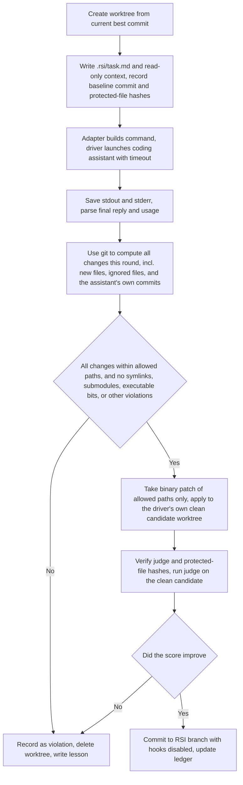

# B. Coding Agent CLIs and Judge Model Integration (RSI-Anything / Open RSI)

Research date: 2026-10-21. Purpose: in each round, the RSI-Anything loop driver must invoke, unattended and inside an isolated git worktree, a coding agent already installed on the user's machine (hereafter "coding assistant") and have it propose one change; the judge scores the change, and the driver commits if the score improves and rolls back if it gets worse. Judges for subjective domains (reports, copy, video) also need to call LLM or vision model APIs directly. Target users include both the US and mainland China.

## 0. Method, version record, and limitations

- **Sources**: official docs, GitHub READMEs, source code, and npm / PyPI metadata take priority. Every table cites its sources. Anything not verified against a primary source is marked **UNVERIFIED**.
- **Local verification**: on the research machine, only `--help` / `--version` was run for the installed CLIs; no session was started, nothing was logged into, and no prompt was sent to any model. Claude Code flags follow the official docs.
- **Version snapshot** (npm / PyPI, queried 2026-10-21):

| Package | Version | Notes |
|---|---|---|
| `@anthropic-ai/claude-code` | 2.1.306 | license field `SEE LICENSE IN README.md` (proprietary commercial terms) |
| `@openai/codex` | 0.163.0 | Apache-2.0; research machine 0.142.1 |
| `@google/gemini-cli` | 0.65.0 | Apache-2.0 |
| `@qwen-code/qwen-code` | 0.25.3 | Apache-2.0 (GitHub) |
| `@tencent-ai/codebuddy-code` | 2.171.0 | research machine 2.97.3 |
| `opencode-ai` (OpenCode 1) | 1.19.3 | MIT; OpenCode 2 is `@opencode/cli` 2.1.2 |
| `@github/copilot` | 1.0.101 | proprietary |
| `@anthropic-ai/sandbox-runtime` (`srt`) | 0.0.81 | Apache-2.0, research preview |
| `openai` (Python SDK) | 3.35.1 | Apache-2.0 |
| `litellm` | 1.107.0 | MIT core + separately licensed `enterprise/` |
| `any-llm-sdk` | 1.39.0 | Apache-2.0 |
| `mini-swe-agent` | 2.4.6 (2026-07-23) | MIT, depends on litellm |

- **Limitations**: the shared WebSearch quota for this round ran out midway, so the second half could only fetch known official URLs and source code directly. "Not found" therefore only means not found on those paths, not that it definitely does not exist. Part of the research was done by three parallel subtasks; their full original details are attached at the end as Appendices A, B, and C, and the main text contains only conclusions, comparison tables, and design.

## 1. Coding assistant CLIs that can be driven headlessly

"Headless" means no interactive UI: one command runs one round of the task and exits. For the driver, five things matter: whether tool calls can be auto-approved, whether it can emit machine-readable results (ideally one JSON containing the final reply and tokens / cost), whether sessions can be resumed, whether writes can be confined to a given directory, and whether the model can be pointed at an arbitrary OpenAI / Anthropic-compatible endpoint (which determines whether users in China can use it).

### 1.1 Headless capability comparison

| Tool | Version / date | Headless invocation | Machine-readable output and final reply | Usage / cost | Session resume | Auto-approval and permissions | Budget control | Sources |
|---|---|---|---|---|---|---|---|---|
| **Claude Code** | 2.1.306 (npm, 2026-10-21) | `claude -p` (prompt can come via stdin, 10MB limit) | `--output-format json`, read `.result`; the last line of `stream-json --verbose` is the `result` message; with `--json-schema`, read `.structured_output` | `total_cost_usd` (client-side estimate), `usage`, `modelUsage`, `num_turns`; `subtype` is one of `success` / `error_max_turns` / `error_during_execution` / `error_max_budget_usd` / `error_max_structured_output_retries` | `-r <id or transcript path>`, `-c`, `--session-id <uuid>`, `--fork-session`; `--no-session-persistence` writes nothing to disk | `--permission-mode default\|acceptEdits\|plan\|auto\|dontAsk\|bypassPermissions`; `--allowedTools` / `--disallowedTools` / `--tools`; `--permission-prompts none` (v2.1.259+, denies outright when no one answers); `--restricted` (v2.1.248+, file tools confined to the working directory, command-execution tools removed); since v2.1.302 `-p` defaults to Manual mode | `--max-turns`, `--max-budget-usd` | https://code.claude.com/docs/en/cli-reference , https://code.claude.com/docs/en/headless , https://code.claude.com/docs/en/agent-sdk/typescript |
| **OpenAI Codex CLI** | 0.163.0 (npm, 2026-10-20); research machine 0.142.1 | `codex exec [PROMPT]`; reads from stdin with `-` or when omitted | By default stdout prints only the final reply; `--json` emits JSONL events (`thread.started` with `thread_id`, `turn.completed`, `item.*`, `error`); `-o/--output-last-message <FILE>` writes the final reply; `--output-schema <FILE>` | `turn.completed.usage`: `input_tokens`, `cached_input_tokens`, `output_tokens`, `reasoning_output_tokens`; no USD | `codex exec resume <SESSION_ID>` / `--last`; `--ephemeral` writes nothing to disk | `--sandbox read-only` (exec default) `\|workspace-write\|danger-full-access`; `approval_policy` is `on-request` / `never` (can use `-c approval_policy="never"`); `--add-dir`; `--dangerously-bypass-approvals-and-sandbox`. **Note `-p` is `--profile`, not prompt**; `--full-auto` is no longer supported | None (driver timeout only) | research machine `codex exec --help`; https://learn.chatgpt.com/docs/non-interactive-mode , https://learn.chatgpt.com/docs/config-file/config-advanced |
| **Cursor CLI** | research machine 2026.10.01-e373342 (command `cursor-agent`, `agent` also installed) | `cursor-agent -p "..."` | `--output-format json`, read `.result` (also `session_id`, `duration_ms`); on failure no JSON, non-zero exit; `stream-json` has `system/init`, `assistant`, `tool_call`, `result` | **Does not report** tokens or cost | `--resume [chatId]`, `--continue`, `create-chat` | Without `--force` (alias `--yolo`), changes are only "proposed" and not written to disk; `--sandbox enabled\|disabled`; `permissions.allow/deny` in `~/.cursor/cli-config.json` and project `.cursor/cli.json` (`Shell()`, `Read()`, `Write()`, `WebFetch()`, `Mcp()`, deny wins); `--trust`; `--workspace <path>` | None | research machine `cursor-agent --help`; https://cursor.com/docs/cli/headless , https://cursor.com/docs/cli/reference/output-format , https://cursor.com/docs/cli/reference/permissions , https://cursor.com/docs/cli/reference/configuration |
| **OpenCode 1** | 1.19.3 (2026-10-16) | `opencode run "..."` | `--format json`: JSONL; the last `type=="text"` event is the final reply | Each `step_finish` has `part.cost` (USD) and `part.tokens{input,output,reasoning,cache}`; sum them for the round total | `-c`, `-s <id>`, `--fork` | `--auto` approves every request not explicitly denied (**including writes outside the project**; block with `OPENCODE_PERMISSION='{"external_directory":"deny"}'`); without `--auto`, permission requests are auto-denied | None | Appendix B §3.3 |
| **Qwen Code** | 0.25.3 (2026-10-19) | `qwen -p "..."` | `-o json` emits an **array**; read `.[-1].result`; `stream-json` | `usage`, `stats.models` (tokens), no USD | `--continue`, `--resume [id]` | `--approval-mode plan\|default\|auto-edit\|auto\|yolo` (or `--yolo`); `permissions.allow/ask/deny`; `-s/--sandbox` (macOS Seatbelt has a no-network profile, Linux bwrap supports `network: closed`) | `--max-session-turns`, `--max-wall-time`, `--max-tool-calls`; exit code 53 = turn limit hit, 55 = over budget | Appendix A §3.2 |
| **CodeBuddy Code** (Tencent) | 2.171.0 (2026-10-20) | `codebuddy -p "..." -y` | Flags copied from Claude Code: `--output-format json`, read `.result` | Docs confirm `.total_cost_usd`, `.session_id` | `-c`, `-r [id]`, `--session-id`, `--fork-session` | Docs state headless mode **must** use `-y`; `--permission-mode`; tool allow/deny lists; Bash sandbox (Seatbelt / bubblewrap) | `--max-turns` | Appendix A §3.1 |
| Gemini CLI | 0.65.0 (2026-10-20) | `gemini -p "..."` | `-o json`, read `.response`; `stream-json` | `.stats` (tokens), no USD; exit codes 0/1/42/53 | `-r latest\|<index>\|<session-id>` | `--approval-mode yolo` (`--yolo` deprecated); Policy Engine, `ask_user` treated as deny when headless; `-s` sandbox | None (53 = turn limit exceeded) | Appendix B §3.1 |
| Kimi Code CLI | 2.3.0 (2026-10-21) | `kimi -p "..."` | Only `--output-format stream-json` (JSONL), no single result object | Undocumented (UNVERIFIED) | `-c`, `-S [id]` | `-p` mode itself never requests human approval and runs as `auto`; **no working-directory flag**, set the process cwd to the worktree | None | Appendix A §3.3 |
| Qoder CLI (Alibaba) | 1.1.75 (2026-10-20) | `qoder -p "..." --yolo` | `-o json\|stream-json`, fields undocumented (UNVERIFIED) | UNVERIFIED | `-c`, `-r`, `--session-id` | `--permission-mode`, `--allowed-tools`; `-w/--cwd` | `--max-turns` | Appendix A §3.4 |
| GitHub Copilot CLI | 1.0.101 (2026-10-20) | `copilot -p "..." --allow-all-tools` | `--output-format json` (JSONL, event schema undocumented); `-s` outputs only the reply | OTel file export (`COPILOT_OTEL_FILE_EXPORTER_PATH`) | `--resume`, `--continue`, `--session-id <uuid>` | `--allow-tool` / `--deny-tool`, `--allow-url` / `--deny-url`, `--add-dir`, `--sandbox`, `--no-ask-user` | None | Appendix B §3.2 |
| Goose | v1.55.0 (2026-10-16) | `goose run -t "..."` | `--output-format json`, read the last item of `messages`; `stream-json` | tokens and `cost_usd` in `metadata` | `-n <name> -r`; `--no-session` | `GOOSE_MODE=auto` (auto is the default); no OS sandbox | `--max-turns` | Appendix B §3.5 |
| Amp | `@ampcode/cli` (2026-10-21) | `amp -x "..."` | `--stream-json`, format deliberately compatible with Claude Code | `result.usage` (optional) | `amp threads continue` | Runs tools without asking by default | None | Appendix B §3.6 |
| Cline CLI | 3.0.73 (2026-10-17) | `cline --json "..."` | `.text` of the `run_result` line | `run_result.usage` (inner fields undocumented) | `--id <id>` | `--auto-approve` defaults to `true`; no per-command allowlist | `-t/--timeout` | Appendix B §3.8 |
| Kilo Code CLI | 7.8.15 (2026-10-19) | `kilo run --auto "..."` | `--format json` (OpenCode fork, fields presumably identical, UNVERIFIED) | Same, UNVERIFIED | `kilo -c` | Without `--auto`, auto-denies and exits with code 1 | Exit code 124 = timeout | Appendix B §3.7 |
| Factory Droid | 0.245.1 (2026-10-21) | `droid exec "..."` | `-o json`, read `.result` | No usage | `-s <id>`, `--fork` | `--auto low\|medium\|high`; read-only by default | None | Appendix B §3.11 |
| Aider | 0.86.2 (PyPI, 2026-02-12) | `aider --message "..." --yes-always` | **No JSON**, terminal text only | Parse the `Tokens: … Cost: $… session.` text line | `--restore-chat-history` | No tool-level permissions, no sandbox | None | Appendix B §3.4 |
| Charm Crush | 0.98.1 (2026-10-09) | `crush run "..."` | **No JSON**, plain text | None | `-C`, `-s <id>` | `crush run` auto-approves all requests | None | Appendix B §3.10 |
| Baidu Zulu CLI | 1.7.21 (2026-09-22) | `zulu run --query "..." --license <key>` | `--display record` (JSON trajectory) etc. | `tokenUsage` is context usage, not cost | `--conversation <id>` | Default Turbo mode runs all commands directly, no sandbox | None | Appendix A §3.6 |
| Trae Agent (ByteDance) | No release, last commit 2026-02-05 | `trae-cli run "..." --working-dir <dir>` | Trajectory JSON file | UNVERIFIED | Not supported | Fully automatic, no approval | `--max-steps` | Appendix A §3.7 |
| Mistral Vibe | 3.0.1 (2026-10-20) | `vibe -p "..."` | `--output json\|streaming` | `--max-price` implies cost tracking, fields UNVERIFIED | `-c`, `--resume` | `--auto-approve` | `--max-turns`, `--max-price` | Appendix B §3.15 |
| Shut down / unmaintained | — | iFlow CLI (shut down 2026-04-17, officially told to migrate to Qoder); Roo Code (shut down and archived 2026-05-15); legacy Python kimi-cli (archived 2026-09-23); OpenHands CLI (README states it is no longer actively maintained) | — | — | — | — | — | https://cli.iflow.cn/ , Appendices A, B |

### 1.2 Installation, custom endpoints, availability in China, and licenses

| Tool | Installation | Can it point at a custom endpoint | Availability in mainland China | License |
|---|---|---|---|---|
| **Claude Code** | `curl -fsSL https://claude.ai/install.sh \| bash`; `brew install --cask claude-code`; `npm install -g @anthropic-ai/claude-code` (Node 22+, npm package bundles a native binary) | Yes: `ANTHROPIC_BASE_URL` + `ANTHROPIC_AUTH_TOKEN` (or `ANTHROPIC_API_KEY` / `apiKeyHelper`), Anthropic Messages format only. Anthropic officially states that routing Claude Code to non-Claude models via a gateway is unsupported, but Zhipu, Kimi, DeepSeek, MiniMax, Alibaba Cloud Model Studio, and Volcano Engine Ark all document how to connect it (see 1.3) | Anthropic's official service does not cover mainland China (the install docs list "located in a supported country" as a system requirement). The practical route is to use it only as a "shell" with models served via Chinese Anthropic-compatible endpoints; whether the install script domain `claude.ai` is directly reachable from China is UNVERIFIED, and the npm route can use a domestic mirror (not tested) | Proprietary (Anthropic commercial terms) |
| **Codex CLI** | `curl -fsSL https://chatgpt.com/codex/install.sh \| sh`; `npm install -g @openai/codex`; `brew install --cask codex` | Yes: `[model_providers.<id>]` in `~/.codex/config.toml` (`base_url`, `env_key`, `wire_api`, `http_headers`, etc.), or `openai_base_url`. **But the source shows `wire_api = "chat"` has been removed, leaving only `"responses"`**, so it can only connect to endpoints supporting the OpenAI Responses API; project-level `.codex/config.toml` cannot set a provider | OpenAI accounts are unavailable in China; Chinese models require a vendor with a Responses endpoint: Moonshot officially provides a Codex config example, and the docs of Zhipu Coding Plan, Alibaba Cloud Model Studio (workspace domain), and Volcano Engine Ark state Responses support | Apache-2.0 |
| **Cursor CLI** | `curl https://cursor.com/install -fsS \| bash` | **No**: the config has no model base URL or BYOK key; `--endpoint` refers to Cursor's own service address, and `HTTP(S)_PROXY` only changes the proxy | Requires a Cursor account (`CURSOR_API_KEY`). Range of models available in China UNVERIFIED | Proprietary |
| OpenCode | `curl -fsSL https://opencode.ai/install \| bash`; `npm i -g opencode-ai` | Yes: `provider.<id>.options.baseURL`, both OpenAI-compatible and Anthropic; built-in DeepSeek, Moonshot, Z.AI, MiniMax | No overseas account needed; `OPENCODE_DISABLE_MODELS_FETCH` disables fetching the model list online | MIT |
| Qwen Code | `curl -fsSL https://qwen-code-assets.oss-cn-hangzhou.aliyuncs.com/installation/install-qwen-standalone.sh \| bash`; `npm i -g @qwen-code/qwen-code@latest` (Node 22+) | Yes: three protocols, OpenAI (`OPENAI_BASE_URL`), Anthropic (`ANTHROPIC_BASE_URL`), Gemini | Install script hosted on Alibaba Cloud OSS, directly reachable from China; Qwen OAuth free tier ended 2026-04-15, a Model Studio (or similar) key is needed | Apache-2.0 |
| CodeBuddy Code | `npm install -g @tencent-ai/codebuddy-code`; `curl -fsSL https://www.codebuddy.cn/cli/install.sh \| bash` | Yes, but OpenAI format only: `~/.codebuddy/models.json` | Has a China edition (codebuddy.cn) with built-in Chinese models | Effectively proprietary (npm ships only bundled build output) |
| Gemini CLI | `npm install -g @google/gemini-cli` | Docs mention only the Gemini protocol; the source reads `GOOGLE_GEMINI_BASE_URL`, so the only workaround is a protocol-translating gateway such as LiteLLM | Gemini API is not available in mainland China or Hong Kong; free personal / Google One users were migrated to Antigravity CLI from 2026-06-18, paid API keys still work | Apache-2.0 |
| Kimi Code CLI | `curl -fsSL https://code.kimi.com/kimi-code/install.sh \| bash`; `npm i -g @moonshot-ai/kimi-code` | Yes: `type` under `[providers.*]` can be `openai`, `openai_responses`, `anthropic`, etc. | Available in China | MIT |
| Qoder CLI | `curl -fsSL https://qoder.com/install \| bash`; China edition `curl -fsSL https://qoder.com.cn/install \| bash` | BYOK can only be configured in the `/model` wizard, and only for the personal plan; no documented base URL setting | Has a China edition; two docs disagree on the command name (`qoderclicn` / `qodercn`), needs testing | Proprietary |
| Copilot CLI | `npm install -g @github/copilot` | BYOK: `COPILOT_PROVIDER_BASE_URL`, `COPILOT_PROVIDER_TYPE=openai\|azure\|anthropic` | With BYOK plus `COPILOT_OFFLINE=true`, it does not connect to GitHub at all | Proprietary |
| Goose | Official `download_cli.sh` | Yes: OpenAI / Anthropic-compatible custom provider | No overseas account needed | Apache-2.0 |
| Aider | `pip install aider-install && aider-install` | Yes: `--openai-api-base` (litellm underneath) | No overseas account needed | Apache-2.0 |
| Amp / Droid / Auggie / Warp oz | Their own install scripts | Amp and Droid have BYOK, Auggie does not | All require a vendor account | Proprietary |

Sources as in 1.1; Claude Code installation at https://code.claude.com/docs/en/setup , gateway notes at https://code.claude.com/docs/en/llm-gateway ; Codex installation at https://github.com/openai/codex , `wire_api` in the source https://raw.githubusercontent.com/openai/codex/main/codex-rs/model-provider-info/src/lib.rs (original error message: `` `wire_api = "chat"` is no longer supported. ``, with a hint to switch to `responses`).

### 1.3 Endpoints for connecting Chinese models to coding assistants (vendors' official docs)

| Vendor / plan | Anthropic-compatible URL (for Claude Code) | OpenAI-compatible URL | Claude Code auth variable | Sources |
|---|---|---|---|---|
| Zhipu GLM Coding Plan (China) | `https://open.bigmodel.cn/api/anthropic` | Chat: `https://open.bigmodel.cn/api/coding/paas/v4`; Responses: `https://open.bigmodel.cn/api/v1` | `ANTHROPIC_AUTH_TOKEN` | https://docs.bigmodel.cn/cn/coding-plan/tool/claude , https://docs.bigmodel.cn/cn/coding-plan/tool/others |
| Z.ai (international) | `https://api.z.ai/api/anthropic` | Chat: `https://api.z.ai/api/coding/paas/v4`; Responses: `https://api.z.ai/api/v1` | `ANTHROPIC_AUTH_TOKEN` | https://docs.z.ai/devpack/tool/claude |
| Moonshot open platform | `https://api.moonshot.cn/anthropic` | `https://api.moonshot.cn/v1` (Codex uses `wire_api = "responses"`) | `ANTHROPIC_AUTH_TOKEN` | https://platform.kimi.com/docs/guide/claude-code-kimi , https://platform.kimi.com/docs/guide/codex-kimi |
| Kimi Code membership | `https://api.kimi.com/coding/` | `https://api.kimi.com/coding/v1` (UNVERIFIED) | `ANTHROPIC_API_KEY` | https://www.kimi.com/code/docs/third-party-tools/claude-code.html |
| DeepSeek | `https://api.deepseek.com/anthropic` | `https://api.deepseek.com` | `ANTHROPIC_AUTH_TOKEN` | https://api-docs.deepseek.com/guides/anthropic_api |
| MiniMax China / international | `https://api.minimax.cn/anthropic` / `https://api.minimax.io/anthropic` | `https://api.minimax.cn/v1` / `https://api.minimax.io/v1` | `ANTHROPIC_AUTH_TOKEN` | https://platform.minimax.cn/docs/token-plan/claude-code |
| Alibaba Cloud Model Studio Coding Plan | `https://coding.dashscope.aliyuncs.com/apps/anthropic` | `https://coding.dashscope.aliyuncs.com/v1` | `ANTHROPIC_AUTH_TOKEN` | https://help.aliyun.com/zh/model-studio/claude-code-coding-plan |
| Alibaba Cloud Model Studio pay-as-you-go | `https://{WorkspaceId}.cn-beijing.maas.aliyuncs.com/apps/anthropic` | `https://dashscope.aliyuncs.com/compatible-mode/v1` | `ANTHROPIC_AUTH_TOKEN` | https://help.aliyun.com/zh/model-studio/claude-code |
| Volcano Engine Ark Coding Plan | `https://ark.cn-beijing.volces.com/api/coding` | `https://ark.cn-beijing.volces.com/api/coding/v3` | `ANTHROPIC_AUTH_TOKEN` | https://docs.volcengine.com/docs/82379/1928262 |

Some common pitfalls: each vendor's Coding Plan key may only be used in officially recognized coding tools; it cannot be used as a judge model, nor mixed with pay-as-you-go keys and URLs. The Kimi Code membership docs also warn that tampering with the client User-Agent is a violation. Zhipu's docs recommend setting both `API_TIMEOUT_MS=3000000` and `CLAUDE_CODE_DISABLE_NONESSENTIAL_TRAFFIC=1` (the latter turns off telemetry and other non-essential traffic from Claude Code to Anthropic). DeepSeek's Anthropic endpoint maps `claude-opus*` to `deepseek-v4-pro` and `claude-sonnet*` / `claude-haiku*` to `deepseek-flash`, and does not support MCP-related content blocks.

### 1.4 Summary

The best headless quality, and also the most widespread, is **Claude Code**: one JSON gives the final reply, session ID, cost, and tokens together, plus a turn limit, a USD limit, structured output, and fine-grained permission modes. **Codex CLI** has the most solid sandbox among open-source tools: exec is read-only by default and `workspace-write` blocks network by default, but it does not report USD, has no budget flag, and now only accepts the Responses API. **Cursor CLI** has many users, but its JSON has no usage and the model endpoint cannot be changed. The general-purpose choices that are open source, connect to any endpoint, and need no overseas account are **OpenCode** (USD and per-category tokens in its JSON) and **Qwen Code** (finest-grained budget flags, installs directly from China). Among Chinese proprietary tools, **CodeBuddy Code** copies Claude Code's flags and output almost exactly, so it has the lowest adaptation cost.

## 2. Model APIs for judging

### 2.1 Vendor endpoints and capabilities (excerpt; full table in Appendix C)

| Vendor | OpenAI-compatible base URL | Anthropic-compatible | Vision models in doc examples | How to pass video | Structured output | Mainland China | Sources |
|---|---|---|---|---|---|---|---|
| OpenAI | `https://api.openai.com/v1` | None | `gpt-6.1-sol`, `gpt-6-astra`, `gpt-6-luna` all accept images | Not supported; frame extraction only | `json_schema` | Not supported in mainland China, Hong Kong, Macau | https://developers.openai.com/api/docs/models , https://developers.openai.com/api/docs/supported-countries |
| Anthropic | Compatibility layer `https://api.anthropic.com/v1/` (officially only suitable for testing; ignores `response_format`) | Native | `claude-opus-5-5`, `claude-sonnet-5-5`, etc. all accept images | Not supported; frame extraction only | Native `output_config.format` | Not supported, and excludes Chinese-controlled companies | https://platform.claude.com/docs/en/api/openai-sdk , https://www.anthropic.com/supported-countries |
| Google Gemini | `https://generativelanguage.googleapis.com/v1beta/openai/` | None | `gemini-4-argon`, `gemini-3.8-flash` | Native API is strongest (File API / inline / YouTube, `fps` configurable); whether the compatibility layer accepts video UNVERIFIED | `json_schema` | Not supported | https://ai.google.dev/gemini-api/docs/openai , https://ai.google.dev/gemini-api/docs/video-understanding |
| DeepSeek | `https://api.deepseek.com` | `https://api.deepseek.com/anthropic` | Only `deepseek-flash` accepts images | Not mentioned in docs | Only `json_object`, occasionally returns empty | Directly reachable in China | https://api-docs.deepseek.com/guides/vision , https://api-docs.deepseek.com/guides/json_mode |
| Alibaba Cloud Model Studio Qwen | Beijing `https://dashscope.aliyuncs.com/compatible-mode/v1`; international uses workspace domains (Singapore / US) | `https://{WorkspaceId}.cn-beijing.maas.aliyuncs.com/apps/anthropic` | `qwen3.8-max`, `qwen3.8-flash`, `qwen3-vl-plus`, omni-modal `qwen3.8-omni-flash` | `video_url` (`fps` at the same level as `video_url`), or a frame list; URL up to 2GB | `json_schema` for text only; **automatically downgrades to `json_object` when images or video are included** | Directly reachable in China; keys are bound to a region, cross-region gives 401 | https://help.aliyun.com/zh/model-studio/vision , https://help.aliyun.com/zh/model-studio/json-mode |
| Moonshot Kimi | `https://api.moonshot.cn/v1` (international `.ai`) | `https://api.moonshot.cn/anthropic` | `kimi-k3`, `kimi-k2.6` | Must upload first and reference as `ms://<file-id>`; images do not accept public URLs | `json_schema` | Directly reachable in China; real-name verification required before top-up | https://platform.kimi.ai/docs/guide/use-kimi-vision-model.md |
| Zhipu GLM | `https://open.bigmodel.cn/api/paas/v4` (international `https://api.z.ai/api/paas/v4`) | `https://open.bigmodel.cn/api/anthropic` | `glm-5.3-flash`, `glm-5v-turbo`, `glm-4.6v`, etc. | `video_url` accepts URLs only | Only `json_object`, and not supported by vision models | Directly reachable in China | https://docs.bigmodel.cn/cn/guide/start/model-overview.md |
| MiniMax | `https://api.minimax.cn/v1` (international `.io`) | `https://api.minimax.cn/anthropic` | `MiniMax-M3`, `MiniMax-M3.1-Flash` | `video_url` (URL / base64 / `mm_file://`) | Not documented (UNVERIFIED) | Directly reachable in China | https://platform.minimax.io/docs/api-reference/text-chat-openai.md |
| Volcano Engine Ark Doubao | `https://ark.cn-beijing.volces.com/api/v3` (BytePlus international `https://ark.ap-southeast.bytepluses.com/api/v3`) | Pay-as-you-go endpoint not found (UNVERIFIED) | `doubao-seed-2-1-pro-260915`, `doubao-seed-2-1-lite-260915` | `video_url` (`fps` inside `video_url`); up to 512MB (Files API) | `json_schema` strict (beta) | Directly reachable in China | https://ark.volcengine.com/region:cn-beijing/docs/video-understanding |
| SiliconFlow | `https://api.siliconflow.cn/v1` (international `.com`) | `https://api.siliconflow.cn` (`/v1/messages`) | `zai-org/GLM-5.3-Flash`, `Qwen/Qwen3.8-27B`, etc. | Vision guide does not mention video | Depends on model | Directly reachable in China | https://docs.siliconflow.cn/docs/userguide/capabilities/vision |
| OpenRouter | `https://openrouter.ai/api/v1` | `https://openrouter.ai/api` (`/v1/messages`) | Depends on upstream | `video_url`, depends on upstream | `json_schema` + `require_parameters` | Officially unstated whether directly reachable from China (UNVERIFIED); terms prohibit using a VPN to bypass regional restrictions | https://openrouter.ai/docs/quickstart , https://openrouter.ai/terms |

The two points with the biggest impact on judge design: first, structured output differs widely across vendors and cannot be relied on as a safety net; degrade through "`json_schema` → `json_object` → prompt constraints", and always validate on the client with Pydantic and retry on failure. Second, Claude 4.7 and later models return 400 when temperature is below 1, Kimi K3 has fixed sampling parameters, and MiniMax M3 ignores temperature, so judge stability can only come from sampling multiple times and taking the median or majority vote, not from temperature 0.

### 2.2 Abstraction library comparison

| Library | Form / license | Maturity (2026-10-21) | Dependency weight | Chinese vendor support | Multimodal | Verdict |
|---|---|---|---|---|---|---|
| **Official `openai` SDK + `base_url`** | Apache-2.0 | 3.35.1, frequent releases | 6 dependencies, very light | Works with every OpenAI-compatible vendor | Up to the vendor | **Core dependency** |
| LiteLLM | SDK + Proxy; MIT core | 61.7k stars, 1.107.0, several releases a day | Heavy (23 base dependencies, including tokenizers, boto3, etc.) | Native dashscope, moonshot, zai, volcengine, deepseek, minimax, openrouter; SiliconFlow via generic compatibility | Images; video documented only for Gemini | Optional extra only, pin version plus hashes. 2026-03 PyPI poisoning: 1.82.7 and 1.82.8 were injected with credential-stealing code (GHSA-5mg7-485q-xm76, Critical, verified); the Proxy additionally has CVE-2026-42208 and CVE-2026-42271 listed in CISA KEV |
| any-llm (Mozilla) | Apache-2.0 | 2.2k stars, 1.39.0 | Medium | dashscope, moonshot, zai, deepseek, minimax; no volcengine, siliconflow | Images for some vendors | Worth watching, not the default |
| OpenRouter | Hosted router (acquisition by Stripe announced 2026-08) | — | Zero dependencies (uses the openai SDK) | Hosts Qwen, GLM, Kimi, DeepSeek, etc. | Images, `video_url` | One preset, not an abstraction layer |
| Pydantic AI | MIT | 20.8k stars | `pydantic-ai-slim` is fairly light | Alibaba (international site by default), DeepSeek, moonshotai, zai | `VideoUrl` supported by only a few backends | Framework is heavy, not needed |
| LangChain | MIT | `langchain-community` announced end of maintenance 2026-05, archived 06 (the Chinese integrations all live there) | Heavy | Weak | Depends on integration | Do not use |
| Instructor | MIT | 14.0k stars | Medium | No Chinese providers | — | Our own Pydantic validation can replace it |
| Vercel AI SDK | Apache-2.0, TypeScript | 27.4k stars | — | Has alibaba, deepseek, moonshotai, zai, minimax | — | Wrong tech stack |
| new-api / one-api | Go gateways; new-api is AGPL-3.0, one-api has no commits since 2025-02 | — | Needs separate deployment | Most complete coverage of Chinese channels | Depends on upstream | Do not embed; docs suggest users self-deploy and connect via `base_url` |

Sources: the source column of the table in Appendix C section 5, and section 5.1.

### 2.3 Judge layer recommendation

The core depends only on the official `openai` Python SDK, connects to all vendors via `base_url`, and ships a "vendor + region" preset table. Besides `base_url`, the key's environment variable name, the default text model, and the default vision model, each preset also carries capability flags: the highest level of structured output supported (`json_schema` / `json_object` / `json_object_text_only` / `none`), how video is passed (`frames` / `dashscope` / `ark` / `minimax` / `zhipu_url` / `kimi_upload` / `gemini_native`), whether images can be given by URL, the per-image size limit, and whether temperature can be set. By default, video is frame-extracted and sent as multiple images, and images are downscaled to 2048px on the long side and converted to base64 JPEG, so every vision-capable model works; native video is only an optional optimization. Three optional extras: `[anthropic]` calls Claude via the native SDK (the compatibility layer ignores `response_format`), `[gemini]` uses `google-genai` for native video understanding, and `[litellm]` is for users who want hundreds of vendors, but it must be version-pinned and installed with `pip install --require-hashes`, SDK only, no Proxy.

Default combination: overseas text judging uses `gpt-6.1-sol` or `gemini-3.8-flash`, video judging uses native Gemini; in China, both text and vision judging use Alibaba Cloud Model Studio `qwen3.8-max`, with Volcano Engine Ark `doubao-seed-2-1-pro-260915` as fallback (both accept native video and support `json_schema`). Every default model ID must be user-overridable, and the run log must record the actual `provider`, `base_url`, and `model` requested and the `model` field returned in the response, because in 2026 Kimi, MiniMax, and DeepSeek have all retired models or silently mapped them to new ones. Full preset table in Appendix C section 6.2.

## 3. Driver adapter design recommendations

### 3.1 Which to support first

Recommend 6 for the first batch, balancing US / China, user count, and headless quality:

| Order | Tool | Why | Main weakness |
|---|---|---|---|
| 1 | **Claude Code** | Most complete headless capability (JSON with cost, `--max-budget-usd`, `--max-turns`, `--json-schema`, permission modes); most US users; usable in China via Chinese Anthropic-compatible endpoints, with official integration docs from six vendors | Proprietary; Anthropic does not officially support non-Claude models, upgrades may break compatibility |
| 2 | **Codex CLI** | Apache-2.0; built-in OS-level sandbox with network off by default; `-o` writes the final reply file directly; clear token usage | No USD reporting, no budget flag; Responses API only, limited vendors reachable in China |
| 3 | **OpenCode** | MIT, the most-starred open-source coding assistant; any OpenAI / Anthropic-compatible endpoint; JSON includes USD and per-category tokens; several built-in Chinese providers; also covers its fork Kilo | OpenCode 2 is a generational rewrite in progress, v2 `run` flags are undocumented, adapter must branch by version |
| 4 | **Qwen Code** | Apache-2.0, Chinese open source; connects to all three protocols; finest budget flags (turns, wall-clock time, tool-call count); install script on Alibaba Cloud, best experience in China; same lineage as Gemini CLI, so adding Gemini CLI later is cheap | No USD in JSON; third-party docs say that headless under the default approval mode, calls needing confirmation fail outright (UNVERIFIED), so the adapter should pass `--approval-mode` explicitly |
| 5 | **Cursor CLI** | Common among US developers; has `json` / `stream-json` | No usage, cannot change model endpoint, requires a Cursor account; unsuitable as the default in China |
| 6 | **CodeBuddy Code** | Tencent's China edition works without a VPN and has built-in Chinese models; flags and JSON structure copied from Claude Code, shares the parser with #1, nearly zero cost | Proprietary; must add `-y` to write files headlessly |

Second batch: Gemini CLI (free personal channel closed, unavailable in China, but open source with clean JSON), Kimi Code CLI (MIT, JSONL stream only), Qoder CLI (fields undocumented), Goose, Copilot CLI (BYOK can run offline), Aider (text parsing only). Not recommended: iFlow, Roo Code (shut down), Trae Agent (essentially unmaintained, no resume).

Implementation does not need one adapter per tool; grouping by output format into a few families is enough: Claude family (Claude Code, CodeBuddy; Qoder and Amp are also largely compatible later), Codex family, OpenCode family (OpenCode, Kilo), Gemini family (Gemini, Qwen, with slight structural differences), plain-text family (Aider, Crush, only stdout and git diff available).

### 3.2 Common interface

The driver knows only a minimal interface; all tool-specific differences are confined to adapters. Python is recommended (v0.1 is already Python):

```python
@dataclass
class AgentTask:
    workdir: Path                 # root of this round's worktree, also the subprocess cwd
    prompt_file: Path             # full instructions written by the driver (goal, context, lessons), kept outside the worktree
    context_files: list[Path]     # read-only reference material, copied into .rsi/context/ in the worktree with paths listed in the prompt
    allowed_paths: list[str]      # globs allowed to change (relative to workdir), enforced by the driver afterwards
    denied_paths: list[str]       # additional forbidden globs; by default includes the judge, .rsi/, and each assistant's config directory
    timeout_s: int                # wall-clock timeout; the driver kills the process
    max_turns: int | None         # passed through when the tool supports it
    max_cost_usd: float | None    # passed through when the tool supports it (currently only Claude Code natively)
    model: str | None             # passed through to the tool; None means the tool's own default
    env: dict[str, str]           # endpoint and key, e.g. ANTHROPIC_BASE_URL
    run_dir: Path                 # this round's log directory: stdout, stderr, and parsed results all go here
    network: Literal["default", "model_only", "off"]  # desired network policy, best effort

@dataclass
class AgentResult:
    status: Literal["ok", "agent_error", "timeout", "max_turns", "budget_exceeded",
                    "auth_error", "not_installed", "killed"]
    exit_code: int | None
    final_text: str | None        # final reply (may be empty, e.g. Aider)
    session_id: str | None
    usage: Usage | None           # input/output/cached tokens, cost_usd, and source: reported / estimated / none
    duration_s: float
    transcript_path: Path         # stdout saved verbatim (JSON / JSONL / text)
    stderr_path: Path
    agent: str
    agent_version: str | None
    model_reported: str | None

class AgentAdapter(Protocol):
    name: str
    binaries: list[str]           # e.g. ["cursor-agent", "agent"]
    family: str                   # claude / codex / opencode / gemini / text
    capabilities: Capabilities    # json_output, cost, tokens, resume, native_sandbox, custom_endpoint, max_turns, budget
    def detect(self) -> Detection: ...                     # installed?, version, login status (only commands that cost nothing)
    def build(self, task: AgentTask) -> Invocation: ...    # argv, extra env vars, stdin source
    def parse(self, stdout: Path, stderr: Path, exit_code: int | None) -> AgentResult: ...
```

Which files changed is not reported by the adapter; the driver computes it afterwards with git (see 3.5), so all tools are treated the same. Process management is also unified in the driver: the subprocess goes into a new process group, stdin is the prompt file or `/dev/null`, and on timeout it first sends SIGINT (Claude Code docs say SIGINT ends the current turn cleanly, while SIGTERM exits with 143 and records no result), waits 10 seconds, then SIGTERM, and finally SIGKILL to the whole process group.

Command mapping for the first batch (only flags verified in this research):

| Tool | Command template (cwd = worktree) | Final reply | Usage |
|---|---|---|---|
| Claude Code | `claude -p --output-format stream-json --verbose --permission-mode acceptEdits --permission-prompts none --allowedTools "<user-declared test command>" --max-turns N --max-budget-usd X [--model M] < prompt.md`; add `--bare` when using an API key or third-party endpoint (skips project hooks, MCP, CLAUDE.md, but does not read subscription login state; whether `ANTHROPIC_AUTH_TOKEN` works under bare is UNVERIFIED) | `.result` of the last `type=="result"` line | `total_cost_usd`, `usage`, `num_turns` on the same line |
| Codex CLI | `codex exec --json -o <run_dir>/last.txt --sandbox workspace-write -c approval_policy="never" -C <worktree> [-m M] - < prompt.md` | `last.txt` | Sum of all `turn.completed.usage`; USD estimated by the driver from a price table or marked none |
| OpenCode 1 | `OPENCODE_PERMISSION='{"external_directory":"deny"}' opencode run --format json --auto --dir <worktree> [-m provider/model] "<short instruction: read .rsi/task.md first>"` | Last `type=="text"` event | Sum of `part.cost` and `part.tokens` across all `step_finish` |
| Qwen Code | `qwen -p "<short instruction>" -o json --approval-mode auto-edit or yolo --max-session-turns N --max-wall-time 20m [-m M]` | `.[-1].result` | `.[-1].usage`, `stats.models` |
| Cursor CLI | `CURSOR_API_KEY=… cursor-agent -p --output-format json --force --trust --workspace <worktree> [--sandbox enabled] [--model M] "<short instruction>"` | `.result` | None, only `duration_ms` can be recorded |
| CodeBuddy Code | `codebuddy -p "<short instruction>" -y --output-format json --max-turns N [--model M]` | `.result` | `.total_cost_usd` |

When the prompt is long, the uniform approach is to write the full instructions to `.rsi/task.md` inside the worktree (added to `.git/info/exclude`, and confirmed unchanged in the post-run check), and pass only a short instruction like "read .rsi/task.md before starting" on the command line. This sidesteps differences in stdin support and command-line length limits across tools.

### 3.3 Full flow of one round



### 3.4 How to detect what the user has installed

1. **Find commands**: use `shutil.which` over each adapter's `binaries` list, e.g. `claude`, `codex`, `cursor-agent` / `agent`, `opencode`, `qwen`, `codebuddy` / `cbc`, `gemini`, `kimi`, `qodercli` / `qoder`, `goose`, `copilot`, `aider`. A generic name like `agent` must be double-checked against the `--version` output format to confirm it is Cursor; `kimi` must distinguish the archived Python kimi-cli from the new Kimi Code (by major version).
2. **Check version**: run `<cmd> --version` with stdin from `/dev/null` and a 10-second timeout; on timeout or unrecognized output, mark "installed but unconfirmed", and never let detection block the main loop. Third-party wrapper scripts hanging on `--version` have actually been observed.
3. **Check login status using only commands that cost nothing**: `claude auth status` (outputs JSON, exit code 0 when logged in, 1 when not; the `authMethod` field distinguishes subscription, API key, and `third_party`), `codex login status`, `cursor-agent status`. For other tools, only check whether environment variables and config files exist (e.g. `OPENAI_BASE_URL`, `~/.qwen/settings.json`, `~/.codebuddy/models.json`). The detection phase sends no prompt to any model.
4. **Optional smoke test**: `rsi doctor --smoke`, with the user's explicit consent, actually runs one small read-only task to verify that JSON parsing and auth both work, telling the user it will consume a small number of tokens.
5. **Selection**: pick the first "ready" one in the user's configured preference order; if none is configured, use the order in 3.1; the user can specify with `--agent`.

### 3.5 An "allowed paths only" guarantee that does not depend on each CLI

Permission systems vary widely in granularity and reliability (Cline, Crush, Goose, Amp, and OpenHands allow everything by default when headless; OpenCode's `--auto` also allows directories outside the project by default), so the driver must provide its own safety net, in three layers:

**Layer 1: post-run git check (mandatory, works for all tools).** After the assistant finishes, run `git status --porcelain=v2 -z --untracked-files=all --ignored=matching` in the worktree to get all changes, including new files and files ignored by `.gitignore`; if HEAD moved (the assistant committed on its own), also use `git diff --name-status -z <baseline commit>` to include committed changes. Check each path: it must match `allowed_paths` and must not match `denied_paths`; for renames, check both old and new paths; reject new symlinks, submodule changes, files becoming executable (unless allowed), and files over the size limit. Paths denied by default include the judge and evaluation data, `.rsi/`, `.git*` files (`.gitattributes`, `.gitmodules`), and each assistant's project config directory (`.claude/`, `.codex/`, `.gemini/`, `.qwen/`, `.cursor/`, `.opencode/`, `.codebuddy/`, etc.). This last one matters: Claude Code docs state that without `--bare`, `claude -p` runs hooks from the project's `.claude/settings.json` and connects to servers in `.mcp.json` without a trust prompt, so if the assistant is allowed to modify these files, whatever it writes in one round gets executed in the next.

**Layer 2: judging runs only on a clean candidate.** After the check passes, the driver takes only the binary patch for allowed paths (`git diff --binary`), applies it to a clean worktree it creates itself, and runs the judge there. That way untracked files, caches, and ignored files the assistant left in its worktree cannot affect the score. All of the driver's own git commands use `-c core.hooksPath=/dev/null`, and commits use `--no-verify`. There is also a worktree-specific pitfall: all worktrees share the main repo's `.git` directory (hooks and config live there), so an assistant not confined by a sandbox can reach them via relative paths. Therefore, before and after each round, hash-compare the main repo's `.git/config`, `.git/hooks/`, and the judge files, and abort the whole run if anything changed.

**Layer 3: protection against writes outside the worktree (use according to capability).** git cannot see writes outside the worktree; this layer can only rely on sandboxing:

- First, turn on each tool's built-in restrictions: Codex `--sandbox workspace-write` (network off by default), Claude Code's `acceptEdits` plus Bash sandbox settings (`--settings '{"sandbox":{"enabled":true,"allowUnsandboxedCommands":false,"failIfUnavailable":true}}'`; the sandbox covers only Bash, file tools are governed by permission rules), the Seatbelt or bwrap sandbox of Qwen Code / Gemini CLI, OpenCode's `external_directory: deny`, Cursor's `--sandbox enabled`.
- Generic outer sandbox (optional): Anthropic's open-source `srt` (`@anthropic-ai/sandbox-runtime`, Apache-2.0, research preview) can wrap any command in macOS Seatbelt or Linux bubblewrap, denying writes and network by default, with `filesystem.allowWrite` and `network.allowedDomains` to allow. When wrapping a coding assistant, allow the worktree, the assistant's own state directory (e.g. `~/.claude`, `~/.codex`), and temp directories, and allow the model API domains on the network, otherwise the assistant cannot even reach its model. Also, the README states that by default new user namespaces cannot be created inside the sandbox, so nested sandbox tools will fail; with `srt` as the outer layer, the assistant's built-in sandbox likely has to be turned off (e.g. switch Codex to `danger-full-access`). This combination needs testing (UNVERIFIED).
- Strongest and heaviest: a Docker / Podman container with only the worktree mounted writable. Consistent across platforms, but users in China need a registry mirror to pull images; offered as an advanced option.

The default recommendation is "layers 1 and 2 always on, layer 3 using each tool's built-in restrictions", with `--isolation srt|docker` left for users with stricter requirements.

### 3.6 Budget, timeout, and resume

Only Claude Code natively supports a USD cap; Qwen Code and Claude Code support a turn cap; all other tools rely on the driver's wall-clock timeout. The driver maintains its own run-level ledger: if the tool reports cost, add the cost; if it reports only tokens, estimate using a user-selectable price table; if it reports nothing (Cursor, Droid, Crush), count only rounds and time. By default each round starts a new session without resuming, so each round's context is clean and results are reproducible; session IDs are recorded in the ledger, and resume flags are used only when "the previous round was interrupted by a timeout and should be finished".

### 3.7 What if the user has no coding assistant at all

Recommend building in a minimal "patch assistant", but not a full tool-calling coding assistant. How it works: the driver puts the contents of the files allowed to change (within the token limit), the goal, and the lessons into the prompt, calls the model once using the same `openai` SDK presets as the judge layer, and asks it to return only SEARCH/REPLACE blocks or whole-file replacements for small files; the driver applies the changes and, if applying fails, sends the error back to the model for one retry. It runs no shell and has no network access (other than the model API itself), roughly two to three hundred lines of code.

It is worth doing for four reasons: first, users in China can get running with just one DeepSeek or Model Studio key, without installing any Node tool; second, the subjective domains the project emphasizes (reports, copy, prompts, configs) don't need an assistant running commands or browsing a codebase, so one call changing a few files fits well; third, it can be wired to a fake model for deterministic end-to-end tests; fourth, it serves as a control baseline for all coding assistants. What is not worth doing is a full coding assistant with its own bash loop, context management, and sandbox; OpenCode and Qwen Code have already done all that, open source and connectable to any endpoint. For code tasks, the docs give a "one line to install OpenCode or Qwen Code, configure a DeepSeek / Model Studio key" guide. If a Python-built-in small assistant that can run commands is really wanted, a `mini-swe-agent` adapter can be added (MIT, 2.4.6, core ~100 lines, bash as its only tool, `mini -t <task> -y -o <trajectory>`, plus a `-l` cost cap and `--exit-immediately`), but it depends on litellm and must be version-pinned per section 2.2.

### 3.8 Notes for mainland China

1. **Official services do not cover it**: the OpenAI, Anthropic, and Gemini APIs do not support mainland China, Hong Kong, or Macau, and Anthropic also excludes Chinese-controlled companies; Claude Code's install docs list "located in a supported country" as a system requirement; Gemini CLI's personal channel is closed. Project docs should not teach users to circumvent the firewall, and OpenRouter's terms also prohibit using a VPN to bypass regional restrictions.
2. **The viable routes in China are "overseas tool shell + Chinese model endpoint" or "Chinese tools"**: Claude Code connects to the Anthropic-compatible endpoints in section 1.3; Codex can only connect to vendors with a Responses API; OpenCode, Qwen Code, Kimi Code, Goose, and Aider connect to any OpenAI-compatible endpoint; the China editions of CodeBuddy and Qoder work out of the box. Cursor, Amp, Gemini CLI, and Auggie are unsuitable as defaults in China.
3. **Anthropic does not officially support connecting Claude Code to non-Claude models**; vendors' compatibility layers may break as Claude Code upgrades (e.g. DeepSeek does not support MCP content blocks and ignores `cache_control`). The driver should record the assistant version and, when necessary, have users pin it (Claude Code supports `DISABLE_AUTOUPDATER=1` and installing a specific version).
4. **Coding Plan keys cannot be used as judge keys**: coding plans are restricted to officially recognized tools, and judging needs pay-as-you-go keys; Kimi membership also prohibits tampering with the User-Agent.
5. **China sites and international sites are separate accounts with separate keys**; using an Alibaba Cloud Model Studio key across regions gives 401; the preset table must be split by "vendor + region". Alibaba Cloud signup may require real-name verification, and Kimi's China site requires real-name verification before top-up.
6. **Install sources**: the Qwen Code install script is on Alibaba Cloud OSS, and the China editions of CodeBuddy and Qoder have domestic install URLs; npm packages can use a domestic mirror in China (not tested); whether the install scripts on `claude.ai` and `chatgpt.com` are directly reachable from China is UNVERIFIED.
7. **Model IDs change quickly**: all default models must be user-overridable, and logs must record the actual model.

## 4. To-test / unverified list

- Whether `ANTHROPIC_AUTH_TOKEN` (the variable commonly used by third-party endpoints) works under Claude Code `--bare`; whether the `auto` permission mode is usable on third-party endpoints.
- How well Codex actually works with the Zhipu, Model Studio, and Ark Responses endpoints; the default `approval_policy` under exec; from which version `--approve-for-me` exists (in the docs, absent on the research machine's 0.142.1).
- Whether Cursor CLI requires `--trust` when headless; the range of models available to mainland China accounts.
- Whether OpenCode 2 (`@opencode/cli`) `run` flags and JSON events match v1; Kilo's JSON fields.
- The command name of Qoder's China edition; the JSON result fields and usage of Qoder and Kimi Code.
- Nesting conflicts between `srt` and the built-in sandboxes of Codex / Claude Code when wrapping them.
- Whether the Gemini compatibility layer accepts video; MiniMax's `response_format`; whether Volcano Engine Ark's pay-as-you-go endpoint has an Anthropic-compatible interface; whether OpenRouter is directly reachable from China.
- Appendices A, B, and C each list more detailed items to verify at their ends.

## 5. Main sources (main text)

- Claude Code: https://code.claude.com/docs/en/cli-reference , https://code.claude.com/docs/en/headless , https://code.claude.com/docs/en/agent-sdk/typescript , https://code.claude.com/docs/en/sandboxing , https://code.claude.com/docs/en/llm-gateway , https://code.claude.com/docs/en/setup
- Codex: research machine `codex --help` / `codex exec --help` / `codex login --help` (0.142.1); https://learn.chatgpt.com/docs/non-interactive-mode ; https://learn.chatgpt.com/docs/config-file/config-advanced ; https://github.com/openai/codex ; https://raw.githubusercontent.com/openai/codex/main/codex-rs/model-provider-info/src/lib.rs
- Cursor: research machine `cursor-agent --help` (2026.10.01); https://cursor.com/docs/cli/headless ; https://cursor.com/docs/cli/reference/output-format ; https://cursor.com/docs/cli/reference/permissions ; https://cursor.com/docs/cli/reference/configuration
- Sandbox: https://github.com/anthropics/sandbox-runtime ; npm `@anthropic-ai/sandbox-runtime`
- Patch assistant reference: https://github.com/SWE-agent/mini-swe-agent ; https://mini-swe-agent.com/latest/usage/mini/ ; https://pypi.org/pypi/mini-swe-agent/json
- Spot checks: https://github.com/advisories/GHSA-5mg7-485q-xm76 (LiteLLM poisoning); https://cli.iflow.cn/ (iFlow shutdown notice); https://developers.googleblog.com/an-important-update-transitioning-gemini-cli-to-antigravity-cli/ (Gemini CLI migration)
- Sources for the remaining tools and vendors are in the sections of Appendices A, B, and C.

---

# Appendix A: Chinese coding assistant CLIs and integration options in China, in detail (subtask original)

## Research on Chinese coding agent CLIs and integration options usable in China

Research date: 2026-10-21. Purpose: the RSI-Anything loop driver must, inside an isolated git worktree, invoke a coding agent CLI on the user's machine headlessly with one prompt per round, and it must work for users in mainland China.

Method: priority went to official docs, GitHub READMEs, npm/PyPI metadata, and the CodeBuddy installed on the research machine (only `codebuddy --help` and `codebuddy --version` were run). Version numbers and release dates come mainly from `npm view` / PyPI JSON, all fetched on 2026-10-21. Anything that could not be verified against a primary source is marked **UNVERIFIED**. Nothing was installed, nothing was logged into, and no prompt was sent to any model.

Note: the WebSearch quota ran out midway, so later content could only come from fetching known URLs directly and querying the npm registry; entries in section 5 marked "not found" only mean not found on those paths, not that they definitely do not exist.

### 1. Summary table

| Tool | Vendor | Latest version / date | Headless invocation | Machine-readable output | Auto-approval | Session resume | Endpoints beyond built-in models | Open source / License | Availability in China | Status |
|---|---|---|---|---|---|---|---|---|---|---|
| CodeBuddy Code (`codebuddy` / `cbc`) | Tencent | npm `2.171.0`, 2026-10-20 (research machine has `2.97.3`) | `codebuddy -p "..." -y` | `--output-format json` / `stream-json`, `--input-format stream-json`, `--json-schema` | `-y` / `--dangerously-skip-permissions` (docs state it is required in headless mode), `--permission-mode bypassPermissions` | `-c`, `-r [sessionId]`, `--session-id <uuid>`, `--fork-session` | `~/.codebuddy/models.json`, OpenAI format only (also supports `openai-responses`) | Not open source: npm publishes only bundled output; `LICENSE.txt` is MIT text | Has a China edition (`CODEBUDDY_INTERNET_ENVIRONMENT=internal`, codebuddy.cn) with built-in Chinese models | Active |
| Qwen Code (`qwen`) | Alibaba Qwen | npm `0.25.3`, 2026-10-19 | `qwen -p "..." --yolo` | `-o json` (array) / `stream-json`, `--input-format stream-json` | `--yolo` / `--approval-mode yolo` (also `plan`/`default`/`auto-edit`/`auto`) | `--continue`, `--resume [sessionId]` | Custom base URL configurable for all three protocols: OpenAI, Anthropic, Gemini | Apache-2.0, ~28.6k stars | Install script on Alibaba Cloud OSS; Qwen OAuth free tier ended 2026-04-15, now requires a key such as Model Studio Coding Plan | Active |
| Kimi Code CLI (`kimi`) | Moonshot AI | npm `@moonshot-ai/kimi-code` `2.3.0`, 2026-10-21 | `kimi -p "..."` | Only `--output-format stream-json` (JSONL), no single JSON result | `-p` mode itself never asks a human and runs under the `auto` policy; `-p` cannot be combined with `--yolo`/`--auto`/`--plan` | `-c`/`--continue`, `-S`/`--session [id]` | `[providers.*]` in `config.toml`, `type` can be `kimi`/`openai`/`openai_responses`/`anthropic`/`google-genai`/`vertexai` | MIT, ~8.0k stars | Kimi Code OAuth or a Moonshot open platform key, usable in China | Active (replaces the archived kimi-cli) |
| Qoder CLI (`qoder`; npm bin also has `qodercli`) / Qoder CN CLI | Alibaba | npm `@qoder-ai/qodercli` `1.1.75`, 2026-10-20 | `qoder -p "..." --yolo` | `-o json` / `stream-json`, `--input-format stream-json` | `--yolo`, equivalent to `--permission-mode bypass_permissions` | `-c`, `-r [id]`, `--session-id` | BYOK can only be configured in the `/model` wizard, and only on the personal plan; no documented base URL config | Proprietary, no open-source license declared | International edition at qoder.com; separate Qoder CN CLI in China (qoder.com.cn), command name see section 3.4 | Active |
| Zulu CLI (`zulu`) / `comatecli` | Baidu Comate | `@comate/zulu` `1.7.21`, 2026-09-22; `@comate/comatecli` `2.0.0`, 2026-09-16 | `zulu run --query "..." --license <key>` | `--display task` (Markdown with frontmatter)/`record` (JSON)/`legacy` (JSON)/`event-stream`, `record-stream` (JSONL) | Turbo mode by default with an empty denylist; commands run directly | `--conversation <id>` | No custom model endpoint; only `HTTP_HOST` can change the service address | npm says MIT, but the source repo is on Baidu's internal icode | Connects to `https://comate.baidu.com` by default, a domestic service; requires a Comate license | Active |
| Trae Agent (`trae-cli`) | ByteDance | No GitHub release; last commit 2026-02-05 | `trae-cli run "..." --working-dir <dir>` | Trajectory JSON file (`--trajectory-file`); patch file (`--patch-path`) | No approval step, fully automatic | None | `--model-base-url`, `OPENAI_BASE_URL`, `DOUBAO_BASE_URL`, etc. | MIT, ~12.2k stars | Can connect to Doubao (Volcano Engine Ark); needs GitHub + uv | Essentially unmaintained |
| iFlow CLI (`iflow`) | Alibaba iFlow | npm `0.5.19`, 2026-04-25 | — | — | — | — | — | MIT, ~5.1k stars | **Service shut down 2026-04-17**, officially told to migrate to Qoder | Shut down |
| kimi-cli (legacy, Python) | Moonshot AI | PyPI `1.52.0`, 2026-09-22 | — | — | — | — | — | Apache-2.0, ~11.4k stars | Archived; existing installs will stop working | Archived 2026-09-23 |

For Zhipu, MiniMax, Volcano Engine Ark, and DeepSeek, **no** official coding agent CLI was **verified**. Their main paths for users in China are Anthropic-compatible endpoints (for Claude Code) and OpenAI-compatible endpoints (for Codex / OpenCode, etc.); see section 4.

### 2. Conclusions for RSI-Anything

The most complete headless capability belongs to **CodeBuddy Code**, **Qwen Code**, and **Qoder CLI**. All three were designed largely after Claude Code's flags: each has `-p`, `json`/`stream-json`, resume by session ID, and tool allow/deny lists. CodeBuddy also includes `total_cost_usd` in its JSON result and ships `--worktree` and `--max-turns`. Qwen Code has the finest budget control (`--max-session-turns`, `--max-wall-time`, `--max-tool-calls`, with dedicated exit codes) and the most controllable sandbox (Seatbelt has a no-network profile, Linux uses bwrap). Qoder has `-w/--cwd` and `--worktree`, but its JSON fields are undocumented.

Kimi Code CLI's headless mode works, but it only outputs a JSONL stream with no single result object, and token usage is undocumented. It also has no flag for the working directory, so the driver must set the process cwd to the worktree.

Baidu Zulu's `record` / `task` output suits evaluation and trajectory logging, but by default it runs every command unconditionally, has no sandbox, and cannot connect to custom models.

Trae Agent is a research implementation (aimed at SWE-bench): fully automatic and able to output trajectories, but it cannot resume sessions and has barely been updated since 2026-02.

For users in China, the easiest approach is: **use Claude Code (or Codex / OpenCode) and point the base URL at a Chinese model's Anthropic / OpenAI-compatible endpoint**. Zhipu, Kimi, DeepSeek, MiniMax, Alibaba Cloud Model Studio, and Volcano Engine Ark all give Claude Code configuration instructions in their official docs (section 4).

### 3. Per-tool details

#### 3.1 Tencent CodeBuddy Code

**Version and installation**

- npm package `@tencent-ai/codebuddy-code`, latest `2.171.0`, published 2026-10-20T17:27Z. bins: `codebuddy`, `cbc`, `codebuddy-code`, `codebuddy-lowmem`, `cbc-prewarm`. Source: `npm view @tencent-ai/codebuddy-code` (2026-10-21).
- On the research machine, `codebuddy --version` prints `2.97.3`, much older than npm latest. The flags below are from this version's `--help`.
- Install commands (China docs page): `npm install -g @tencent-ai/codebuddy-code`, `brew tap Tencent-CodeBuddy/tap && brew install codebuddy-code`, `curl -fsSL https://www.codebuddy.cn/cli/install.sh | bash`, `irm https://www.codebuddy.cn/cli/install.ps1 | iex`. npm install requires Node.js 18.20+; Homebrew and the native binary do not need Node. Source: https://www.codebuddy.cn/docs/cli/installation
- Docs location: `copilot.tencent.com/docs/cli/*` 302-redirects to `https://www.codebuddy.cn/docs/cli/*`; the international edition is at `https://www.codebuddy.ai/docs/cli/*`, and the same content is also at `https://www.workbuddy.ai/docs/cli/*`. The latest release note in the docs sidebar is v2.162.0.

**Headless invocation (research machine `codebuddy --help`, 2.97.3)**

- `-p, --print`: print the result and exit.
- `--output-format <format>`: `text` (default) / `json` (single result) / `stream-json` (real-time stream), only effective with `--print`.
- `--input-format <format>`: `text` / `stream-json`.
- `--json-schema <schema>`: validate structured output against a JSON Schema.
- `--include-partial-messages`: output raw SSE incremental messages, only with `stream-json`.
- `-y, --dangerously-skip-permissions`: skip all permission checks.
- `--permission-mode <mode>`: `acceptEdits` / `bypassPermissions` / `default` / `plan`.
- `--tools <value>`, `--allowedTools <tools...>`, `--disallowedTools <tools...>`: restrict or allow tools, e.g. `"Bash(git:*) Edit"`.
- `--add-dir <directories...>`, `--max-turns <number>`, `--effort <level>`, `--model <model>`, `--fallback-model <model>` (only effective with `--print`).
- `--system-prompt`, `--system-prompt-file`, `--append-system-prompt`, `--settings <file-or-json>`, `--setting-sources`, `--mcp-config`, `--strict-mcp-config`.
- `-c, --continue`, `-r, --resume [sessionId]`, `--session-id <uuid>`, `--fork-session`.
- `-w, --worktree [name]`, `--worktree-branch <branch>`: create a git worktree and start the session in it.
- `--sandbox [url]`: `container` (Docker/Podman) or an E2B API URL; also `--sandbox-new`, `--sandbox-kill`, `--sandbox-id`.
- `--acp`: ACP (Agent Client Protocol, the protocol between editors and agents) mode; `--serve`: HTTP server.
- `-H, --header <headers...>`: add custom HTTP headers to model requests.
- The research machine has an enterprise-customized edition, so its `--model` candidate list does not represent the public China edition and is not listed here.

**Official docs on headless mode**

- "`-y` (or `--dangerously-skip-permissions`) is a required flag for non-interactive mode." Without it, operations needing authorization, such as reading/writing files, running commands, and network access, are blocked. The international docs add that even with `-y`, HIGH/CRITICAL dangerous commands may still prompt. Sources: https://www.codebuddy.cn/docs/cli/headless , https://www.codebuddy.ai/docs/cli/headless , https://www.workbuddy.ai/docs/cli/headless
- Getting the final result: in `json` mode read `.result` (`jq -r '.result'`); doc examples also show `.total_cost_usd` and `.session_id`. `stream-json` starts with an `init` system message and ends with a `result` message carrying stats.
- The bundled code of 2.97.3 on the research machine contains the field names `total_cost_usd`, `num_turns`, `duration_api_ms`, `is_error`, `permission_denials`, indicating a result structure very similar to Claude Code's. However, the docs confirm only `result`, `total_cost_usd`, and `session_id`; the other fields are **UNVERIFIED**.

**Permissions and sandbox**

- Bash sandbox: enable with `/sandbox` or `sandbox.enabled` in `settings.json`; related keys include `sandbox.autoAllowBashIfSandboxed`, `sandbox.excludedCommands`, `sandbox.network.httpProxyPort`, `sandbox.network.socksProxyPort`. By default it can only read/write the current directory and subdirectories; network goes through a proxy with per-domain allowlisting. macOS uses Seatbelt, Linux uses bubblewrap, Windows is not yet supported. Source: https://www.codebuddy.cn/docs/cli/bash-sandboxing
- No dedicated config key for "fully offline" was found in the docs, **UNVERIFIED**.

**Models and auth**

- Custom models go in `~/.codebuddy/models.json` (user level) or `<project-root>/.codebuddy/models.json` (project level, overrides user level for the same id). Fields include `id`, `name`, `vendor`, `apiKey`, `url`, `api`, `maxInputTokens`, `supportsToolCall`, etc. `url` must be the full endpoint path, usually ending in `/chat/completions`; only when `api` is `openai-responses` can just the base URL be given. The docs say verbatim "currently only APIs in the OpenAI interface format are supported"; Anthropic format is not supported. `apiKey` and `url` can reference environment variables as `${VAR_NAME}`. There are also `CODEBUDDY_SMALL_FAST_MODEL`, `CODEBUDDY_BIG_SLOW_MODEL`, `CODEBUDDY_CODE_SUBAGENT_MODEL`, and the allowlist `availableModels`. Source: https://www.codebuddy.cn/docs/cli/models
- Auth: `CODEBUDDY_API_KEY`. `CODEBUDDY_INTERNET_ENVIRONMENT` by edition: unset for international, `internal` for China, `ioa` for iOA, `cloudhosted` for dedicated, `selfhosted` for on-premises. Enterprise OAuth uses `CODEBUDDY_AUTH_TOKEN` (requires Premium). Key consoles: international https://www.codebuddy.ai/profile/keys , China https://copilot.tencent.com/profile/ . SDK packages are `@tencent-ai/agent-sdk` (npm) and `codebuddy-agent-sdk` (PyPI). Source: https://www.workbuddy.ai/docs/cli/sdk
- The bundled code also contains the string `CODEBUDDY_BASE_URL`, but the docs don't mention it, **UNVERIFIED**.

**License and availability in China**

- The npm license field is `SEE LICENSE IN README.md`; the package's `LICENSE.txt` is MIT text ("Copyright 2023 Tencent Cloud"). But npm only has a bundled, minified `dist`, and the product homepage https://cnb.cool/codebuddy/codebuddy-code is mainly for filing issues, with no public source seen, so it is effectively treated as proprietary.
- The China edition is codebuddy.cn / copilot.tencent.com, and the install script is also on codebuddy.cn, no VPN needed. Which login methods are supported (WeChat, phone number, etc.) is not stated on the docs page, **UNVERIFIED**.

#### 3.2 Qwen Code (QwenLM/qwen-code, forked from Gemini CLI)

**Version and installation**

- npm `@qwen-code/qwen-code` latest `0.25.3`, released 2026-10-19; there is also a `preview` version `0.25.4-preview.1`. bin is `qwen`. Source: `npm view`.
- GitHub ~28.6k stars, license Apache-2.0. The latest on GitHub Releases is `v0.25.4-preview.1` (October 20). Sources: https://github.com/QwenLM/qwen-code , https://github.com/QwenLM/qwen-code/releases
- Installation: `curl -fsSL https://qwen-code-assets.oss-cn-hangzhou.aliyuncs.com/installation/install-qwen-standalone.sh | bash` (script on Alibaba Cloud Hangzhou OSS, directly reachable from China without issue), `npm install -g @qwen-code/qwen-code@latest` (requires Node.js 22+), `brew install qwen-code`.

**Headless invocation** (source: https://qwenlm.github.io/qwen-code-docs/en/users/features/headless/ )

- `--prompt`/`-p`; `--output-format`/`-o`: `text`/`json`/`stream-json`; `--input-format stream-json` (requires output to also be `stream-json`); `--include-partial-messages`.
- `--yolo`/`-y`; `--approval-mode`: `plan`, `default`, `auto-edit`, `auto`, `yolo`. `--yolo` cannot be used together with `--approval-mode`.
- `--continue` (resume the most recent session of the current project), `--resume [sessionId]`.
- Budget control: `--max-session-turns`, `--max-wall-time` (e.g. `30s`, `5m`, `1.5h`), `--max-tool-calls`. Exit codes: 53 = turn limit hit, 55 = over budget, 130 = SIGINT.
- Other: `--system-prompt`, `--append-system-prompt`, `--model`/`-m`, `--include-directories`, `--exclude-tools`, `--safe-mode`.
- JSON output: `--output-format json` waits until the session ends and then outputs one **array**, containing in order `system` (`session_start`, with `session_id`, `model`), `assistant` (with `message.usage`), and `result` (with `is_error`, `duration_ms`, `result`, `usage`). The last item also has `stats.models` (tokens per model) and `stats.tools`. Get the final reply with `jq -r '.[-1].result'`. **No cost field**. Tool results are kept up to 65,536 bytes in the JSON.
- Third-party mirror docs say that in `default` approval mode, tool calls requiring confirmation fail outright in headless mode, so automation should use `yolo` or `auto-edit`. The exact statement was not found on the official English page, **UNVERIFIED**.

**Permissions and sandbox**

- `settings.json` has `permissions.allow`, `permissions.ask`, `permissions.deny`, with priority deny > ask > allow. The old `tools.allowed` and `tools.exclude` are deprecated. On the command line, `--allowed-tools` can be used. Source: https://qwenlm.github.io/qwen-code-docs/en/users/configuration/settings/
- Sandbox: `-s`/`--sandbox`/`--sandbox=<provider>`, or the environment variable `QWEN_SANDBOX=true|false|docker|podman|sandbox-exec` (highest priority), or `tools.sandbox` in settings. macOS Seatbelt uses the `permissive-open` profile by default, which only restricts writes outside the project directory; `permissive-closed` and `restrictive-closed` **cut off the network**, selected via `SEATBELT_PROFILE`. Linux has a bwrap tool sandbox where `network: closed` cuts off the network and `filesystem` can be `read-only` or `workspace-write`. Source: https://qwenlm.github.io/qwen-code-docs/en/users/features/sandbox/
- The docs specifically warn: YOLO does not automatically enable the sandbox.

**Models and auth** (source: https://qwenlm.github.io/qwen-code-docs/en/users/configuration/auth/ )

- **The Qwen OAuth free tier ended on 2026-04-15**, and it can no longer be selected in the `/auth` menu.
- OpenAI-compatible: `OPENAI_API_KEY`, `OPENAI_BASE_URL`, `OPENAI_MODEL` (alias `QWEN_MODEL`).
- Anthropic-compatible: `ANTHROPIC_API_KEY`, `ANTHROPIC_BASE_URL`, `ANTHROPIC_MODEL`. Gemini: `GEMINI_API_KEY`, `GEMINI_MODEL`.
- Alibaba Cloud Model Studio Coding Plan: `BAILIAN_CODING_PLAN_API_KEY`, Beijing `https://coding.dashscope.aliyuncs.com/v1`, international `https://coding-intl.dashscope.aliyuncs.com/v1`.
- Model Studio Token Plan: `BAILIAN_TOKEN_PLAN_API_KEY`, Beijing `https://token-plan.cn-beijing.maas.aliyuncs.com/compatible-mode/v1`, Singapore `https://token-plan.ap-southeast-1.maas.aliyuncs.com/compatible-mode/v1`.
- DashScope pay-as-you-go: `DASHSCOPE_API_KEY`, `https://dashscope.aliyuncs.com/compatible-mode/v1`.
- QwenCloud: `QWENCLOUD_API_KEY` / `QWENCLOUD_TOKEN_PLAN_API_KEY`, China `https://maas.qianwenaiapi.com/compatible-mode/v1`, `https://token-plan.maas.qianwenaiapi.com/compatible-mode/v1`.
- `/auth` has built-in DeepSeek, MiniMax, Z.AI, Kimi, ModelScope, OpenRouter, etc., and Custom Provider can also be selected.
- In `settings.json`, configure multiple providers with `modelProviders.{openai|anthropic|gemini}[]`, each entry having `id`, `baseUrl`, `envKey`, then pick one `id` with `model.name`.

#### 3.3 Kimi Code CLI (MoonshotAI/kimi-code) and the legacy kimi-cli

**Version and installation**

- npm `@moonshot-ai/kimi-code` `2.3.0`, released 2026-10-21, MIT, bin is `kimi`. GitHub ~8.0k stars; the repo toolchain indicates TypeScript. Sources: `npm view`, https://github.com/MoonshotAI/kimi-code
- Installation: `curl -fsSL https://code.kimi.com/kimi-code/install.sh | bash` (officially this script does not need Node.js), `brew install kimi-code`, `npm install -g @moonshot-ai/kimi-code`.

**Legacy kimi-cli**

- Python implementation, Apache-2.0, ~11.4k stars. **Archived 2026-09-23**; the README says existing installs will stop working, and `kimi migrate` can move data to Kimi Code CLI (credentials, MCP authorizations, and plugins are not migrated). Last PyPI release `1.52.0`, 2026-09-22. Sources: https://github.com/MoonshotAI/kimi-cli , https://pypi.org/pypi/kimi-cli/json

**Headless invocation** (source: https://www.kimi.com/code/docs/en/kimi-code-cli/reference/kimi-command.html )

- `-p, --prompt <prompt>`: run a single prompt without opening the TUI.
- `--output-format <format>`: `text` (default) or `stream-json`, only together with `--prompt`. `stream-json` emits one JSON object per line: a plain reply is one assistant message; for a tool call, an assistant message with `tool_calls` comes first, followed by the corresponding tool message. Thinking content is not written to the JSONL.
- The reply body goes to stdout; the thinking process, tool progress, and the "resuming session" notice go to stderr.
- Permissions: "In `-p` mode, no human approval is requested", meaning `-p` mode never requests human approval and ordinary tool calls run under the `auto` policy, though static deny rules in the config still apply. `--prompt` cannot be combined with `--yolo`, `--auto`, or `--plan`.
- Resume: `-c/--continue` (most recent session in the current directory), `-S/--session [id]` (hidden alias `-r/--resume`); the two are mutually exclusive.
- There is **no** working-directory flag (only `--add-dir`); the session opens in the current directory. The exit codes, token usage, and final-message fields of `-p` are all undocumented, **UNVERIFIED**.
- Subcommands: `login` (device-code OAuth, without entering the TUI), `acp`, `web`, `doctor`, `export`, `migrate`, `provider`, `vis`, etc.

**Configuration** (sources: https://www.kimi.com/code/docs/en/kimi-code-cli/configuration/config-files.html , https://www.kimi.com/code/docs/en/kimi-code-cli/configuration/providers.html )

- The config file is `~/.kimi-code/config.toml`; the directory can be changed with `KIMI_CODE_HOME`.
- `default_permission_mode` can be `manual`/`yolo`/`auto`; permission rules go in `[[permission.rules]]` with fields `decision` (allow/deny/ask), `pattern` (e.g. `Bash(rm -rf*)`), and `scope`; `KIMI_CODE_DANGEROUS_COMMAND_GUARD=false` turns off the dangerous-command guard.
- Environment variables relevant to headless runs: `KIMI_CODE_BACKGROUND_PRINT_MAX_TURNS`, `KIMI_CODE_BACKGROUND_PRINT_WAIT_CEILING_S`, `KIMI_LOOP_MAX_STEPS_PER_TURN`, etc.
- Providers: `type` under `[providers.<name>]` can be `kimi` (OpenAI-compatible, default `https://api.moonshot.ai/v1`), `openai` (change `base_url` to connect to compatible services such as DeepSeek or Qwen), `openai_responses`, `anthropic`, `google-genai`, `vertexai`. Credentials go in `api_key`, or `api_key_env` names an environment variable; **ordinary shell environment variables (e.g. `KIMI_API_KEY`) are not read automatically**. `KIMI_MODEL_*` can define a temporary in-memory-only provider.
- Login: `/login` in the TUI, choosing Kimi Code OAuth or a Moonshot open platform API key.

**Availability in China**: installation and login both use kimi.com / moonshot.cn domains, usable in China.

#### 3.4 Qoder CLI (Alibaba) and Qoder CN CLI

**International edition**

- npm `@qoder-ai/qodercli` `1.1.75`, released 2026-10-20, bins `qoder` and `qodercli`; npm lists no license. The docs footer copyright holder is "BRIGHT ZENITH PRIVATE LIMITED"; it is presumably a proprietary commercial product (specific terms **UNVERIFIED**).
- Installation: `curl -fsSL https://qoder.com/install | bash`, `irm https://qoder.com/install.ps1 | iex`; npm install is marked legacy. Source: https://docs.qoder.com/cli/installation
- Headless flags (sources: https://docs.qoder.com/cli/run-in-scripts , https://docs.qoder.com/cli/cli-reference ):
  - `-p, --print`; `-o, --output-format`: `text`/`json`/`stream-json`; `--input-format`: `text`/`stream-json`.
  - `--permission-mode`: `default`/`plan`/`auto`/`bypass_permissions`/`accept_edits`/`dont_ask`; `--yolo` is equivalent to `--permission-mode bypass_permissions`.
  - `--allowed-tools` (e.g. `'Read,Bash(git status)'`), `--disallowed-tools`, `--add-dir`, `--max-turns`, `-m, --model`, `-w, --cwd`, `--worktree [name]`.
  - `-c, --continue`, `-r, --resume [id]`, `--session-id`.
- JSON output: the docs only say `json` returns an object containing the result and metadata; field names are not given, **UNVERIFIED**.
- CI auth uses `QODER_PERSONAL_ACCESS_TOKEN`. The npm README also lists environment variables corresponding to startup flags: `QODER_MODEL`, `QODER_WORKING_DIR`, `QODER_SESSION_ID`, `QODER_PERMISSION_MODE`, `QODER_MCP_CONFIG`.
- Models beyond the built-in ones (BYOK): can only be added via the Custom wizard in `/model`; the docs advise against hand-editing `settings.json`, and only the personal plan can use it. The docs give no way to set a custom base URL. Source: https://docs.qoder.com/cli/custom-models

**Qoder CN CLI (China edition)**

- Installation: `curl -fsSL https://qoder.com.cn/install | bash`, `irm https://qoder.com.cn/install.ps1 | iex`. Source: https://help.aliyun.com/zh/lingma/qoder-cli-cn-get-started-quickly
- **The command name differs between two sources**: the Alibaba Cloud help center says `qoderclicn`, while the examples and flag reference on the new docs site docs.qoder.cn say `qodercn`. Confirm with `--version` after installing. Sources: https://docs.qoder.cn/cli/run-in-scripts , https://docs.qoder.cn/cli/cli-reference
- Flags are the same as the international edition (`-p`, `-o json|stream-json`, `--yolo`, `--permission-mode`, `-w/--cwd`, `-c`, `-r`, `--worktree`, etc.). CI auth uses `QODERCN_PERSONAL_ACCESS_TOKEN`. Login can go through the browser or use a personal access token; whether it uses an Alibaba Cloud account is not documented, **UNVERIFIED**.

#### 3.5 iFlow CLI (Alibaba iFlow)

- The cli.iflow.cn homepage notice reads: "iFlow CLI will officially stop service on April 17, 2026 (Beijing time); please migrate to Qoder". The GitHub README also carries the shutdown notice. Sources: https://cli.iflow.cn/ , https://github.com/iflow-ai/iflow-cli
- Last npm release `0.5.19`, published 2026-04-25 (after the shutdown); the README says MIT; GitHub ~5.1k stars.
- Capabilities before shutdown (historical reference only): had `iflow --resume`, config in `~/.iflow/settings.json` (example `baseUrl` is `https://apis.iflow.cn/v1`). **RSI-Anything should not support it any more.**

#### 3.6 Baidu Comate: Zulu CLI and comatecli

- `@comate/zulu` `1.7.21` (2026-09-22), bin is `zulu`, described as "AI Coding Agent", npm says MIT, repo address is Baidu's internal `icode.baidu.com` (no public source visible). Same maintainers as `@comate/comatecli`. Source: `npm view @comate/zulu`
- Installation: `npm install -g @comate/zulu` (requires Node.js 18+; ripgrep is downloaded automatically if not installed).
- Headless invocation (all from the npm README):
  - `zulu run --query="..." --license=<key>`; `--license` is required.
  - Other flags: `--cwd`, `--model`/`-m`, `--mode` (`Agent`/`Ask`/`Plan`), `--conversation`/`-c <id>` (multi-turn conversation; requests in the same session queue serially), `--retry` with `--retry-query`, `--force`, `--attach-file`, `--activate-skill`, etc.
  - Output via `--display`: `task` (default, Markdown with frontmatter containing `conversationId` and `status`, body is the last turn's text); `legacy` (full JSON; messages have `tokenUsage`, but that is context usage, not cost); `record` (flat JSON trajectory with node types REASON/TEXT/TOOL/EXCEPTION); `event-stream`, `record-stream` (one JSON per line).
  - `zulu list-model` and `zulu inspect` also output JSON.
  - README verbatim: "`Zulu CLI` uses `Turbo` mode with an empty denylist, which means instructions produced by the model are executed by default". No approval and no sandbox.
  - Network: requests `https://comate.baidu.com` by default; `HTTP_HOST` can switch to another service address Zulu supports. Cannot connect to arbitrary OpenAI or Anthropic endpoints.
- `@comate/comatecli` `2.0.0` (2026-09-16), MIT, bin is `comatecli`. Running it directly opens an interactive TUI; `comatecli run -q "..." --display event-stream` is headless streaming JSON; there are also `serve`, `list-model`, and other subcommands. The README's install command is `npm install -g comatecli`, which does not match the npm package name `@comate/comatecli`, **UNVERIFIED**.
- Availability in China: a Baidu domestic service. How to obtain a license key and how to log in was not verified on the official comate.baidu.com pages, **UNVERIFIED**.

#### 3.7 ByteDance Trae Agent (bytedance/trae-agent)

- MIT, ~12.2k stars, no GitHub release; the most recent commit is 2026-02-05 ("fix(openai): persist tool outputs in message history (#369)"), and the one before that was 2025-09-24. Sources: https://github.com/bytedance/trae-agent , https://github.com/bytedance/trae-agent/commits/main
- Installation: `git clone https://github.com/bytedance/trae-agent.git && cd trae-agent && uv sync --all-extras && source .venv/bin/activate`. Not published to PyPI (`trae-agent` is not found on PyPI).
- `trae-cli run` flags (source: https://raw.githubusercontent.com/bytedance/trae-agent/main/trae_agent/cli.py ):
  - The task can be a positional argument or read from a file with `-f/--file`.
  - `-p/--provider`, `-m/--model`, `--model-base-url`, `-k/--api-key`, `--max-steps`.
  - `-w/--working-dir` (automatically converted to an absolute path), `-mp/--must-patch`, `-pp/--patch-path`, `-t/--trajectory-file`, `--config-file` (default `trae_config.yaml`, env var `TRAE_CONFIG_FILE`), `-ct/--console-type simple|rich`, `-at/--agent-type trae_agent`.
  - Docker-related: `--docker-image`, `--docker-container-id`, `--dockerfile-path`, `--docker-image-file`, `--docker-keep`; the first four are mutually exclusive.
- Output: prints "Trajectory saved to: …" at the end. The trajectory JSON is saved by default to `trajectories/trajectory_YYYYMMDD_HHMMSS.json` and contains LLM interactions, steps, and tool calls. Whether the trajectory includes token stats was not verified, **UNVERIFIED**. Exit code is 1 on interruption or error.
- No approval step: the only tools are `bash`, `str_replace_based_edit_tool`, `sequentialthinking`, `task_done`, all executed automatically. Session resume is not supported.
- Supported providers: openai, anthropic, google, openrouter, doubao, ollama, azure. Environment variables include `OPENAI_API_KEY`/`OPENAI_BASE_URL`, `ANTHROPIC_API_KEY`/`ANTHROPIC_BASE_URL`, `DOUBAO_API_KEY`/`DOUBAO_BASE_URL` (README example: `https://ark.cn-beijing.volces.com/api/v3/`), etc. Source: https://raw.githubusercontent.com/bytedance/trae-agent/main/README.md
- **TRAE CLI / TRAE SOLO CLI**: no official ByteDance TRAE command-line coding agent was found. TRAE SOLO is a desktop, web, and mobile product (the winget package name `ByteDance.TraeSolo.CN` comes from a third party). The trae-related packages on npm are all third-party plugins. Treated as "existence not verified".

#### 3.8 Zhipu GLM

- No official Zhipu coding agent CLI was verified.
  - Z Code is, per third-party reports, a desktop GUI for orchestrating Claude Code, Codex, etc., **UNVERIFIED**.
  - `@z_ai/coding-helper` (bins `chelper`/`coding-helper`, `0.1.1`, 2026-08-27) is a setup wizard for GLM Coding Plan users that can detect, install, and configure Claude Code, OpenCode, Crush, and Factory Droid, supporting both China and international plans. Sources: npm README, https://docs.bigmodel.cn/cn/coding-plan/tool/claude
  - `@z_ai/zai-cli` (`0.0.3`, MIT) is a collection of chat, media, search, and other tools, not a coding agent.
- Tools supported by GLM Coding Plan (official overview page): ZCode, AutoClaw, Claude Code, Codex, OpenCode, WorkBuddy. Plans are Lite, Pro, Max, with 5-hour and weekly credit limits. Available models are GLM-5.3 and GLM-5.3-Flash; calls to GLM-5.2 or 5.1 are automatically switched to 5.3, and calls to GLM-5-Turbo or 4.7 to 5.3-Flash. Source: https://docs.bigmodel.cn/cn/coding-plan/overview
- Endpoints in section 4.

#### 3.9 MiniMax

- No official coding agent CLI. `mmx-cli` (bin `mmx`, `1.0.28`, 2026-10-12, repo https://github.com/MiniMax-AI/cli ) is the command-line tool for the MiniMax platform (text, image, video, speech, search). Its `mmx agent setup` can non-interactively configure MiniMax into Claude Code, Codex, OpenCode, Hermes, Pi, etc., e.g. `mmx agent setup --all --api-key "$MINIMAX_API_KEY" --region cn --output json`; `--region cn` maps to `api.minimaxi.com`. Source: npm README
- Endpoints in section 4. Note that the README gives the China domain as `api.minimaxi.com`, while the current official China docs say `api.minimax.cn`, and `platform.minimaxi.com` also 302-redirects to `platform.minimax.cn`.

### 4. Endpoints for connecting Chinese models to Claude Code / Codex / OpenCode

Usage: Claude Code reads `ANTHROPIC_BASE_URL` and `ANTHROPIC_AUTH_TOKEN` (or `ANTHROPIC_API_KEY`), which can go in the `env` field of `~/.claude/settings.json` or be exported directly. Once these variables are set, the `claude -p ... --output-format json` headless flags work as-is, so for RSI-Anything this is the easiest option for users in China. Model names in the table below are as written in each vendor's docs in 2026-10; they change quickly and should be rechecked before use.

| Vendor / plan | Anthropic-compatible base URL (for Claude Code) | OpenAI-compatible base URL | Claude Code auth variable | Models in doc examples | Sources |
|---|---|---|---|---|---|
| Zhipu GLM Coding Plan (China) | `https://open.bigmodel.cn/api/anthropic` | Chat Completions: `https://open.bigmodel.cn/api/coding/paas/v4`; Responses: `https://open.bigmodel.cn/api/v1` | `ANTHROPIC_AUTH_TOKEN`, also recommends `API_TIMEOUT_MS=3000000` | `glm-5.3[1m]`, `glm-5.3-flash[1m]` | https://docs.bigmodel.cn/cn/coding-plan/tool/claude , https://docs.bigmodel.cn/cn/coding-plan/tool/others |
| Z.ai GLM Coding Plan (international) | `https://api.z.ai/api/anthropic` | Chat: `https://api.z.ai/api/coding/paas/v4`; Responses: `https://api.z.ai/api/v1` | `ANTHROPIC_AUTH_TOKEN` | Same as above | https://docs.z.ai/devpack/tool/claude , https://docs.z.ai/devpack/tool/others |
| Moonshot open platform (pay-as-you-go) | `https://api.moonshot.cn/anthropic` | `https://api.moonshot.cn/v1` (Codex uses `wire_api = "responses"`, calling `/v1/responses` directly) | `ANTHROPIC_AUTH_TOKEN` (docs require removing `ANTHROPIC_API_KEY`); Codex uses `KIMI_API_KEY` | `kimi-k3[1m]`, `kimi-k2.7-code` | https://platform.kimi.com/docs/guide/claude-code-kimi , https://platform.kimi.com/docs/guide/codex-kimi |
| Kimi Code membership | Chinese page says `https://api.kimi.com/coding/`, English page says `https://api.kimi.ai/coding/` | `https://api.kimi.com/coding/v1` seen only in a search snippet, **UNVERIFIED** | `ANTHROPIC_API_KEY` (docs require removing `ANTHROPIC_AUTH_TOKEN`) | `k3-256k`, `k3[1m]`, `kimi-for-coding` | https://www.kimi.com/code/docs/third-party-tools/claude-code.html , https://www.kimi.com/code/docs/en/third-party-tools/claude-code.html |
| DeepSeek (pay-as-you-go) | `https://api.deepseek.com/anthropic` | `https://api.deepseek.com` | `ANTHROPIC_AUTH_TOKEN` | `deepseek-flash[1m]`, `deepseek-flash`, `deepseek-v4-pro` | https://api-docs.deepseek.com/quick_start/agent_integrations/claude_code/ , https://api-docs.deepseek.com/ |
| MiniMax (China) | `https://api.minimax.cn/anthropic` | `https://api.minimax.cn/v1` | `ANTHROPIC_AUTH_TOKEN` | `MiniMax-M3.1-Flash[1m]` | https://platform.minimax.cn/docs/token-plan/claude-code , https://platform.minimax.cn/docs/token-plan/other-tools |
| MiniMax (international) | `https://api.minimax.io/anthropic` | `https://api.minimax.io/v1` | `ANTHROPIC_AUTH_TOKEN` | `MiniMax-M3.1-Flash` | https://platform.minimax.io/docs/token-plan/other-tools |
| Alibaba Cloud Model Studio Coding Plan | `https://coding.dashscope.aliyuncs.com/apps/anthropic` | `https://coding.dashscope.aliyuncs.com/v1` (international: `https://coding-intl.dashscope.aliyuncs.com/v1`) | `ANTHROPIC_AUTH_TOKEN` (must be a Coding Plan-specific key) | `qwen3.7-plus` | https://help.aliyun.com/zh/model-studio/claude-code-coding-plan , Qwen Code auth docs |
| Alibaba Cloud Model Studio pay-as-you-go | `https://{WorkspaceId}.cn-beijing.maas.aliyuncs.com/apps/anthropic` (the FAQ also mentions `https://dashscope.aliyuncs.com/apps/anthropic`) | `https://dashscope.aliyuncs.com/compatible-mode/v1` | `ANTHROPIC_AUTH_TOKEN` | `qwen3.7-max`, `qwen3.6-flash` | https://help.aliyun.com/zh/model-studio/claude-code |
| Volcano Engine Ark Coding Plan | `https://ark.cn-beijing.volces.com/api/coding` | `https://ark.cn-beijing.volces.com/api/coding/v3` | `ANTHROPIC_AUTH_TOKEN` | `ark-code-latest` (switch models in the console), or `doubao-seed-2.1-pro`, `glm-5.3`, `deepseek-v4-pro`, `kimi-k3`, etc. | https://docs.volcengine.com/docs/82379/1928262 (page updated 2026-10-20) |
| Volcano Engine Ark pay-as-you-go (Doubao) | — | `https://ark.cn-beijing.volces.com/api/v3/` (Trae Agent's example; requests to this URL do not consume Coding Plan quota) | — | — | Trae Agent README |
| Tencent Cloud TokenHub (international site) | `https://tokenhub-intl.tencentcloudmaas.com` | Not documented | `ANTHROPIC_AUTH_TOKEN`, recommends `ENABLE_TOOL_SEARCH=false` | `deepseek-v4-pro` | https://intl.cloud.tencent.com/document/product/1300/80641 (China site URL **UNVERIFIED**) |

Complete Claude Code configuration examples from each vendor's docs:

- Zhipu: `ANTHROPIC_BASE_URL=https://open.bigmodel.cn/api/anthropic`, `ANTHROPIC_AUTH_TOKEN=<key>`, `API_TIMEOUT_MS=3000000`, `CLAUDE_CODE_DISABLE_NONESSENTIAL_TRAFFIC=1`; alternatively run `npx @z_ai/coding-helper` to configure automatically. The docs state it has been verified on Claude Code 2.1.140.
- DeepSeek:
  ```bash
  export ANTHROPIC_BASE_URL=https://api.deepseek.com/anthropic
  export ANTHROPIC_AUTH_TOKEN=<your DeepSeek API Key>
  export ANTHROPIC_MODEL=deepseek-flash[1m]
  export ANTHROPIC_DEFAULT_OPUS_MODEL=deepseek-flash[1m]
  export ANTHROPIC_DEFAULT_SONNET_MODEL=deepseek-flash[1m]
  export ANTHROPIC_DEFAULT_HAIKU_MODEL=deepseek-flash
  export CLAUDE_CODE_SUBAGENT_MODEL=deepseek-flash
  export CLAUDE_CODE_EFFORT_LEVEL=max
  export CLAUDE_CODE_AUTO_COMPACT_WINDOW=786432
  ```
  DeepSeek's Anthropic endpoint maps `claude-opus*` to `deepseek-v4-pro` and `claude-sonnet*`/`claude-haiku*` to `deepseek-flash`; it does not support MCP-related content blocks and ignores `cache_control`. Source: https://api-docs.deepseek.com/guides/anthropic_api
- Moonshot: `ANTHROPIC_BASE_URL=https://api.moonshot.cn/anthropic`, `ANTHROPIC_AUTH_TOKEN`, `ANTHROPIC_MODEL=kimi-k3[1m]`, `ANTHROPIC_DEFAULT_HAIKU_MODEL=kimi-k2.7-code`, `CLAUDE_CODE_SUBAGENT_MODEL=kimi-k3[1m]`.
- Codex with Kimi (official example):
  ```toml
  model = "kimi-k3"
  model_provider = "kimi"
  model_context_window = 1048576
  [model_providers.kimi]
  name = "Kimi"
  base_url = "https://api.moonshot.cn/v1"
  env_key = "KIMI_API_KEY"
  wire_api = "responses"
  ```

A few notes:

- Each vendor's Coding Plan has its own dedicated base URL and dedicated key, which cannot be mixed with pay-as-you-go keys and URLs.
- Zhipu and Kimi both officially provide OpenAI **Responses** endpoints. Whether other vendors' OpenAI-compatible URLs support the Responses protocol was not verified, **UNVERIFIED**. Verify separately before connecting newer Codex versions.
- The Kimi Code membership docs warn that tampering with the client User-Agent is a violation and may result in membership benefits being revoked.

### 5. Items not found or not verified

- Volcano Engine veCLI: `https://github.com/volcengine/vecli` returns 404; `@volcengine/cli` on npm is a cloud resource management CLI, not a coding agent. No official veCLI coding agent was found.
- Kuaishou KAT / Kwaipilot CLI: the Kwaipilot GitHub org only has `KAT-Coder`, `KAT-Coder-Agent` (both without descriptions), `SWE-Compass`, and one experimental fork; no kwaipilot CLI on npm. Not verified.
- Huawei CodeArts: npm only has third-party provider plugins or stats tools; no official coding agent CLI found.
- StepFun: `@stepfun-ai/cli` on npm is maintained by an individual (repo `janssenkm/stepfun-cli`), not an official coding agent, **UNVERIFIED**.
- Ant Group CodeFuse: no CLI found.
- Doubao: `@doubao-dev/cli` (`dbx`) on npm is a Doubao app development tool published by ByteDance, not a coding agent.
- TRAE CLI / TRAE SOLO CLI: no official command-line product found (see section 3.7).

### 6. Sources

- CodeBuddy: research machine `codebuddy --help` / `--version` (2.97.3); `npm view @tencent-ai/codebuddy-code`; https://www.codebuddy.cn/docs/cli/installation ; https://www.codebuddy.cn/docs/cli/headless ; https://www.codebuddy.cn/docs/cli/models ; https://www.codebuddy.cn/docs/cli/bash-sandboxing ; https://www.codebuddy.ai/docs/cli/headless ; https://www.workbuddy.ai/docs/cli/headless ; https://www.workbuddy.ai/docs/cli/sdk
- Qwen Code: https://github.com/QwenLM/qwen-code ; https://github.com/QwenLM/qwen-code/releases ; https://qwenlm.github.io/qwen-code-docs/en/users/features/headless/ ; https://qwenlm.github.io/qwen-code-docs/en/users/configuration/auth/ ; https://qwenlm.github.io/qwen-code-docs/en/users/configuration/settings/ ; https://qwenlm.github.io/qwen-code-docs/en/users/features/sandbox/
- Kimi: https://github.com/MoonshotAI/kimi-code ; https://github.com/MoonshotAI/kimi-cli ; https://pypi.org/pypi/kimi-cli/json ; https://www.kimi.com/code/docs/en/kimi-code-cli/reference/kimi-command.html ; https://www.kimi.com/code/docs/en/kimi-code-cli/configuration/config-files.html ; https://www.kimi.com/code/docs/en/kimi-code-cli/configuration/providers.html ; https://www.kimi.com/code/docs/third-party-tools/claude-code.html ; https://platform.kimi.com/docs/guide/agent-support ; https://platform.kimi.com/docs/guide/claude-code-kimi ; https://platform.kimi.com/docs/guide/codex-kimi
- Qoder: `npm view @qoder-ai/qodercli` (incl. README); https://docs.qoder.com/cli/installation ; https://docs.qoder.com/cli/run-in-scripts ; https://docs.qoder.com/cli/cli-reference ; https://docs.qoder.com/cli/custom-models ; https://docs.qoder.cn/cli/run-in-scripts ; https://docs.qoder.cn/cli/cli-reference ; https://help.aliyun.com/zh/lingma/qoder-cli-cn-get-started-quickly
- iFlow: https://cli.iflow.cn/ ; https://github.com/iflow-ai/iflow-cli ; `npm view @iflow-ai/iflow-cli`
- Baidu Comate: `npm view @comate/zulu` (incl. README); `npm view @comate/comatecli` (incl. README)
- Trae Agent: https://github.com/bytedance/trae-agent ; https://raw.githubusercontent.com/bytedance/trae-agent/main/README.md ; https://raw.githubusercontent.com/bytedance/trae-agent/main/trae_agent/cli.py ; https://github.com/bytedance/trae-agent/commits/main
- Zhipu: https://docs.bigmodel.cn/cn/coding-plan/overview ; https://docs.bigmodel.cn/cn/coding-plan/tool/claude ; https://docs.bigmodel.cn/cn/coding-plan/tool/others ; https://docs.z.ai/devpack/tool/claude ; https://docs.z.ai/devpack/tool/others ; `npm view @z_ai/coding-helper`, `@z_ai/zai-cli`
- DeepSeek: https://api-docs.deepseek.com/ ; https://api-docs.deepseek.com/guides/anthropic_api ; https://api-docs.deepseek.com/quick_start/agent_integrations/claude_code/ ; https://api-docs.deepseek.com/guides/coding_agents
- MiniMax: https://platform.minimax.cn/docs/token-plan/claude-code ; https://platform.minimax.cn/docs/token-plan/other-tools ; https://platform.minimax.io/docs/token-plan/other-tools ; `npm view mmx-cli` (incl. README)
- Alibaba Cloud Model Studio: https://help.aliyun.com/zh/model-studio/claude-code-coding-plan ; https://help.aliyun.com/zh/model-studio/claude-code
- Volcano Engine Ark: https://docs.volcengine.com/docs/82379/1928262
- Tencent Cloud TokenHub: https://intl.cloud.tencent.com/document/product/1300/80641
- Kwaipilot: https://github.com/Kwaipilot

---

# Appendix B: Overseas coding assistant CLIs in detail (excluding Claude Code / Codex / Cursor; subtask original)

## Research on headless invocation of overseas (non-Chinese vendor) coding agent CLIs

Research date: 2026-10-21. Scope: overseas coding agent CLIs other than Claude Code / Codex / Cursor. Purpose: in each round, the RSI-Anything loop driver invokes, headlessly with one prompt inside an isolated git worktree, a coding agent CLI already on the user's machine; we need to know for each tool how to run it unattended, how to get the last reply and usage, how to resume, how to restrict permissions, and whether it can connect to arbitrary OpenAI / Anthropic-compatible endpoints (most critical for users in China).

Method: priority went to official docs, GitHub READMEs, and source code (`raw.githubusercontent.com`); version numbers and release dates come mainly from the npm registry / PyPI JSON / GitHub Releases pages, all fetched on 2026-10-21. Anything not verified against a primary source is marked **UNVERIFIED**. Nothing was installed, nothing was logged into, no agent was run, and no prompt was sent to any model.

Note: the WebSearch quota (shared with other parallel agents) ran out midway, so the second half could only fetch known official doc URLs and source files directly; entries marked "not mentioned in docs" therefore only mean not found on those paths, not that they definitely do not exist. GitHub star counts are the values displayed on GitHub pages (approximate).

### 1. Summary tables

#### 1.1 Headless capability comparison

| Tool | Latest version / date | Headless invocation | Machine-readable output | Where the final reply is | Usage / cost | Session resume | Auto-approval | Status |
|---|---|---|---|---|---|---|---|---|
| Gemini CLI (`gemini`) | `0.65.0` stable, 2026-10-20 | `gemini -p "..."` | `--output-format json` / `stream-json` | json: `.response`; stream: concatenate `message` (role=assistant) events | json `.stats`; stream `result.stats` with `input_tokens`/`output_tokens`/`total_tokens`/`cached`/`models`; no USD cost | `-r latest` / `-r <index>` / `-r <session-id>`, `--list-sessions` | `--approval-mode yolo` (`--yolo` deprecated); `ask_user` treated as deny when headless | Active, but free personal / Google One users were migrated to the proprietary Antigravity CLI from 2026-06-18 |
| GitHub Copilot CLI (`copilot`) | `1.0.101`, 2026-10-20 | `copilot -p "..."` | `--output-format json` (JSONL) | With `-s`, stdout contains only the reply body; JSONL has `assistant.message` / `result` events (third-party observation, **UNVERIFIED**) | Without `-s`, prints a usage summary before exiting; exact tokens via the OTel file exporter (`COPILOT_OTEL_FILE_EXPORTER_PATH`) | `--resume=<id>`, `--continue`, `--session-id <uuid>` (ID can be preassigned) | `--allow-all-tools` (required for programmatic use) / `--allow-all` / `--yolo`, `--no-ask-user` | Active, proprietary |
| OpenCode v1 (`opencode`, npm `opencode-ai`) | `1.19.3`, 2026-10-16 | `opencode run "..."` | `--format json` (JSONL events) | `part` of the last `text` event | `part.cost` (USD) and `part.tokens{input,output,reasoning,cache{read,write}}` on `step_finish` events | `-c`, `-s <id>`, `--fork`; `opencode export <id>` | `--auto` (approves everything not explicitly denied); without it, permission requests are auto-denied | Active; v2 (npm `@opencode/cli` `2.1.2`, 2026-10-21) released but headless flags undocumented |
| Aider (`aider`) | PyPI `aider-chat 0.86.2`, 2026-02-12 (latest GitHub release `v0.86.0`) | `aider --message "..." <files>` | No JSON output | Terminal text only | Text line `Tokens: … sent, … received. Cost: $… message, $… session.` | `--restore-chat-history` (restores from Markdown history, not a session ID) | `--yes-always` | Maintenance slowing (only PyPI patch releases in 2026) |
| Goose (`goose`) | `v1.55.0`, 2026-10-16 | `goose run -t "..."` / `-i <file>` | `--output-format json` / `stream-json` | json: last item of the `messages` array; stream: `message` events | json `metadata` / stream `complete` event: `total_tokens`, `input_tokens`, `output_tokens`, cache fields, `cost_usd` (optional) | `goose run -n <name> -r`; `--no-session` writes nothing to disk | `GOOSE_MODE=auto` (`auto` is the default) | Active, handed over to the Linux Foundation AAIF |
| Amp (`amp`) | npm `@ampcode/cli`, 2026-10-21 | `amp -x "..."` | `--stream-json` (requires `-x`), as compatible as possible with Claude Code's format | `.result` of the `result` event | `result.usage` (optional) | `amp threads continue --execute "..." --stream-json` | Docs say tools run without asking by default; `--dangerously-allow-all` not found in current docs (**UNVERIFIED**) | Active, proprietary |
| Kilo Code CLI (`kilo`) | npm `@kilocode/cli` `7.8.15`, 2026-10-19 | `kilo run "..."` | `--format json` | Same as OpenCode (OpenCode fork, fields identical **UNVERIFIED**) | Same (**UNVERIFIED**) | `kilo -c` (cannot be combined with `--auto`/prompt); `kilo export`/`import` | `kilo run --auto`; without it, auto-denies and ends with exit code 1 | Active |
| Cline CLI (`cline`) | npm `cline` `3.0.73`, 2026-10-17 | `cline "..."` (automatically headless with `--json`, piped stdin, or redirected stdout) | `--json` (NDJSON) | `.text` of the `run_result` line | `run_result.usage` (inner fields undocumented), `usage` events in `agent_event` | `--id <session-id>`; `cline history` | `--auto-approve` (default `true`); README also has `--yolo` | Active |
| Roo Code CLI (`roo`) | No verifiable release | `roo -p "..."` | `--output-format json` / `stream-json` | **UNVERIFIED** | **UNVERIFIED** | None | **UNVERIFIED** | Shut down 2026-05-15, repo archived |
| Charm Crush (`crush`) | npm `@charmland/crush` `0.98.1`, 2026-10-09 | `crush run "..."` | None, plain-text stdout | stdout | None | `-C` (most recent), `-s <id>` | `crush run` auto-approves all permission requests for the session (source code) | Active |
| Factory Droid (`droid`) | npm `droid` / `@factory/cli` `0.245.1`, 2026-10-21 | `droid exec "..."` | `-o json` / `stream-jsonrpc` | json: `.result` | No `usage` field in doc examples | `-s <session-id>`, `--fork <id>` | `--auto low|medium|high`, `--skip-permissions-unsafe`; read-only by default | Active, proprietary |
| OpenHands CLI (`openhands`) | PyPI `openhands` `1.16.0`, 2026-05-08 | `openhands --headless -t "..."` | `--json` (JSONL, one line per action/observation) | **UNVERIFIED** | **UNVERIFIED** | `--resume [ID]`, `--last` | Headless is always always-approve | README says no longer actively maintained |
| Warp `oz` | **UNVERIFIED** | `oz agent run --prompt "..."` | JSON for `run` undocumented | — | — | — | — | Proprietary, requires a Warp account |
| Augment Auggie (`auggie`) | npm `0.36.0` (`latest` tag 2026-08-21), prerelease `1.2.0-prerelease`, 2026-10-20 | `auggie --print "..."` | `--output-format json` | `--quiet` outputs only the final reply | **UNVERIFIED** | `-c`, `--resume <id>` | `--permission <tool>:allow` | Proprietary, requires an Augment account |
| Mistral Vibe (`vibe`) | PyPI `mistral-vibe 3.0.1`, 2026-10-20 | `vibe -p "..."` | `--output json` (outputs all messages at the end) / `streaming` (one NDJSON line per message) | Last item of the json message list (**UNVERIFIED**) | `--max-price` implies cost tracking; fields **UNVERIFIED** | `-c`, `--resume <id>` | `--auto-approve` (also `--yolo`) | Active |

#### 1.2 Models / endpoints / licenses / availability in China

| Tool | License | Stars (approx.) | Custom endpoint | OpenAI-compatible | Anthropic-compatible | Overseas account login required? | Can it run entirely on a Chinese OpenAI-compatible endpoint |
|---|---|---|---|---|---|---|---|
| Gemini CLI | Apache-2.0 | 107.5k | `GOOGLE_GEMINI_BASE_URL`, `GOOGLE_VERTEX_BASE_URL` (confirmed in source) | No, Gemini protocol only | No | Google login or Gemini API key (Gemini API not available in mainland China and Hong Kong) | Only indirectly: point it at a gateway that translates the Gemini protocol to other protocols (e.g. LiteLLM Proxy) |
| Copilot CLI | Proprietary (GitHub Copilot CLI License) | 11.3k | BYOK: `COPILOT_PROVIDER_BASE_URL`, etc. | Yes (default `COPILOT_PROVIDER_TYPE=openai`) | Yes (`COPILOT_PROVIDER_TYPE=anthropic`) | No GitHub auth needed with BYOK; with `COPILOT_OFFLINE=true` it does not connect to GitHub at all | Yes; the model must support tool calling and streaming |
| OpenCode | MIT | 219.5k | `provider.<id>.options.baseURL` | Yes (`@ai-sdk/openai-compatible`) | Yes (change `anthropic`'s `baseURL`) | No | Yes; built-in DeepSeek, Moonshot, Z.AI, MiniMax |
| Aider | Apache-2.0 | 49.7k | `--openai-api-base` / `OPENAI_API_BASE`, litellm underneath | Yes (prefix model name with `openai/`) | Theoretically possible via litellm (**UNVERIFIED**) | No | Yes |
| Goose | Apache-2.0 | 55.5k | `OPENAI_HOST` + `OPENAI_BASE_PATH`; `custom_providers/*.json`; `GOOSE_PROVIDER__HOST` | Yes | Yes (custom provider can choose Anthropic Compatible, `ANTHROPIC_HOST`) | No | Yes |
| Amp | Proprietary | Closed source | Add a Custom URL in web settings or via `amp config model-providers` | Yes (`chat-completions` / `responses`) | Yes (`anthropic-messages`) | Requires an Amp account (`AMP_API_KEY`) | Uncertain: whether requests are relayed through Amp's servers is **UNVERIFIED**; intranet endpoints are likely unreachable |
| Kilo Code CLI | MIT | 27.7k | Same config as OpenCode (`baseURL`) | Yes | Yes (**UNVERIFIED**, inferred from OpenCode) | Docs don't say basic use requires a Kilo account | Yes (details **UNVERIFIED**) |
| Cline CLI | Apache-2.0 | 70.7k | `cline auth --provider ... --baseurl ...` | Yes (README says any OpenAI-compatible endpoint is supported) | **UNVERIFIED** | Docs don't say BYOK requires a Cline login | Yes (specific provider ID **UNVERIFIED**) |
| Roo Code CLI | Apache-2.0 (repo) | 24.3k | Undocumented | — | — | — | Shut down, not considered |
| Crush | FSL-1.1-MIT (source-available, not OSI open source) | 28.7k | `crush provider add ... --type openai-compat --base-url ...` | Yes | Yes (`--type anthropic --base-url ...`) | No | Yes (the README example is DeepSeek) |
| Factory Droid | UNLICENSED (proprietary) | Closed source | `customModels[].baseUrl` in `~/.factory/settings.json` | Yes (`generic-chat-completion-api`, `openai`) | Yes (`anthropic`) | `droid exec` requires `FACTORY_API_KEY`; whether BYOK can skip login **UNVERIFIED** | Models can use Chinese endpoints, but a Factory account is still required |
| OpenHands CLI | MIT | 268 (CLI repo) | `LLM_BASE_URL` (requires `--override-with-envs`), litellm underneath | Yes | Via litellm (**UNVERIFIED**) | No | Yes, but the project is no longer actively maintained |
| Warp `oz` | Proprietary (**UNVERIFIED**) | — | Whether the CLI supports BYOK / custom inference endpoints **UNVERIFIED** | — | — | Required (`WARP_API_KEY`) | Uncertain |
| Auggie | Proprietary (Custom Proprietary License) | 287 | No BYOK in docs | No | No | Requires an Augment account | No |
| Mistral Vibe | Apache-2.0 | 5.2k | `ProviderConfig.api_base`, `api_style` defaults to `"openai"` (source) | Yes | Only `vertex-anthropic` seen; generic Anthropic compatibility **UNVERIFIED** | README says a Mistral API key is required; whether still required with a custom provider **UNVERIFIED** | Probably yes (**UNVERIFIED**) |

### 2. Conclusions for RSI-Anything

The most complete headless modes (JSON with both the final reply and usage, auto-approval, resume) belong to **Gemini CLI**, **OpenCode**, **Goose**, **Amp**, **Cline CLI**, and **Copilot CLI**. Of these, OpenCode and Goose are the best default adapter targets: both are open source, need no overseas account, give USD cost directly in their JSON (OpenCode gives `cost` and per-category tokens in every `step_finish`; Goose gives tokens and `cost_usd` in the final `metadata`/`complete`), and both connect to any OpenAI-compatible endpoint. Gemini CLI's JSON structure is defined in source: `--output-format json` directly has `session_id`, `response`, `stats`, and exit codes follow a convention (`0`/`1`/`42`/`53`), but it only speaks the Gemini protocol, so users in China can only go through a protocol-translating gateway. Copilot CLI has the finest-grained flags (tool-level allow/deny, URL allow/deny, `--sandbox`, `--session-id` to preassign a session ID), and BYOK + `COPILOT_OFFLINE=true` can avoid GitHub entirely, but it is proprietary and its JSONL event format is not officially documented. Amp's `--stream-json` deliberately mirrors Claude Code's format, so adaptation cost is lowest, but an Amp account is required.

Tools that connect to any OpenAI / Anthropic-compatible endpoint without an overseas account: OpenCode, Kilo Code CLI (OpenCode fork), Goose, Aider, Crush, Cline CLI, OpenHands CLI, Copilot CLI (BYOK mode), Mistral Vibe (whether a Mistral key is still needed is **UNVERIFIED**). Of these, those also supporting the Anthropic protocol are Copilot CLI, OpenCode, Goose, Crush, Amp, Droid. Those requiring an overseas account or vendor backend: Amp, Factory Droid, Warp `oz`, Augment Auggie, and Gemini CLI (Google account or Gemini key).

Pitfalls to note:

- OpenCode's `--auto` approves every request "not explicitly denied", including `external_directory` (paths outside the project directory), which defaults to `ask`. If the driver wants to confine writes to the worktree, it should explicitly set `"external_directory": "deny"` via `OPENCODE_PERMISSION` rather than relying on defaults.
- Cline CLI's `--auto-approve` defaults to `true`, Crush's `crush run` also auto-approves all permission requests for the whole session, Goose's `GOOSE_MODE` defaults to `auto`, OpenHands headless is always always-approve, and Amp doesn't ask by default. In headless mode these tools are effectively "wide open", so the driver must rely on worktree isolation and an outer sandbox as a safety net.
- Aider and Crush have no JSON output: Aider can only be parsed from the `Tokens: … Cost: …` text line, and Crush doesn't even report usage.
- Roo Code was shut down and archived on 2026-05-15; OpenHands CLI's README states it is no longer actively maintained; Gemini CLI has switched free personal users to the proprietary Antigravity CLI. These three are not recommended as default adapter targets.
- Several tools have their own worktree flags (Gemini `--worktree` (experimental), Copilot `-w/--worktree`, Droid `-w/--worktree`, Cline `--worktree`). When RSI-Anything manages worktrees itself, don't stack these flags on top; just point the process cwd or `--dir` / `--cwd` at the worktree the driver created.

Suggested invocation templates (only flags verified in this research):

| Tool | Suggested command | Final reply | Usage |
|---|---|---|---|
| Gemini CLI | `gemini -p "$PROMPT" --output-format json --approval-mode yolo` (add `-s` to enable the sandbox) | `.response` | `.stats`; `.session_id` for resuming with `-r` |
| Copilot CLI | `copilot -p "$PROMPT" --allow-all-tools --no-ask-user --session-id $UUID --output-format json` (or add `-s` for plain text) | With `-s`, all of stdout; with JSONL, take `result`/`assistant.message` (**UNVERIFIED**) | OTel file exporter (`COPILOT_OTEL_FILE_EXPORTER_PATH`) |
| OpenCode v1 | `OPENCODE_PERMISSION='{"external_directory":"deny"}' opencode run --format json --auto -m provider/model --dir $WT "$PROMPT"` | Last `type=="text"` event | Sum `part.cost` / `part.tokens` over all `step_finish`; every line has `sessionID` |
| Goose | `GOOSE_MODE=auto goose run --no-session --output-format json --provider X --model Y -t "$PROMPT"` | Last assistant message in `messages` | `metadata.total_tokens` etc., `metadata.cost_usd` |
| Amp | `AMP_API_KEY=… amp -x "$PROMPT" --stream-json` | `.result` of `type=="result"` | `.usage`, `.session_id` |
| Cline | `cline --json --auto-approve true -c $WT -P <provider> -m <model> "$PROMPT"` | `.text` of `type=="run_result"` | `.usage`, `.durationMs` |
| Droid | `droid exec --auto medium -o json --cwd $WT "$PROMPT"` | `.result` | Not documented |
| Aider | `aider --message "$PROMPT" --yes-always --no-auto-commits --model openai/<m> --openai-api-base <url>` | stdout text | Parse the `Tokens: … Cost: $… session.` line |

### 3. Per-tool details

#### 3.1 Google Gemini CLI

**Version and installation**: npm `@google/gemini-cli`, `latest` = `0.65.0` (released 2026-10-20), `preview` = `0.66.0-preview.0`, `nightly` = `0.67.0-nightly.20261021`. Stable releases ship every Tuesday at 20:00 UTC. Installation: `npm install -g @google/gemini-cli`, `npx @google/gemini-cli`, `brew install gemini-cli`, `sudo port install gemini-cli`. License Apache-2.0, ~107.5k stars.
Sources: https://github.com/google-gemini/gemini-cli , https://github.com/google-gemini/gemini-cli/releases , npm registry `https://registry.npmjs.org/@google/gemini-cli`

**Important status change**: the README states that for "Unpaid tier and Google One users", Gemini CLI was replaced by Antigravity CLI on 2026-06-18; the README also says Gemini CLI is not optimized for Gemini 4 Argon, and to use Gemini 4 Argon you should use Antigravity. The Google Developers Blog (2026-05-19) explains: for Google AI Pro / Ultra subscribers and free Code Assist individual users, Gemini CLI stops service from 2026-06-18; Code Assist Standard / Enterprise customers are unaffected; Gemini CLI can still be used with a paid Gemini API key or a Gemini Enterprise Agent Platform key. Antigravity CLI is written in Go, and third-party reports say it is not open source (**UNVERIFIED**; the blog itself does not state the license).
Sources: https://raw.githubusercontent.com/google-gemini/gemini-cli/main/README.md , https://developers.googleblog.com/an-important-update-transitioning-gemini-cli-to-antigravity-cli/

**Headless invocation and key flags** (from the CLI reference):

- `-p` / `--prompt`: "Prompt text. Appended to stdin input if provided. Forces non-interactive mode."; non-TTY environments also enter headless automatically.
- `-o` / `--output-format`: `text` (default), `json`, `stream-json`.
- `--approval-mode`: `default`, `auto_edit`, `yolo`, `plan`. `-y` / `--yolo` is marked Deprecated; use `--approval-mode=yolo`.
- `--allowed-tools` is marked Deprecated; use the Policy Engine instead.
- `-s` / `--sandbox`: enable the sandbox.
- `--include-directories`: additional directories to add to the workspace (comma-separated or passed multiple times).
- `-m` / `--model`: default `auto`; aliases include `pro`, `flash`, `flash-lite`.
- `-r` / `--resume`: "Use 'latest' for most recent or index number"; `gemini -r "<session-id>"` also works; `--list-sessions`, `--delete-session`.
- `-w` / `--worktree`: start in a new git worktree (requires `experimental.worktrees: true` in settings).
- `--skip-trust`: skip the folder trust check for this session.
- `--extensions`, `--allowed-mcp-server-names`, `--debug`.

Source: https://github.com/google-gemini/gemini-cli/blob/main/docs/cli/cli-reference.md

**Machine-readable output**: the headless docs say json output is a single object with `response` (final reply), `stats` (tokens and API latency), and optional `error`; stream-json is JSONL with event types `init`, `message`, `tool_use`, `tool_result`, `error`, `result`. The definitions in source `packages/core/src/output/types.ts` are more complete:

- `JsonOutput`: `session_id?`, `response?`, `stats?: SessionMetrics`, `error?`, `warnings?`.
- `InitEvent`: `session_id`, `model`. `MessageEvent`: `role` (`user`/`assistant`), `content`, `delta?`. `ToolUseEvent`: `tool_name`, `tool_id`, `parameters`. `ToolResultEvent`: `tool_id`, `status`, `output?`, `error?`.
- `ResultEvent`: `status` (`success`/`error`), `error?`, `stats?: StreamStats`; `StreamStats` contains `total_tokens`, `input_tokens`, `output_tokens`, `cached`, `input`, `duration_ms`, `tool_calls`, `models` (per-model breakdown).
- No USD cost field.

Exit codes: `0` success, `1` general error or API failure, `42` input error, `53` turn limit exceeded.
Sources: https://github.com/google-gemini/gemini-cli/blob/main/docs/cli/headless.md , https://raw.githubusercontent.com/google-gemini/gemini-cli/main/packages/core/src/output/types.ts

**Permissions and sandbox**: Policy Engine rules go in `~/.gemini/policies/*.toml`, with fields `toolName`, `commandPrefix`, `commandRegex`, `argsPattern`, `decision` (`allow` / `deny` / `ask_user`), `priority`, `modes`, etc.; the docs explicitly say "In non-interactive mode, this is treated as `deny`", i.e. calls requiring human confirmation are denied when headless. Project-level `.gemini/policies` is currently disabled. Ways to enable the sandbox: `-s`, `GEMINI_SANDBOX=true|docker|podman|sandbox-exec|runsc|lxc`, or `{"tools": {"sandbox": true}}` in settings. macOS Seatbelt `SEATBELT_PROFILE` options are `permissive-open` (default, restricts writes, network open), `permissive-proxied`, `restrictive-open`, `restrictive-proxied`, `strict-open`, `strict-proxied`; `*-proxied` routes the network through a proxy. Docker / Podman default image is `ghcr.io/google/gemini-cli:latest`; `SANDBOX_MOUNTS` adds mounts and `SANDBOX_FLAGS` passes flags to docker/podman. The docs have no direct "no network" switch; passing `--network none` via `SANDBOX_FLAGS` is an inference (**UNVERIFIED**).
Sources: https://github.com/google-gemini/gemini-cli/blob/main/docs/reference/policy-engine.md , https://github.com/google-gemini/gemini-cli/blob/main/docs/cli/sandbox.md

**Models and endpoints**: auth methods are Google login (`oauth-personal`), `GEMINI_API_KEY`, Vertex AI (`GOOGLE_API_KEY` + `GOOGLE_GENAI_USE_VERTEXAI=true`), Cloud Shell, ADC, and `gateway`. Source `contentGenerator.ts` reads `GOOGLE_GEMINI_BASE_URL` and `GOOGLE_VERTEX_BASE_URL` as `httpOptions.baseUrl`, but this research did not find these two variables on the official docs pages. It speaks only the Gemini (genai) protocol and cannot connect directly to OpenAI / Anthropic-compatible endpoints. LiteLLM's official tutorial demonstrates `GOOGLE_GEMINI_BASE_URL=http://localhost:4000` + `GEMINI_API_KEY=<litellm key>`, then uses `model_group_alias` to map Gemini model names to Anthropic / OpenAI / Bedrock models; this is the only viable workaround for connecting Chinese models in China.
Sources: https://raw.githubusercontent.com/google-gemini/gemini-cli/main/packages/core/src/core/contentGenerator.ts , https://docs.litellm.ai/docs/tutorials/litellm_gemini_cli

**Availability in China**: the Gemini API's list of available regions does not include mainland China or Hong Kong; the free personal channel is closed. Users in China must either use a paid key plus overseas network access or go through a protocol-translating gateway such as LiteLLM. Its sibling fork Qwen Code, covered in the Chinese CLI report, natively supports the OpenAI / Anthropic / Gemini protocols and is a more direct alternative.
Source: https://ai.google.dev/gemini-api/docs/available-regions

#### 3.2 GitHub Copilot CLI

**Version and installation**: npm `@github/copilot`, `latest` = `1.0.101` (2026-10-20), `prerelease` = `1.0.102-1` (2026-10-21). Installation: `npm install -g @github/copilot`, `brew install copilot-cli`, `winget install GitHub.Copilot`, `curl -fsSL https://gh.io/copilot-install | bash`. ~11.3k stars (the repo mainly hosts issues and release artifacts). The license is the "GitHub Copilot CLI License", which prohibits modification and derivative works; it is not an open-source license.
Sources: https://github.com/github/copilot-cli , https://github.com/github/copilot-cli/releases , https://github.com/github/copilot-cli/blob/main/LICENSE.md

**Headless invocation and key flags** (CLI command reference):

- `-p PROMPT` / `--prompt=PROMPT`: run non-interactively, then exit; the closing summary includes a `copilot --resume=SESSION-ID` hint. Piped input also works, but piped input is ignored when `-p` is also given.
- `-s` / `--silent`: output only the agent reply, without usage stats; good for script capture.
- `--output-format=FORMAT`: `text` (default) or `json` (JSONL, one object per line).
- `--allow-all-tools`: all tools without confirmation; docs say it is required for programmatic use. The flag table lists the environment variable `COPILOT_ALLOW_ALL`, but the environment variable table says `COPILOT_ALLOW_ALL` is equivalent to `--allow-all` (and with value `true` also trusts the current directory); the two are inconsistent, so go by actual testing.
- `--allow-tool=...` / `--deny-tool=...`: allow or deny per tool; deny wins over allow, even with `--allow-all`.
- `--available-tools=...` / `--excluded-tools=...`: control which tools the model can see.
- `--add-dir=PATH`: grant access to additional directories (repeatable); `--allow-all-paths` turns off path validation.
- `--allow-url` / `--deny-url` / `--allow-all-urls`: network access control.
- `--allow-all` (= `--allow-all-tools --allow-all-paths --allow-all-urls`); `--yolo` is equivalent to `--allow-all`.
- `--no-ask-user`: disable the `ask_user` tool so the agent completes on its own.
- `--autopilot`, `--max-autopilot-continues=COUNT`: keep running automatically until `task_complete`.
- `--model=MODEL` or `COPILOT_MODEL`; `--effort` / `--reasoning-effort`: `low`, `medium`, `high`, `xhigh`, `max`.
- `-r` / `--resume[=VALUE]`, `--continue`, `--session-id ID` (given a valid UUID, it creates a new session with that ID, convenient for the driver to preassign IDs).
- `--sandbox` / `--no-sandbox`: turn the OS-level shell sandbox on / off for this session.
- `-w` / `--worktree[=NAME]`: create an isolated worktree under `<repo>.worktrees/`.
- `--trust-folder`: for this `-p` session, trust the current directory's hooks, MCP, and plugin settings (not tool permissions).
- `--share=PATH`, `--share-gist`: export the session as Markdown or a gist at the end.
- `--secret-env-vars=...`: scrub the given variables from the shell and MCP environments.
- `COPILOT_TASK_WAIT_TIMEOUT_SECONDS`: how long `-p` waits for background tasks, default `600`.

Tool permission patterns are written as `Kind(argument)`, e.g. `shell(git:*)`, `shell(git push)`, `url(github.com)`, `write(src/*.ts)`, `MyMCP(create_issue)`.
Sources: https://docs.github.com/en/copilot/reference/cli-command-reference , https://docs.github.com/en/copilot/how-tos/copilot-cli/automate-copilot-cli/run-cli-programmatically

**Machine-readable output and usage**: officially json is only described as JSONL, with no documented event schema. A PR in the third-party evaluation framework Harbor observed two streams: with Anthropic models, flat `message` / `tool_use` / `tool_result` / `usage`; with OpenAI models, `assistant.message`, `user.message`, `tool.execution_*`, `result`, with payloads in `data` and no prompt token count (**UNVERIFIED**, go by actual testing). Exact usage can be obtained via OpenTelemetry: `COPILOT_OTEL_FILE_EXPORTER_PATH` writes all signals as JSON lines to a file; the `invoke_agent` span has `gen_ai.usage.input_tokens` / `output_tokens` / cache breakdowns, `github.copilot.nano_aiu` is AI units, and `github.copilot.total_premium_requests` is on the session-end event; `github.copilot.cost` is a billing multiplier, "Not a monetary value".
Sources: https://github.com/harbor-framework/harbor/pull/1985 , https://docs.github.com/en/copilot/reference/cli-command-reference

**Models and endpoints (BYOK)**: BYOK and local models supported since 2026-04-07. Environment variables: `COPILOT_PROVIDER_BASE_URL` (required), `COPILOT_PROVIDER_TYPE` (`openai` default / `azure` / `anthropic`), `COPILOT_PROVIDER_API_KEY`, `COPILOT_PROVIDER_BEARER_TOKEN`, `COPILOT_PROVIDER_WIRE_API`, `COPILOT_PROVIDER_MODEL_ID`, `COPILOT_PROVIDER_WIRE_MODEL`, `COPILOT_PROVIDER_MAX_PROMPT_TOKENS`, `COPILOT_PROVIDER_MAX_OUTPUT_TOKENS`, `COPILOT_MODEL` (required), `COPILOT_OFFLINE`; also `COPILOT_PROVIDER_API_KEY_COMMAND` (runs a command before each request to fetch a fresh key) and `COPILOT_PROVIDERS_CONFIG` (default `<COPILOT_HOME>/providers.json`). The model must support tool calling and streaming, with 128k+ context recommended; on misconfiguration it does not fall back to GitHub-hosted models. Official changelog verbatim: "When using your own model provider, GitHub authentication is not required."; with `COPILOT_OFFLINE=true` it does not contact GitHub, disables telemetry, and talks only to the configured provider.
Sources: https://docs.github.com/en/copilot/how-tos/copilot-cli/customize-copilot/use-byok-models , https://github.blog/changelog/2026-04-07-copilot-cli-now-supports-byok-and-local-models/

**Availability in China**: without BYOK, a GitHub account and Copilot subscription are required (or a fine-grained PAT with the "Copilot Requests" permission, passed via `COPILOT_GITHUB_TOKEN` / `GH_TOKEN` / `GITHUB_TOKEN`). With BYOK + `COPILOT_OFFLINE=true`, it can connect only to Chinese OpenAI-compatible or Anthropic-compatible endpoints, theoretically needing no overseas account at all. But it is proprietary software: the driver can only invoke it, not ship a modified version.

#### 3.3 OpenCode

**Repo and versions**: the repo is now `anomalyco/opencode` (moved after SST renamed itself Anomaly; the GitHub page itself shows no redirect, and the move comes from third-party reports, **UNVERIFIED**). ~219.5k stars, MIT. There are two lines:

- OpenCode 1: npm `opencode-ai`, `latest` = `1.19.3` (2026-10-16); the latest GitHub release is also `v1.19.3`. The official docs homepage still centers on OpenCode 1: `curl -fsSL https://opencode.ai/install | bash`, `npm install -g opencode-ai`, `brew install anomalyco/tap/opencode`, etc.
- OpenCode 2: npm `@opencode/cli`, `latest` = `2.1.2` (2026-10-21). Installation: `curl -fsSL https://opencode.ai/v2/install | bash`, `npm install -g @opencode/cli`, `brew install anomalyco/tap/opencode-v2`. The docs note that 1 and 2 both use the `opencode` command and cannot coexist by default. The v2 docs only say `opencode run "Explain this repository"` can submit a prompt without opening the UI, without documenting run's flags; new additions include `--standalone`, `--server <url>`, and a shared background service. v2's headless flags could not be verified this time (**UNVERIFIED**); the text below follows v1.

Sources: https://github.com/anomalyco/opencode , https://github.com/anomalyco/opencode/releases , https://opencode.ai/docs/ , https://opencode.ai/v2/docs/ , https://opencode.ai/v2/docs/cli/ , npm registry

**Headless invocation (v1 `opencode run`, `run.ts` in source `v1.19.3`)**:

- Positional argument `message`; `--command`; `-c` / `--continue`; `-s` / `--session <id>`; `--fork` (with `--continue` or `--session`); `-m` / `--model` (`provider/model` format); `--agent`; `--format` (`default` or `json`); `-f` / `--file`; `--title`; `--attach <url>` (attach to a running `opencode serve`); `-p` / `--password`, `-u` / `--username`; `--dir` (run directory; a remote path when attaching); `--port`; `--variant` (reasoning effort, e.g. `high`/`max`/`minimal`); `--thinking`; `--auto`. Hidden flags `--yolo` and `--dangerously-skip-permissions` are equivalent to `--auto`; `--share` is deprecated.
- Permission handling: non-interactive mode sets `question`, `plan_enter`, and `plan_exit` to deny; on receiving `permission.asked`, it approves with `once` if `--auto` is set, otherwise prints "auto-rejecting" and replies `reject`.

**JSON output**: one object per line, each with `type`, `timestamp`, `sessionID`; types are `step_start`, `tool_use`, `text`, `reasoning` (only when thinking is on), `step_finish`, `error`. The `part` of `step_finish` (source schema) contains `reason`, `snapshot?`, `cost`, `tokens{total?, input, output, reasoning, cache{read, write}}`, so a round's USD cost and tokens can be obtained by summing all `step_finish`.
Sources: https://raw.githubusercontent.com/anomalyco/opencode/v1.19.3/packages/opencode/src/cli/cmd/run.ts , https://raw.githubusercontent.com/anomalyco/opencode/v1.19.3/packages/schema/src/v1/session.ts

**Other commands**: `opencode serve` (`--port` default 4096, `--hostname` default 127.0.0.1, `--cors`, `--mdns`), with OpenAPI at `/doc`; session endpoints `POST /session`, `POST /session/:id/message` (synchronous), `POST /session/:id/prompt_async`, `GET /event` (SSE), `POST /session/:id/abort`, `POST /session/:id/permissions/:permissionID`; `OPENCODE_SERVER_PASSWORD` enables basic auth. `opencode session list --format json`, `opencode export [sessionID]`, `opencode stats` (token and cost stats), `opencode models --refresh` (refresh from models.dev).
Sources: https://opencode.ai/docs/cli/ , https://opencode.ai/docs/server/

**Permission config**: `permission` can be a global string (e.g. `"allow"`) or configured per key with values `allow` / `ask` / `deny`, supporting wildcards and "last matching rule wins". Keys are `read`, `edit`, `glob`, `grep`, `shell`, `task`, `skill`, `lsp`, `question`, `webfetch`, `websearch`, `external_directory`, `doom_loop`. Most default to `allow`; `doom_loop` and `external_directory` are `ask`, and reading `*.env` is `deny`. Can be overridden per agent. The environment variable `OPENCODE_PERMISSION` can inline a JSON permission config, and `OPENCODE_CONFIG_CONTENT` can inline the whole config. No built-in OS sandbox or network-off switch (not mentioned in docs).
Sources: https://opencode.ai/docs/permissions/ , https://opencode.ai/docs/cli/

**Models and endpoints**: a custom OpenAI-compatible provider uses `"npm": "@ai-sdk/openai-compatible"` + `options.baseURL` + `options.apiKey` (preferably referencing an environment variable) + `models`; ones using `/v1/responses` use `@ai-sdk/openai`. Any built-in provider's endpoint can be changed with `options.baseURL`; the doc example changes `anthropic`'s baseURL. Built-in providers include DeepSeek, Moonshot AI, Z.AI (including Z.AI Coding Plan), and MiniMax; Qwen appears only as a model on other platforms. `OPENCODE_DISABLE_MODELS_FETCH` prevents fetching models.dev online, and `OPENCODE_MODELS_URL` can point to a custom URL, useful on networks in China. Credentials are stored in `~/.local/share/opencode/auth.json`.
Sources: https://opencode.ai/docs/providers/ , https://opencode.ai/docs/cli/

**Availability in China**: needs no overseas account at all and can run entirely on Chinese OpenAI / Anthropic-compatible endpoints.

#### 3.4 Aider

**Version and installation**: latest PyPI `aider-chat` is `0.86.2` (uploaded 2026-02-12, requires Python `>=3.10,<3.13`); the GitHub Releases page shows latest `v0.86.0` (09 Aug, inferred as 2025 from PyPI). Installation: `python -m pip install aider-install`, then `aider-install`. ~49.7k stars, Apache-2.0. Only PyPI patch releases seen in 2026; maintenance has clearly slowed.
Sources: https://github.com/Aider-AI/aider , https://github.com/Aider-AI/aider/releases , `https://pypi.org/pypi/aider-chat/json`

**Headless invocation and key flags** (options page; environment variables in parentheses):

- `--message` / `-m` / `--msg` (`AIDER_MESSAGE`): send one message, process the reply, then exit; `--message-file` / `-f`.
- `--yes-always` (`AIDER_YES_ALWAYS`): answer yes to all confirmations.
- `--auto-commits` / `--no-auto-commits` (auto-commits by default), `--dirty-commits`.
- `--model`, `--openai-api-base`, `--openai-api-key`, `--anthropic-api-key`, `--api-key PROVIDER=KEY`, `--set-env`.
- `--edit-format`, `--architect`, `--map-tokens`, `--read`, `--file`, `--subtree-only`, `--no-git`.
- `--test-cmd` + `--auto-test`, `--lint-cmd` + `--auto-lint`, `--timeout`, `--dry-run`, `--no-pretty`, `--no-stream`, `--analytics-disable`, `--no-check-update`, `--no-show-model-warnings`, `--model-settings-file`, `--model-metadata-file`.
- Resume: `--restore-chat-history` restores the conversation from `--chat-history-file`; there is no session ID concept.

No JSON output flag. The Python API (`Coder.create(...)` + `coder.run(...)`) is explicitly "not officially supported or documented".
Sources: https://aider.chat/docs/config/options.html , https://aider.chat/docs/scripting.html

**Usage and cost**: source `base_coder.py` builds `usage_report` from `Tokens: {sent} sent, … {received} received.` and `Cost: ${message_cost} message, ${total_cost} session.`, output as plain text; no JSON form.
Source: https://raw.githubusercontent.com/Aider-AI/aider/main/aider/coders/base_coder.py

**Permissions and sandbox**: no tool-level permission system and no sandbox. Aider's model mainly changes files via edit formats and asks for confirmation before running shell commands; `--yes-always` agrees to everything. Scope can only be limited via `--subtree-only` and external isolation.

**Models and endpoints**: litellm underneath. OpenAI-compatible endpoints: set `OPENAI_API_BASE` and `OPENAI_API_KEY`, and prefix the model name with `openai/`, e.g. `aider --model openai/<model-name>`. The base URL setting for Anthropic-compatible endpoints was not verified this time (**UNVERIFIED**).
Source: https://aider.chat/docs/llms/openai-compat.html

**Availability in China**: needs no overseas account and can run entirely on Chinese OpenAI-compatible endpoints.

#### 3.5 Goose

**Repo and version**: the repo is now `aaif-goose/goose`, part of the Agentic AI Foundation (AAIF) under the Linux Foundation; ~55.5k stars, Apache-2.0. Latest `v1.55.0` (2026-10-16). CLI installation: `curl -fsSL https://github.com/aaif-goose/goose/releases/download/stable/download_cli.sh | bash`. The docs site moved to goose-docs.ai.
Sources: https://github.com/block/goose (actually opens as aaif-goose/goose), https://github.com/aaif-goose/goose/releases

**Headless invocation and key flags** (`goose run`):

- Input: `-t, --text <TEXT>`, `-i, --instructions <FILE>` (`-` reads stdin), `--system <TEXT>`, `--recipe <FILE>`, `--params KEY=VALUE`, `--sub-recipe`.
- Session: `-s, --interactive`, `-n, --name <name>`, `-r, --resume`, `--no-session` (neither creates nor saves a session), `--path` (legacy file storage), `--container <container_id>` (run extensions in a Docker container).
- Extensions: `--with-extension <COMMAND>`, `--with-streamable-http-extension <URL>`, `--with-builtin <name>` (e.g. `developer`).
- Control: `--max-turns` (default 1000), `--max-tool-repetitions`, `-q, --quiet` (print only model replies), `--output-format` (`text` / `json` / `stream-json`), `--provider`, `--model`, `--debug`.
- Session management: `goose session list -f json`, `goose session export --format json`, `goose session remove/rename/diagnostics`.

Source: https://goose-docs.ai/docs/guides/goose-cli-commands

**Machine-readable output** (source `crates/goose-cli/src/session/mod.rs`):

- `json`: at the end, outputs `{ "messages": [...], "metadata": {...} }` all at once; `metadata` contains `total_tokens`, `status`, and optionally `input_tokens`, `output_tokens`, `cache_read_input_tokens`, `cache_write_input_tokens`, `cost_usd`.
- `stream-json`: one event per line, distinguished by `type`: `message`, `notification` (extension logs / progress), `error`, `complete` (with the same token and cost fields). On error it outputs `error` instead of `complete`.

Source: https://raw.githubusercontent.com/aaif-goose/goose/main/crates/goose-cli/src/session/mod.rs

**Permissions and headless config**: `GOOSE_MODE` takes `auto` / `approve` / `chat` / `smart_approve`, default `auto`; the headless tutorial recommends `GOOSE_MODE=auto`, `GOOSE_CONTEXT_STRATEGY=summarize`, `GOOSE_MAX_TURNS`, `GOOSE_DISABLE_SESSION_NAMING=true` (saves one model call for naming the session), and `GOOSE_ALLOWLIST` (list of allowed extensions). `GOOSE_PATH_ROOT` can redirect config, data, and state to an isolated directory, suitable for CI. `GOOSE_TELEMETRY_ENABLED` defaults to `false`. The docs have no OS sandbox or network-off switch.
Sources: https://goose-docs.ai/docs/guides/environment-variables , https://goose-docs.ai/docs/tutorials/headless-goose

**Models and endpoints**: `GOOSE_PROVIDER` / `GOOSE_MODEL` must be configured. OpenAI-compatible: `OPENAI_API_KEY` + `OPENAI_HOST`; set `OPENAI_BASE_PATH` when the path is not `v1/chat/completions`. Anthropic uses `ANTHROPIC_API_KEY` + optional `ANTHROPIC_HOST`. Custom providers can be added interactively with `goose configure`, or by placing JSON in `~/.config/goose/custom_providers/` (fields `name`, `engine`, `display_name`, `api_key_env`, `base_url`, `models`, `headers`, `supports_streaming`, `requires_auth`), with type OpenAI Compatible / Anthropic Compatible / Ollama Compatible. There are also three generic variables `GOOSE_PROVIDER__TYPE`, `GOOSE_PROVIDER__HOST`, `GOOSE_PROVIDER__API_KEY`. Built-in Z.AI Coding Plan provider (`GOOSE_PROVIDER=zai_coding_plan`). The docs note that goose relies heavily on tool calling.
Sources: https://goose-docs.ai/docs/getting-started/providers , https://goose-docs.ai/docs/guides/environment-variables

**Availability in China**: needs no overseas account and can run entirely on Chinese OpenAI or Anthropic-compatible endpoints.

#### 3.6 Sourcegraph Amp

**Version and installation**: recommended `curl -fsSL https://ampcode.com/install.sh | bash`. Since 2026-05-14 it is a single-file executable compiled with Bun, and the npm package was renamed from `@sourcegraph/amp` to `@ampcode/cli` (latest on npm 2026-10-21, version numbers like `0.0.1792569643-g77e609`). License is "SEE LICENSE IN LICENSE.md", proprietary.
Sources: https://ampcode.com/docs/cli , https://ampcode.com/news/npm-package-changes , npm registry

**Headless invocation**: `-x` / `--execute` sends a message, waits for the turn to finish, prints the final reply, and exits; it enters execute mode automatically when stdout is redirected; piped input is supported. Other flags: `--fast`, `--mcp-config '{...}'`, `--plugin-ready-timeout`, `--timings`, `--executor local|orb|runner:<id>`, `--settings-file <path>`. In CI use `AMP_API_KEY` (an access token starting with `sgamp_`); the short-lived session token from `amp login` cannot be used for this.
Source: https://ampcode.com/docs/cli/execute-mode

**Machine-readable output**: `--stream-json` (must be used with `--execute`) emits one JSON line per message; `--stream-json-input` reads multiple messages from stdin; `--stream-json-thinking` adds thinking blocks (this part is not Claude Code compatible). Message types: `system` (subtype `init`, with working directory, session ID, tools, MCP status), `user`, `assistant`, `result`. `result` fields: `subtype`, `duration_ms`, `is_error`, `num_turns`, `result` (final text), `session_id`, optional `usage`. Officially it "tries to be compatible with Claude Code's format as much as possible". Resume: `amp threads continue --execute "..." --stream-json` (how to specify a thread ID was not verified this time, **UNVERIFIED**).
Source: https://ampcode.com/docs/cli/streaming-json

**Permissions**: the tools page says verbatim "By default, Amp does not ask for approval before running tools."; for control, use a custom policy plugin or an isolated environment. Settings include `amp.tools.disable` (supports `builtin:toolname` and wildcards) and `amp.mcpPermissions`. `--dangerously-allow-all` and `amp.permissions` rules were not found in the current docs (**UNVERIFIED**; possibly removed along with "don't ask by default").
Sources: https://ampcode.com/docs/tools , https://ampcode.com/docs/cli/settings

**Models and endpoints**: Model Routing supports BYOK: single-vendor API keys, subscriptions (ChatGPT, SuperGrok), cloud platforms (Bedrock, Vertex), gateways (OpenRouter, Vercel, Cloudflare), and Custom URL: give a base URL and choose one of `chat-completions` (default), `responses`, `anthropic-messages`, `google-genai`. Managed via web settings or `amp config model-providers`. On billing, there's a free Hobby tier and paid credits with no markup; BYOK is available on Hobby / Individual / Teams.
Sources: https://ampcode.com/docs/customize/model-routing , https://ampcode.com/docs/pricing

**Availability in China**: requires an Amp account and `AMP_API_KEY`. The docs don't say whether Custom URL requests are sent from the research machine or from Amp's servers (**UNVERIFIED**); connections are managed centrally on the web, presumably routed server-side, in which case intranet endpoints in China would be unreachable. Not suitable as a China-only option.

#### 3.7 Kilo Code CLI

**Version and installation**: `npm install -g @kilocode/cli`, command `kilo`; latest npm `7.8.15` (2026-10-19), MIT. Repo `Kilo-Org/kilocode`, ~27.7k stars. The README explicitly says "Kilo CLI is a fork of OpenCode"; config is the same as OpenCode's, but it no longer reads the `.opencode` directory, using `~/.config/kilo/` and `./.kilo/` instead (global config file `~/.config/kilo/kilo.jsonc`).
Sources: https://kilo.ai/docs/cli , https://github.com/Kilo-Org/kilocode , npm registry

**Headless invocation**: `kilo run [message..]`; `kilo run --auto "..."` runs fully automatically per the auto-approval settings; without `--auto`, non-interactive runs auto-deny permission requests and, if any request was denied, end with exit code `1`. Exit codes: `0` success, `124` timeout, `1` error. The docs mention that under `--format json`, when there is no output a final `error` record is emitted, but no JSON schema is listed (presumably identical to OpenCode, **UNVERIFIED**). Resume: `kilo -c` / `--continue` (cannot be combined with `--auto` or a prompt); `kilo export [sessionID]`, `kilo import <file>`. Permission config, like OpenCode, supports `"permission": "allow"` or per-tool `allow` / `ask` / `deny`.
Source: https://kilo.ai/docs/cli

**Models and endpoints**: configure provider credentials with `/connect` or `kilo auth`; custom models via `provider.<id>.models`, with `baseURL` support; `{env:VAR}` is resolved only in trusted configs (global, `KILO_CONFIG`, organization-pushed), not in project-level `kilo.json`. Environment variables `KILO_PROVIDER`, `KILO_API_KEY`, `KILO_ORG_ID`. The docs don't say basic use requires a Kilo account; `/profile`, `/teams`, and remote mode need Kilo Gateway.
Source: https://kilo.ai/docs/cli

**Availability in China**: following OpenCode's config approach it can connect to Chinese OpenAI-compatible endpoints without an overseas account (details **UNVERIFIED**).

#### 3.8 Cline CLI

**Version and installation**: `npm install -g cline` (nightly via `cline@nightly`), latest npm `3.0.73` (2026-10-17), Apache-2.0; the CLI code is in `apps/cli/` of the `cline/cline` repo, which has ~70.7k stars. There is also the experimental `@cline/cli` (command `clite`, `0.0.13`, 2026-05-07), not the mainline.
Sources: https://docs.cline.bot/cline-cli/overview , https://github.com/cline/cline , https://raw.githubusercontent.com/cline/cline/main/apps/cli/README.md , npm registry

**Headless invocation**: enters headless mode automatically with `--json`, piped stdin, or redirected stdout, e.g. `cline --json "task"`. Global flags: `-p/--plan`, `--json`, `--auto-approve <boolean>` (default `true`; default `false` in ACP mode), `-t/--timeout <seconds>` (default 0, no limit), `-m/--model`, `-P/--provider`, `-k/--key`, `-c/--cwd`, `--config`, `--data-dir`, `--thinking <level>`, `--compaction <mode>`, `--retries` (default 3), `--hooks-dir`, `--acp`, `--id <session-id>`, `-s/--system`, `--worktree`, etc. The README also has `--yolo`: "Skip tool approval prompts, enable `submit_and_exit`, and disable spawn/team tools by default." (not listed on the CLI reference page; the two docs disagree).
Sources: https://docs.cline.bot/cli/cli-reference , https://raw.githubusercontent.com/cline/cline/main/apps/cli/README.md

**Machine-readable output**: every line has `type` and `ts`. `agent_event` wraps `event`, with event types `content_start`, `content_update`, `content_end`, `iteration_start`, `iteration_end`, `usage`, `notice`, `done`, `error`; `run_result` fields are `finishReason`, `iterations`, `usage`, `durationMs`, `model`, `text`; when aborted it is followed by `run_aborted` (`reason`, `message`). Errors go to stderr as `{"type":"error","message":...}`. Official example: `cline --json "..." | jq -r 'select(.type == "run_result") | .text'`. The inner fields of `usage` are undocumented (**UNVERIFIED**); exit codes are undocumented.
Sources: https://docs.cline.bot/cli/cli-reference , https://docs.cline.bot/cline-cli/overview

**Permissions and sandbox**: only one master switch, `--auto-approve`; no allow / deny list for shell commands, and the docs suggest intercepting with a `PreToolUse` hook. The so-called "sandbox mode" (`--data-dir`, `CLINE_SANDBOX`, `CLINE_SANDBOX_DATA_DIR`) isolates local state into another directory; it is not a filesystem or network sandbox.
Source: https://docs.cline.bot/cli/cli-reference

**Models and endpoints**: `cline auth --provider openai-native --apikey sk-... --modelid gpt-5 --baseurl https://api.example.com/v1` (README example); the README says it supports the same providers as the VS Code extension, including "any OpenAI-compatible endpoint". The full list of provider IDs on the CLI side (e.g. whether OpenAI-compatible is `openai`) was not verified this time (**UNVERIFIED**). Whether BYOK requires a Cline account login is not stated in the docs (**UNVERIFIED**).

#### 3.9 Roo Code CLI

The `RooCodeInc/Roo-Code` repo was archived read-only on 2026-05-15; the README states the Roo Code extension stopped service that day and directs users to the community fork ZooCode or to Cline. The archived repo has `apps/cli`, command `roo`, with flags including `-p, --print`, `--output-format text|json|stream-json`, `--ephemeral`, `--oneshot`, `--stdin-prompt-stream`, `--provider` (default `openrouter`), `-k, --api-key`, `-m, --model`, `--create-with-session-id`; the README doesn't cover base URL config or session resume. The project has stopped; adapting it is not recommended.
Sources: https://github.com/RooCodeInc/Roo-Code , https://raw.githubusercontent.com/RooCodeInc/Roo-Code/main/apps/cli/README.md

#### 3.10 Charm Crush (brief)

npm `@charmland/crush` `0.98.1` (2026-10-09), license `FSL-1.1-MIT` (Functional Source License: source-available, restricts competing uses, converts to MIT after two years under standard FSL terms; specific terms not checked clause by clause this time; not OSI open source), ~28.7k stars. Installation: `brew install charmbracelet/tap/crush`, `npm install -g @charmland/crush`, `go install github.com/charmbracelet/crush@latest`, etc.

Headless: `crush run "..."` (the prompt can also come via stdin), flags `-q/--quiet` (hide spinner), `-v/--verbose`, `-m/--model` (`model` or `provider/model`), `--small-model`, `--reasoning-effort`, `-s/--session <id>`, `-C/--continue`. Output is a plain-text stream, with no JSON and no usage output. A comment in source `RunNonInteractive` says "Automatically approve all permission requests for this non-interactive session", i.e. `crush run` auto-approves all requests; in interactive mode `--yolo` skips confirmations, and `crushrc` uses `permissions allow ...` / `permissions deny ...` (whether deny rules still apply in non-interactive mode is **UNVERIFIED**).

Models: `crush provider add deepseek --type openai-compat --base-url "https://api.deepseek.com/v1"`; Anthropic-compatible uses `--type anthropic --base-url ...`. The config file is now the Bash-like `crushrc`; `crush.json` is marked deprecated. `CRUSH_DISABLE_METRICS` / `DO_NOT_TRACK` turn off telemetry, and `CRUSH_DISABLE_PROVIDER_AUTO_UPDATE` turns off automatic provider list updates. No overseas account needed.
Sources: https://github.com/charmbracelet/crush , https://raw.githubusercontent.com/charmbracelet/crush/main/internal/cmd/run.go , https://raw.githubusercontent.com/charmbracelet/crush/main/internal/app/app.go

#### 3.11 Factory Droid (brief)

npm `droid` / `@factory/cli` `0.245.1` (2026-10-21), license `UNLICENSED` (proprietary).

Headless: `droid exec [options] [prompt]`, `-f/--file`, `--auto low|medium|high` (read-only without it; operations beyond the level error out, exit non-zero, and leave no partial changes), `--skip-permissions-unsafe` (cannot be combined with `--auto`), `-o/--output-format` (default `text`, also `json`, `stream-jsonrpc`), `--input-format stream-jsonrpc` (`stream-json` input is deprecated), `-s/--session-id`, `--fork <id>`, `-m/--model`, `-r/--reasoning-effort`, `--use-spec`, `--restrict-tools`, `--additional-tools`, `--disabled-tools`, `--list-tools`, `--cwd`, `-w/--worktree`, `--append-system-prompt(-file)`. Example json fields: `type` (`result`), `subtype`, `is_error`, `duration_ms`, `num_turns`, `result`, `session_id`; no `usage`. Auth: `export FACTORY_API_KEY=fk-...`.

BYOK: `customModels[]` in `~/.factory/settings.json`, fields `model`, `displayName`, `baseUrl`, `apiKey` (supports `${ENV}`), `provider` (`anthropic` / `openai` (Responses API) / `generic-chat-completion-api` / `bedrock-converse`), selected with `--model "custom:<Display-Name>-<index>"`; the docs say API keys are stored only locally and not uploaded. Whether BYOK can work without a Factory account is **UNVERIFIED**; the `droid exec` docs require `FACTORY_API_KEY`.
Sources: https://docs.factory.com/cli/droid-exec/overview , https://docs.factory.com/cli/byok/overview , npm registry

#### 3.12 OpenHands CLI (brief)

PyPI `openhands` `1.16.0` (2026-05-08, requires Python 3.12), MIT; the CLI repo `OpenHands/OpenHands-CLI` has ~268 stars, and the README states "no longer actively maintained", recommending Agent Canvas. Installation: `uv tool install openhands --python 3.12` or `curl -fsSL https://install.openhands.dev/install.sh | sh`.

Headless: `openhands --headless -t "..."` or `-f task.txt`; `--json` outputs JSONL (one line per action / observation, e.g. `{"type": "action", "action": "write", ...}`); "Headless mode always runs in `always-approve` mode", and `--llm-approve` is unavailable in headless; `--resume [ID]`, `--last`, `--override-with-envs`, `--exit-without-confirmation`. Final reply and usage fields are undocumented (**UNVERIFIED**). Models: `LLM_API_KEY`, `LLM_MODEL`, `LLM_BASE_URL`; the latter two only take effect with `--override-with-envs` and are not persisted; settings are stored in `~/.openhands/agent_settings.json`. No overseas account needed and it can connect to OpenAI-compatible endpoints, but the project is no longer actively maintained.
Sources: https://docs.openhands.dev/openhands/usage/cli/headless , https://docs.openhands.dev/openhands/usage/cli/command-reference , https://github.com/OpenHands/OpenHands-CLI , `https://pypi.org/pypi/openhands/json`

#### 3.13 Warp (`oz` CLI, brief)

Warp's command-line agent is now called `oz` (preview `oz-preview`, formerly `warp-cli`). Installation: macOS `brew install --cask oz`, Linux has an `oz-stable` package, or install via the Warp app. Local headless run: `oz agent run --prompt "..."`, flags `--profile`, `--model` (look up IDs with `oz model list`), `--cwd/-C`, `--share`, `--name`, `--skill`, `--mcp`, `-e/--environment`, `-f/--file`; cloud: `oz agent run-cloud`. `run` has no documented JSON output. Auth requires `WARP_API_KEY` or `oz login`. Whether the CLI supports BYOK / custom inference endpoints, and its license, are both **UNVERIFIED**.
Source: https://docs.warp.dev/developers/cli

#### 3.14 Augment Auggie CLI (brief)

`npm install -g @augmentcode/auggie@latest` (Node 22+); npm `latest` = `0.36.0` (2026-08-21), preview `1.2.0-prerelease.202610201517` (2026-10-20). The license is the "Custom Proprietary License for Augment CLI". Headless: `auggie --print "..."` (`-p`), `--quiet` (output only the final reply), `--compact`, `--output-format json`, `--max-turns`; resume with `-c/--continue`, `--resume <sessionId>`; permissions `--permission launch-process:allow`, `--remove-tool`; `--workspace-root`. Auth: `auggie login`, `AUGMENT_SESSION_AUTH`, `auggie token print`. `--model` can only select models from `auggie models list`; no BYOK. Cannot be used in China with Chinese endpoints alone. JSON fields **UNVERIFIED**.
Sources: https://docs.augmentcode.com/cli/reference , https://github.com/augmentcode/auggie , https://github.com/augmentcode/auggie/blob/main/LICENSE.md

#### 3.15 Mistral Vibe (brief)

PyPI `mistral-vibe` `3.0.1` (2026-10-20), Apache-2.0, ~5.2k stars, requires Python 3.12+. Installation: `curl -LsSf https://mistral.ai/vibe/install.sh | bash`, `uv tool install mistral-vibe`, `pip install mistral-vibe`. Command `vibe`.

Headless: via pipe or `-p/--prompt`; `--output text|json|streaming` (`json` outputs all messages at the end, `streaming` one NDJSON line per message), `--output-dir DIR` (writes `export.json` and session logs), `--max-turns N`, `--max-price DOLLARS`, `--auto-approve` (i.e. `--yolo`), `--enabled-tools` (disables other tools in programmatic mode), `--agent`, `-c/--continue`, `--resume [SESSION_ID]`.

Models: the README says `MISTRAL_API_KEY` is required; `VIBE_HOME` changes the config directory. In source `vibe/core/config/models.py`, `ProviderConfig` has `name`, `api_base`, `api_key_env_var`, `api_style` (default `"openai"`), `backend` (default `GENERIC`), `reasoning_field_name` (default `"reasoning_content"`), `extra_headers`; `ModelConfig` has `input_price` / `output_price` (price per million tokens). This indicates a generic OpenAI-style endpoint can be configured with cost computed from prices, but the exact `config.toml` syntax and "whether a Mistral key is still needed with a custom provider" were not verified this time (**UNVERIFIED**).
Sources: https://github.com/mistralai/mistral-vibe , https://raw.githubusercontent.com/mistralai/mistral-vibe/main/README.md , https://raw.githubusercontent.com/mistralai/mistral-vibe/main/vibe/core/config/models.py , `https://pypi.org/pypi/mistral-vibe/json`

### 4. Unverified / to-test list

- Copilot CLI `--output-format json` event schema, and whether the final `result` event carries usage (only third-party observations).
- Whether OpenCode v2 (`@opencode/cli`) `opencode run` flags and JSON events match v1.
- Whether Kilo `kilo run --format json` event fields exactly match OpenCode v1.
- Cline `run_result.usage` inner fields, exit codes, and the ID of the CLI-side OpenAI-compatible provider.
- Whether Amp still has `--dangerously-allow-all`; whether Custom URL requests are sent by Amp's servers.
- Whether Factory Droid can work without a Factory account when using only BYOK.
- Mistral Vibe custom provider `config.toml` syntax and whether a Mistral key is still needed.
- Warp `oz` license and BYOK support.
- The actual effect of cutting off the network in Gemini CLI via `SANDBOX_FLAGS`.

---

# Appendix C: Judge model integration and abstraction layer in detail (subtask original)

## RSI-Anything research: judge model integration and abstraction layer

Research date: 2026-10-21. All model IDs, URLs, and prices were read that day from official docs, GitHub, and PyPI pages, with a source on every row. No model API was called, and nothing was logged into, installed, or changed in the repo. Content with no primary source found is marked **UNVERIFIED**.

Three points of background first:

- **Models change very fast.** `kimi-k2-*`, `moonshot-v1-*-vision-preview`, `MiniMax-M2*`, and `deepseek-chat`, common in 2025, have all been retired or renamed (see section 2). So model IDs in the preset table can only be defaults and must be user-overridable.
- **The WebSearch quota ran out midway.** The second half could only fetch known official doc URLs directly. Volcano Engine and SiliconFlow docs are rendered client-side, so public doc pages were opened and read in the browser pane, without logging in.
- **Where vendor docs are unclear**, it is marked UNVERIFIED, with no guessing.

---

### 1. Conclusions at a glance

**Recommended abstraction layer:**
- The core depends only on the official `openai` Python SDK, connecting via `base_url`, plus a "vendor preset table".
- Two optional extras are also provided: native `anthropic` adaptation and native `google-genai` video adaptation.
- LiteLLM is only an optional extra; it must be version-pinned with hashes, SDK only, no Proxy.

Reasons:
- Of the 12 vendors covered, 11 offer an OpenAI-compatible Chat Completions interface (Anthropic's own compatibility layer is only suitable for testing).
- The real differences between vendors are not in how they are called but in four capabilities: structured output, how video is passed, whether temperature can be set, and image size limits. "Capability flags" in the preset table handle these well enough; no heavy framework is needed.

**Users in mainland China:**
- OpenAI, Anthropic, and Gemini all officially do not support mainland China, Hong Kong, or Macau.
- The recommended default judge for users in China is Alibaba Cloud Model Studio Qwen or Volcano Engine Ark Doubao. These two have the most complete image and video support and also support `json_schema`.
- Zhipu GLM, MiniMax, Kimi, DeepSeek, and SiliconFlow are fallbacks.

**Overseas users:** default to OpenAI or Gemini. Gemini has the strongest native video understanding. For Claude, use the native SDK, because its OpenAI compatibility layer ignores `response_format`.

---

### 2. Vendor endpoint comparison

| Vendor | Region | OpenAI-compatible base URL | Responses API | Anthropic-compatible (Messages) | Native API / SDK | Sources |
|---|---|---|---|---|---|---|
| OpenAI | Global (excluding mainland China, Hong Kong, Macau) | `https://api.openai.com/v1` (openai SDK default) | Supported, officially recommended | None | Same as left | https://developers.openai.com/api/docs/models |
| Anthropic | Global (excluding mainland China, Hong Kong, Macau) | `https://api.anthropic.com/v1/` (officially only suitable for testing, not recommended for production) | Not mentioned in docs | Native is the Messages API | `anthropic` SDK | https://platform.claude.com/docs/en/api/openai-sdk |
| Google Gemini | Global (excluding mainland China, Hong Kong, Macau) | `https://generativelanguage.googleapis.com/v1beta/openai/` | Not mentioned in docs | None | `google-genai` SDK (needed for video) | https://ai.google.dev/gemini-api/docs/openai |
| DeepSeek | Global, directly reachable in China | `https://api.deepseek.com` | Not mentioned in docs | `https://api.deepseek.com/anthropic` | Same as the OpenAI-compatible interface | https://api-docs.deepseek.com/ , https://api-docs.deepseek.com/guides/anthropic_api |
| Alibaba Cloud Model Studio (DashScope) | Beijing | Old domain: `https://dashscope.aliyuncs.com/compatible-mode/v1` (officially still usable)<br>New workspace-specific domain: `https://{WorkspaceId}.cn-beijing.maas.aliyuncs.com/compatible-mode/v1` | Supported, requires the workspace domain | `https://{WorkspaceId}.cn-beijing.maas.aliyuncs.com/apps/anthropic` | DashScope SDK | https://help.aliyun.com/zh/model-studio/compatibility-of-openai-with-dashscope , https://help.aliyun.com/zh/model-studio/get-api-key , https://help.aliyun.com/zh/model-studio/compatibility-with-openai-responses-api , https://help.aliyun.com/zh/model-studio/anthropic-api-messages |
| Alibaba Cloud Model Studio (DashScope) | Singapore, US (Virginia), etc. | Singapore: `https://{WorkspaceId}.ap-southeast-1.maas.aliyuncs.com/compatible-mode/v1`<br>US: `https://{WorkspaceId}.us-east-1.maas.aliyuncs.com/compatible-mode/v1`<br>The old Singapore domain `https://dashscope-intl.aliyuncs.com` is still listed in the migration notes; appending the `/compatible-mode/v1` path comes from the LiteLLM docs, as Alibaba's official page doesn't spell it out, marked **UNVERIFIED** | Supported, covering Singapore, US, Frankfurt, Tokyo, Hong Kong | Append `/apps/anthropic` to the corresponding regional domain | Same as above | https://www.alibabacloud.com/help/en/model-studio/compatibility-of-openai-with-dashscope (updated 2026-10-13) |
| Moonshot Kimi | China site | `https://api.moonshot.cn/v1` | Supported, same path | `https://api.moonshot.cn/anthropic` (only `kimi-k3` listed as a model) | Same as the OpenAI-compatible interface | https://platform.kimi.com/docs/api/overview.md (`platform.moonshot.cn` redirects here) |
| Moonshot Kimi | International site | `https://api.moonshot.ai/v1` | Supported | `https://api.moonshot.ai/anthropic` | Same as above | https://platform.kimi.ai/docs/api/overview.md |
| Zhipu GLM | China site | `https://open.bigmodel.cn/api/paas/v4` | Whether the regular pay-as-you-go API supports it is **UNVERIFIED** | `https://open.bigmodel.cn/api/anthropic` | Same as the OpenAI-compatible interface | https://docs.bigmodel.cn/cn/guide/develop/claude/introduction.md |
| Z.ai | International site | `https://api.z.ai/api/paas/v4` | **UNVERIFIED** | `https://api.z.ai/api/anthropic` | Same as above | https://docs.z.ai/api-reference/llm/chat-completion.md |
| MiniMax | China site | `https://api.minimax.cn/v1`. The docs domain has redirected from `platform.minimaxi.com` to `platform.minimax.cn`; whether the old `api.minimaxi.com` still works is **UNVERIFIED** | Not mentioned in docs | `https://api.minimax.cn/anthropic` | Same as the OpenAI-compatible interface | https://platform.minimax.cn/docs/api-reference/text-openai-api.md |
| MiniMax | International site | `https://api.minimax.io/v1` | Not mentioned in docs | `https://api.minimax.io/anthropic` | Same as above | https://platform.minimax.io/docs/api-reference/text-anthropic-api.md |
| Volcano Engine Ark (Doubao) | Beijing | `https://ark.cn-beijing.volces.com/api/v3`; `model` can be the model ID directly, without first creating an `ep-` endpoint | Supported | Not found in the general docs, **UNVERIFIED** (Coding Plan has its own URL, unsuitable for judging) | Same as the OpenAI-compatible interface | https://ark.volcengine.com/region:cn-beijing/docs/chat-api |
| BytePlus ModelArk | Singapore (ap-southeast-1), Europe (eu-west-1) | `https://ark.ap-southeast.bytepluses.com/api/v3`<br>`https://ark.eu-west.bytepluses.com/api/v3` | Supported | **UNVERIFIED** | Same as above | https://docs.byteplus.com/en/docs/modelark/model-list (updated 2026-10-19) |
| SiliconFlow | China site | `https://api.siliconflow.cn/v1` | Not mentioned in docs | `POST https://api.siliconflow.cn/v1/messages`, so the Anthropic SDK base is `https://api.siliconflow.cn` | Same as the OpenAI-compatible interface | https://docs.siliconflow.cn/docs/api/chat-completions-post , https://docs.siliconflow.cn/docs/api/messages-post |
| SiliconFlow | International site | `https://api.siliconflow.com/v1` | Not mentioned in docs | Has a messages endpoint, visible in the docs index | Same as above | https://docs.siliconflow.com/en/api-reference/chat-completions/chat-completions |
| OpenRouter | Global | `https://openrouter.ai/api/v1` | **UNVERIFIED** | `POST https://openrouter.ai/api/v1/messages`; the Anthropic SDK base is `https://openrouter.ai/api` | Same as the OpenAI-compatible interface | https://openrouter.ai/docs/quickstart , https://openrouter.ai/docs/api/api-reference/anthropic-messages/create-a-message |
| StepFun | China site / international site | `https://api.stepfun.com/v1` / `https://api.stepfun.ai/v1` | Not mentioned in docs | `POST https://api.stepfun.com/v1/messages` | Same as the OpenAI-compatible interface | https://platform.stepfun.ai/docs/en/api-reference/chat/chat-completion-create.md , https://platform.stepfun.com/docs/zh/api-reference/chat/messages-create.md |
| Tencent Hunyuan | China | New entry: `https://tokenhub.tencentmaas.com/v1`<br>Old entry: `https://api.hunyuan.cloud.tencent.com/v1`, officially no new capabilities will be added | Docs say supported | Docs say compatible, but give no URL, **UNVERIFIED** | — | https://cloud.tencent.com/document/product/1823/132252 (updated 2026-10-13), https://cloud.tencent.com/document/product/1729/111007 |
| Baidu Qianfan | China | `https://qianfan.baidubce.com/v2` | **UNVERIFIED** | **UNVERIFIED** | — | https://cloud.baidu.com/doc/qianfan-api/s/3m7of64lb (updated 2026-09-29) |

---

### 3. Vendor model and capability comparison (the part the judge layer cares about most)

| Vendor | Flagship / recommended text model | Vision-capable models | Video input and how to pass it | Structured output | Pitfalls for judging | Price (per million tokens, input / output) | Sources |
|---|---|---|---|---|---|---|---|
| OpenAI | `gpt-6-astra` (flagship), `gpt-6.1-sol`, `gpt-6-luna` (cheap) | All three support text plus images | No video; only frame extraction sent as multiple images | Supports structured outputs (json_schema) | `gpt-6.1-sol` cannot call tools via Chat Completions, but judging uses no tools, so no impact; whether temperature can be set is **UNVERIFIED** | astra $10 / $50; sol 2 / 10; luna 0.10 / 0.50 | https://developers.openai.com/api/docs/models/gpt-6.1-sol and the other two model pages |
| Anthropic | `claude-opus-5-5` (officially recommended default), `claude-fable-5-1` (strongest), `claude-sonnet-5-5`, `claude-haiku-5-5` | All support images | No video; frame extraction only | Native interface uses `output_config.format`, `type: "json_schema"`, no beta header needed; **the OpenAI compatibility layer ignores `response_format`** | For 4.7 and later models, temperature below 1 returns 400 outright; `top_p` only accepts 0.99; Opus 5.5, Sonnet 5.5, Fable 5.1 do not support forced tool calls | Fable 5.1 10 / 50; Opus 5.5 4 / 20; Sonnet 5.5 2 / 10; Haiku 5.5 from 0.10 / 0.50 | https://platform.claude.com/docs/en/docs/about-claude/models/overview , https://platform.claude.com/docs/en/api/openai-sdk , https://platform.claude.com/docs/en/build-with-claude/structured-outputs |
| Google Gemini | `gemini-4-argon` (flagship), `gemini-3.8-flash`, `gemini-3.5-flash-lite` | `gemini-4-argon` supports text, images, video, audio, PDF; for the flash series see the video docs | The native API supports three ways: File API upload (2GB on free tier, 20GB paid), inline in the request (only for short videos under ~1 minute), YouTube links. Default 1 frame per second, `fps` customizable. **Whether the OpenAI-compatible interface accepts video is UNVERIFIED** | Supported; the compatibility layer uses `beta.chat.completions.parse` | The 3.x series cannot turn off thinking | argon $2 / $10 ($4 / $20 from 12-01); 3.8-flash 0.75 / 3.75 (1.50 / 7.50 from 2027-01-01); 3.5-flash-lite 0.30 / 2.50; flash has a free tier | https://ai.google.dev/gemini-api/docs/models (updated 2026-10-19), https://ai.google.dev/gemini-api/docs/video-understanding , https://ai.google.dev/gemini-api/docs/pricing |
| DeepSeek | `deepseek-v4-pro` (DeepSeek-V4-Pro-0813); `deepseek-flash` (V4.1-Flash-1017) | **Only `deepseek-flash` accepts images**; images passed via `image_url` as URL or base64, up to 600 per request | Docs don't mention video | Only `json_object`, no json_schema; docs warn it "occasionally returns empty content" | Old names `deepseek-v4-flash` and `deepseek-v4-flash-vision-exp` are automatically routed to flash | CNY (off-peak / peak): flash input 1 / 2, output 4 / 8; v4-pro input 4.5 / 9, output 13.5 / 27 | https://api-docs.deepseek.com/zh-cn/quick_start/pricing , https://api-docs.deepseek.com/guides/vision , https://api-docs.deepseek.com/guides/json_mode |
| Alibaba Cloud Model Studio Qwen | `qwen3.8-max`, `qwen3.7-plus`, `qwen3.8-flash` | `qwen3.8-max`, `qwen3.8-flash`, `qwen3.7-plus` can natively see images and video; also `qwen3-vl-plus` and the omni-modal `qwen3.8-omni-flash` | Two ways:<br>① Whole video: `{"type":"video_url","video_url":{"url":...},"fps":2}`, **`fps` at the same level as `video_url`**<br>② Frame list: `{"type":"video","video":[frame image URLs...]}`<br>Limits: up to 2GB via URL, base64 no more than 10MB, duration 2 seconds to 2 hours (3.5 to 3.8 series); audio in the video is not understood | `json_schema` (strict) supported on Qwen3.7/3.8 series; **when the input contains images, video, or audio it automatically downgrades to `json_object`**, and schema constraints do not apply | API keys are bound to a region, cross-region use returns 401; request body limit on the old DashScope domain is only 16 MiB | **UNVERIFIED** (price list not obtained) | https://help.aliyun.com/zh/model-studio/vision , https://help.aliyun.com/zh/model-studio/json-mode , https://www.alibabacloud.com/help/en/model-studio/getting-started/models (updated 2026-10-11) |
| Moonshot Kimi | `kimi-k3` (1M context), `kimi-k2.6`, `kimi-k2.7-code` | k3 and k2.6 support text plus images. Images **accept only base64 or `ms://<file-id>`, not public URLs** | Must upload first: `files.create(purpose="video")`, then write `{"type":"video_url","video_url":{"url":"ms://<file-id>"}}` | `json_object`, and `json_schema` strict (per Moonshot's own schema spec) | k3's sampling parameters are fixed, don't pass temperature; `kimi-k2-*` retired 2026-05-25, `moonshot-v1-*vision*` retired 2026-08-31 | Official price page not captured; third parties say k3 is $3 / $15, **UNVERIFIED** | https://platform.kimi.ai/docs/models.md , https://platform.kimi.ai/docs/guide/use-kimi-vision-model.md , https://platform.kimi.ai/docs/guide/response_format.md |
| Zhipu GLM / Z.ai | `glm-5.3` (1M context, text only, thinking mode cannot be turned off) | `glm-5.3-flash`, `glm-5.3-flashx`, `glm-5v-turbo`, `glm-4.6v`, `glm-4.6v-flash` (free), etc. | `video_url` **accepts only URLs, not base64**, up to 200MB, formats mp4, mkv, mov | Only `json_object`, and **only text models support it**; vision models must rely on prompt constraints plus own validation | Coding Plan keys cannot be used for judging | China: GLM-5.3 ¥8 / ¥28; 5.3-Flash ¥0.8 / ¥2.8<br>International: GLM-5.3 $1.40 / $4.40; 5.3-Flash 0.15 / 0.50 | https://docs.bigmodel.cn/cn/guide/start/model-overview.md , https://docs.bigmodel.cn/cn/guide/start/pricing.md , https://docs.z.ai/guides/capabilities/struct-output.md |
| MiniMax | `MiniMax-M3`, `MiniMax-M3.1-Flash` (both 1M context) | Both support images and video; M2.x does not | `video_url` can be a URL, base64, or `mm_file://{file_id}`. Direct upload up to 50MB, uploaded files up to 512MB, `fps` between 0.2 and 5 | `response_format` not documented in the API reference, **UNVERIFIED** | temperature and top_p have no effect even if passed; M2.5 and M2.7 retire on 2026-11-18 | M3: $0.30 / $1.20 (¥2.1 / ¥8.4); M3.1-Flash: $0.15 / $0.60 | https://platform.minimax.io/docs/api-reference/text-chat-openai.md , https://platform.minimax.io/docs/faq/models.md , https://platform.minimax.io/docs/pricing/overview.md |
| Volcano Engine Ark Doubao | Recommended `doubao-seed-2-1-pro-260915`, `doubao-seed-2-1-lite-260915`, both 1024k context; also `doubao-seed-evolving` (fast-iterating version) | All of the above are labeled "multimodal understanding" | Chat API: `{"type":"video_url","video_url":{"url":...,"fps":1}}`, **`fps` goes inside `video_url`**, unlike Alibaba. URL or base64 up to 50MB, Files API up to 512MB. `fps` between 0.2 and 5, 16 to 1280 frames | Both `json_schema` (strict) and `json_object` supported, but labeled **beta**; online inference with a purchased TPM guarantee package does not support structured output | For text-only generation, thinking can be turned off: pass `thinking.type=disabled` in the Chat API, `reasoning.effort=minimal` in the Responses API | **UNVERIFIED** | https://ark.volcengine.com/region:cn-beijing/docs/model-list (updated 2026-10-21), https://ark.volcengine.com/region:cn-beijing/docs/video-understanding , https://ark.volcengine.com/region:cn-beijing/docs/structured-output-beta |
| BytePlus ModelArk | `dola-seed-2-1-turbo-260628` (flagship), `seed-2-0-lite-260428`, `seed-2-0-mini-260428` | All labeled "Multi-modal understanding" | The docs index has Video understanding, specific parameters not checked, **UNVERIFIED** | dola-seed labeled Structured output; for the seed-2-0 series `json_schema` is recommended | — | **UNVERIFIED** | https://docs.byteplus.com/en/docs/modelark/model-list |
| SiliconFlow (China site) | `deepseek-ai/DeepSeek-V4-Pro`, `zai-org/GLM-5.3`, `Qwen/Qwen3.8-27B`, etc. | Labeled "visual input" in the model marketplace: `deepseek-ai/DeepSeek-V4.1-Flash`, `zai-org/GLM-5.3-Flash`, `Pro/moonshotai/Kimi-K2.6`, `moonshotai/Kimi-K2.7-Code`, `Qwen/Qwen3.8-27B`, `Qwen/Qwen3.6-35B-A3B` | Vision guide doesn't mention video | Both `json_schema` and `json_object` supported, depending on the model | Images can be URL or base64, `detail` low or high | **UNVERIFIED** | https://docs.siliconflow.cn/docs/userguide/capabilities/vision , https://www.siliconflow.cn/models |
| SiliconFlow (international site) | Model enum includes `deepseek-ai/DeepSeek-V4-Pro` | Enum includes `zai-org/GLM-5V-Turbo`, `zai-org/GLM-4.6V`, `moonshotai/Kimi-K2.6`, `Qwen/Qwen3-Omni-30B-A3B-Instruct`, `Qwen/Qwen2.5-VL-7B-Instruct`. Vision support on the international site is inferred from model series, **UNVERIFIED** | — | Same as China site | — | **UNVERIFIED** | https://docs.siliconflow.com/en/api-reference/chat-completions/chat-completions |
| OpenRouter | Aggregates models from many vendors, e.g. `anthropic/claude-sonnet-5.5`, `google/gemini-4-argon`, `google/gemini-3.8-flash`, `qwen/qwen3.8-max` | Depends on the model | Supports `video_url`, as a URL or `data:video/mp4;base64,...`; URL support depends on upstream, e.g. Gemini on AI Studio only accepts YouTube links | json_schema strict, with `require_parameters` to route only to supporting upstreams | Some upstreams restrict use in certain regions (ToS section 5.7) | Upstream pricing | https://openrouter.ai/docs/guides/overview/multimodal/overview , https://openrouter.ai/anthropic , https://openrouter.ai/google , https://openrouter.ai/qwen |
| StepFun | `step-5-preview` (1M context, supports text, images, video) | `step-5-preview`, `step-3.7-flash`, `step-1o-turbo-vision` | `video_url` can be a URL, base64, or `stepfile://<id>`, mp4 up to 128MB | `json_object` and `json_schema` strict | — | step-5-preview ¥7 / ¥20 | https://platform.stepfun.com/docs/zh/guides/developer/video-chat.md , https://platform.stepfun.com/docs/zh/guides/developer/json-mode.md |
| Tencent Hunyuan | TokenHub: `hy4-preview`, `hy3` | The old platform has `hunyuan-vision`; vision models on TokenHub **UNVERIFIED** | **UNVERIFIED** | **UNVERIFIED** | The old platform gets no new capabilities | **UNVERIFIED** | See section 2 |
| Baidu Qianfan | **UNVERIFIED** | **UNVERIFIED** | **UNVERIFIED** | `json_object` and `json_schema`, except the ERNIE X1 Turbo series | — | **UNVERIFIED** | https://cloud.baidu.com/doc/qianfan-api/s/3m7of64lb |

#### 3.1 How to pass video: vendor differences and the safest approach

| Method | Supporting vendors | Key points |
|---|---|---|
| Extract frames and send as multiple `image_url` | All vision-capable models (OpenAI, Claude, DeepSeek-flash, SiliconFlow, etc.) | Widest applicability. Cost: many tokens and no timing information |
| `video_url` with URL or base64, `fps` at the same level as `video_url` | Alibaba Cloud Model Studio Qwen | `{"type":"video_url","video_url":{"url":...},"fps":2}`; base64 up to 10MB |
| `video_url` with URL or base64, `fps` inside `video_url` | Volcano Engine Ark | `{"type":"video_url","video_url":{"url":...,"fps":1}}`; up to 50MB |
| `video_url` with URL, base64, or `mm_file://` | MiniMax M3 | `fps` between 0.2 and 5 |
| `video_url` accepts URL only | Zhipu GLM vision models | Local videos must first be self-hosted publicly |
| Must upload first, then reference `ms://<file-id>` via `video_url` | Kimi | Requires an extra call to the Files endpoint |
| `video_url` with URL, base64, or `stepfile://` | StepFun | mp4 up to 128MB |
| Native File API, inline, or YouTube link | Gemini (`google-genai`) | Default 1 frame per second, `fps` configurable, clips can be selected |
| `video_url` with URL or base64 | OpenRouter | Depends on upstream model |

Conclusions:
- The judge layer defaults to "extract frames and send as multiple images", which works with every vision-capable model.
- "Native video" is only an optional optimization, distinguished by the `video_mode` field in the preset table, with values `frames`, `dashscope`, `ark`, `minimax`, `zhipu_url`, `kimi_upload`, `gemini_native`.
- Images are always converted to base64 by default, because Kimi doesn't accept public URLs. Before sending, downscale so the long side is at most 2048px and convert to JPEG; this satisfies Zhipu's 5MB per-image limit and Volcano Engine's and MiniMax's 10MB per-image limits at once.

#### 3.2 How structured output and temperature affect judge design

**Structured output cannot be relied on as a vendor safety net.** Support varies widely:
- OpenAI, Anthropic (native interface), Gemini, Kimi, Volcano Engine Ark, StepFun, OpenRouter: support `json_schema`.
- Alibaba Qwen: `json_schema` only for text-only requests; with images or video it downgrades to `json_object`.
- Zhipu: only `json_object`, and not supported by vision models.
- DeepSeek: only `json_object`, occasionally returns empty content.
- MiniMax: not documented.

So the judge layer should degrade in this order: try `json_schema` first, fall back to `json_object` if unsupported, and then to prompt constraints. In every case, validate on the client with Pydantic at the end, and retry or repair 1 to 2 times on failure.

**temperature cannot be set to 0.**
- Claude 4.7 and later models error out when temperature is below 1.
- Kimi K3 has fixed sampling parameters.
- MiniMax M3 ignores temperature.

So judge stability must come from sampling multiple times and aggregating (median or majority vote), or from voting across multiple judge models, not from setting temperature to 0.

---

### 4. Accessibility from mainland China and signup requirements

| Vendor | Usable from mainland China? | Signup requirements | Sources |
|---|---|---|---|
| OpenAI | Mainland China, Hong Kong, and Macau not supported. Officially, use outside the supported list may get the account banned | — | https://developers.openai.com/api/docs/supported-countries |
| Anthropic | Mainland China, Hong Kong, and Macau not supported. Also, **companies controlled by individuals or entities from unsupported regions** cannot use it even if located in a supported region. The page states an effective date of Nov 12, 2026 | — | https://www.anthropic.com/supported-countries |
| Gemini | The available-regions list does not include mainland China, Hong Kong, or Macau (page updated 2026-04-28) | — | https://ai.google.dev/gemini-api/docs/available-regions |
| DeepSeek | Directly reachable in China | **UNVERIFIED** | — |
| Alibaba Cloud Model Studio | Beijing region directly reachable; overseas users use the Singapore or US region. API keys are bound to a region | Requires an Alibaba Cloud account; if activation prompts that real-name verification is missing, it must be done first | https://help.aliyun.com/zh/model-studio/first-api-call-to-qwen |
| Kimi | `.cn` in China, `.ai` overseas. They are separate platforms; whether keys are interchangeable is **UNVERIFIED** | China site logs in by phone number, and **individual or enterprise verification is required before top-up**; international site logs in by email or Google | https://platform.kimi.com/docs/guide/account-and-payments.md , https://platform.kimi.ai/docs/guide/account-security-and-sign-in.md |
| Zhipu / Z.ai | bigmodel.cn in China, z.ai overseas | Real-name verification is not mandatory for API calls in China; individual verification uses facial recognition; how to sign up for Z.ai is **UNVERIFIED** | https://docs.bigmodel.cn/cn/faq/authentication-issues.md |
| MiniMax | `.cn` in China, `.io` overseas | Docs only say voice cloning requires real-name verification; whether the regular API does is **UNVERIFIED** | — |
| Volcano Engine Ark / BytePlus | Volcano Engine Ark is in China; BytePlus targets overseas | **UNVERIFIED** | — |
| SiliconFlow | `.cn` for China, `.com` for international | **UNVERIFIED** | — |
| OpenRouter | Officially unstated whether it can be used directly from mainland China, **UNVERIFIED**. ToS section 5.7: some upstream vendors restrict users in certain regions; these "Restricted Models" cannot be used, and using a VPN to bypass this is prohibited | FAQ says major credit cards, Alipay, and USDC cryptocurrency payments are supported | https://openrouter.ai/terms , https://openrouter.ai/docs/faq |

---

### 5. Abstraction library comparison

| Library | Form / License | Maturity (checked 2026-10-21) | Dependency weight | Chinese vendor support | Image / video input | Structured output | Sources |
|---|---|---|---|---|---|---|---|
| **openai-python with `base_url`** | Apache-2.0 | Version 3.35.1 (2026-10-18); 6 releases between 10-14 and 10-18 | **Very light**: 6 dependencies: httpx2, pydantic, typing-extensions, anyio, sniffio, jiter | Works with every vendor that has an OpenAI-compatible interface | Up to the vendor | Up to the vendor; the SDK has a built-in `parse` method | https://raw.githubusercontent.com/openai/openai-python/main/pyproject.toml , https://github.com/openai/openai-python/releases |
| **LiteLLM** | Python SDK plus Proxy gateway. Core is MIT, `enterprise/` directory separately licensed | 61.7k stars; v1.107.0 (PyPI), ~10 releases between 10-20 and 10-21, `main` branch already at 1.108.0 | **Heavy**: 23 base dependencies, including tokenizers, huggingface-hub, tiktoken, boto3, aiohttp, jinja2, openai, etc. | Native support for dashscope (international and Beijing), moonshot (default `.ai`, `MOONSHOT_API_BASE` can switch to `.cn`), zai, volcengine (must set `ARK_API_BASE` yourself), deepseek, minimax (only `api.minimax.io` documented), openrouter. SiliconFlow is not in the native catalog and can only be used as a generic OpenAI-compatible interface | Images supported; video documented only for Gemini's `file` method | Supports json_schema in `response_format`; `supports_response_schema` can check model support first; there is also a client-side validation switch | https://github.com/BerriAI/litellm , https://pypi.org/pypi/litellm/json , https://docs.litellm.ai/docs/providers/dashscope , https://docs.litellm.ai/docs/providers/volcano , https://docs.litellm.ai/docs/completion/json_mode |
| **any-llm (Mozilla)** | Python SDK calling each vendor's official SDK underneath; Apache-2.0 | 2.2k stars; 1.39.0, several releases a week | Medium: pydantic, openai, anthropic, httpx, etc.; the Chinese vendor extras are empty, no extra packages needed | Supports dashscope, moonshot, zai, deepseek, minimax; not volcengine, siliconflow | Images: dashscope, deepseek, gemini, anthropic, openrouter supported; moonshot, zai, minimax not; video undocumented | Supports `response_format`, can pass a Pydantic model | https://github.com/mozilla-ai/any-llm , https://docs.mozilla.ai/any-llm/providers/ |
| **OpenRouter (hosted service)** | Hosted routing service. Acquisition by Stripe announced 2026-08-19 | — | No extra dependencies, use the openai SDK directly | Hosts Qwen, GLM, Kimi, DeepSeek, and other models | Supports images, PDF, audio, `video_url` | Supports json_schema strict | https://openrouter.ai/docs/quickstart , https://www.orrick.com/en/News/2026/08/OpenRouter-to-be-Acquired-by-Stripe-to-Help-Businesses-Optimize-Token-Routing-and-Usage |
| Vercel AI SDK | TypeScript; Apache-2.0 | 27.4k stars; ai@7.0.148, v5, v6, v7 maintained in parallel | Doesn't match this project's Python stack | Has `@ai-sdk/alibaba` (connects to international site by default), `deepseek`, `moonshotai`, `zai`, `minimax`; no volcengine | Images and files supported; video undocumented | Since v6 `generateObject` is deprecated in favor of `generateText` with `Output.object()` | https://github.com/vercel/ai , https://ai-sdk.dev/providers/ai-sdk-providers |
| Pydantic AI | Python agent framework; MIT | 20.8k stars; v2.59.0 (2026-10-20), also still maintaining v1.107.9 | Fairly light with `pydantic-ai-slim` plus extras | Has AlibabaProvider (connects to international site by default), DeepSeek, moonshotai, zai, openrouter; no siliconflow, minimax | Has `ImageUrl`, `VideoUrl`, `BinaryContent`; video supported only by Google, Bedrock, OpenRouter | Natively via `output_type` | https://github.com/pydantic/pydantic-ai , https://pydantic.dev/docs/ai/models/compatible-apis/ |
| LangChain | Python; MIT | langchain-openai 1.7.2, langchain-core 1.6.12. **`langchain-community` announced end of maintenance on 2026-05-22, repo archived 2026-06-19**; `ChatTongyi`, `ChatZhipuAI`, `MoonshotChat` are all in that package | Medium to heavy; core dependencies include langsmith | Has `ChatDeepSeek`; `ChatQwen` comes from the third-party package `langchain-qwq` | Depends on the integration | Via `with_structured_output` | https://github.com/langchain-ai/langchain-community/issues/674 , https://pypi.org/pypi/langchain-openai/json |
| Instructor | Python; MIT | 14.0k stars; 1.17.0 | Medium: openai, jinja2, rich, typer, aiohttp, tenacity, etc. | No Chinese vendors in the `from_provider` list; only via OpenAI client plus `base_url` (this is an inference, **UNVERIFIED**) | Images supported for OpenAI, Anthropic, Google | Core feature | https://github.com/567-labs/instructor , https://python.useinstructor.com/integrations/ |
| aisuite | MIT | 16.4k stars; 0.2.0 (2026-09-18). Before that release, the main branch had no commits for ~2 months; 78 open issues, 83 open PRs | Very light | No Chinese vendors listed | — | — | https://github.com/andrewyng/aisuite |
| Portkey gateway | Self-hosted gateway, TypeScript; MIT | 13.2k stars; v1.15.2; last commit on main 2026-05-25 | Requires deploying a separate service | Has dashscope, deepseek, moonshot, zhipu, z-ai, siliconflow; volcengine and minimax not seen | README says vision is supported | Not mentioned | https://github.com/Portkey-AI/gateway |
| one-api | Go gateway; MIT with attribution requirement | 37.2k stars; v0.6.10; **no new commits since 2025-02** | Requires deploying a service | Most complete coverage of Chinese channels | Depends on upstream | Depends on upstream | https://github.com/songquanpeng/one-api |
| new-api | Go gateway; **AGPL-3.0 with additional terms** | ~50.4k stars; v1.0.0-rc.45 (10-17), an rc release roughly every 2 to 5 days | Requires deploying a service | 60 channels, including Zhipu, Alibaba, Moonshot, Volcano Engine, SiliconFlow, MiniMax, DeepSeek, Baidu, Tencent, etc. | Depends on upstream | Translates among the OpenAI, Anthropic, and Gemini protocols | https://github.com/QuantumNous/new-api , https://raw.githubusercontent.com/QuantumNous/new-api/main/constant/channel.go |

#### 5.1 LiteLLM security incidents (verified from primary sources)

1. **PyPI supply-chain poisoning, GHSA-5mg7-485q-xm76, severity Critical.**
   - `litellm` versions 1.82.7 and 1.82.8 were injected with credential-stealing malicious code. Uploaded 2026-03-24; the officially stated exposure window is 10:39 to 16:00 UTC; the GitHub advisory was published 2026-03-25.
   - Attack method: 1.82.8 included a `litellm_init.pth` file that executes automatically as soon as Python starts. The malicious code sent environment variables, SSH keys, and cloud credentials to `models.litellm[.]cloud`.
   - Root cause: the trivy dependency used in CI was compromised, leaking the PyPI token.
   - The official Docker images and versions 1.82.6 and earlier are unaffected. v1.83.0 was then released through a new CI/CD pipeline.
   - Sources: https://github.com/advisories/GHSA-5mg7-485q-xm76 , https://docs.litellm.ai/blog/security-update-march-2026 , https://github.com/BerriAI/litellm/issues/24518
2. **CVE-2026-42208 (GHSA-r75f-5x8p-qvmc): SQL injection in the Proxy, exploitable without login.** Affects 1.81.16 up to before 1.83.7; added to the CISA Known Exploited Vulnerabilities catalog (KEV) on 2026-05-08. Source: https://github.com/advisories/GHSA-r75f-5x8p-qvmc
3. **CVE-2026-42271: command injection in the Proxy's MCP test endpoint.** Affects 1.74.2 up to before 1.83.7; added to KEV on 2026-06-08. Source: https://services.nvd.nist.gov/rest/json/cves/2.0?cveId=CVE-2026-42271
4. From May to October 2026 there were several more Proxy-related advisories, including authentication bypass and privilege escalation. Source: https://github.com/BerriAI/litellm/security/advisories

Impact on this project:
- Vulnerabilities 2 and 3 are only in the Proxy; using only the SDK is unaffected.
- The poisoning in item 1 affects SDK users too. If a LiteLLM optional extra is offered, it must pin the exact version and verify hashes (`pip install --require-hashes`), and must not be in the default dependencies.

---

### 6. Recommended approach

#### 6.1 Abstraction layer design

1. **Core dependency** is only `openai` (Apache-2.0, 6 dependencies). All judge requests go through Chat Completions; not every vendor has the Responses API, so it is not used for now.
2. **Vendor preset table** lives in the repo, written as a Python dict or YAML. Each preset contains these fields:
   - Basics: `base_url`, `api_key_env` (the environment variable name the key is read from), `region`, default text model, and default vision model.
   - Capability flags:
     - `structured`: `json_schema`, `json_object`, `json_object_text_only`, or `none`
     - `video_mode`: see section 3.1
     - `image_input`: `base64_only` or `url_or_base64`
     - `max_image_mb`
     - `temperature_ok`: whether temperature can be set
   - Users can point `--provider custom --base-url ... --model ...` at any OpenAI-compatible service, such as a self-deployed new-api or one-api gateway, vLLM, or Ollama.
3. **Optional extras**, installed only when the user needs them:
   - `rsi-anything[anthropic]`: calls Claude via the native `anthropic` SDK, because the OpenAI compatibility layer ignores `response_format` and is officially not suitable for production.
   - `rsi-anything[gemini]`: uses `google-genai` for the native video interface.
   - `rsi-anything[litellm]`: for users who want 100+ vendors and cost tracking. Must be version-pinned with hashes, SDK only.
4. **Judge stability is guaranteed by the framework, not by vendors.**
   - Structured output degrades in the order "json_schema → json_object → prompt constraints", always validated with Pydantic at the end, retrying on failure.
   - Each score is sampled multiple times and aggregated.
   - The run log records the actual `provider`, `base_url`, and `model` used and the returned `model` field, because vendors such as DeepSeek and Kimi silently map old model names to new models.
5. **Rejected options:**
   - LangChain: the community package is no longer maintained.
   - aisuite: inactive maintenance.
   - Instructor: no Chinese vendor support, and its core feature (structured validation) can be replaced by our own Pydantic validation plus retries.
   - Vercel AI SDK: TypeScript, doesn't match the project stack.
   - new-api: AGPL license, cannot be embedded in the project; the docs only recommend that users self-deploy it and connect via `base_url`.

#### 6.2 Preset table (verified model IDs only)

Notes:
- Among environment variable names, `OPENAI_API_KEY`, `ANTHROPIC_API_KEY`, and `ARK_API_KEY` are used in official docs or examples; the others are suggestions, kept as consistent with LiteLLM conventions as possible.
- The "default text judge model" is chosen for "capable enough, moderately priced, supports structured output".

| preset | base_url | Key environment variable | Default text judge model | Default vision judge model | video_mode | structured |
|---|---|---|---|---|---|---|
| `openai` | `https://api.openai.com/v1` | `OPENAI_API_KEY` | `gpt-6.1-sol` | `gpt-6.1-sol` | frames | json_schema |
| `anthropic` (native extra) | `https://api.anthropic.com` | `ANTHROPIC_API_KEY` | `claude-sonnet-5-5` | `claude-sonnet-5-5` | frames | json_schema (via `output_config.format`) |
| `anthropic-openai-compat` | `https://api.anthropic.com/v1/` | `ANTHROPIC_API_KEY` | `claude-sonnet-5-5` | `claude-sonnet-5-5` | frames | none (`response_format` is ignored) |
| `gemini` | `https://generativelanguage.googleapis.com/v1beta/openai/` | `GEMINI_API_KEY` (suggested) | `gemini-3.8-flash` | `gemini-3.8-flash` | frames; gemini_native with the `[gemini]` extra installed | json_schema |
| `deepseek` | `https://api.deepseek.com` | `DEEPSEEK_API_KEY` (suggested) | `deepseek-v4-pro` | `deepseek-flash` | frames | json_object |
| `dashscope` (Beijing) | `https://dashscope.aliyuncs.com/compatible-mode/v1` | `DASHSCOPE_API_KEY` (suggested) | `qwen3.8-max` | `qwen3.8-max` | dashscope | json_schema for text only; downgrades to json_object with images or video |
| `dashscope-intl` (Singapore) | `https://{WorkspaceId}.ap-southeast-1.maas.aliyuncs.com/compatible-mode/v1`; full path for the old domain UNVERIFIED | `DASHSCOPE_API_KEY` | `qwen3.8-max` | `qwen3.8-max` | dashscope | Same as above |
| `dashscope-us` (Virginia) | `https://{WorkspaceId}.us-east-1.maas.aliyuncs.com/compatible-mode/v1` | `DASHSCOPE_API_KEY` | Models available in the US region **UNVERIFIED** | **UNVERIFIED** | dashscope | Same as above |
| `moonshot` (China) | `https://api.moonshot.cn/v1` | `MOONSHOT_API_KEY` (suggested) | `kimi-k3` | `kimi-k3` | kimi_upload | json_schema |
| `moonshot-intl` | `https://api.moonshot.ai/v1` | `MOONSHOT_API_KEY` | `kimi-k3` | `kimi-k3` | kimi_upload | json_schema |
| `zhipu` (China) | `https://open.bigmodel.cn/api/paas/v4` | `ZHIPUAI_API_KEY` (suggested) | `glm-5.3` | `glm-5.3-flash` | zhipu_url | json_object for text models only |
| `zai` (international) | `https://api.z.ai/api/paas/v4` | `ZAI_API_KEY` (suggested) | `glm-5.3` | `glm-5.3-flash` | zhipu_url | json_object for text models only |
| `minimax` (China) | `https://api.minimax.cn/v1` | `MINIMAX_API_KEY` (suggested) | `MiniMax-M3` | `MiniMax-M3` | minimax | none (UNVERIFIED) |
| `minimax-intl` | `https://api.minimax.io/v1` | `MINIMAX_API_KEY` | `MiniMax-M3` | `MiniMax-M3` | minimax | none (UNVERIFIED) |
| `volcengine` | `https://ark.cn-beijing.volces.com/api/v3` | `ARK_API_KEY` | `doubao-seed-2-1-pro-260915` | `doubao-seed-2-1-pro-260915` | ark | json_schema (beta) |
| `byteplus` | `https://ark.ap-southeast.bytepluses.com/api/v3` | `BYTEPLUS_API_KEY` (suggested; official variable name UNVERIFIED) | `dola-seed-2-1-turbo-260628` | `dola-seed-2-1-turbo-260628` | frames (native video parameters UNVERIFIED) | json_schema |
| `siliconflow` (China) | `https://api.siliconflow.cn/v1` | `SILICONFLOW_API_KEY` (suggested) | `deepseek-ai/DeepSeek-V4-Pro` | `zai-org/GLM-5.3-Flash` | frames | Depends on model |
| `siliconflow-intl` | `https://api.siliconflow.com/v1` | `SILICONFLOW_API_KEY` | `deepseek-ai/DeepSeek-V4-Pro` | `zai-org/GLM-5V-Turbo` (vision support on the international site UNVERIFIED) | frames | Depends on model |
| `openrouter` | `https://openrouter.ai/api/v1` | `OPENROUTER_API_KEY` (suggested) | `anthropic/claude-sonnet-5.5` | `google/gemini-3.8-flash` | frames (`video_url` depends on upstream) | json_schema, with `require_parameters` |
| `stepfun` | `https://api.stepfun.com/v1` | `STEPFUN_API_KEY` (suggested) | `step-5-preview` | `step-5-preview` | video_url (stepfun syntax) | json_schema |

Suggested default combinations:

- **Overseas**: text judging with `openai`'s `gpt-6.1-sol` or `gemini`'s `gemini-3.8-flash`; video judging with `gemini` plus the `[gemini]` extra.
- **China**: both text and vision judging with `dashscope`'s `qwen3.8-max`, with `volcengine`'s `doubao-seed-2-1-pro-260915` as fallback. Both accept native video, supporting single videos up to 2GB and 512MB respectively.
- **Low-cost cross-judging**: `deepseek`'s `deepseek-flash` (vision), `zhipu`'s `glm-5.3-flash`, `minimax`'s `MiniMax-M3`.

---

### 7. Notes related to mainland China

1. OpenAI, Anthropic, and Gemini all officially do not support mainland China, Hong Kong, or Macau. Anthropic also excludes Chinese-controlled companies. Project docs should not teach users to circumvent the firewall to use these three, and OpenRouter's ToS also explicitly prohibits using a VPN to bypass regional restrictions.
2. China sites and international sites are separate accounts with separate keys. Alibaba Cloud Model Studio explicitly states that using a key across regions returns 401. So the preset table must be split into multiple entries by "vendor plus region", not one entry per vendor.
3. Signup barriers: Alibaba Cloud may require real-name verification on activation; Kimi's China site requires individual or enterprise verification before top-up; Zhipu does not mandate real-name verification for API calls in China. The others are **UNVERIFIED**.
4. Models are retired frequently. In 2026, Kimi, MiniMax, and DeepSeek all retired or renamed models. Default models must be overridable via config or environment variables, and run logs must record the actual model used.
5. Multimodal limits vary widely across vendors:
   - Kimi does not accept public image URLs.
   - Zhipu video accepts URLs only.
   - Alibaba and Volcano Engine both use `video_url`, but `fps` goes in different places: Alibaba puts it at the same level as `video_url`, Volcano Engine puts it inside `video_url`.
   - Alibaba video base64 is limited to 10MB.
   - The old DashScope domain's request body limit is only 16 MiB.
6. Judging cannot rely on temperature 0 for stability. Claude 4.7 and later, Kimi K3, and MiniMax M3 don't allow setting temperature, so it must come from sampling multiple times and aggregating.
7. Keys for "coding plans" such as Zhipu Coding Plan may only be used in officially supported tools and cannot be used for judging.

### 8. Unverified content (UNVERIFIED summary)

- Prices: Kimi, Qwen, Volcano Engine Ark, BytePlus, SiliconFlow.
- URLs and compatibility: whether MiniMax's old domain `api.minimaxi.com` still works; the full path of DashScope's old international domain.
- Interface capabilities:
  - Whether Volcano Engine Ark and BytePlus have an Anthropic-compatible interface.
  - Whether Gemini's OpenAI-compatible interface accepts video.
  - Whether OpenRouter supports the Responses API.
  - Whether Zhipu and DeepSeek support the Responses API.
  - MiniMax's `response_format`.
- Access and signup: whether OpenRouter is directly reachable from mainland China; real-name requirements for most Chinese vendors.
- Models and platforms: vision model IDs and video support on Tencent TokenHub and Baidu Qianfan; vision capability labels on SiliconFlow's international site.

### 9. Main sources (by vendor)

- **OpenAI**:
  - https://developers.openai.com/api/docs/models
  - https://developers.openai.com/api/docs/models/gpt-6-astra
  - https://developers.openai.com/api/docs/models/gpt-6.1-sol
  - https://developers.openai.com/api/docs/models/gpt-6-luna
  - https://developers.openai.com/api/docs/supported-countries
- **Anthropic**:
  - https://platform.claude.com/docs/en/docs/about-claude/models/overview
  - https://platform.claude.com/docs/en/api/openai-sdk
  - https://platform.claude.com/docs/en/build-with-claude/structured-outputs
  - https://www.anthropic.com/supported-countries
- **Gemini**:
  - https://ai.google.dev/gemini-api/docs/openai (updated 2026-10-14)
  - https://ai.google.dev/gemini-api/docs/models
  - https://ai.google.dev/gemini-api/docs/models/gemini-4-argon
  - https://ai.google.dev/gemini-api/docs/video-understanding (updated 2026-10-13)
  - https://ai.google.dev/gemini-api/docs/pricing (updated 2026-10-19)
  - https://ai.google.dev/gemini-api/docs/available-regions
- **DeepSeek**:
  - https://api-docs.deepseek.com/
  - https://api-docs.deepseek.com/zh-cn/quick_start/pricing
  - https://api-docs.deepseek.com/guides/anthropic_api
  - https://api-docs.deepseek.com/guides/json_mode
  - https://api-docs.deepseek.com/guides/vision
- **Alibaba Cloud Model Studio**:
  - https://help.aliyun.com/zh/model-studio/compatibility-of-openai-with-dashscope
  - https://help.aliyun.com/zh/model-studio/anthropic-api-messages
  - https://help.aliyun.com/zh/model-studio/vision
  - https://help.aliyun.com/zh/model-studio/json-mode
  - https://help.aliyun.com/zh/model-studio/get-api-key
  - https://help.aliyun.com/zh/model-studio/first-api-call-to-qwen
  - https://help.aliyun.com/zh/model-studio/compatibility-with-openai-responses-api
  - https://www.alibabacloud.com/help/en/model-studio/getting-started/models
  - https://www.alibabacloud.com/help/en/model-studio/compatibility-of-openai-with-dashscope
- **Kimi**:
  - https://platform.kimi.com/docs/api/overview.md
  - https://platform.kimi.ai/docs/api/overview.md
  - https://platform.kimi.ai/docs/models.md
  - https://platform.kimi.ai/docs/guide/use-kimi-vision-model.md
  - https://platform.kimi.ai/docs/guide/response_format.md
  - https://platform.kimi.ai/docs/api/messages.md
  - https://platform.kimi.com/docs/guide/account-and-payments.md
- **Zhipu**:
  - https://docs.bigmodel.cn/cn/guide/start/model-overview.md
  - https://docs.bigmodel.cn/cn/guide/start/pricing.md
  - https://docs.bigmodel.cn/cn/guide/develop/claude/introduction.md
  - https://docs.bigmodel.cn/cn/coding-plan/quick-start.md
  - https://docs.bigmodel.cn/cn/faq/authentication-issues.md
  - https://docs.z.ai/api-reference/llm/chat-completion.md
  - https://docs.z.ai/guides/capabilities/struct-output.md
  - https://docs.z.ai/guides/overview/pricing.md
- **MiniMax**:
  - https://platform.minimax.cn/docs/api-reference/text-openai-api.md
  - https://platform.minimax.io/docs/api-reference/text-chat-openai.md
  - https://platform.minimax.io/docs/api-reference/text-anthropic-api.md
  - https://platform.minimax.io/docs/faq/models.md
  - https://platform.minimax.io/docs/pricing/overview.md
- **Volcano Engine Ark / BytePlus**:
  - https://ark.volcengine.com/region:cn-beijing/docs/model-list
  - https://ark.volcengine.com/region:cn-beijing/docs/chat-api
  - https://ark.volcengine.com/region:cn-beijing/docs/video-understanding
  - https://ark.volcengine.com/region:cn-beijing/docs/image-understanding
  - https://ark.volcengine.com/region:cn-beijing/docs/structured-output-beta
  - https://docs.byteplus.com/en/docs/modelark/model-list
- **SiliconFlow**:
  - https://docs.siliconflow.cn/docs/userguide/capabilities/vision
  - https://docs.siliconflow.cn/docs/api/chat-completions-post
  - https://docs.siliconflow.cn/docs/api/messages-post
  - https://www.siliconflow.cn/models
  - https://docs.siliconflow.com/en/api-reference/chat-completions/chat-completions
- **OpenRouter**:
  - https://openrouter.ai/docs/quickstart
  - https://openrouter.ai/docs/guides/overview/multimodal/overview
  - https://openrouter.ai/docs/api/api-reference/anthropic-messages/create-a-message
  - https://openrouter.ai/docs/guides/features/structured-outputs
  - https://openrouter.ai/docs/faq
  - https://openrouter.ai/terms
- **Other vendors**:
  - https://platform.stepfun.com/docs/zh/guides/developer/video-chat.md
  - https://platform.stepfun.com/docs/zh/guides/developer/json-mode.md
  - https://cloud.tencent.com/document/product/1823/132252
  - https://cloud.tencent.com/document/product/1729/111007
  - https://cloud.baidu.com/doc/qianfan-api/s/3m7of64lb
- **Abstraction libraries**: see the source column of the table in section 5 and section 5.1.

---

