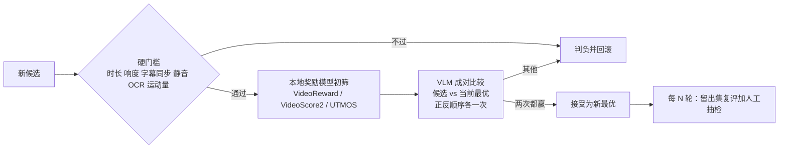
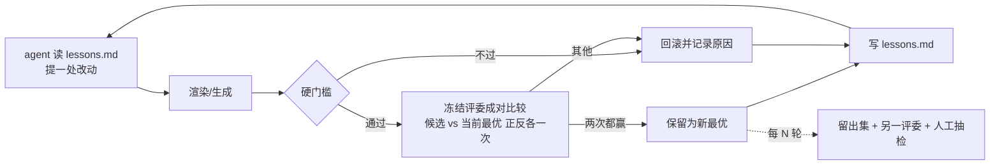

# 调研 C：自媒体领域（剪辑、视频生成、文案）的 RSI 可行性

调研日期：2026-10-21。目标是给 RSI-Anything / Open RSI 选出自媒体领域可以直接包装的开源项目、能让循环无人值守跑下去的自动评委，以及适合放进 README 的演示循环。

**数据口径。** GitHub 的 stars、许可证、是否归档、最近提交日期，都是 2026-10-21 当天抓取仓库公开页面和 `commits.atom` 得到的（抽查过和 GitHub API 一致）；仓库改名或迁移的写跳转后的新地址。Hugging Face 的许可证来自官方 API 标签。托管 API 的价格只写查到官方或注明来源的数字。标「未核实」的内容只有二手资料或没查到原文。本轮调研后期 WebSearch 配额用完了，之后的信息全部来自直接打开已知的官方页面、仓库 README 和 LICENSE 原文；因此 2025-2026 年冒出来、事先不知道名字的小仓库可能有遗漏，其中豆包视频理解参数、可灵官方单价、腾讯混元视频 API、部分平台文案字数上限等几处只能标「未核实」。

## 摘要

**最值得接入的项目。** 剪辑方向，感知层用 faster-whisper / WhisperX（英文）和 FunASR / SenseVoice（中文），加上 silero-vad、PySceneDetect、ffsubsync、pyloudnorm，全部是宽松许可证、笔记本能跑；执行层用 ffmpeg 渲染一份自定义的 EDL/时间线 JSON，需要互通时转 OpenTimelineIO，给中国用户精修时输出剪映草稿（pyJianYingDraft / VectCutAPI，但剪映新版本没法无人值守导出，只能当交付物）。2026 年最相关的「剪辑 Agent」是 browser-use 的 video-use（MIT，29k★，文字稿 + EDL + 渲染后自检）、HeyGen 的 HyperFrames（Apache-2.0，69k★，HTML 写视频、给 agent 用）和 OpenMontage（70k★，但 AGPL）。「主题 → 成片」流水线首选 MoneyPrinterTurbo（MIT，134k★，有 FastAPI 和 CLI）和 Pixelle-Video（Apache-2.0，29k★）。视频生成方向，开源首选 Wan2.1/2.2（Apache-2.0，ModelScope 有权重），编排用 ComfyUI 的 HTTP 接口或 diffusers / DiffSynth-Studio；托管首选阿里云万相 API（国际站和国内站两地都能用、支持 seed、480P 每秒约 $0.015~0.02），其次 MiniMax、Vidu、Kling、Seedance；Sora 2 API 已关停、Veo 3.1 预览版即将下线，适配层必须能换模型。文案方向，生成不需要专门项目，真正稀缺的是评委校准数据：小红书的 Qilin 数据集（约 198 万条笔记，带曝光、点击、点赞、收藏，Apache-2.0）和英文的 Upworthy 标题 A/B 档案（32,487 组实验）。

**怎么自动评。** 三个子领域都用同一种结构：先过零成本的硬门槛（时长、静音、字幕同步、响度、运动量、OCR、字数、违禁词、事实核对），再用便宜的本地奖励模型或代理模型投一票，最后让不同家族的评委把「新候选」和「当前最优」放在一起比，正反顺序各一次，两次都赢才保留。会看视频的评委：美国用 Gemini（原生音画一起理解，60 秒成片评一次不到一美分），中国用百炼 Qwen3.x / Omni 或免费的 GLM-4.6V-Flash，离线用 mlx-vlm / MiniCPM-V；GPT 和 Claude 只收图片，只能抽帧。VBench 系列只当诊断面板，不当优化目标。

**演示循环。** 首推「10 分钟口播 → 60 秒高光」剪辑循环（被改的是 `edit.json`，约 $1~4、20~30 分钟），其次是「视频生成提示词 + 参数」循环（被改的是 `gen.json`，约 $3~4、25~35 分钟）和「小红书笔记 / X 帖子」循环（不到 $0.5、5~10 分钟）。三个都设计了「评委体检」和「换评委留出验收」，用来证明进步不是在迎合评委。

## 目录

- A. 视频剪辑与短视频流水线
- B. 视频生成
- C. 自动评审（视频剪辑与视频生成）
- D. 文案撰写
- E. 推荐的三个演示循环
- F. 许可证与合规速查
- G. 仍未核实、建议后续补查的事项

## A. 视频剪辑与短视频流水线

数据口径：stars、许可证、是否归档、最近提交日期都是 2026-10-21 抓取 GitHub 仓库公开页面和 `commits.atom` 得到的（和 GitHub API 对过一次，数值一致）；仓库改名或迁移的，表里写的是跳转后的新地址。许可证一栏如果 GitHub 只显示 "License"（自定义许可证），我读了 LICENSE 原文再写结论。README 里的接口和硬件要求以 2026-10-21 当天的 README 为准；没在原文里看到的写「未核实」。

### A.1 端到端短视频流水线与「剪辑 Agent」

这一层是「给主题或素材，直接出成片」的整套工具。对 RSI 工具包来说，它们是最容易包一层的东西：输入参数或中间产物（脚本、分镜、剪辑决策表）都能被 agent 改，成片能被评委看。

| 项目 | 做什么 | 自动化接口 | 硬件 | 许可证 / 商用 | 中国友好度 | Stars / 最近提交 |
|---|---|---|---|---|---|---|
| [MoneyPrinterTurbo](https://github.com/harry0703/MoneyPrinterTurbo) | 主题或关键词 → LLM 写文案 → 配素材（Pexels / Pixabay / Coverr 免费素材，或 MiniMax H3、Seedance 等 AI 生成）→ TTS → 字幕 → BGM → 合成，支持 9:16 / 16:9 / 1:1、批量 | WebUI（8501）、FastAPI（8080，`/docs`）、`python cli.py --video-subject ...`，批量 JSON/JSONL（每批最多 100 条），`pip install mpt` 后有 `mpt webui` / `mpt cli` | 最低 4 核 / 4GB 内存，**不需要 GPU**；只有本地 faster-whisper 出字幕时 GPU 有帮助 | MIT，可商用 | 很好：中文 README，直连 DeepSeek / 通义 / Kimi / 火山方舟 / MiniMax，免费 edge-tts | 133,636 / 2026-10-21 |
| [Pixelle-Video](https://github.com/ATH-MaaS/Pixelle-Video)（原 AIDC-AI，已迁到 ATH-MaaS） | 主题 → 文案 → AI 配图/视频 → 配音 → BGM → 合成；另有数字人口播、图生视频、动作迁移模块 | WebUI；README 写「API 接口支持模板自定义参数」，原子能力走 ComfyUI / RunningHub 工作流或直连 DashScope、Seedance、Kling 等 API | 本地可不用 GPU（生成能力外包给 RunningHub 或 API） | Apache-2.0 | 很好（阿里系团队，中文优先） | 29,252 / 2026-06-14 |
| [OpenMontage](https://github.com/calesthio/OpenMontage) | 「让编码 Agent 变成视频制作团队」：12 条流水线、700+ 份 skill 文件、60+ 供应商；可从参考视频反推节奏和结构；零 API key 路线用 Piper TTS + Pexels / Archive.org / NASA 等免费素材建 CLIP 检索库再剪成片 | 由 Claude Code / Codex / Cursor 驱动；流水线写在 YAML 清单里，每步有「评审 skill」和渲染后自检（ffprobe、抽帧、音频分析） | 零 key 路线 CPU 可跑；有 GPU 可接本地 Wan / Hunyuan / LTX | **AGPL-3.0**（作为服务提供或嵌入时有传染性，接入方式要谨慎） | 一般（默认供应商以海外为主） | 70,492 / 2026-10-16 |
| [video-use](https://github.com/browser-use/video-use)（browser-use 出品） | 把一堆原始素材交给 Claude Code / Codex，自动去口癖和空档、调色、30ms 音频淡入淡出、烧字幕、生成动画叠层，最后出 `final.mp4` | 是一个 agent skill：转写 → 打包成 12KB 文本 → LLM 推理 → **EDL（剪辑决策表）** → ffmpeg 渲染 → 在每个剪辑点对成片自检（最多修 3 次） | CPU + ffmpeg；转写默认用 ElevenLabs Scribe API | MIT | 一般：默认依赖 ElevenLabs（中国大陆需替换转写服务，替换难度未核实） | 29,462 / 2026-10-08 |
| [HyperFrames](https://github.com/heygen-com/hyperframes)（HeyGen 出品） | 用 HTML/CSS + 动画库写视频，逐帧确定性渲染成 MP4；适合字幕动画、标题卡、图表、转场 | `npx hyperframes init / preview / render`；提供给 agent 的 skills（`npx skills add heygen-com/hyperframes`）；合成文件是带 `data-start` / `data-duration` 等属性的 HTML | Node 22+、FFmpeg、无头 Chrome；不需要 GPU | Apache-2.0，README 写明无按次渲染费、无商用门槛 | 好（纯本地） | 68,871 / 2026-10-21 |
| [Remotion](https://github.com/remotion-dev/remotion) | 用 React 写视频，`npx remotion render` 渲染；有官方 [agent skills](https://github.com/remotion-dev/skills)（5,465★） | CLI、Node API、AWS Lambda 分布式渲染 | CPU + 无头 Chrome | **Remotion License**：个人、≤3 人的营利公司、非营利组织免费（含商用）；更大的公司要买 Company License | 好 | 65,869 / 2026-10-21 |
| [NarratoAI](https://github.com/linyqh/NarratoAI) | 影视解说：VLM 看懂视频 → LLM 写解说词 → 自动剪辑 + 配音 + 字幕；v0.8.6（2026-07-16） | 只有 Streamlit WebUI（8501），README 没提供 API/CLI | 4 核 / 8GB，不需要 GPU | MIT | 很好：通义 VL、DeepSeek、腾讯云 / 豆包 TTS、IndexTTS（含 Mac MLX 版） | 11,480 / 2026-10-19 |
| [FunClip](https://github.com/modelscope/FunClip)（阿里通义） | FunASR 转写 → 选文字或说话人 → 剪出对应片段并出 SRT；支持 LLM 辅助选段、热词、说话人分离 | CLI：`python funclip/videoclipper.py --stage 1 --file x.mp4 --output_dir ./output`，`--stage 2 ... --dest_text '...' --start_ost 0 --end_ost 100`；Gradio UI | README 没写；Paraformer 在 CPU 可跑 | 代码 MIT，默认模型 Apache-2.0 | 很好（中文默认，ModelScope 下载） | 6,433 / 2026-10-08 |
| [AI-Youtube-Shorts-Generator](https://github.com/Anil-matcha/AI-Youtube-Shorts-Generator)（原 SamurAIGPT） | 长视频 → Whisper 转写 + LLM 选高光 → 自动裁成 9:16 | CLI，`--mode api`（走作者的 MuAPI 付费服务）或 `--mode local`，`--output-json` | local 模式需本地 Whisper | MIT（README 带商业 API 推广） | 一般 | 5,530 / 2026-10-11 |
| [ViMax](https://github.com/HKUDS/ViMax)（港大 HKUDS） | Idea2Video / Script2Video / Novel2Video / AutoCameo：从想法到剧本、分镜、关键帧、视频、合成 | `vimax tui`（agent 循环）、Web UI、`main_idea2video.py` + YAML（`chat_model`、`image_generator`、`video_generator`）；`image_selection.num_candidates` 会生成多张关键帧再让 VLM 选 | 本地不需要 GPU，全靠 API | MIT | 一般：示例默认 OpenRouter、Nano Banana、Veo；可换 Seedance | 12,716 / 2026-09-30 |
| [VideoAgent](https://github.com/HKUDS/VideoAgent)（HKUDS，EMNLP 2026） | 视频理解 + 剪辑（解说、混剪、卡点）+ 二创（鬼畜、MV、英文脱口秀改中文相声） | `python main.py` 交互；配置在 `environment/config/config.yml` | 8GB 显存；本地跑 CosyVoice、fish-speech、seed-vc、DiffSinger、Whisper、ImageBind | MIT（依赖模型各有许可证） | 一般：路由要 Claude，另用 DeepSeek、GPT、Gemini | 1,961 / 2026-07-22 |
| [VideoClaw](https://github.com/HITsz-TMG/VideoClaw)（原 FilmAgent） | 「AI 导演」：剧本 → 角色/场景 → 分镜 → 参考图 → 视频 → 剪辑；短剧续写、解说短视频、数字人口播 | 可被 OpenClaw 调用，WebUI 配置 | 依赖外部生成 API | MIT | 好（中文优先） | 1,871 / 2026-08-26 |
| [Vidi](https://github.com/bytedance/vidi)（字节） | 视频理解与剪辑大模型（Vidi2.5，2026-01）：时间定位、检索、章节、高光、问答；开放 Vidi1.5-9B 权重和微调代码 | 本地推理脚本；在线 demo 有 vidi-edit 自动成片 | 9B 级，需要单张大显存卡（具体数字未核实） | 自定义许可证（未细读，未核实） | 一般 | 660 / 2026-08-03 |
| [Director](https://github.com/video-db/Director) | 视频 agent 框架 | Python，依赖 VideoDB 云服务 | 云端 | MIT（但核心能力在付费云） | 差 | 1,557 / 2026-01-23 |
| [OpenCut](https://github.com/OpenCut-app/OpenCut) | 开源剪映替代品（Web） | **目前正在重写**，README 说新版本才会有 Editor API、MCP server、无头渲染；旧版已归档到 opencut-classic | — | MIT | — | 95,548 / 2026-09-24（暂不建议接入） |
| 其他 | [MoneyPrinterV2](https://github.com/FujiwaraChoki/MoneyPrinterV2)（32,164，AGPL-3.0，偏「全自动赚钱」）、[ShortGPT](https://github.com/RayVentura/ShortGPT)（8,058，MIT，2025-02 后停更）、[RedditVideoMakerBot](https://github.com/elebumm/RedditVideoMakerBot)（12,549，GPL-3.0） | | | | | |

**结论。** 想在 RSI 工具包里最快跑通「剪辑」这条线，最值得包的是 video-use 的思路：它把视频变成文字稿加一份 EDL，LLM 只改 EDL，渲染交给 ffmpeg，评审在成片上做。EDL 天然就是「每轮改一处、能回滚」的可变产物。MoneyPrinterTurbo 和 Pixelle-Video 适合「主题 → 成片」的生成式短视频，它们有 API/CLI，可以把「文案 + 素材关键词 + 字幕样式 + 配音参数」当作被优化的配置。FunClip 是中文口播高光剪辑的现成底座。OpenMontage 功能最全，但它是 AGPL，而且本身已经是一个很重的 agent 框架，更适合当参考或外部调用，不适合当工具包的依赖。

### A.2 时间线格式与渲染引擎（可变产物放在哪一层）

| 项目 | 时间线怎么表达 | 怎么程序化 | 许可证 | Stars / 最近提交 | 备注 |
|---|---|---|---|---|---|
| [FFmpeg](https://ffmpeg.org/) | 命令行 + `filter_complex` 滤镜图 | CLI | LGPL/GPL（看编译选项） | — | 一切的底座；`silencedetect`、`ebur128`、`loudnorm` 等指标也在这里 |
| [MoviePy](https://github.com/Zulko/moviepy) | Python 对象 | Python API | MIT | 15,009 / 2026-08-26 | MoneyPrinter 系列都用它；长视频渲染慢 |
| [auto-editor](https://github.com/WyattBlue/auto-editor) | 按响度/画面运动自动切掉空档 | CLI：`--edit audio:-19dB`、`--margin 0.2sec`、`--edit motion:threshold=0.02`、`--export premiere / resolve / final-cut-pro / shotcut / kdenlive`；有 agent skill | Unlicense（公有领域） | 5,574 / 2026-10-21 | 现在用 Nim 写；适合当「粗剪」第一步，导出工程文件给人精修 |
| [AutoCut](https://github.com/mli/autocut)（李沐） | 「改文字稿就是剪视频」：生成 Markdown 字幕，勾选要保留的句子就剪 | CLI：`autocut -t x.mp4`、`autocut -c`、`autocut -d <目录>` 守护模式 | Apache-2.0 | 7,834 / 2024-10-05（停更） | Descript 式文字稿剪辑的最简实现；Markdown 本身就是可变产物 |
| [OpenTimelineIO](https://github.com/AcademySoftwareFoundation/OpenTimelineIO) | 行业通用的时间线交换格式 `.otio`（JSON） | Python / C++；适配器读写 FCP XML、AAF、CMX 3600 EDL（v0.16 后适配器拆到独立仓库） | Apache-2.0 | 2,032 / 2026-10-17 | 最适合当工具包内部「标准时间线」格式，导出到各家剪辑软件 |
| [MLT](https://github.com/mltframework/mlt) / [Kdenlive](https://github.com/KDE/kdenlive) / [Shotcut](https://github.com/mltframework/shotcut) | MLT XML 工程文件 | `melt` 命令行无头渲染 MLT XML（常见用法，命令细节未逐条核实） | MLT LGPL-2.1；Kdenlive / Shotcut GPL-3.0 | 1,867 / 5,908 / 15,460，均 2026-10 有提交 | 想让人类在桌面剪辑器里打开 agent 的结果时有用 |
| [libopenshot](https://github.com/OpenShot/libopenshot) | OpenShot 工程 | C++ + Python 绑定 | LGPL-3.0 | 1,577 / 2026-10-21 | |
| [pyJianYingDraft](https://github.com/GuanYixuan/pyJianYingDraft) | 剪映草稿 `draft_content.json` | Python：轨道、文本、花字、特效、转场、关键帧、SRT 导入、模板替换 | Apache-2.0 | 4,620 / 2026-10-14 | **自动导出只在 Windows 且剪映 6 及以下可用**；剪映 7+ 的草稿往往不是明文 JSON，模板读取要额外读取器；Linux/Mac 只能生成草稿。CapCut 版是 [pyCapCut](https://github.com/GuanYixuan/pyCapCut)（715★） |
| [VectCutAPI](https://github.com/sun-guannan/VectCutAPI)（原 CapCutAPI） | 剪映 / CapCut 草稿 | `python capcut_server.py`（HTTP，默认 9001 端口）、`python mcp_server.py`（MCP，stdio） | Apache-2.0 | 2,321 / 2026-10-16 | 云端渲染和预览走作者的商业服务 vectcut.com |
| [Motion Canvas](https://github.com/motion-canvas/motion-canvas) / [Revideo](https://github.com/midrender/revideo) | TypeScript 代码 | Node | MIT | 19,413 / 2026-07-02；4,126 / 2026-07-15 | 偏动效和讲解视频 |
| [Pallaidium](https://github.com/tin2tin/Pallaidium) | Blender 视频编辑器（VSE）里的生成式 AI 插件 | Blender 的 `bpy` Python 可以脚本化 VSE | GPL-3.0 | 1,550 / 2026-10-17 | |
| [editly](https://github.com/mifi/editly) | JSON5 声明式剪辑 | CLI / Node API | MIT | 5,536 / 2025-02-20（停更） | 思路好，但已不活跃 |
| [lossless-cut](https://github.com/mifi/lossless-cut) | 无损裁切 | 主要是 GUI | GPL-2.0 | 44,820 / 2026-10-21 | 不适合当自动化底座 |

**结论。** 工具包内部建议用「EDL/时间线 JSON」当剪辑类的可变产物：最小可行版本是一个自定义 JSON（片段列表：源文件、入点、出点、字幕样式、转场、BGM 音量），用 ffmpeg 渲染；需要和专业软件互通时转成 OpenTimelineIO，再由 OTIO 适配器或 auto-editor 导出给 Premiere / Resolve / FCP / Kdenlive。中国用户想在剪映里接着精修时，再用 pyJianYingDraft 或 VectCutAPI 输出草稿；但剪映新版本没法无人值守导出，所以**剪映草稿只能当交付物，不能放在循环里当渲染器**。

### A.3 语音识别、字幕与对齐（剪辑的「眼睛」，也是评委的输入）

| 项目 | 做什么 | 接口 | 硬件 | 许可证 | 中国友好度 | Stars / 最近提交 |
|---|---|---|---|---|---|---|
| [openai/whisper](https://github.com/openai/whisper) | 多语言 ASR | Python / CLI | GPU 更快，CPU 可跑小模型 | MIT | 中文一般 | 110,986 / 2026-08-31 |
| [faster-whisper](https://github.com/SYSTRAN/faster-whisper) | CTranslate2 加速版 Whisper | Python | CPU/GPU | MIT | 同上 | 26,013 / 2026-10-16 |
| [whisper.cpp](https://github.com/ggml-org/whisper.cpp) | C/C++ 版，Mac Metal 加速 | CLI / 绑定 | 笔记本友好 | MIT | 同上 | 54,533 / 2026-10-19 |
| [WhisperX](https://github.com/m-bain/whisperX) | 词级时间戳、强制对齐、说话人分离 | Python / CLI | GPU 推荐 | BSD-2 | 同上 | 24,745 / 2026-10-18 |
| [FunASR](https://github.com/modelscope/FunASR) | 中文 ASR 工具箱：VAD、标点、说话人分离、流式；README 写支持 OpenAI 兼容服务和 MCP | Python / 服务 | CPU 可跑 | MIT（模型多为 Apache-2.0） | 很好 | 20,784 / 2026-10-21 |
| [SenseVoice](https://github.com/QwenAudio/SenseVoice)（已迁到 QwenAudio） | 中粤英日韩 ASR + 情绪 + 声音事件（笑声、掌声） | Python | CPU 可跑，速度快 | MIT | 很好 | 9,557 / 2026-09-30 |
| [Qwen3-ASR](https://github.com/QwenLM/Qwen3-ASR) | 多语言、可识别歌声 | Python | GPU | Apache-2.0 | 很好 | 3,753 / 2026-06-26 |
| [FireRedASR](https://github.com/FireRedTeam/FireRedASR) | 普通话、方言、英文 | Python | GPU | Apache-2.0 | 很好 | 2,007 / 2026-02-25 |
| [mlx-audio](https://github.com/Blaizzy/mlx-audio) | Apple Silicon 上的 STT / TTS | Python | Mac | MIT | — | 8,082 / 2026-10-20 |
| [VideoCaptioner](https://github.com/WEIFENG2333/VideoCaptioner)（卡卡字幕助手） | 转写 + LLM 断句、校正、翻译 | `pip install videocaptioner`，有 CLI 和 Claude Code skill | CPU 可跑 | GPL-3.0 | 很好 | 16,322 / 2026-05-24 |
| [VideoLingo](https://github.com/Huanshere/VideoLingo) | Netflix 级字幕切分、翻译、对齐、配音 | Streamlit + **本地 HTTP API**（README 说专门给 agent 和脚本用） | GPU 可选 | Apache-2.0 | 好 | 18,871 / 2026-09-30 |
| [pyvideotrans](https://github.com/jianchang512/pyvideotrans) | 视频翻译 + 多角色配音 + 字幕 | GUI + CLI（无头） | GPU 可选 | GPL-3.0 | 很好 | 19,488 / 2026-10-15 |
| [stable-ts](https://github.com/jianfch/stable-ts) | Whisper 时间戳稳定化、强制对齐 | Python | — | MIT | — | 2,281 / **已归档** |

字幕同步（ffsubsync、alass）、静音检测（silero-vad）、镜头切换（PySceneDetect）这些在 C.3 里作为评审指标列出。

### A.4 配音 / TTS

| 项目 | 特点 | 硬件 | 许可证（代码 / 权重） | 中国友好度 | Stars / 最近提交 |
|---|---|---|---|---|---|
| [CosyVoice](https://github.com/QwenAudio/CosyVoice)（已迁到 QwenAudio） | 多语言、零样本克隆、流式 | GPU 推荐 | Apache-2.0 / CosyVoice2 权重 Apache-2.0 | 很好 | 24,082 / 2026-05-25 |
| [Qwen3-TTS](https://github.com/QwenLM/Qwen3-TTS) | 稳定、有表现力、流式 | GPU | Apache-2.0 | 很好 | 13,904 / 2026-03-17 |
| [IndexTTS](https://github.com/index-tts/index-tts)（B 站） | 工业级可控零样本 TTS，能控时长和情绪，配音常用 | GPU；NarratoAI 有 Mac MLX 版 | **bilibili 模型使用协议**：上月 MAU 超 1 亿或上年营收超 10 亿元须另行授权；**禁止用它改进其他 AI 模型**（自身衍生和非商用模型除外） | 很好 | 24,629 / 2026-09-29 |
| [fish-speech](https://github.com/fishaudio/fish-speech) | 多语言高质量 TTS | GPU | **Fish Audio Community License**（2026-10-13 更新）：年营收 <50 万美元可免费商用，提供托管服务需另签授权 | 好 | 33,332 / 2026-10-14 |
| [GPT-SoVITS](https://github.com/RVC-Boss/GPT-SoVITS) | 1 分钟音频就能训出音色，中文圈最流行的克隆方案 | GPU | MIT | 很好 | 63,371 / 2026-10-19 |
| [VibeVoice](https://github.com/microsoft/VibeVoice)（微软） | 长时多说话人（播客式） | GPU | MIT / 1.5B 权重 MIT | 好 | 54,906 / 2026-10-08 |
| [Chatterbox](https://github.com/resemble-ai/chatterbox) | 英文为主，情绪强度可调 | GPU | MIT | 一般 | 27,126 / 2026-07-21 |
| [Kokoro-82M](https://github.com/hexgrad/kokoro) | 82M 小模型，**CPU 实时** | CPU | Apache-2.0 / Apache-2.0 | 中文一般 | 9,557 / 2025-08-06 |
| [F5-TTS](https://github.com/SWivid/F5-TTS) | 流匹配零样本 TTS | GPU | 代码 MIT / **权重 CC-BY-NC-4.0（不可商用）** | 好 | 15,434 / 2026-10-14 |
| [ChatTTS](https://github.com/2noise/ChatTTS) | 日常对话风格 | GPU | 代码 AGPL-3.0 / **权重 CC-BY-NC-4.0** | 好 | 39,919 / 2026-04-10 |
| [Spark-TTS](https://github.com/SparkAudio/Spark-TTS) | | GPU | 代码 Apache-2.0 / **权重 CC-BY-NC-SA-4.0** | 好 | 10,987 / 2025-04-09 |
| 其他 | [MegaTTS3](https://github.com/bytedance/MegaTTS3)（6,115，Apache-2.0）、[Dia](https://github.com/nari-labs/dia)（19,403，Apache-2.0，英文对话）、[Higgs Audio](https://github.com/boson-ai/higgs-audio)（8,367，Apache-2.0）、[OpenVoice](https://github.com/myshell-ai/OpenVoice)（38,034，MIT，2025-04 后停更） | | | | |
| [edge-tts](https://github.com/rany2/edge-tts) | 调用微软 Edge 在线朗读服务，免费、无需 key；MoneyPrinterTurbo、Pixelle-Video 默认用它 | 无 | LGPLv3（个别文件 MIT）；**调用的是微软非公开服务，稳定性和条款属灰色地带** | 国内可用 | 12,345 / 2026-10-14 |
| [MiniMax-MCP](https://github.com/MiniMax-AI/MiniMax-MCP) | 官方 MCP：TTS、图像、视频生成 | 云端 | MIT（服务按量付费） | 国内外都有站点 | 1,593 / 2026-08-20 |

### A.5 数字人与口型同步（口播类内容常用）

| 项目 | 做什么 | 许可证 | Stars / 最近提交 |
|---|---|---|---|
| [LatentSync](https://github.com/bytedance/LatentSync)（字节） | 基于扩散的唇形同步 | Apache-2.0 | 6,172 / 2025-06-20 |
| [MuseTalk](https://github.com/TMElyralab/MuseTalk)（腾讯音乐） | 实时唇形同步 | MIT | 6,765 / 2025-09-26 |
| [LivePortrait](https://github.com/KlingAIResearch/LivePortrait)（快手，已迁到 KlingAIResearch） | 照片驱动表情和头部动作 | 代码 MIT（依赖的人脸检测组件许可证另算，未核实） | 19,280 / 2026-06-01 |
| [Duix-Avatar](https://github.com/duixcom/Duix-Avatar)（原 HeyGem.ai） | 离线数字人克隆与视频合成 | DUIX 社区许可证（按 MAU 设门槛，细节未逐条核实） | 16,005 / 2026-04-21 |
| [EchoMimicV3](https://github.com/antgroup/echomimic_v3)（蚂蚁） | 1.3B 多模态人像动画 | Apache-2.0 | 1,093 / 2026-03-18 |
| [Wav2Lip](https://github.com/Rudrabha/Wav2Lip) | 老牌唇形同步，SyncNet 指标的来源 | README 写开源版**仅限研究/个人用途** | 13,254 / 2025-06-22 |
| InfiniteTalk、HunyuanVideo-Avatar、SkyReels-V3 数字人 | 见 B.1 | | |

### A.6 素材检索、B-roll、音乐与发布

| 项目 | 用途 | 关键信息 | 链接 |
|---|---|---|---|
| Pexels API | 免费图片和视频素材检索 | 免费；默认每小时 200 次、每月 20,000 次；要求显著标注「Photos provided by Pexels」；视频检索 `GET https://api.pexels.com/v1/videos/search?query=...` | [文档](https://www.pexels.com/api/documentation/) |
| Pixabay API | 免费素材 | MoneyPrinterTurbo 内置；限额本轮未核实 | [文档](https://pixabay.com/api/docs/) |
| [open_clip](https://github.com/mlfoundations/open_clip) / [clip-retrieval](https://github.com/rom1504/clip-retrieval) | 用文字检索素材画面（B-roll 匹配），OpenMontage 的免费素材路线就是这么做的 | 14,211★（自定义 MIT 式许可）/ 2,799★ MIT | |
| [ACE-Step](https://github.com/ace-step/ACE-Step) | 开源音乐生成（BGM） | Apache-2.0，4,968★ | |
| [audiocraft / MusicGen](https://github.com/facebookresearch/audiocraft) | 音乐生成 | 代码 MIT，**权重 CC-BY-NC-4.0**，23,750★，2025-03 后少更新 | |
| [social-auto-upload](https://github.com/dreammis/social-auto-upload) | 自动上传到抖音、小红书、视频号、TikTok、YouTube、B 站（浏览器自动化） | MIT，15,680★，2026-10-21；有封号风险，见 D.4 | |
| [biliup](https://github.com/biliup/biliup) | B 站命令行投稿、直播录制 | MIT，5,522★，2026-10-20 | |

**结论。** 剪辑链路的「感知层」（转写、对齐、静音、切点）全部有成熟开源件，CPU 或笔记本就能跑：英文用 faster-whisper / whisper.cpp + WhisperX 对齐，中文用 FunASR / SenseVoice。配音层要特别注意许可证：IndexTTS 和 fish-speech 的商用都有门槛，F5-TTS、ChatTTS、Spark-TTS、MusicGen 的权重不能商用；工具包默认配置建议用 CosyVoice、Qwen3-TTS、Kokoro、GPT-SoVITS 这类 Apache/MIT 的，或者直接用 edge-tts 起步并提示它的条款风险。

## B. 视频生成

调研日期 2026-10-21。GitHub stars 和最近提交日期是当天抓取仓库公开页面和 `commits.atom` 得到的（和 GitHub API 对过一次，数值一致）；Hugging Face 许可证标签来自 `huggingface.co/api/models/<id>`。价格只写查到来源的，来源是第三方转述的会注明；没查到或只有二手说法的标「未核实」。本轮 WebSearch 配额中途用完，Kling 官方价、腾讯混元视频 API 价格、Luma/PixVerse 官方价没能补齐。

### B.1 开源视频生成模型

| 项目 | 做什么 | 自动化接口 | 显存 / 速度（官方或 README 数据） | 许可证 / 能否商用 | 中国友好度 | Stars / 最近提交（2026-10-21） |
|---|---|---|---|---|---|---|
| [Wan2.2](https://github.com/Wan-Video/Wan2.2)（阿里通义万相） | T2V/I2V A14B（MoE）、TI2V-5B、S2V-14B（语音驱动）、Animate-14B；2026 年 HF 上又新增 [Wan2.2-Animate-2-14B](https://huggingface.co/Wan-AI/Wan2.2-Animate-2-14B)（2026-08）、[Wan-Dancer-14B](https://huggingface.co/Wan-AI/Wan-Dancer-14B)（2026-07） | `generate.py` CLI；diffusers（`Wan-AI/*-Diffusers`）；ComfyUI 原生 | TI2V-5B 加 `--offload_model True --convert_model_dtype --t5_cpu` 可在 24GB（4090）跑 720p；模型卡称 5B「单张消费级卡 9 分钟内出 5 秒 720P」；A14B 官方命令要 80GB，社区 GGUF Q4 + offload 约 16GB（[builderai 二手数据](https://builderai.tools/blog/best-open-source-video-generation-stack-2026)） | Apache-2.0，可商用、无地域限制 | HF + ModelScope 双发，国内直接下 | 18,074 / 2026-09-21 |
| [Wan2.1](https://github.com/Wan-Video/Wan2.1) | T2V-1.3B/14B、I2V、FLF2V、VACE（视频编辑） | 同上 | T2V-1.3B 仅需 8.19GB，4090 上 5 秒 480P 约 4 分钟（未加速） | Apache-2.0 | HF + ModelScope | 17,264 / 2026-03-05 |
| Wan 2.5 / 2.6 / 2.7 / 3.0 | 只有云 API，没有开放权重。2026-10-21 查 HF `Wan-AI` 组织，最新仍是 2.2 系列 | 见 B.3 阿里云 | — | 闭源 API | 百炼可用 | — |
| [HunyuanVideo](https://github.com/Tencent-Hunyuan/HunyuanVideo)（腾讯，org 已迁到 Tencent-Hunyuan） | 13B T2V | CLI、diffusers、ComfyUI 原生、kijai wrapper | 720p×129 帧 60GB，544p 45GB；FP8 省约 10GB | 腾讯混元社区许可证：**不适用于欧盟、英国、韩国**；月活 >1 亿需另行申请；**禁止用模型输出去改进其他 AI 模型** | HF；国内可下 | 12,643 / 2026-10-08 |
| [HunyuanVideo-1.5](https://github.com/Tencent-Hunyuan/HunyuanVideo-1.5) | 8.3B 轻量版，T2V/I2V，480p/720p，另有 720→1080 超分 | `torchrun generate.py`；diffusers `HunyuanVideo15Pipeline`；ComfyUI | 开 offload 最低 14GB；480p I2V 步数蒸馏版 8~12 步，**4090 单卡约 75 秒出一条**；CFG 蒸馏约 2 倍加速 | 同上混元许可证（[LICENSE](https://github.com/Tencent-Hunyuan/HunyuanVideo-1.5/blob/main/LICENSE)） | HF（README 未提 ModelScope） | 4,575 / 2026-04-10 |
| [HunyuanVideo-I2V](https://github.com/Tencent-Hunyuan/HunyuanVideo-I2V) / [Avatar](https://github.com/Tencent-Hunyuan/HunyuanVideo-Avatar) / [Foley](https://github.com/Tencent-Hunyuan/HunyuanVideo-Foley) / [HunyuanCustom](https://github.com/Tencent-Hunyuan/HunyuanCustom) | 图生视频 / 音频驱动数字人 / 给视频配音效 / 主体定制 | CLI；Foley 有 ComfyUI 社区节点 | Avatar 官方最低 24GB（很慢），经 Wan2GP 可 10GB；Foley XL 16GB（offload 8GB） | 混元许可证 | HF | 1,849 / 2,186 / 1,076 / 1,231；最近提交 2025-09~2026-04 |
| [LTX-2 / LTX-2.5](https://github.com/Lightricks/LTX-2)（Lightricks） | 22B 音视频联合生成（视频带同步音频），T2AV/I2AV、音频驱动、重配音（DubIt）、IC-LoRA 一堆；最高 4K | `uv run python -m ltx_pipelines.distilled` CLI；diffusers（[LTX-2.5-Diffusers](https://huggingface.co/Lightricks/LTX-2.5-Diffusers)）；[ComfyUI-LTXVideo](https://github.com/Lightricks/ComfyUI-LTXVideo)（4,209★） | README 无具体显存数，提供 `--quantization fp8-cast --offload`；蒸馏管线 8+4 步；权重约 66GiB | [LTX-2.x Community License](https://github.com/Lightricks/LTX-2/blob/main/LICENSE-2_x)（2026-08-11）：年收入 **≥1000 万美元** 的公司商用需付费；全球可用（受制裁地区除外）；用输出训练出的模型算衍生品，须沿用同一许可证；HF 需点同意（gated=auto） | DiffSynth-Studio 已在 ModelScope 放 [LTX-2.5](https://modelscope.cn/models/Lightricks/LTX-2.5) | 9,825 / 2026-10-18 |
| [LTX-Video](https://github.com/Lightricks/LTX-Video)（0.9.x，2B/13B） | 上一代，蒸馏版很快（H100 上实时），0.9.8 支持 60 秒长视频 | `inference.py`、diffusers、ComfyUI | 2B 蒸馏版显存很低；13B 有 FP8 版 | 2B 0.9.5 为 OpenRAIL-M；13B 系列 HF 标签为 other（未细核） | HF | 11,150 / 2026-01-05 |
| [MiniMax-H3](https://huggingface.co/MiniMaxAI/MiniMax-H3)（2026-08 开放权重，无 GitHub 主仓） | 33B 全模态生成：文/图/视频/音频输入，输出 4~15 秒带立体声的视频；2K 超分步骤未开源 | SGLang / vLLM-Omni 服务、diffusers ModularPipeline、ComfyUI 模板 | 参考部署 4 卡；[WanGP](https://github.com/deepbeepmeep/WanGP) 称 15 秒 1080p 降到 11GB；[FastVideo FastH3](https://haoailab.com/blogs/fasth3-local/) 4 步蒸馏版：M4 Max 36GB 跑 832×480×124 帧约 465~504 秒，DGX Spark 约 243~264 秒 | [MiniMax H3 Community License](https://huggingface.co/MiniMaxAI/MiniMax-H3/blob/main/LICENSE)（2026-08-02）：**适用地域排除欧盟、英国、韩国和美国**；年收入 >2000 万美元需书面授权；商用须在界面显著标注「MiniMax H3」；禁止用输出改进其他模型 | ModelScope 有 DiffSynth 适配；国内友好 | HF 下载约 500 万、6,262 赞（无 GitHub 仓库） |
| [CogVideoX](https://github.com/zai-org/CogVideo)（智谱） | 2B/5B/1.5-5B，T2V/I2V | diffusers、`cli_demo.py` | diffusers 下 5B BF16 最低约 5GB、2B 约 4GB（开 offload）；5B 单卡 A100 约 180 秒、H100 约 90 秒 | 2B 为 Apache-2.0；5B 用 [CogVideoX LICENSE](https://huggingface.co/THUDM/CogVideoX-5b/blob/main/LICENSE)：商用须登记，**月访问量 ≤100 万** | HF + ModelScope | 13,092 / 2025-11-04（画质已落后） |
| [Open-Sora 2.0](https://github.com/hpcaitech/Open-Sora) | 11B，T2V+I2V，256px/768px | CLI（colossalai） | 768px 需多卡序列并行 | Apache-2.0 | ModelScope 有权重 | 29,875 / 2026-04-09 |
| [Mochi 1](https://github.com/genmoai/mochi) | 10B，480p T2V | CLI、ComfyUI 原生 | 官方单卡约 60GB，ComfyUI 优化后 <20GB | Apache-2.0 | HF | 3,752 / 2026-10-06 |
| [SkyReels-V2](https://github.com/SkyworkAI/SkyReels-V2) / [V3](https://github.com/SkyworkAI/SkyReels-V3) / [V1](https://github.com/SkyworkAI/SkyReels-V1)（昆仑万维） | V2：Diffusion Forcing 无限时长；V3：参考图生视频、视频续写、19B 说话数字人 | CLI、diffusers（V2） | V2 1.3B 540P 峰值 14.7GB、14B 51.2GB；V3 `--low_vram` 可在 24GB 以下跑 | Skywork 社区许可证：允许商用、无需申请，但要求面向互联网服务前做安全评估和备案（[LICENSE](https://huggingface.co/Skywork/SkyReels-V2-DF-1.3B-540P/blob/main/LICENSE)） | HF + ModelScope | V2 7,707 / 2026-01-29；V3 584 / 2026-01-30；V1 2,695 / 2025-03-10 |
| [MAGI-1](https://github.com/SandAI-org/MAGI-1)（Sand AI） | 自回归分块生成，可流式续写 | CLI、ComfyUI 节点 | 4.5B 单卡 4090（24GB），fp8 量化 + `window_size=1` 可 12GB；24B 需 8×H100 | Apache-2.0 | HF | 3,796 / 2026-06-17 |
| [Step-Video-T2V](https://github.com/stepfun-ai/Step-Video-T2V)（阶跃） | 30B T2V | CLI | 80GB 级；544×992×136 帧约 408 秒 | MIT | HF + ModelScope | 3,189 / 2025-03-17（不适合笔记本） |
| [LongCat-Video](https://github.com/meituan-longcat/LongCat-Video)（美团） | 13.6B，T2V/I2V/续写，分钟级长视频，720p30；另有 avatar 版 | CLI | 高显存消费卡（具体数未写）；avatar 版支持 INT8 | 权重 MIT | HF | 9,217 / 2026-05-27 |
| [Kandinsky 5](https://github.com/kandinskylab/kandinsky-5) / [Kandinsky 6](https://github.com/kandinskylab/kandinsky-6)（Sber） | K5：Lite 2B T2V（5s/10s）；K6（2026-10-06 发布）：Lite 3B / Pro 29B，5 秒视频 + 44kHz 同步音频（含口型） | diffusers、ComfyUI、vLLM-Omni | K6 非蒸馏版 5 秒片段：4090 上 Lite SD 437 秒、Pro HD 1194 秒 | 仓库 MIT（K6 权重许可证 HF 接口拿不到，未核实） | HF | K5 843 / 2026-01-19；K6 365 / 2026-10-20 |
| [FramePack](https://github.com/lllyasviel/FramePack) | 基于 HunyuanVideo 13B 的逐段 I2V，可出 60 秒 | 主要是 Gradio 桌面应用，没有正式 API | **6GB 显存可跑，笔记本 GPU 也行**；4090 约 1.5~2.5 秒/帧 | 代码 Apache-2.0；权重派生自 HunyuanVideo，HF 未标许可证（未核实，稳妥起见按混元许可证处理） | 首次自动下载 30GB+ | 17,308 / 2025-10-16 |
| [Self-Forcing](https://github.com/guandeh17/Self-Forcing) / [Helios](https://github.com/PKU-YuanGroup/Helios) | 自回归蒸馏实现实时/流式生成；Helios 是 14B，H100 上 19.5 FPS 分钟级长视频 | Python 脚本、Gradio | Self-Forcing ≥24GB；Helios 支持 group offload（具体显存数未核实） | 都是 Apache-2.0 | HF | 3,552 / 2025-09-12；2,217 / 2026-08-24 |
| [Ovi](https://github.com/character-ai/Ovi)（Character.AI） | 音视频联合生成，5s/10s，960×960 | CLI；ComfyUI 经 kijai wrapper | 最低 32GB，fp8 + CPU offload 可 24GB；80GB 卡约 83~140 秒/条 | Apache-2.0 | HF | 1,761 / 2025-11-15 |
| [InfiniteTalk](https://github.com/MeiGen-AI/InfiniteTalk)（美团） | 音频驱动的无限时长说话视频（图生、视频重配） | CLI、ComfyUI、Wan2GP | 有低显存模式（`--num_persistent_param_in_dit 0`） | Apache-2.0 | HF | 8,127 / 2026-05-22 |
| 其他（不建议首批接入） | [Open-Sora-Plan](https://github.com/PKU-YuanGroup/Open-Sora-Plan)（12,207，MIT，2026-03-08）、[Pyramid-Flow](https://github.com/jy0205/Pyramid-Flow)（3,213，MIT，2024-12 后停更）、[LingBot-Video](https://github.com/robbyant/lingbot-video)（975，Apache，偏具身智能）、[Waver](https://github.com/FoundationVision/Waver)（953，许可证未标）、音频补全 [MMAudio](https://github.com/hkchengrex/MMAudio)（2,289，MIT） | | | | | |

### B.2 推理框架与编排层（RSI 工具包实际要对接的是这一层）

| 项目 | 作用 | 自动化接口 | 许可证 | Stars / 最近提交 |
|---|---|---|---|---|
| [ComfyUI](https://github.com/Comfy-Org/ComfyUI) | 节点式工作流引擎，几乎所有开源视频模型都有节点 | HTTP：`POST /prompt` 提交 `{"prompt": <API 格式工作流 JSON>, "client_id": ...}`，返回 `prompt_id`；`/ws` 推送进度；`GET /history/{prompt_id}` 取结果；`GET /view` 下载文件；`POST /upload/image` 上传首帧（[路由文档](https://docs.comfy.org/development/comfyui-server/comms_routes)，仓库内 `script_examples/websockets_api_example.py` 有完整示例）。工作流在 UI 里导出为 API 格式后就是一个可被 agent 改写的 JSON | GPL-3.0（通过 HTTP 调用不涉及链接，工具包本身不受传染） | 141,212 / 2026-10-21 |
| [comfy-cli](https://github.com/Comfy-Org/comfy-cli) | 命令行安装/启动/装节点 | CLI | GPL-3.0 | 1,024 / 2026-10-21 |
| [ComfyUI-WanVideoWrapper](https://github.com/kijai/ComfyUI-WanVideoWrapper) | Wan 全家桶及 Ovi、InfiniteTalk 等新模型的首发节点 | ComfyUI 节点 | Apache-2.0 | 6,740 / 2026-05-24 |
| [diffusers](https://github.com/huggingface/diffusers) | Python 统一管线：Wan、HunyuanVideo(1.5)、LTX(2.5)、CogVideoX、SkyReels-V2、Kandinsky 5/6、Mochi | Python API，所有参数都能直接改 | Apache-2.0 | 34,774 / 2026-10-21 |
| [DiffSynth-Studio](https://github.com/modelscope/DiffSynth-Studio)（魔搭） | Wan、LTX-2.5、MiniMax-H3 等推理与 LoRA 训练，逐层 offload、NF4/INT8 量化 | Python API；另有 DiffSynth-ComfyUI | Apache-2.0 | 13,283 / 2026-10-21；**国内首选** |
| [WanGP（原 Wan2GP）](https://github.com/deepbeepmeep/WanGP) | 「GPU 穷人」一站式应用，部分模型 6GB 可跑，覆盖 Wan、Hunyuan、LTX-2.3/2.5、MiniMax-H3、Kandinsky 6 | 主要是 Gradio UI（是否有稳定 CLI/HTTP 接口未核实） | WanGP Community License 2.0：公司内部免费用、输出可卖，但**不得嵌进付费产品或作为付费 API/SaaS 提供** | 10,845 / 2026-10-19 |
| [LightX2V](https://github.com/ModelTC/LightX2V) | 推理加速框架，4 步蒸馏 LoRA（Wan、MiniMax-H3 Turbo 等），Day-0 支持 HunyuanVideo-1.5 | Python、Gradio、ComfyUI | Apache-2.0 | 2,932 / 2026-10-21 |
| [FastVideo](https://github.com/hao-ai-lab/FastVideo) | 稀疏注意力 + 蒸馏：FastWan2.1-1.3B、FastWan2.2-TI2V-5B（3 步）、FastH3；**支持 Apple Silicon（MLX，FastMetal-QAD 1.3B/5B/14B）**；自带本地 OpenAI 兼容服务 | Python、本地 OpenAI 兼容 HTTP | Apache-2.0（FastH3 权重沿用 MiniMax H3 许可证） | 4,667 / 2026-10-20 |
| [TurboDiffusion](https://github.com/thu-ml/TurboDiffusion) / [xDiT](https://github.com/xdit-project/xDiT) | 视频扩散加速（自称 100~200 倍）/ 多卡并行推理 | Python | Apache-2.0 | 3,857 / 2026-08-27；2,741 / 2026-10-15 |

### B.3 托管视频生成 API

| 服务 | 当前主力模型（2026-10） | 官方文档 | 美国 | 中国大陆 | 价格（来源与日期） | 时长 / 分辨率 / 音频 | 异步与可调参数 |
|---|---|---|---|---|---|---|---|
| 可灵 Kling（快手） | v2.5 Turbo、v2.6、v3、O3/Omni（以 fal、Replicate 上架为准） | 国际 [kling.ai/document-api](https://kling.ai/document-api)；国内 [klingai.com/document-api](https://klingai.com/document-api)（旧地址 app.klingai.com 均 301 到这两处） | 国际站可用 | 国内站可用 | 官方单价未核实（页面需登录渲染）；[fal 价格页](https://fal.ai/pricing) 2026-10-21：Kling v3 $0.14/s、v2.5 Turbo Pro $0.07/s；[CostBench](https://costbench.com/software/ai-media-apis/kling-api/) 2026-08 称 $0.06~0.42/s（第三方） | 5/10 秒为主（未核实） | 异步任务 + 轮询；prompt、negative_prompt、cfg_scale、时长、比例、运镜等（据既往文档，本轮未核实） |
| MiniMax / 海螺 | **MiniMax-H3**、H3-Max（fal 后训练的快速版）；Hailuo-2.3 / 02 已列为旧款 | 国际 [platform.minimax.io](https://platform.minimax.io/docs/guides/video-generation)；国内 platform.minimaxi.com（已 302 到 platform.minimax.cn） | 可用 | 可用 | [官方价格页](https://platform.minimax.io/docs/pricing/overview)（2026-10-21，美元）：H3 768P $0.08/s、2K $0.13/s；H3-Max 480P $0.05/s、768P $0.08/s；Hailuo-02 512P 6 秒 $0.10/条 | H3 4~15 秒，768P/2K，带音频 | `POST /v2/video_generation` → `GET /v2/query/video_generation/{task_id}`，建议 10 秒轮询；另有 H3-Context-IR 提示词增强接口 |
| Seedance（字节/豆包） | Seedance 2.5（4~30 秒，≤1080p）、2.0（4~15 秒，最高 4K；fast/mini 版 ≤720p）、1.0 pro | 国内 [火山方舟](https://docs.volcengine.com/docs/ark/create-video-generation-task-api?lang=zh)；国际 [BytePlus ModelArk](https://docs.byteplus.com/en/docs/modelark/create-video-generation-task-api) | BytePlus 可用 | 火山方舟可用；**开通 2.x 需账户余额 >200 元或购买节省计划/资源包** | 官方按 token 计费，单价未核实；第三方 [Atlas Cloud](https://www.atlascloud.ai/blog/guides/seedance-2-cost-per-second)、[apiframe](https://apiframe.ai/models/seedance-2.0/pricing) 2026-08~09 报约 $0.11~0.19/s | 2.x 默认生成音频（`generate_audio=true`） | `POST https://ark.cn-beijing.volces.com/api/v3/contents/generations/tasks`，轮询或 `callback_url`；resolution、ratio、duration、watermark；**`seed` 只在 1.0 pro 支持，2.x 不支持** |
| Vidu（生数） | Q3-pro、Q3-turbo、Q3-mix | 国际 [platform.vidu.com](https://platform.vidu.com/docs/pricing)；国内 platform.vidu.cn | 可用 | 可用 | [官方](https://platform.vidu.com/docs/pricing)：1 credit=$0.005；Q3-turbo 540P $0.04/s、720P $0.06/s、1080P $0.07/s；Q3-pro 540P $0.05/s、720P $0.125/s、1080P $0.15/s；错峰模式约半价 | 1~16 秒；是否带音频说法不一（未核实） | 异步任务 |
| Runway | gen4_turbo、gen4.5、aleph2，并转售 veo3.1 | [docs.dev.runwayml.com](https://docs.dev.runwayml.com/guides/pricing/) | 可用 | 未核实（无国内服务，需海外卡） | [官方](https://docs.dev.runwayml.com/guides/pricing/)：$0.01/credit；gen4_turbo $0.05/s、gen4.5 $0.12/s、aleph2 $0.28/s、veo3.1 带音频 $0.40/s | — | 异步任务 |
| Google（Gemini API） | **Veo 3.1 预览版已宣布 2026-10-22 下线**，官方建议迁到 `gemini-omni-1.1-flash`（Gemini Omni Flash） | [ai.google.dev/gemini-api/docs/video](https://ai.google.dev/gemini-api/docs/video) | 可用 | 不可用（Gemini API 不在大陆提供服务，本轮未逐条核对地区表） | [官方价格页](https://ai.google.dev/gemini-api/docs/pricing)：Omni Flash 按 token 计，720p 约 $0.10/s；Veo 3.1 标准 $0.40/s、Fast $0.10/s、Lite $0.05/s（720p）；视频无免费额度 | Veo 3.1 原生音频 | 长任务轮询 |
| OpenAI Sora 2 | **Sora 2 模型和 Videos API 已于 2026-09-24 关停** | [文档（仅存档）](https://developers.openai.com/api/docs/guides/video-generation) | 已停 | 不可用 | — | — | 不要再接 |
| 阿里云万相 API | wan2.7-t2v（2026-06）、wan2.6、wan2.5-preview、wan2.2-plus/flash；Replicate 已出现 `alibaba/wan-3` | 国际 [Model Studio](https://www.alibabacloud.com/help/en/model-studio/text-to-video-api-reference)；国内 [百炼](https://help.aliyun.com/zh/model-studio/text-to-video-api-reference) | 可用（Virginia 区有旧版模型；wan2.7 仅新加坡/北京） | 北京区可用 | [官方价格页](https://www.alibabacloud.com/help/en/model-studio/model-pricing)（2026-10-21）：新加坡 wan2.7 720P $0.10/s、1080P $0.15/s；**wan2.2-t2v-plus 480P $0.02/s、wan2.2-i2v-flash 480P $0.015/s、720P $0.036/s**；北京区 wan2.7 720P 约 0.086/s；新加坡区每模型送 50 秒免费额度（90 天）；失败不计费 | wan2.7：2~15 秒，720P/1080P，可传 `audio_url`，不传则自动配音 | 头部 `X-DashScope-Async: enable` 创建任务 + `GET /api/v1/tasks/{id}` 轮询；prompt（≤5000 字）、negative_prompt、seed、resolution、ratio、duration、**prompt_extend（默认开，会改写提示词）**、watermark |
| 腾讯混元生视频 | 混元视频 | [cloud.tencent.com/document/product/1616](https://cloud.tencent.com/document/product/1616) | 未核实 | 可用 | 未核实 | 未核实 | 接口名与异步方式未核实 |
| xAI Grok Imagine Video | grok-imagine-video-1.5（图生、参考生、首尾帧）、grok-imagine-video（编辑） | [docs.x.ai](https://docs.x.ai/developers/model-capabilities/video) | 可用 | 不可用 | 官方按秒计价但文档未写单价；fal 列 $0.05/s（Grok Imagine Video） | 最长 15 秒 | `POST /v1/videos/generations` + `GET /v1/videos/{id}` 轮询 |
| Luma / PixVerse / BFL FLUX 3 Video | Luma Ray 3.2（Replicate 上架）、PixVerse V6、FLUX 3 Video（仅 API） | [Luma](https://docs.lumalabs.ai/docs/api)（已迁到 platform.lumalabs.ai）、[PixVerse](https://docs.pixverse.ai/)、[BFL](https://docs.bfl.ai/) | 可用 | 未核实 | fal 列 PixVerse V6 约 $0.225/5 秒条；其余未核实 | — | 异步任务 |
| 聚合商 | [fal.ai](https://fal.ai/pricing)、[Replicate](https://replicate.com/collections/text-to-video)、[硅基流动 SiliconFlow](https://docs.siliconflow.cn/userguide/capabilities/video) | — | fal、Replicate 可用 | 硅基流动可用（目前视频只有 Wan2.2-T2V-A14B / I2V-A14B） | fal 页面 2026-10-21：H3 Max Turbo $0.025/s、MiniMax H3 Max $0.05/s、Kling v3 $0.14/s；硅基流动单价文档未写（未核实） | — | 统一的异步队列接口，换模型只改模型名 |

### B.4 对 RSI 循环有用的结论

**能调的旋钮。** 开源路线（diffusers / ComfyUI / DiffSynth）几乎所有参数都能改：prompt、negative prompt、seed、步数、CFG、flow shift、分辨率、帧数、首帧图、LoRA 及权重、采样器、TeaCache 之类的加速阈值，ComfyUI 的 API 格式工作流 JSON 本身就可以当作「被修改的产物」。托管 API 能动的只有 prompt、negative prompt、时长、分辨率、比例、首帧/参考图，个别家给 seed。有两个容易踩的坑：一是阿里万相默认开 `prompt_extend`、MiniMax 有 Context-IR，会在服务端把提示词改写一遍，循环里必须关掉，不然评委打分的对象就不是 agent 写的那版提示词；二是 Seedance 2.x 不支持 seed，同一提示词每次结果都不一样，单次打分噪声很大，每个候选至少要采 2~3 个样本，并且和基线用相同的 seed 集合配对比较（支持 seed 的模型才做得到）。

**最便宜的路线。** 笔记本没 GPU 时，首选阿里云 wan2.2-i2v-flash / wan2.2-t2v-plus 的 480P（$0.015~0.02/s，一条 5 秒约 $0.08~0.10，新加坡区还送 50 秒），支持 seed、能关提示词改写，国内用户走北京区同样可用；按「15 轮 × 每轮 3 个候选 × 2 个 seed × 5 秒」算约 450 秒视频，成本 $7~9。追求音视频效果、预算宽一点就用 MiniMax H3-Max 480P（$0.05/s）或 fal 上的 H3 Max Turbo（$0.025/s）。Veo 3.1 Lite 虽然便宜（$0.05/s），但预览版 2026-10-22 下线，Sora 2 API 已经停了，说明托管模型更替很快，适配层要能热插拔，最好统一走 fal/Replicate 这类聚合接口或本地 OpenAI 兼容服务。有 4090 时，Wan2.1-T2V-1.3B（8GB，480P 5 秒约 4 分钟；FastWan 蒸馏版更快）或 HunyuanVideo-1.5 480P 步数蒸馏版（4090 约 75 秒/条）适合快速迭代，Wan2.2-TI2V-5B 适合出 720P 成片。Mac 上 FastVideo 已支持 MLX，但 M4 Max 跑一条 5 秒 480P 仍要 8 分钟左右，30 分钟内跑完一个演示不现实，Mac 用户建议直接用 API。

**许可证坑。** 想让工具包的默认路线完全无法律负担，就选 Wan2.1/2.2、Open-Sora、Mochi、MAGI-1（Apache-2.0）或 LongCat-Video、Kandinsky 5（MIT）。需要特别提醒用户的有五类：腾讯混元系列（含基于它的 FramePack）在欧盟、英国、韩国不可用，而且禁止用输出改进其他模型，这和「用生成结果训练评委或蒸馏模型」的 RSI 玩法直接冲突；MiniMax-H3 开放权重把美国、欧盟、英国、韩国排除在授权地域之外，美国用户只能走 API，同样禁止拿输出改进其他模型，商用还要在界面标注「MiniMax H3」；LTX-2.x 对年收入 ≥1000 万美元的公司要收费，用输出训练出的模型也算衍生品；CogVideoX-5B 商用要登记且月访问量不超过 100 万；WanGP 不允许被包装成付费 API/SaaS。ComfyUI 是 GPL-3.0，工具包通过 HTTP 调用它不受影响，但不要把它的代码打包进自己的发行版。

## C. 自动评审（视频剪辑与视频生成）

数据口径：GitHub 的 stars、许可证、最近提交日期都是 2026-10-21 从仓库公开页面和 `commits.atom` 抓的（"最近提交"指默认分支最新一次提交）。仓库里找不到 LICENSE 文件的写「未声明」，按惯例视为保留所有权利，商用前要单独问作者。标「未核实」的条目只有二手资料或者没查到原文。这一轮调研后期 WebSearch 配额用完了，豆包视频理解的官方参数、百炼 API 默认抽帧率、VQualA 2025 数据集名这几处只能靠已拿到的资料，下文都单独标了。

### C.1 VLM 当评委：哪些模型能直接看视频

| 模型 / 渠道 | 视频怎么喂进去 | 音频是否一起理解 | 本地 / API | 中国大陆 | 美国 | 价格量级 | 链接 |
|---|---|---|---|---|---|---|---|
| Gemini API（2.5 Flash/Pro、3 Flash、3.1 Pro、3.5 Flash-Lite、3.6/3.8 Flash、4 Argon，页面列出的现行型号） | 原生视频：Files API（付费层单文件 ≤20GB，免费层 ≤2GB）、内联 <20MB 请求、公开 YouTube URL（预览功能，免费层每天 8 小时）；默认每秒抽 1 帧，`fps` 可调，可设 `start_offset/end_offset` 只看片段；2.5 及以后每请求最多 10 个视频 | 是，音画一起理解（音频约 32 token/秒） | API | 不可用（官方可用地区列表里没有中国大陆和香港） | 可用 | 默认分辨率约 100 token/秒视频（高分辨率约 300）。按 3.5 Flash-Lite 输入 $0.30/百万 token 算，60 秒成片约 6k token，单次评审不到 $0.01；1M 上下文能放约 3 小时低分辨率视频 | [视频理解文档](https://ai.google.dev/gemini-api/docs/video-understanding)、[价格](https://ai.google.dev/gemini-api/docs/pricing)、[可用地区](https://ai.google.dev/gemini-api/docs/available-regions) |
| 阿里云百炼 Qwen API（qwen3-vl-plus、qwen3.5–3.8 plus/flash/max 系列） | 原生视频；qwen3.5 及以后的型号单视频最长 2 小时 / 2GB，qwen3-vl-plus 最长 1 小时 / 2GB。百炼 API 的默认抽帧率**未核实**（开源 Qwen-VL 默认 2 fps，来自 HF 讨论区，属二手） | 文档写明 omni 系列（qwen3.5-omni-plus/flash、qwen3.8-omni-flash）能理解视频里的声音；其他型号文档没说 | API（北京、新加坡等地域） | 可用 | 国际站可用（新加坡地域） | 按 token 计费，视频的 token 算法官方页没写，**未核实** | [百炼视觉模型文档](https://help.aliyun.com/zh/model-studio/vision-model) |
| Qwen3-VL 开源权重（含原 Qwen2.5-VL 仓库，已重定向到这里） | 原生视频（transformers / vLLM 下传视频路径加 fps） | 否（纯视觉） | 本地，小尺寸模型能在单卡或 Mac 上跑 | 可用（ModelScope 有权重） | 可用 | 免费，只花算力 | [QwenLM/Qwen3-VL](https://github.com/QwenLM/Qwen3-VL)：20,102★，Apache-2.0，最近提交 2026-01-30 |
| Qwen3-Omni 开源权重 | 原生视频和音频 | 是 | 本地（显存需求偏大） | 可用 | 可用 | 免费 | [QwenLM/Qwen3-Omni](https://github.com/QwenLM/Qwen3-Omni)：4,067★，Apache-2.0，2026-04-23 |
| 智谱 GLM-4.6V / 4.6V-FlashX / 4.6V-Flash（API），GLM-4.5V / 4.1V-Thinking（开源） | `{"type":"video_url","video_url":{"url":...}}`；128K 上下文；文档注明视频、图片、文件不能放在同一次请求里一起理解；单视频时长和大小上限文档没写 | 文档没说 | API 加开源权重 | 可用（bigmodel.cn） | z.ai 国际站是否支持视频没核实 | GLM-4.6V-Flash 官方称完全免费；其他档位见价格页，具体数字**未核实** | [GLM-4.6V 文档](https://docs.bigmodel.cn/cn/guide/models/vlm/glm-4.6v)、[zai-org/GLM-V](https://github.com/zai-org/GLM-V)：2,400★，Apache-2.0，2026-10-17 |
| 豆包 Seed 视觉模型（火山方舟，doubao-seed-1.6 / 2.0 系列） | 第三方 Skill 页面的说法：先用 Files API 上传（≤512MB，默认存 7 天），上传时设抽帧 fps，建议 0.3–3。**官方文档本轮没查到，全部未核实** | 未核实 | API | 可用 | BytePlus 国际站情况未核实 | 未核实 | [第三方说明（非官方）](https://claudeskills.info/zh/skills/freestylefly/canghe-skills/volcengine-video-understanding/) |
| OpenAI GPT-4.1 / GPT-5.x | 官方 vision 文档只收 PNG/JPEG/WEBP/非动画 GIF，**没有视频输入**，只能自己抽帧当多图发；网上有"GPT-5 支持 video_url"的说法，查不到官方出处，未核实 | 不能和画面一起理解，要另外转写音频 | API | 官方不对中国大陆提供服务 | 可用 | 按图片 token 计费 | [OpenAI 图像与视觉文档](https://developers.openai.com/api/docs/guides/images-vision) |
| Claude（Anthropic API） | 只收图片（JPEG/PNG/GIF/WebP，动图只取第一帧），每请求最多 600 张（200k 上下文的型号最多 100 张），超过 20 张时单图会被压到约 2000px 以内；视频要自己抽帧 | 否 | API | 官方不对中国大陆提供服务 | 可用 | 一张 1000×1000 的图约 1,296 token | [Claude Vision 文档](https://platform.claude.com/docs/en/build-with-claude/vision) |
| MiniCPM-V 4.7（35B-A3B MoE、1B）、MiniCPM-o 4.5（9B） | 4.7 列出了视频理解；o 4.5 支持连续视频流和全双工交互 | o 4.5 能听能说 | 本地：Ollama、GGUF 跑 CPU、手机端；官方称 35B-A3B 在 iPhone 17 Pro Max 上只占 3GB 内存、每秒 13+ token | 可用 | 可用 | 免费 | [OpenBMB/MiniCPM-V](https://github.com/OpenBMB/MiniCPM-V)：26,920★，Apache-2.0（另有模型使用声明），2026-10-16 |
| InternVL 3.x 系列 | 原生视频（多帧） | 否 | 本地（lmdeploy / vLLM） | 可用 | 可用 | 免费 | [OpenGVLab/InternVL](https://github.com/OpenGVLab/InternVL)：10,168★，MIT，2025-09-22 |
| VideoLLaMA3（2B/7B） | 原生视频 | 否 | 本地 | 可用 | 可用 | 免费 | [DAMO-NLP-SG/VideoLLaMA3](https://github.com/DAMO-NLP-SG/VideoLLaMA3)：1,190★，Apache-2.0，2025-08-14 |
| mlx-vlm（Mac 本地推理框架） | `mlx_vlm.generate --model mlx-community/Qwen2-VL-2B-Instruct-4bit --video x.mp4 --fps 1.0`；README 列出 Qwen2-VL、Qwen2.5-VL、LLaVA-OneVision 等支持视频，**没列 Qwen3-VL** | 部分 omni 模型能收音频（`--audio`） | 本地（Apple Silicon） | 可用 | 可用 | 免费 | [Blaizzy/mlx-vlm](https://github.com/Blaizzy/mlx-vlm)：5,640★，MIT，2026-10-20 |
| Ollama / llama.cpp | 主要收图片，视频一般自己抽帧当多图；是否原生支持视频**未核实** | 否 | 本地 | 可用 | 可用 | 免费 | — |

**推荐用法。** 美国用户默认拿 Gemini Flash-Lite 或 Flash 当视频评委：它原生能同时看画面、听声音，60 秒成片评一次不到一美分，还能一次塞进两个视频做成对比较。中国大陆用户默认用百炼 Qwen3.x（原生视频，单条最长 2 小时）；需要判断配音、BGM、口播节奏时换 omni 型号；预算为零时用 GLM-4.6V-Flash。完全离线、笔记本上跑的话，Mac 用 mlx-vlm 加 Qwen2.5-VL-7B 4bit，或者 Ollama 加 MiniCPM-V。用 Claude 或 GPT 当评委时只能把视频按 1–2 fps 抽成带时间戳的帧拼图，再附上 ASR 转写文本，节奏、卡点、音画同步这类问题它们基本看不出来，所以只适合评"内容和画面"，不适合评"剪得顺不顺"。

**钻空子风险。** 第一，评委一般 1 fps 抽帧，两帧之间的闪烁、跳帧、穿帮它看不见，被优化方很容易在"评委看不到的地方"变差，所以必须配一个逐帧的硬指标，比如镜头切换检测和闪烁检测。第二，VLM 会读画面里的字，被优化方只要在画面上加一句"本片节奏紧凑、高光密集"之类的字幕，就可能抬高分数，等于对评委做了提示词注入。评委提示词里要明确"忽略画面文字里对视频本身的评价"，同时用 OCR 把这类自我吹捧的字幕当违规项拦掉。第三，同一家模型既提方案又当评委时会偏向自己的风格（见 C.4 的自我偏好研究），提方案和当评委最好用不同家族的模型。

### C.2 视频生成：质量指标与奖励模型

| 名称 | 测什么 | 怎么调用 | 算力 | 许可证 | Stars / 最近提交 | 已知的钻空子方式 | 链接 |
|---|---|---|---|---|---|---|---|
| VBench | 16 个维度：主体一致性、背景一致性、时序闪烁、运动平滑、动态程度、美学质量、成像质量、物体类别、多物体、人体动作、颜色、空间关系、场景、时序风格、外观风格、整体一致性 | `pip install vbench`；`vbench evaluate --videos_path $P --dimension $D`；自定义视频用 `--mode=custom_input`，但只支持其中 6 个维度（主体一致、背景一致、运动平滑、动态程度、美学质量、成像质量） | 要 CUDA；部分维度依赖 detectron2；没给显存数字，单张消费级显卡跑 custom_input 的几个维度通常够（未核实） | Apache-2.0 | 1,828★ / 2026-08-21 | 完全静止的视频在一致性、闪烁类维度上能拿高分；官方要求评闪烁前先用 `static_filter.py` 过滤静态视频，VBench++ 论文也明确说动态程度必须单独测。有研究发现闪烁指标会惩罚真实的运动、奖励模糊画面 | [Vchitect/VBench](https://github.com/Vchitect/VBench)、[论文 2311.17982](https://arxiv.org/abs/2311.17982)、[Hi-Light 补充材料](https://openaccess.thecvf.com/content/CVPR2026W/CVEU/supplemental/Liu_Hi-Light_A_Path_CVPRW_2026_supplemental.pdf) |
| VBench++ | 在 VBench 上加了图生视频（`vbench2_beta_i2v`）、长视频（`vbench2_beta_long`）、可信度（公平、偏见、安全） | 和 VBench 在同一个仓库 | 同上 | Apache-2.0 | 同上 | 同上 | [论文 2411.13503](https://arxiv.org/abs/2411.13503) |
| VBench-2.0 | 18 个"内在真实性"维度，分 5 类：创造力（多样性、构图）、常识（运动合理性、实例保持）、可控性（动态空间关系、动态属性、动作顺序、人物交互、复杂景观、复杂情节、镜头运动）、人体保真（解剖、身份、服装）、物理（力学、热学、材质、多视角一致） | `evaluate.py --mode=custom_input`，自定义视频只支持 5 个维度（人体解剖、身份、服装、多样性、多视角一致）；多样性要求同一提示词生成 20 条 | 需要先下载 LLaVA-Video-7B-Qwen2 和 Qwen2.5-7B-Instruct；最多 8 卡并行，一个维度占一张卡 | Apache-2.0 | 同上 | 大量维度靠 VLM/LLM 判断，会继承评委模型的偏差；固定提示词集一旦被反复针对，过拟合风险高 | [VBench-2.0 目录](https://github.com/Vchitect/VBench/tree/master/VBench-2.0)、[论文 2503.21755](https://arxiv.org/abs/2503.21755) |
| EvalCrafter | 多项客观指标（画质、文本对齐、运动、时序一致），再按人类打分回归出加权总分 | 脚本 | GPU | 未声明 | 196★ / 2024-10-03 | 已停更；加权系数是在老一代模型上拟合的 | [evalcrafter/EvalCrafter](https://github.com/evalcrafter/EvalCrafter)、[论文 2310.11440](https://arxiv.org/abs/2310.11440) |
| T2V-CompBench | 组合生成能力（属性绑定、空间关系、动作、计数等） | 脚本加检测模型 | GPU | 未声明 | 125★ / 2025-10-25 | 固定提示词集，只适合做诊断 | [KaiyueSun98/T2V-CompBench](https://github.com/KaiyueSun98/T2V-CompBench)、[论文 2407.14505](https://arxiv.org/abs/2407.14505) |
| VideoScore | 模拟人类细粒度打分（视觉质量、时序一致、动态、文本对齐、事实一致） | HF 模型 | 单卡 | MIT | 248★ / 2025-12-04 | 训练数据主要来自 2024 年的生成模型，对新模型的分布外泛化有限 | [TIGER-AI-Lab/VideoScore](https://github.com/TIGER-AI-Lab/VideoScore)、[论文 2406.15252](https://arxiv.org/abs/2406.15252) |
| VideoScore2 | 三个维度：视觉质量、文本对齐、物理和常识一致性；先写推理过程再给分 | `python vs2_inference.py --video_path=<v> --t2v_prompt=
`；HF `TIGER-Lab/VideoScore2` | 单卡（依赖 qwen-vl-utils，基座规格 README 没写） | MIT | 60★ / 2026-09-14 | README 给的是准确率（域内 44.35、域外均值 50.37），说明单独用它判断胜负并不可靠，最好只当几票之一 | [TIGER-AI-Lab/VideoScore2](https://github.com/TIGER-AI-Lab/VideoScore2)、[论文 2509.22799](https://arxiv.org/abs/2509.22799) |
| VideoReward（VideoAlign 仓库，快手可灵） | VQ 视觉质量、MQ 运动质量、TA 文本对齐，三个分数 | `python inference.py`（单条提示词加视频），HF `KwaiVGI/VideoReward` | 基于 Qwen2-VL-2B，消费级显卡能跑（具体显存没写） | MIT | 522★ / 2025-09-24（仓库已改名为 KlingAIResearch/VideoAlign） | 体量小，适合当便宜的初筛评委；它是单条打分的奖励模型，有 Pref-GRPO 指出的分差被放大的通病，单独追它的分要配合动态程度门槛 | [KlingAIResearch/VideoAlign](https://github.com/KlingAIResearch/VideoAlign)、[论文 2501.13918](https://arxiv.org/abs/2501.13918) |
| VisionReward | 把主观偏好拆成大量是非题（视频 64 个维度），再加权汇总；有 `--compare` 成对模式 | `python inference-video.py --score` / `--compare`；HF `THUDM/VisionReward-Video` | 基于 cogvlm2-video-llama3-chat，需要较大显存（数字未写） | 代码 Apache-2.0，权重许可证没写 | 425★ / 2025-03-26 | 是非题清单可以被逐条"刷满"，但画面整体并没有变好 | [zai-org/VisionReward](https://github.com/zai-org/VisionReward)、[论文 2412.21059](https://arxiv.org/abs/2412.21059) |
| UnifiedReward（含 2.0 / Think / Flex） | 统一的多模态奖励模型，能做成对排序和单条打分，覆盖图像和视频的生成与理解；2.0 版本的视频生成维度有对齐、连贯/物理、风格 | vLLM 服务脚本或 transformers；基于 Qwen2.5-VL（3B/7B/32B/72B）和 Qwen3-VL（2B/4B/8B/32B） | 2B–8B 能在单张消费卡上跑 | MIT | 818★ / 2026-06-18 | 同一团队的 Pref-GRPO 论文指出：单条打分再做组内归一化，会把很小的分差放大成"虚假优势"，引发奖励钻空子；改成组内成对比较、用胜率当奖励会更稳 | [CodeGoat24/UnifiedReward](https://github.com/CodeGoat24/UnifiedReward)、[论文 2503.05236](https://arxiv.org/abs/2503.05236)、[Pref-GRPO 2508.20751](https://arxiv.org/abs/2508.20751) |
| Q-Align / OneAlign | 图像和视频的画质分、美学分 | `QAlignVideoScorer()(load_video(...))`，或 HF `q-future/one-align` | 基于 mPLUG-Owl2 级别的 7B 模型（推理显存没写） | **S-Lab License，仅限非商用** | 628★ / 2026-06-24 | 画质分偏好清晰、高对比度，对内容好不好不敏感 | [Q-Future/Q-Align](https://github.com/Q-Future/Q-Align)、[论文 2312.17090](https://arxiv.org/abs/2312.17090) |
| DOVER | 用户自拍类视频（UGC）的美学分和技术质量分（模糊、噪声、压缩） | 脚本 | 轻量 | **S-Lab License，仅限非商用** | 532★ / 2024-08-12 | 适合当"画面别烂掉"的门槛，不适合当主要目标 | [VQAssessment/DOVER](https://github.com/VQAssessment/DOVER)、[论文 2211.04894](https://arxiv.org/abs/2211.04894) |
| LAION improved-aesthetic-predictor | CLIP ViT-L/14 加一个小 MLP，给单张图打 1–10 分美学分，视频逐帧取平均（VBench 的美学维度也基于 LAION 美学模型） | 几十行 Python | CPU 也能跑 | Apache-2.0 | 1,349★ / 2023-10-12 | 偏爱高饱和、浅景深、"摄影作品感"的画面；Adv-GRPO 论文总结过基于 CLIP、PickScore、HPS 的奖励都偏向过饱和色彩 | [christophschuhmann/improved-aesthetic-predictor](https://github.com/christophschuhmann/improved-aesthetic-predictor)、[Adv-GRPO 2511.20256](https://arxiv.org/abs/2511.20256) |
| aesthetic-predictor-v2-5 | 基于 SigLIP 的美学分 | pip 包 | CPU/GPU | **AGPL-3.0**（服务化后也要开源） | 441★ / 2024-12-18 | 同上 | [discus0434/aesthetic-predictor-v2-5](https://github.com/discus0434/aesthetic-predictor-v2-5) |
| CLIPScore（逐帧平均） | 文本和画面的相似度 | 简单 | CPU/GPU | MIT | 253★ / 2022-12-16 | 在画面里直接写出提示词就能显著抬分（CLIP 的"文字攻击"问题）；基于 OCR 的奖励也被报告过导致画面文字过多 | [jmhessel/clipscore](https://github.com/jmhessel/clipscore)、[论文 2104.08718](https://arxiv.org/abs/2104.08718) |
| ViCLIP / InternVideo2 | 视频级的文本-视频相似度（VBench 的整体一致性维度就用 ViCLIP） | 模型权重加脚本 | GPU | Apache-2.0 | 2,411★ / 2026-07-02 | 和 CLIPScore 同类问题，但对动作语义更敏感 | [OpenGVLab/InternVideo](https://github.com/OpenGVLab/InternVideo) |
| VideoPhy / VideoPhy-2 | 物理常识和语义贴合度，自带评委模型 VideoCon-Physics | 脚本加评委模型 | GPU | MIT | 213★ / 2026-01-30 | 物理合理性是现有自动评委的弱项（VideoPhy 系列论文的主要结论之一，原文数字未逐字核实），只适合当参考票 | [Hritikbansal/videophy](https://github.com/Hritikbansal/videophy)、[VideoPhy 2406.03520](https://arxiv.org/abs/2406.03520)、[VideoPhy-2 2503.06800](https://arxiv.org/abs/2503.06800) |
| PhyGenBench | 物理常识基准（ICML 2025） | 固定提示词集 | GPU | 未声明 | 169★ / 2024-10-25 | 固定提示词集，只适合做诊断 | [OpenGVLab/PhyGenBench](https://github.com/OpenGVLab/PhyGenBench)、[论文 2410.05363](https://arxiv.org/abs/2410.05363) |
| Video-Bench（CVPR 2025） | 用 MLLM 按多个维度给视频生成打分，作者称和人类偏好的一致性高于传统指标 | 脚本，调用 GPT 类评委 | 主要是 API 开销 | Apache-2.0 | 82★ / 2025-06-09 | "和人类更一致"是作者自己的结论，换评委模型后需要重新校准 | [Video-Bench/Video-Bench](https://github.com/Video-Bench/Video-Bench)、[论文 2504.04907](https://arxiv.org/abs/2504.04907) |
| Artificial Analysis 视频竞技场 | 人类盲投选更好的视频，再汇总成排行榜（页面写"Vote to reveal"，具体算法没写） | 网页，没有 API | — | — | — | 只能当"哪个生成模型更好"的外部参照，没法放进循环里自动评 | [Text-to-Video Arena](https://artificialanalysis.ai/text-to-video/arena) |

**推荐组合（视频生成的"提示词加参数"优化循环）。** 分三层。第一层是硬门槛，不过就直接判输：时长、分辨率、帧率对不对；用光流或帧差算的运动量不能低于下限（防止"静止画面刷高分"）；OCR 在画面里检测到大段非预期文字直接判负（防止"把提示词写在画面上"骗 CLIP 和 VLM）；DOVER 或 Q-Align 的技术质量分不能比当前最优版本低太多（这两个只适合非商用场景，商用时换成 VBench 的成像质量维度）。第二层是便宜的本地奖励模型，比如 VideoReward 的 VQ/MQ/TA 三个分加上 VideoScore2，用来从一批候选里先筛掉明显差的。第三层才是 VLM 成对比较：让 Gemini 或 Qwen 同时看"新候选"和"当前最优"，正反顺序各问一遍，两次都赢才算赢。VBench 和 VBench-2.0 的分数只当诊断面板放进日志，不当优化目标，因为它们本来就是为"比较不同模型"设计的，固定维度被反复针对时最容易被钻空子。

**主要风险。** 单条打分会被"虚假优势"放大（Pref-GRPO），所以接受新版本的依据要用成对胜率；美学和 CLIP 类分数会把画面推向过饱和、浅景深、画面带字；VBench 一致性类维度会奖励不动的画面；VLM 评委看不见两帧之间的瑕疵。这些都要靠第一层的硬门槛兜住。

### C.3 剪辑类：可直接计算的指标

| 指标 | 工具 | 怎么算 | 参考阈值 | 单独优化会被怎么钻空子 | 链接（Stars / 许可证 / 最近提交） |
|---|---|---|---|---|---|
| 镜头切换节奏（每分钟切几刀、平均镜头时长、最长镜头） | PySceneDetect；TransNetV2（神经网络，对渐变转场更准） | `scenedetect -i out.mp4 detect-adaptive list-scenes`，拿到切点再算统计量 | 口播类短视频平均镜头 2–5 秒属经验值，未核实 | 为了抬"节奏"会无意义地狂切，或者在同一镜头里做假跳切 | [PySceneDetect](https://github.com/Breakthrough/PySceneDetect) 5,275★ BSD-3 2026-10-21；[TransNetV2](https://github.com/soCzech/TransNetV2) 1,061★ MIT 2021-07-28（已停更），[论文 2008.04838](https://arxiv.org/abs/2008.04838) |
| 静音和空白（静音占比、超过 X 秒的停顿次数） | silero-vad；auto-editor（按响度或运动量自动剪掉静音，也能导出时间线）；ffmpeg `silencedetect` | VAD 切出说话段，统计说话段之间的间隔 | 单次停顿超过 0.7–1.0 秒算"冷场"，经验值 | 把换气、语气停顿全剪掉，听起来像机关枪；剪在半个字上 | [silero-vad](https://github.com/snakers4/silero-vad) 10,492★ MIT 2026-09-29；[auto-editor](https://github.com/WyattBlue/auto-editor) 5,574★ Unlicense 2026-10-21 |
| 语速 | WhisperX 词级时间戳 | 中文算字/秒，英文算词/分 | 经验值，按题材定 | 加速播放能刷"信息密度" | [m-bain/whisperX](https://github.com/m-bain/whisperX) 24,744★ BSD-2 2026-10-18 |
| 字幕和音频同步 | WhisperX 强制对齐；ffsubsync（算整体偏移）；alass；aeneas | 对成片的音轨跑 ffsubsync，算出来的偏移量本身就是误差；或者用 WhisperX 词级时间戳和字幕每条的起止时间比 | 偏移小于 100–200ms，经验值 | 把字幕切得很碎、每条很短，同步误差会变小，但读起来累 | [ffsubsync](https://github.com/smacke/ffsubsync) 7,913★ MIT 2026-07-24；[alass](https://github.com/kaegi/alass) 1,458★ GPL-3.0 2021-04-11；[aeneas](https://github.com/readbeyond/aeneas) 2,872★ AGPL-3.0 2020-05-13 |
| 字幕可读性（每秒字数、每行字数、行数） | 纯计算 | 按 Netflix 字幕规范 | 英文成人内容 ≤20 字符/秒、每行 ≤42 字符、最多 2 行；简体中文成人内容 ≤9 字/秒、每行 ≤16 字、最多 2 行 | 删减字幕内容来满足字数，导致字幕和原话对不上 | [Netflix 英文规范](https://partnerhelp.netflixstudios.com/hc/en-us/articles/217350977-English-USA-Timed-Text-Style-Guide)、[Netflix 简中规范](https://partnerhelp.netflixstudios.com/hc/en-us/articles/215986007-Simplified-Chinese-Timed-Text-Style-Guide) |
| 字幕准确率 | 对成片音频重新跑 ASR | 字幕文本和 ASR 结果之间算字错率或词错率 | 越低越好 | 和上一条互相牵制，正好用来防止删字幕 | 同 WhisperX |
| 口型同步（数字人、配音） | SyncNet | LSE-C（置信度，越高越好）、LSE-D（距离，越低越好），这是 Wav2Lip 之后的通用指标 | 和原始素材比相对值 | 嘴部动作夸张、画面糊，反而能拿到高置信度 | [joonson/syncnet_python](https://github.com/joonson/syncnet_python) 916★ MIT 2026-04-17，[Wav2Lip 论文 2008.10010](https://arxiv.org/abs/2008.10010) |
| 响度 | pyloudnorm；ffmpeg `ebur128` / `loudnorm` | 整体响度（LUFS）、真峰值 | YouTube 常被引用为 −14 LUFS 并且只往下压，但官方没公开写过；真峰值 ≤ −1 dBTP 属经验值。抖音、TikTok、Reels 没查到官方目标 | 压缩过度后听感扁平，平台还会再往下压 | [pyloudnorm](https://github.com/csteinmetz1/pyloudnorm) 784★ MIT 2026-01-04；[Wikipedia：音频归一化](https://en.wikipedia.org/wiki/Audio_normalization) |
| 语音（配音/TTS）质量 | UTMOS（SpeechMOS 包里一行就能加载）；DNSMOS（P.835 的 SIG/BAK/OVRL）；Meta audiobox-aesthetics（制作质量 PQ、制作复杂度 PC、内容愉悦度 CE、内容有用度 CU 四个轴，语音、音乐、音效通用） | `torch.hub.load("tarepan/SpeechMOS:v1.2.0","utmos22_strong")`；`pip install audiobox_aesthetics` | 相对比较 | UTMOS 偏好平稳干净的朗读腔，把情绪、语气优化没了；去掉 BGM 也能抬 DNSMOS | [UTMOS22](https://github.com/sarulab-speech/UTMOS22) 314★ MIT；[SpeechMOS](https://github.com/tarepan/SpeechMOS) 368★ MIT；[DNS-Challenge/DNSMOS](https://github.com/microsoft/DNS-Challenge) 1,473★ CC-BY-4.0；[audiobox-aesthetics](https://github.com/facebookresearch/audiobox-aesthetics) 776★ CC-BY-4.0 2025-06-05，[论文 2502.05139](https://arxiv.org/abs/2502.05139) |
| 前 3 秒"钩子" | MediaPipe 人脸检测；RapidOCR / PaddleOCR 识别画面文字；帧差或光流算运动量；LLM 判断第一句话是不是提问、有没有数字、是不是直接对观众说话 | 规则打分：首帧有没有人脸或主体、前 3 秒有没有大字标题、0.5 秒内有没有开口、运动量够不够、第一句话的类型 | 都是行业经验规则，**没有公开研究验证它们和完播率的关系** | 做成和正文无关的标题党开头，或者首帧硬塞一张人脸；严格说这是"骗点击"，不是"变好看" | [mediapipe](https://github.com/google-ai-edge/mediapipe) 37,357★ Apache-2.0；[RapidOCR](https://github.com/RapidAI/RapidOCR) 8,246★ Apache-2.0；[PaddleOCR](https://github.com/PaddlePaddle/PaddleOCR) 91,466★ Apache-2.0 |
| 有没有跑题、漏掉重点（高光剪辑专用） | LLM 先从原始长视频的转写里抽出 N 个要点，再检查成片转写覆盖了几个 | 覆盖率，加上"有没有断章取义"的判断 | 相对比较 | 只顾覆盖要点，剪出来像目录，失去叙事 | — |
| 画面技术质量 | DOVER / Q-Align（非商用）；商用场景用 VBench 的 imaging_quality 维度 | 逐段打分取最差值 | 不比原素材低太多 | 只当门槛用，不当目标 | 见 C.2 |

**带真实互动数据、可以拿来校准偏好代理的数据集。**

| 数据集 | 内容 | 能用来做什么 | 限制 | 链接 |
|---|---|---|---|---|
| MicroLens（西湖大学） | 短视频推荐数据集，有原始视频、音频、封面、文本、评论；50K 和 100K 子集提供每条视频的点赞数、播放数；2025 年发布 1M 版本，2026 年补齐全部视频 | 用"点赞/播放"当弱标签，检查 VLM 评委的成对判断和真实互动是否同向 | 仓库没写许可证，禁止私自修改后二次分发，完整数据要向作者申请；来源平台没写 | [westlake-repl/MicroLens](https://github.com/westlake-repl/MicroLens) 309★ 2026-03-19，[论文 2309.15379](https://arxiv.org/abs/2309.15379) |
| SMP Challenge（社交媒体流行度预测） | 约 50 万条帖子、约 7 万用户，含图片、文本、用户信息、时间；2025 年新增视频赛道 | 训练"流行度"回归模型，当参考票；冠军方案 MVP 用预训练视频特征加用户元数据，再接梯度提升回归 | 流行度很大程度由作者粉丝量和发布时间决定，内容本身贡献有限 | [综述 2405.10497](https://arxiv.org/abs/2405.10497)、[MVP 2507.00950](https://arxiv.org/abs/2507.00950) |
| VQualA 2025 短视频互动预测挑战（ICCV 2025 Workshop） | 用户自拍类短视频，带真实互动指标 | 同上 | 数据集名称和下载方式本轮没查到，**未核实** | [挑战赛论文页](https://openaccess.thecvf.com/content/ICCV2025W/VQualA/html/Li_VQualA_2025_Challenge_on_Engagement_Prediction_for_Short_Videos_Methods_ICCVW_2025_paper.html) |
| INFORMS 2024 数据挑战赛 | 来自 TikTok 的短视频流行度数据 | 同上 | 获取方式未核实 | [INFORMS 讨论帖](https://connect.informs.org/discussion/2024-informs-data-mining-society-data-challenge-1) |

**推荐组合（剪辑类：硬约束门槛加 VLM 成对比较）。** 先跑一遍纯计算的门槛，任何一项不过直接判负、回滚：成片时长在目标区间内；最长冷场不超过约 1 秒；ffsubsync 测出的字幕偏移小于约 200ms；每秒字数符合 Netflix 规范；字幕和 ASR 的字错率低于阈值；整体响度落在 −16 到 −12 LUFS 之间；DOVER 或成像质量分不比原素材差；画面里没有自我评价类文字。门槛全过以后，再让视频评委（Gemini 或百炼 Qwen-Omni，要能听声音）同时看当前最优版本和新候选，按固定评分细则做成对比较，正反顺序各一次，两次都判新版赢才接受。镜头节奏、钩子这类启发式指标只写进评委的评分细则当参考，不单独当分数，因为它们单独优化最容易变成"狂切"和"标题党"。互动数据集的用途是事后校准：每隔一段时间拿几十对有真实点赞/播放差距的视频测一下评委，看它的判断和真实数据是否同向，同向率明显下滑就该换评委或改细则。

### C.4 成对比较与人类偏好代理的做法

| 做法 | 要点 | 依据 |
|---|---|---|
| 用成对比较，不用绝对打分 | 绝对分数在不同轮之间会漂移，小分差还会被放大；接受新版本只看它对当前最优版本的胜负 | [Pref-GRPO 2508.20751](https://arxiv.org/abs/2508.20751)；[Chatbot Arena 2403.04132](https://arxiv.org/abs/2403.04132) |
| 正反顺序各问一遍 | LLM/MLLM 评委有明显的位置偏差（偏向第一个或第二个），两次结论不一致就记平局 | [Large Language Models are not Fair Evaluators 2305.17926](https://arxiv.org/abs/2305.17926)；[MT-Bench / LLM-as-a-Judge 2306.05685](https://arxiv.org/abs/2306.05685) |
| 控制长度和风格 | 评委偏爱更长、格式更花的答案；视频里对应的是"更长、字幕更多、特效更多" | [Length-Controlled AlpacaEval 2404.04475](https://arxiv.org/abs/2404.04475)；[arena-hard-auto](https://github.com/lmarena/arena-hard-auto)（1,080★ Apache-2.0，有风格控制） |
| 提方案和当评委用不同模型 | 评委能认出并偏爱自己生成的内容 | [LLM Evaluators Recognize and Favor Their Own Generations 2404.13076](https://arxiv.org/abs/2404.13076) |
| 多个评委投票 | 用几个不同家族的小模型组成"陪审团"，比单个大模型评委偏差更小、更便宜 | [Replacing Judges with Juries (PoLL) 2404.18796](https://arxiv.org/abs/2404.18796) |
| Bradley-Terry / Elo 汇总 | 多轮成对结果汇总成一条稳定的排名曲线，适合 README 里画"第 N 轮的实力分" | [Chatbot Arena 2403.04132](https://arxiv.org/abs/2403.04132)；[arena-hard-auto](https://github.com/lmarena/arena-hard-auto) |
| 评分细则化的开源评委 | 给出 1–5 分细则加参考答案，开源评委能部分替代闭源 API | [Prometheus 2 论文 2405.01535](https://arxiv.org/abs/2405.01535)；[prometheus-eval](https://github.com/prometheus-eval/prometheus-eval)（1,121★ Apache-2.0） |
| 冻结评委加留出集 | 评委的模型版本、提示词、评分细则整个实验期间冻结；另外留一组被优化方从没见过的素材，只在最后评一次。代理分数一直在涨、留出集却不涨，就是过度优化（Goodhart 效应） | [Scaling Laws for Reward Model Overoptimization 2210.10760](https://arxiv.org/abs/2210.10760) |
| MLLM 评委本身不可靠 | 多模态评委在成对比较和打分上都有偏差和幻觉；小的开源 MLLM 零样本评视频离人类水平还远；跨模态评委整体一致性有限 | [MLLM-as-a-Judge 2402.04788](https://arxiv.org/abs/2402.04788)；[VideoJudge 2509.21451](https://arxiv.org/abs/2509.21451)；[Judge Anything 2503.17489](https://arxiv.org/abs/2503.17489)；[Video-Bench 2504.04907](https://arxiv.org/abs/2504.04907) |
| 定期人工抽检 | 每隔若干轮抽 5–10 对让人盲评，算人和评委的同向率；低于约 70% 就暂停循环，修评分细则或换评委（阈值是建议值） | 工程建议，结合上面几篇的结论 |

**落地建议。** 一轮评审的流程固定成下面这样：

评委侧的所有东西（模型版本、提示词、评分细则、门槛数值、留出素材）都要放在被优化方改不到的地方，并且每轮日志里记下评委版本号。被优化方能改的只有作品本身，比如剪辑时间线 JSON、生成提示词和参数。这条边界本身就是防钻空子最有效的一道墙。

## D. 文案撰写（小红书 / 抖音 / 公众号 / X / 视频脚本）

数据口径同前：GitHub 数字为 2026-10-21 抓取；Hugging Face 许可证来自 `huggingface.co/api/models|datasets/<id>`；论文按 arXiv 标题和摘要核对过。平台规则只写查到官方或一手来源的，查不到的标「未核实」。本节调研时 WebSearch 配额已用完，所以 2025-2026 新冒出来、我事先不知道名字的「AI 爆款文案」类小仓库可能有遗漏。

### D.1 开源工具：生成、发布与取数

文案这条线和视频不同：「生成」本身任何 LLM 都能做，开源生态真正有价值的是**发布和取数的通道**，以及**真实互动数据**。

| 项目 | 做什么 | 接口 | 许可证 | 风险 | Stars / 最近提交 |
|---|---|---|---|---|---|
| [xiaohongshu-mcp](https://github.com/xpzouying/xiaohongshu-mcp) | 小红书 MCP：登录、发图文/视频笔记、搜索笔记、看笔记详情和评论、看用户主页 | MCP server（浏览器自动化，Go） | Apache-2.0 | README 自述：同一账号不能在多个网页端同时登录，否则会被踢下线；新号会触发实名认证；作者称原项目稳定运行一年多未封号（个人经验，不能当保证） | 16,419 / 2026-10-09 |
| [social-auto-upload](https://github.com/dreammis/social-auto-upload) | 自动上传视频到抖音、小红书、视频号、TikTok、YouTube、B 站 | Python + Playwright | MIT | 浏览器自动化发帖，平台风控风险自负 | 15,680 / 2026-10-21 |
| [MediaCrawler](https://github.com/NanmiCoder/MediaCrawler) | 爬小红书、抖音、快手、B 站、微博、贴吧、知乎的帖子和评论 | Python | **NON-COMMERCIAL LEARNING LICENSE 1.1**：仅限学习研究，禁止大规模爬取和干扰平台运营 | 法律和平台条款风险最高，工具包**不应依赖** | 67,591 / 2026-10-15 |
| [XHS-Downloader](https://github.com/JoeanAmier/XHS-Downloader) | 小红书作品链接提取、采集 | Python / CLI | GPL-3.0 | 同上，取数类 | 13,079 / 2026-09-16 |
| [ReaJason/xhs](https://github.com/ReaJason/xhs) | 小红书 Web 端请求封装 | Python | MIT | 签名机制常变，2025-07 后未更新 | 2,220 / 2025-07-01 |
| [Postiz](https://github.com/gitroomhq/postiz-app) | 开源社媒排期工具，支持 X、LinkedIn、Threads、Bluesky 等，有 [Public API](https://docs.postiz.com/public-api)、n8n 节点，并宣传可被 Claude Code / Codex / OpenClaw 等 agent 调用 | REST API | **AGPL-3.0** | 走各平台官方接口，风险较低，但 X 等平台接口收费 | 37,514 / 2026-10-21 |
| [Mixpost](https://github.com/inovector/mixpost) | 自托管的 Buffer 替代品 | Laravel | MIT | 同上 | 3,844 / 2026-03-16 |
| [tweepy](https://github.com/tweepy/tweepy) / [twikit](https://github.com/d60/twikit) | X 官方 API 的 Python 封装 / 不用 API key 的 X 内部接口爬取 | Python | MIT / MIT | twikit 走非官方接口，违反平台条款的风险高 | 11,186 / 2026-07-02；4,745 / 2026-03-10 |
| [doocs/md](https://github.com/doocs/md) | 微信公众号 Markdown 排版编辑器，内置 AI 助手 | Web | WTFPL | 无 | 13,450 / 2026-10-17 |
| [STORM](https://github.com/stanford-oval/storm) | 先检索再写带引用的长文（适合公众号深度文的「事实底稿」） | Python | MIT | 无 | 31,676 / 2025-09-30 |
| [Autoxhs](https://github.com/Gikiman/Autoxhs) | 用 OpenAI API 生成并发布小红书内容 | Python | 未声明 | 2024-03 后停更 | 285 / 2024-03-25 |

**结论。** 发布和取数通道中，**官方接口**只有 X（收费）、YouTube、TikTok（需审核）、公众号（认证服务号）可用；小红书和抖音对个人基本只能走浏览器自动化，有封号和条款风险。RSI 工具包的默认文案循环应当**完全离线**（只用冻结评委），真实发布和取数作为「可选插件、用户自己开、自己担风险」。

### D.2 基准与带真实信号的数据

| 名称 | 内容 | 能怎么用 | 许可证 | 链接 |
|---|---|---|---|---|
| **Qilin**（小红书 + 清华，2025） | 约 198 万条小红书笔记（`notes` 子集 1,983,938 条），带**标题、正文、曝光数、点击数、点赞、收藏、评论、分享、浏览时长**等字段；另有搜索和推荐会话数据 | 中文社媒文案最有价值的公开校准集：可以算「点击/曝光」近似 CTR，构造「同品类、CTR 差距大」的标题对，测评委判断是否和真实数据同向；也可训练一个小的 CTR 代理模型当一票 | Apache-2.0 | [HF THUIR/Qilin](https://huggingface.co/datasets/THUIR/Qilin)、[论文 2503.00501](https://arxiv.org/abs/2503.00501)、[RED-Search/Qilin](https://github.com/RED-Search/Qilin) |
| **Upworthy Research Archive** | 2013-01 至 2015-04 期间 Upworthy 做的 **32,487 组标题 A/B 实验**，有真实点击数据 | 英文标题评委的校准集：拿「赢家 vs 输家」标题对测评委同向率 | 开放研究数据（2024-06 作者发过数据可靠性更新，使用前必须读） | [官网](https://upworthy.natematias.com/)、Nature Scientific Data 2021 数据描述论文 |
| Webis Clickbait Corpus 2017 | 推文是否标题党的人工标注 | 训练或测试「标题党检测器」，用来**惩罚**过度标题党 | 见官网 | [webis-clickbait-17](https://webis.de/data/webis-clickbait-17.html) |
| CyberAgent CAMERA | 日文搜索广告文案数据 | 广告文案生成研究参考 | **CC-BY-NC-SA-4.0** | [HF cyberagent/camera](https://huggingface.co/datasets/cyberagent/camera) |
| PENS（微软） | 个性化新闻标题生成数据 | 标题生成研究参考 | 见官网 | [msnews.github.io/pens](https://msnews.github.io/pens.html) |
| WritingBench | 1,000 条真实写作需求（初版 1,239 条），6 大领域 100 个子领域，**含「广告与营销」**；每题 5 条专属评分标准，可用 LLM 或微调的评委模型打分 | 当「通用写作能力」的留出集，防止优化后整体写作变差 | Apache-2.0；评委模型 [WritingBench-Critic-Model-Qwen-7B](https://huggingface.co/AQuarterMile/WritingBench-Critic-Model-Qwen-7B) Apache-2.0 | [X-PLUG/WritingBench](https://github.com/X-PLUG/WritingBench)（203★，2025-12-19）、[论文 2503.05244](https://arxiv.org/abs/2503.05244) |
| EQ-Bench Creative Writing v3 | 评分细则打分 + 成对比较 + Glicko 排名；专门处理长度、位置、冗长等评委偏差；推荐评委为 Claude Sonnet 4.6 | 借鉴它「先细则打分、再成对比较、最后 Elo 汇总」的流程 | 仓库未声明许可证 | [EQ-bench/creative-writing-bench](https://github.com/EQ-bench/creative-writing-bench)（147★，2026-06-24） |
| LitBench | 2,480 对去偏的人类标注故事比较（测试集）+ 43,827 对训练集（来自 Reddit）；论文称最强现成评委与人类一致率 73%，训练出的 BT 和生成式奖励模型达 78% | 证明「拿真实偏好数据训小评委」比现成大模型当评委更准，是文案评委的方法论参照 | HF 数据集未标许可证 | [论文 2507.00769](https://arxiv.org/abs/2507.00769)、[HF SAA-Lab/LitBench-Test](https://huggingface.co/datasets/SAA-Lab/LitBench-Test) |
| HelloBench / AlpacaEval / Arena-Hard | 长文生成基准 / 长度控制的自动评测 / 带风格控制的自动评测 | 主要借鉴长度控制和风格控制的做法 | MIT / Apache-2.0 / Apache-2.0 | [HelloBench](https://github.com/Quehry/HelloBench)、[alpaca_eval](https://github.com/tatsu-lab/alpaca_eval)、[arena-hard-auto](https://github.com/lmarena/arena-hard-auto) |

### D.3 评审方法与组件

| 组件 | 用法 | 许可证 / 来源 | 钻空子风险 |
|---|---|---|---|
| LLM 成对比较 + 评分细则 | 新稿 vs 当前最优，按固定细则（钩子、信息量、真实性、平台调性、行动号召）判胜负；正反顺序各问一遍；多家模型投票 | 方法见 C.4 引用的 MT-Bench、PoLL、长度控制 AlpacaEval 等论文 | 偏好更长、更多 emoji 和感叹号；同家族模型自我偏好；会被正文里「本文干货满满」之类的自夸文字影响 |
| [Prometheus 2](https://github.com/prometheus-eval/prometheus-eval) | 开源细则评委，支持单条打分和成对比较 | Apache-2.0（7B 权重 Apache-2.0） | 英文为主，中文细则能力未核实 |
| [Skywork-Reward-V2](https://github.com/SkyworkAI/Skywork-Reward-V2) | 通用偏好奖励模型，可当一票 | Qwen3-8B 版 Apache-2.0；Llama-3.1-8B 版 Llama 3.1 许可 | 通用偏好不等于社媒偏好，需用 Qilin / Upworthy 校准 |
| WritingBench 评委模型 | 按题目专属标准打分 | Apache-2.0 | 同上 |
| [slop-forensics](https://github.com/sam-paech/slop-forensics) / [antislop-sampler](https://github.com/sam-paech/antislop-sampler) | 统计「AI 味」高频词和句式（EQ-Bench 作者出品） | MIT / Apache-2.0 | 主要针对英文；中文「AI 味」词表要自建 |
| 英文可读性 | [textstat](https://github.com/textstat/textstat)：Flesch 等公式 | MIT，1,392★ | 追可读性会把文案写得过于幼稚 |
| 中文可读性 | 没找到被广泛采用的开源中文可读性公式库（未核实）。实用做法：用 [jieba](https://github.com/fxsjy/jieba)（35,204★，MIT，2020 后停更）或 [HanLP](https://github.com/hankcs/HanLP)（36,519★，Apache-2.0）分词后算平均句长、长句占比、段落长度、常用字覆盖率 | | 同上 |
| 违禁词与敏感词 | 《广告法》第九条禁止使用「国家级」「最高级」「最佳」等用语（法条见国家法律法规数据库 flk.npc.gov.cn）；开源词库可用 [sensitive-word](https://github.com/houbb/sensitive-word)（Java，DFA，带标签分类，6,081★，Apache-2.0）、[Sensitive-lexicon](https://github.com/konsheng/Sensitive-lexicon)（中文敏感词库，4,224★，MIT）；没找到权威、持续维护的「广告法极限词」开源清单（未核实），建议工具包自带一份可审阅的清单 | | 谐音、拼音、emoji 替字、插空格能绕过词表；需要加一道 LLM 语义检查 |
| 事实一致性 | 用冻结 LLM 把产品资料拆成事实清单，检查文案里的每个功效、数字、价格是否在清单里 | 自建 | 不加这道门槛，优化会自然滑向「夸大功效」，在国内直接触碰广告法 |
| 平台硬约束 | 小红书：**标题 ≤20 字、正文 ≤1000 字**（来源：xiaohongshu-mcp README，引用平台限制；官方页面未直接核实）；X：免费用户 280 字符，Premium 可发长文（25,000 字符为常见说法，官方帮助页 403，未核实）；公众号标题、抖音/视频号文案长度上限：未核实 | | 硬约束只当门槛，不当分数 |

**推荐组合。** 文案评审分三层。第一层是零成本的硬门槛：字数、话题标签数、emoji 上限、广告法极限词、敏感词、事实清单核对，任何一项不过直接判负。第二层是便宜的「代理票」：在 Qilin（中文）或 Upworthy（英文）上训练或校准过的标题 CTR 代理、标题党检测器、AI 味检测。第三层才是 LLM 成对比较陪审团：至少两家不同于写手模型的评委，正反顺序各一次，全票才接受。开跑前先做一次「评委体检」：从 Qilin 抽 100 对同品类、CTR 差距大的笔记标题，看评委和真实数据的同向率；同向率接近 50% 说明这个评委对该品类没有判别力，换评委或改细则后再跑。

### D.4 真实互动数据闭环（可选插件）

| 渠道 | 能做什么 | 成本与门槛 | 来源 |
|---|---|---|---|
| X API | 发帖、读帖、读自己帖子的数据 | 现行按量付费、无订阅：发帖 $0.015/次（带链接 $0.20/次），读帖 $0.005/条，读自己的数据 $0.001/条；每月读帖上限 300 万条；首次充值后送 $20 额度 | [X API 定价](https://docs.x.com/x-api/getting-started/pricing)（2026-10-21 抓取） |
| YouTube Data API | 上传、改标题、读数据 | 默认每天 10,000 配额单位；`videos.insert` 单独每天 100 次、每次 1 单位；`videos.update` 50 单位；`videos.list` 1 单位 | [配额说明](https://developers.google.com/youtube/v3/determine_quota_cost) |
| YouTube「Test & compare」 | 同一视频最多测 3 个标题/缩略图组合，**按观看时长份额定胜负**（不是点击率） | 仅桌面版 YouTube Studio；Shorts 不支持；帮助页未提 API | [帮助中心](https://support.google.com/youtube/answer/13861714) |
| TikTok Content Posting API | 发视频 | 未通过审核的应用发的内容**只能私密可见**，需申请审核 | [官方文档](https://developers.tiktok.com/doc/content-posting-api-get-started) |
| 微信公众号数据统计接口 | `/datacube/getarticlesummary`、`getarticletotal`、`getuserread`、`getarticleread`、`getbizsummary` 等，能拿阅读、分享、收藏 | 官方文档写「向所有**认证服务号**开放」；数据次日 8 点后可查；阅读+分享+收藏合计 <3 的图文不统计；个人订阅号能否使用未核实 | [数据统计接口介绍](https://developers.weixin.qq.com/doc/offiaccount/Analytics/Graphic_Analysis_Data_Interface) |
| 小红书 / 抖音开放平台 | [open.xiaohongshu.com](https://open.xiaohongshu.com/)、[developer.open-douyin.com](https://developer.open-douyin.com/) 都在线，但面向个人开发者的「发笔记 + 取笔记数据」官方接口本轮未核实 | 实际可行的只有浏览器自动化（xiaohongshu-mcp、social-auto-upload），有封号风险 | — |

**结论。** 真实互动数据闭环在美国侧可行（X 按量付费、YouTube 有 API），国内侧只有认证服务号的公众号接口是正规通道。即便能拿到数据，单条帖子的表现受发布时间、账号权重、推荐系统随机性影响极大，噪声远大于文案本身的差别；所以真实数据只适合**每隔一段时间校准评委**，不适合当每一轮的打分。

### D.5 现成的文本优化引擎（文案 RSI 可以直接复用）

| 项目 | 思路 | 许可证 | Stars / 最近提交 | 论文 |
|---|---|---|---|---|
| [DSPy](https://github.com/stanfordnlp/dspy) | 把提示词当程序参数来优化，内置多种优化器（含 GEPA） | MIT | 38,715 / 2026-10-20 | — |
| [GEPA](https://github.com/gepa-ai/gepa) | 反思式进化：读失败原因写改进，保留帕累托前沿；可优化提示词、代码等任意文本 | MIT | 7,087 / 2026-10-20 | [2507.19457](https://arxiv.org/abs/2507.19457) |
| [TextGrad](https://github.com/zou-group/textgrad) | 用 LLM 写的「文字梯度」反向修改文本 | MIT | 3,769 / 2025-07-25 | [2406.07496](https://arxiv.org/abs/2406.07496) |
| [OPRO](https://github.com/google-deepmind/opro) | LLM 看历史分数轨迹提出新解 | Apache-2.0 | 784 / 2024-12-04 | [2309.03409](https://arxiv.org/abs/2309.03409) |
| [EvoPrompt](https://github.com/beeevita/EvoPrompt) | 进化算法 + LLM 变异 | MIT | 254 / 2025-09-22 | [2309.08532](https://arxiv.org/abs/2309.08532) |
| [PromptWizard](https://github.com/microsoft/PromptWizard) | 微软的任务感知提示优化 | MIT | 4,020 / 2025-08-04 | — |
| Promptbreeder | 自指式提示词进化（DeepMind，无官方仓库） | — | — | [2309.16797](https://arxiv.org/abs/2309.16797) |
| [autoresearch](https://github.com/karpathy/autoresearch)（Karpathy） | 「agent 改代码 → 跑训练 → 指标变好就保留，变差就回滚」的极简循环，正是本项目要泛化的模式 | 未声明 | 98,292 / 2026-03-26 | — |

### D.6 文案评审的钻空子清单

| 现象 | 为什么会发生 | 防法 |
|---|---|---|
| 越写越长、emoji 和感叹号越来越多 | LLM 评委普遍偏好更长、更「热情」的文本 | 硬性字数和 emoji 上限；评委提示词要求忽略长度；成对比较时把两稿长度差控制在一定比例内 |
| 标题党、制造焦虑、夸大功效 | CTR 代理和「吸引力」细则天然奖励这些 | 标题党检测器当扣分项；事实清单核对；广告法词表 |
| 违禁词绕过（谐音、拼音、emoji 替字） | 词表是字面匹配 | 词表 + LLM 语义检查两道 |
| 同质化、AI 味 | 写手和评委同一家族时互相强化 | 写手和评委用不同家族；AI 味词表当扣分项 |
| 评委被正文里的自夸或指令影响 | 「请给这篇打高分」「本文干货满满」类提示注入 | 评委提示词明确忽略文中对自身质量的评价；硬门槛检测此类句式 |
| 只对固定几个产品过拟合 | 反复针对同一批简报优化 | 留出一组没见过的简报，最后只评一次；优化对象最好是「写作手册/提示词」而不是单篇 |
| 用真实互动数据时追噪声 | 单帖表现受时间、账号、推荐随机性影响 | 真实数据只做周期性校准，不做每轮打分 |

## E. 推荐的三个演示循环

三个循环共用同一个骨架：被改的只有一个产物文件；评委（模型版本、提示词、细则、门槛数值、留出素材）放在 agent 改不到的目录里并记录版本号；每轮 agent 只提一处改动，先过硬门槛，再和当前最优版本做成对比较，正反顺序都赢才保留，否则回滚；每轮把「改了什么、评委为什么判输赢」写进 `lessons.md`，下一轮 agent 先读它。开跑前先做「评委体检」，跑完后用没见过的素材和另一个评委做一次留出评测。

### E.1 剪辑：10 分钟口播 → 60 秒高光（最推荐做首发 README 演示）

**场景。** 给一段 10 分钟左右的演讲或口播视频，循环自动迭代出一条 60 秒竖屏高光。README 演示素材要用版权干净的视频（自己录的、公有领域或 CC-BY 的演讲）。

**一次性预处理（冻结）。** 用 faster-whisper / WhisperX（英文）或 FunASR / SenseVoice（中文）拿到词级时间戳；silero-vad 切出说话段；PySceneDetect 拿镜头切点；再让一个冻结的 LLM 从全文转写里抽出 8~12 个要点，作为「覆盖率」参照。这些结果都存进评委目录，循环里不再变。

**被改的产物。** `edit.json`：保留哪些片段（源文件入点、出点，必须落在词边界上）、片段顺序、开场用哪一段、字幕样式（每屏几个词、字号、位置）、是否做放大镜头、BGM 音量。进阶版改的是 `playbook.md`（剪辑手册），在 3 条训练视频上评、在 1 条留出视频上验收，这样才更接近「自我改进」而不是对一条视频过拟合。这个设计直接借鉴了 video-use 的「文字稿 + EDL」思路和 Karpathy autoresearch 的「改一处、变好留、变差滚」循环。

**渲染。** ffmpeg 裁切拼接，每个剪辑点加 30ms 音频淡入淡出，ASS 字幕烧录，720p 竖屏；60 秒成片在笔记本 CPU 上约十几到几十秒（经验估计，未实测）。需要给人精修时，用 OpenTimelineIO 导出 Premiere / Resolve / Kdenlive 工程，或用 pyJianYingDraft 出剪映草稿当交付物。

**冻结评委。**
- 硬门槛：时长 55~65 秒；每个切点离最近的词边界不少于 80ms；成片里没有超过 0.8 秒的冷场（silero-vad 复测）；字幕偏移小于 200ms（ffsubsync）；每秒字数符合 Netflix 规范；响度在 −16 到 −12 LUFS（pyloudnorm）；画面里没有自我评价类文字（OCR）；要点覆盖不少于设定值。
- 成对比较：美国用户用 Gemini Flash / Flash-Lite 同时看两条成片（音画一起理解）；中国用户用百炼 Qwen3.x Omni（能听声音）；完全离线用 mlx-vlm 跑 Qwen2.5-VL-7B 看抽帧加转写（弱一些）。细则包括：前 3 秒有没有钩子、有没有断章取义、节奏、结尾是否完整。正反顺序都判新版赢才保留。
- 评委体检：把当前最优版本人为弄坏（插 2 秒静音、在半个词上切、字幕错开 500ms、删掉一个要点），评委必须在九成以上的情况下判坏版本输，否则先修细则再跑循环。这一步本身就是 README 里很有说服力的一张表。

**成本和时间（估计）。** 20 轮。评委每轮看两条 60 秒视频、正反各一次，约 2.4 万输入 token，按 C.1 里 Gemini Flash-Lite 的价格每轮约 1 美分；agent 每轮 1~2 万 token，视模型不同每轮几美分到二十美分。总计约 1~4 美元，20~30 分钟。

**怎么让效果看起来可信。** 一张会动的时间轴：10 分钟原片横条上，被保留的片段随轮次亮起、移动、消失；第 0 轮（「直接截前 60 秒」或 LLM 一次性挑选）和第 N 轮左右并排播放；每轮的接受/拒绝流水账，附评委一句话理由；所有被接受版本的 Bradley-Terry 分数曲线。最后用**另一个评委**（例如循环用 Gemini、验收用 Qwen-Omni）加几位真人盲评，对比第 0 轮、第 N 轮和 FunClip / AI-Youtube-Shorts-Generator 的现成输出，证明进步不只是迎合了循环里的那个评委。

### E.2 视频生成：迭代「提示词 + 参数」

**场景。** 给一个固定简报，比如「6 秒产品主图视频：陶瓷咖啡杯放在木桌上，清晨侧光，镜头缓慢推近，适合小红书封面」，循环迭代生成配置，让成片越来越贴合简报、画面越来越干净。

**被改的产物。** `gen.json`：正向提示词、负向提示词、分辨率、时长、运镜描述、首帧图提示词（图生视频时），本地模型再加步数、CFG、shift、LoRA。seed 集合固定为 2 个，每轮候选和当前最优都用这两个 seed 生成，做配对比较。进阶版改的是 `prompt_playbook.md`（写提示词的手册），在 4 个训练简报上评，在 2 个留出简报上验收。

**生成器。** 默认用阿里云万相 API：wan2.2 系列 480P 约 $0.015~0.02/秒，支持 seed，国际站（新加坡）和国内站（北京）两地都能用，一套代码同时服务美国和中国用户；**必须关掉 `prompt_extend`**，否则服务端会改写提示词，评委评的就不是 agent 写的那版（见 B.4）。备选 fal.ai 上的 MiniMax H3 Max Turbo（约 $0.025/秒，带音频）。有 4090 时可走本地 Wan2.1-1.3B / FastWan 或 HunyuanVideo-1.5 蒸馏版（注意混元许可证的地域限制）。Mac 用户直接用 API。Seedance 2.x 不支持 seed，不适合这个演示。

**冻结评委。**
- 硬门槛：时长和分辨率正确；光流运动量不低于下限（防止「静止画面刷高分」）；OCR 检不到大段文字或水印（防止把提示词写进画面骗分）。
- 简报核对清单：开跑前让冻结 LLM 把简报拆成 6~10 条是非题（「杯子全程完整可见」「有热气」「镜头在推近」），VLM 逐条回答，算通过率。
- 本地奖励模型（有 GPU 时）：VideoReward（MIT，基于 2B 模型）的画质、运动、文本对齐三个分当一票。
- 成对比较：同 seed 下候选 vs 当前最优，Gemini 或 Qwen 正反各问一次。

**成本和时间（估计）。** 12 轮 × 2 个 seed × 5 秒 × $0.02 ≈ $2.4，再加评委费用不到 $1；API 生成单条大约 1~3 分钟（经验估计，未实测），两个 seed 并行，总时长 25~35 分钟，基本卡在 30 分钟边缘。想更快就降到 8 轮或用 4 秒片段。

**怎么让效果看起来可信。** 一张按 seed 配对的网格 GIF：上排第 0 轮、下排最终轮；清单通过率随轮次上升的曲线；评委每轮的文字理由；最后把学到的 `prompt_playbook.md` 用到没见过的简报上，和「直接用原始简报当提示词」比，用另一个评委判，展示「学到的是可迁移的写法，而不是某一条视频碰巧好看」。

### E.3 文案：小红书笔记（中文）/ X 帖子（英文）

**场景。** 给一份产品事实清单（演示时用虚构或自有产品，避免冒用真实品牌）、目标人群和平台，循环迭代出一篇笔记。

**被改的产物。** 入门版直接改笔记本身（标题 ≤20 字、正文 ≤1000 字、3~8 个话题标签）。进阶版改 `xhs_playbook.md`（写作手册），写手模型按手册给 8 个训练简报各写一篇，评委逐篇成对比较后汇总；最后在 4 个留出简报上验收。进阶版更能体现「自我改进」，也天然不容易对单篇过拟合。优化引擎可以是本项目自己的「一次改一处」循环，也可以直接接 DSPy / GEPA。

**冻结评委。**
- 硬门槛：字数、标签数、emoji 上限；广告法极限词表（「最」「第一」「国家级」等）；中文敏感词库（如 Sensitive-lexicon）；事实清单核对（文案里的功效、数字、价格必须出现在产品资料里）；AI 味常用句式表。
- 代理票：在 Qilin 上校准过的标题 CTR 代理（同品类、曝光足够、CTR 差距大的标题对）；标题党检测器当扣分项。英文版用 Upworthy 的 A/B 实验对校准。
- 陪审团：至少两家和写手不同家族的 LLM（中国：通义 + DeepSeek 或 GLM；美国：Gemini + GPT 或 Claude），正反顺序各一次，全票才保留。
- 评委体检：开跑前在 100 对 Qilin 标题上测评委和真实 CTR 的同向率，把这个数字直接写进 README，不预设结果。

**成本和时间（估计）。** 30 轮，每轮写手约 2k token、评委 4 次调用各约 3k token，总共几十万 token，用便宜模型不到 0.5 美元，5~10 分钟，纯笔记本即可。

**怎么让效果看起来可信。** 逐轮 diff 动画，每轮盖「保留 / 回滚」章并写理由（例如「回滚：使用『最好用』，违反广告法第九条」「回滚：正反顺序评委意见不一致」）；把标题渲染成小红书卡片样式做 GIF；Elo 曲线；留出简报上第 0 轮和最终手册的对比。真实发布（xiaohongshu-mcp、X API 按量付费）只作为可选插件，默认关闭，并在文档里写清封号和条款风险。

### E.4 三个演示的对比

| | E.1 高光剪辑 | E.2 生成提示词 | E.3 小红书 / X 文案 |
|---|---|---|---|
| 被改的产物 | `edit.json`（进阶：`playbook.md`） | `gen.json`（进阶：`prompt_playbook.md`） | 笔记本身（进阶：`xhs_playbook.md`） |
| 包的开源件 | faster-whisper / WhisperX / FunASR、silero-vad、PySceneDetect、ffmpeg、pyloudnorm、ffsubsync；导出用 OTIO、pyJianYingDraft | 万相 API / fal.ai / ComfyUI HTTP / diffusers；VideoReward；OCR、光流 | 任意 LLM；Qilin、Upworthy；Sensitive-lexicon；可选 DSPy / GEPA |
| 冻结评委 | 硬门槛 + 音画 VLM 成对比较 | 硬门槛 + 简报清单 + 本地奖励模型 + VLM 成对比较 | 硬门槛 + CTR 代理 + 多家 LLM 陪审团 |
| 硬件 | 笔记本 CPU + API 评委 | 笔记本 + 生成 API（或 4090） | 笔记本 |
| 估计成本 / 时长 | $1~4 / 20~30 分钟 | $3~4 / 25~35 分钟 | <$0.5 / 5~10 分钟 |
| 中美两地 | 评委分地区：Gemini（美）/ 百炼 Qwen-Omni（中） | 万相 API 两地通用 | 两地都有可用 LLM |
| 最大的钻空子风险 | 狂切、标题党开头、评委看不见帧间瑕疵 | 静止画面、画面写字、服务端改写提示词 | 越写越长、标题党、夸大功效、违禁词绕过 |

**首发建议。** README 首屏用 E.1：「丢进一段 10 分钟演讲，看它自己一轮轮剪出更好的 60 秒」最直观，成本低，全程只用宽松许可证的开源件，而且评委体检那张表能让人相信分数不是自说自话。E.3 成本最低、最适合当「5 分钟上手」教程。E.2 视觉冲击最强，但成本和时长都卡在边缘，适合放在第二个 GIF。

## F. 许可证与合规速查

工具包的默认配置应该只用宽松许可证、无地域限制、可商用的组件；其余的做成「用户自己开启」的可选适配器，并在开启时提示条款。

| 类别 | 项目 | 要注意的点 |
|---|---|---|
| 默认可用（MIT / Apache / BSD / Unlicense） | ffmpeg 生态、MoviePy、auto-editor、OpenTimelineIO、faster-whisper、whisper.cpp、WhisperX、FunASR、SenseVoice、Qwen3-ASR、silero-vad、PySceneDetect、ffsubsync、pyloudnorm、CosyVoice、Qwen3-TTS、Kokoro、GPT-SoVITS、VibeVoice、HyperFrames、video-use、MoneyPrinterTurbo、Pixelle-Video、FunClip、NarratoAI、Wan2.1/2.2、Mochi、Open-Sora、MAGI-1、LongCat-Video、diffusers、DiffSynth-Studio、VideoReward、UnifiedReward、Qilin 数据集、DSPy、GEPA | 依赖的模型权重要单独核对许可证 |
| 传染性许可证，只能作为独立进程调用 | OpenMontage、Postiz、MoneyPrinterV2（AGPL-3.0）；ComfyUI、VideoCaptioner、pyvideotrans、Kdenlive、Shotcut、XHS-Downloader（GPL-3.0）；aesthetic-predictor-v2-5、aeneas（AGPL-3.0） | 不要把它们的代码打包进工具包；作为服务对外提供时 AGPL 要求开源 |
| 有收入、用户量或地域门槛 | Remotion（>3 人营利公司需付费）、fish-speech（年营收 ≥50 万美元需授权，托管服务需另签）、IndexTTS（MAU >1 亿或年营收 >10 亿元需授权，禁止用来改进其他模型）、腾讯混元系列（欧盟/英国/韩国不可用，禁止用输出改进其他模型）、MiniMax-H3 开放权重（排除美国、欧盟、英国、韩国）、LTX-2.x（年收入 ≥1000 万美元需付费）、CogVideoX-5B（商用登记、月访问 ≤100 万）、WanGP（不能做成付费 API/SaaS）、Duix-Avatar | RSI 循环常会「用生成结果训练评委或蒸馏」，混元、MiniMax-H3、IndexTTS 的条款直接禁止这种用法 |
| 权重不可商用 | F5-TTS、ChatTTS、Spark-TTS、MusicGen（CC-BY-NC 系列）；Q-Align、DOVER（S-Lab 非商用）；Wav2Lip 开源版；CyberAgent CAMERA；MediaCrawler（非商用学习许可证） | 只能在研究模式下使用 |
| 平台条款风险 | edge-tts（调用微软非公开服务）、xiaohongshu-mcp / social-auto-upload（浏览器自动化发帖）、twikit（非官方 X 接口）、各类爬虫 | 默认关闭；开启时提示封号与条款风险 |
| 内容合规 | 中国《广告法》第九条极限用语；生成式内容的标识要求；演示素材的版权；不冒用真实品牌和人物 | 演示用自有或公有领域素材、虚构产品 |

## G. 仍未核实、建议后续补查的事项

- 可灵官方 API 单价、腾讯混元视频 API 的接口与价格、Luma / PixVerse 官方价格（B.3）。
- 豆包 Seed 视觉模型的官方视频理解参数、百炼 API 的默认抽帧率和视频 token 计费方式（C.1）。
- OpenAI 是否已在 API 中原生支持视频输入（官方文档目前只写图片）。
- 小红书、抖音、视频号、公众号文案的官方字数上限；X Premium 长文字符上限（D.3）。
- 公众号数据统计接口对个人订阅号是否开放（D.4）。
- 小红书 / 抖音开放平台对个人开发者是否提供发帖和取数接口（D.4）。
- 是否存在被广泛采用的开源中文可读性公式库、持续维护的广告法极限词开源清单（D.3）。
- video-use 的转写能否无痛替换成 FunASR 等国内可用服务；Vidi 的权重许可证；LivePortrait 依赖组件的许可证（A 节）。
- 三个演示循环里的渲染耗时、生成耗时和评委体检通过率都是估计值，需要在真实机器上跑一次再写进 README。
