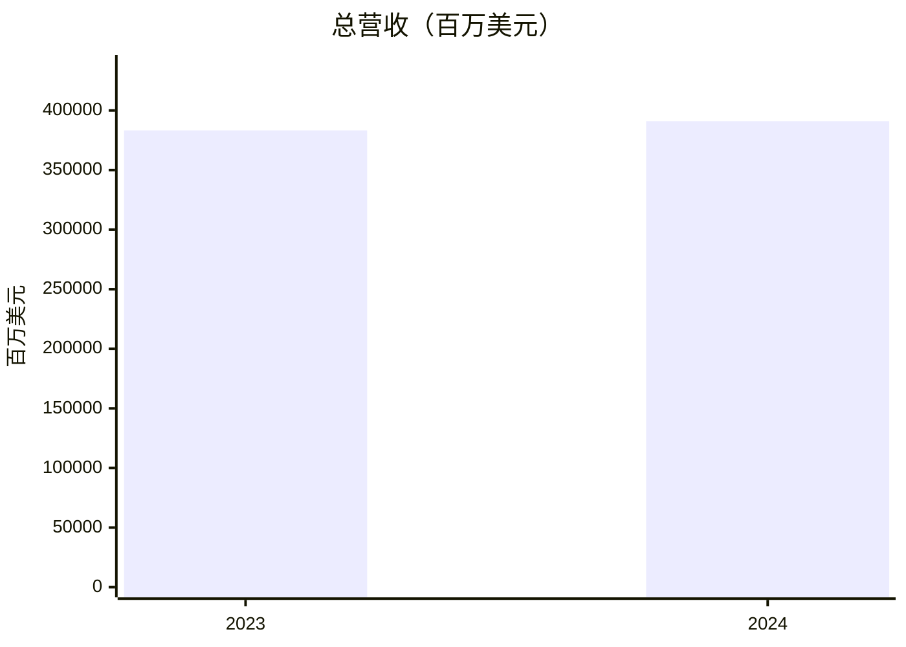
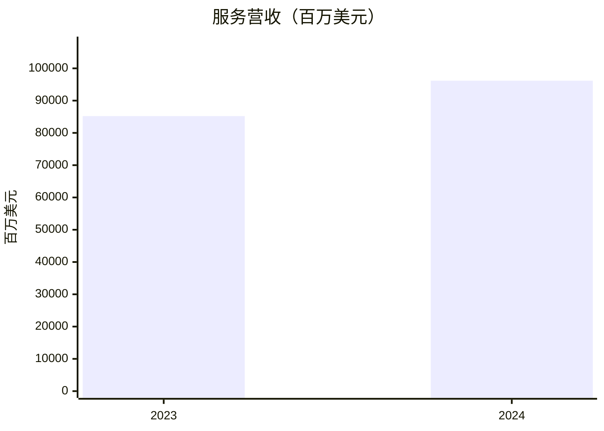

# Apple 2024 财年经营观察

本文使用固定历史资料，不构成投资建议。金额口径为百万美元，财年而非自然年。[S1]

## 经营数字

2024 财年总营收为 391,035 百万美元，2023 财年为 383,285 百万美元，同比 +2.02%。产品营收从 298,085 百万美元 变为 294,866 百万美元；服务营收从 85,200 百万美元 变为 96,169 百万美元。这些变化值得关注。[S1]

## 盈利表现

营业利润由 114,301 百万美元 增至 123,216 百万美元，净利润则由 96,995 百万美元 降至 93,736 百万美元。资料还列出一次性所得税费用 10,246 百万美元。营业利润与净利润的变动方向不同，应该分别观察。[S1][S2]

## 局限

两年数字能够描述变化，但尚不足以解释每项变化的原因。资料不包含未来需求和估值，不能据此推断未来收益。市场竞争、供应链以及监管变化仍需要后续跟踪。[S2]

## 数据图表

## 来源

[S1] Apple FY24 Q4 Consolidated Financial Statements — https://www.apple.com/newsroom/pdfs/fy2024-q4/FY24_Q4_Consolidated_Financial_Statements.pdf
[S2] Apple reports fourth quarter results — https://www.apple.com/newsroom/2024/10/apple-reports-fourth-quarter-results/