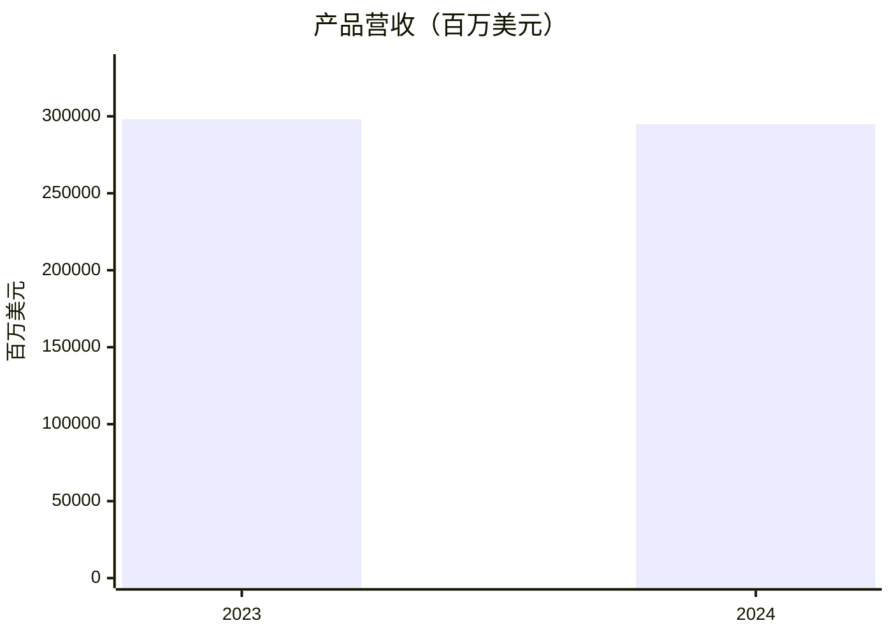
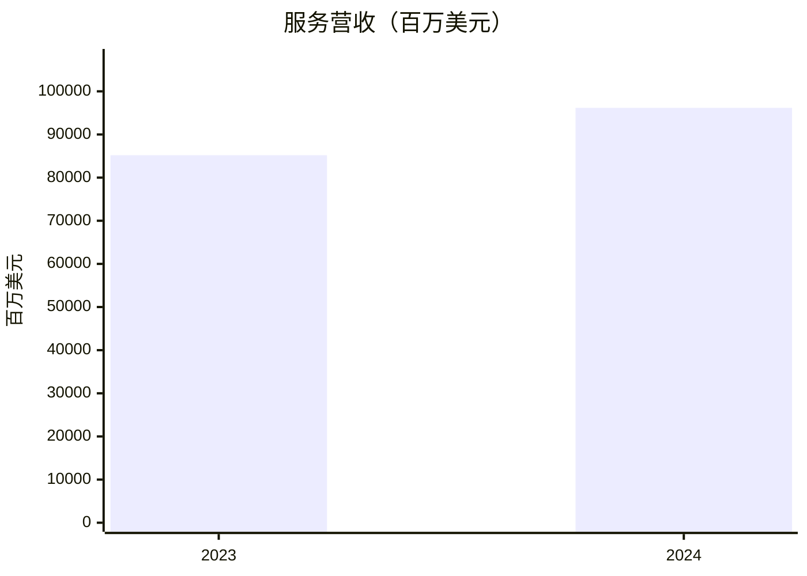

# Apple 2024 财年经营观察

2024 财年总营收同比 +2.02%，增长来自服务增加抵消产品减少，服务占比从 22.23% 升至 24.59%。与此同时，营业利润上升、净利润下降，需要结合一次性所得税费用理解，不能仅凭净利润下降就判断核心经营恶化。[S1][S2]

本文使用固定历史资料，不构成投资建议。以下均为全年数据，财年不同于自然年；金额单位为百万美元，利润采用财报列报口径。[S1]

## 营收增长来自哪部分

把产品、服务和总量放在一起看：产品下降，服务上升，两者相加后的总营收仍增长。[S1]

| 收入项目 | 2023 财年 | 2024 财年 | 同比 |
| --- | --- | --- | --- |
| 产品营收 | 298,085 百万美元 | 294,866 百万美元 | -1.08% |
| 服务营收 | 85,200 百万美元 | 96,169 百万美元 | +12.87% |
| 总营收（产品与服务之和） | 383,285 百万美元 | 391,035 百万美元 | +2.02% |

表中全年金额与同比均来自 [S1]。

下方产品营收图与服务营收图分别展示两年的下降和上升。读图要回答的是：服务增加的金额能否补上产品减少的金额？结合表中金额可知，服务的增加额不仅补上缺口，还留下了总营收的净增量。这解释了为什么产品下降时，总营收仍能增长，也说明服务权重在上升，但产品仍是收入的大头。[S1]

两张图的纵轴均为百万美元、从零起，但上限不同；不能直接比较柱子的高度或高低差。比较收入规模及增减金额时看上表，比较各自增长速度时看同比，也不要把两项同比直接相加。

这能说明哪部分贡献了收入增量，却不能解释增长原因。资料没有销量、价格、付费用户或细分业务数据，无法判断变化来自卖得更多、价格变化还是业务组合变化，也不能把服务收入增长直接解释为利润增长。[S1]

## 为什么营业利润上升，净利润却下降

营业利润可以理解为营收扣掉营业成本和经营费用后的利润；净利润还要计入营业之外的收支及所得税。因此，两者回答的问题不同：前者帮助观察经营环节的盈利，后者反映这些项目全部计入后剩下的利润。[S1]

两种利润放在同一张表里，重点看同比方向：经营环节的利润提高，最终留下的净利润却减少。[S1]

| 利润口径 | 2023 财年 | 2024 财年 | 同比 |
| --- | --- | --- | --- |
| 营业利润 | 114,301 百万美元 | 123,216 百万美元 | +7.80% |
| 净利润 | 96,995 百万美元 | 93,736 百万美元 | -3.36% |

表中均为财报列报的全年利润，来源为 [S1]。

资料列示，与欧盟税务裁决有关的一次性所得税费用为 10,246 百万美元。这项费用计入所得税，压低净利润，不扣减营业利润；费用金额大于全年净利润的减少额，说明它对理解两种利润的不同走势很重要。费用虽在当季确认，这里讨论的是其对全年结果的影响，没有将季度同比混入全年比较。[S1][S2]

因此，净利润下降不能直接证明核心经营恶化；营业利润上升也不等于最终净利润上升。这里保留财报列报的净利润，不把加回一次性费用后的金额当作实际净利润；仅凭现有资料，也不能把全部利润变化归因于税费，或断言服务增长导致了营业利润提高。[S1][S2]

## 这些资料还不能回答什么

这些是历史年度结果，不是最新经营表现或未来预测。两年数据能确认收入结构和利润方向的变化，不能证明趋势会持续。若要判断服务增长能否延续，需要后续的用户、价格及业务拆分数据；若要解释营业利润为何提高，需要成本、费用和产品与服务各自的盈利数据；若要完整解释净利润变化，还需要其他收支和税项的明细。[S1]

资料没有未来需求预期和竞争对手对比。后续可观察服务占比及两种利润能否持续改善，并结合市场竞争、供应链和监管变化理解结果，而不能只凭本期增长外推未来。[S2]

## 数据图表

## 来源

[S1] Apple FY24 Q4 Consolidated Financial Statements — https://www.apple.com/newsroom/pdfs/fy2024-q4/FY24_Q4_Consolidated_Financial_Statements.pdf
[S2] Apple reports fourth quarter results — https://www.apple.com/newsroom/2024/10/apple-reports-fourth-quarter-results/