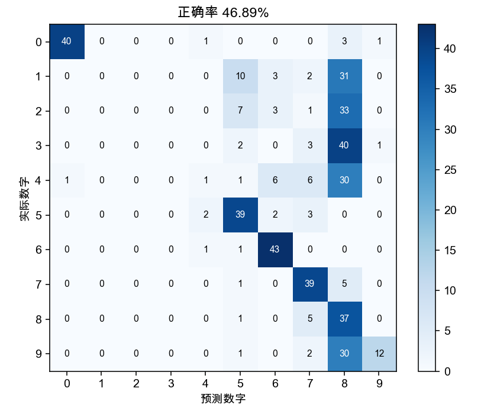
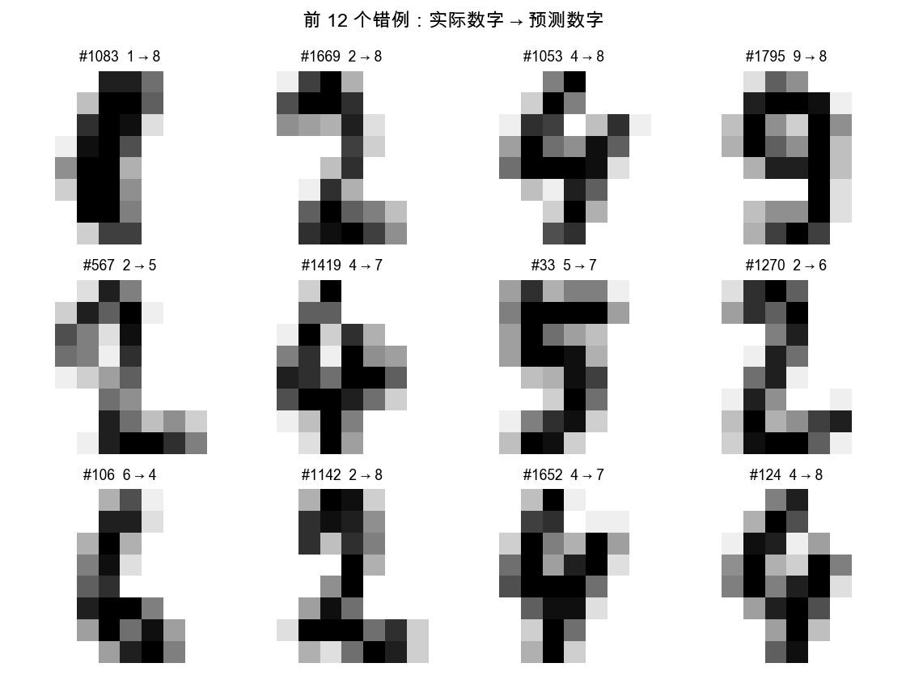

# CPU 手写数字分类

验证集正确率 46.89%，错分 239/450；训练和预测 0.004 秒。召回率较低的数字：1=0.0%、2=0.0%、3=0.0%

这是优化过程中反复使用的固定验证集，结果不代表独立新数据上的泛化效果。





## 当前配置

```json
{
  "model": "tree",
  "scaling": "none",
  "pca_components": 0,
  "params": {
    "max_depth": 3,
    "min_samples_leaf": 1
  }
}
```
