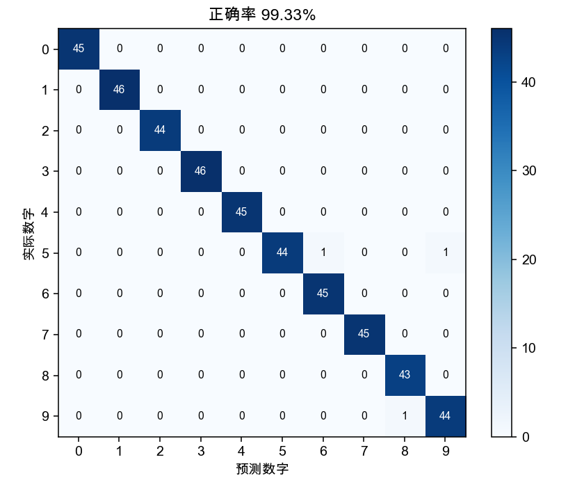
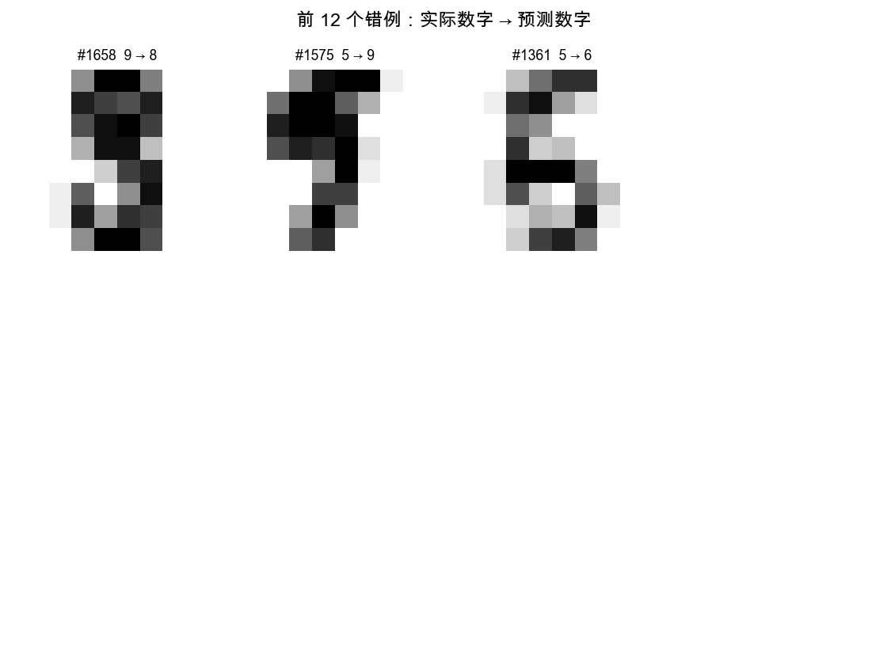

# CPU 手写数字分类

验证集正确率 99.33%，错分 3/450；训练和预测 0.025 秒。召回率较低的数字：5=95.7%、9=97.8%、0=100.0%

这是优化过程中反复使用的固定验证集，结果不代表独立新数据上的泛化效果。





## 当前配置

```json
{
  "model": "svm",
  "scaling": "none",
  "pca_components": 0,
  "params": {
    "C": 10,
    "gamma": "scale",
    "kernel": "rbf"
  }
}
```
