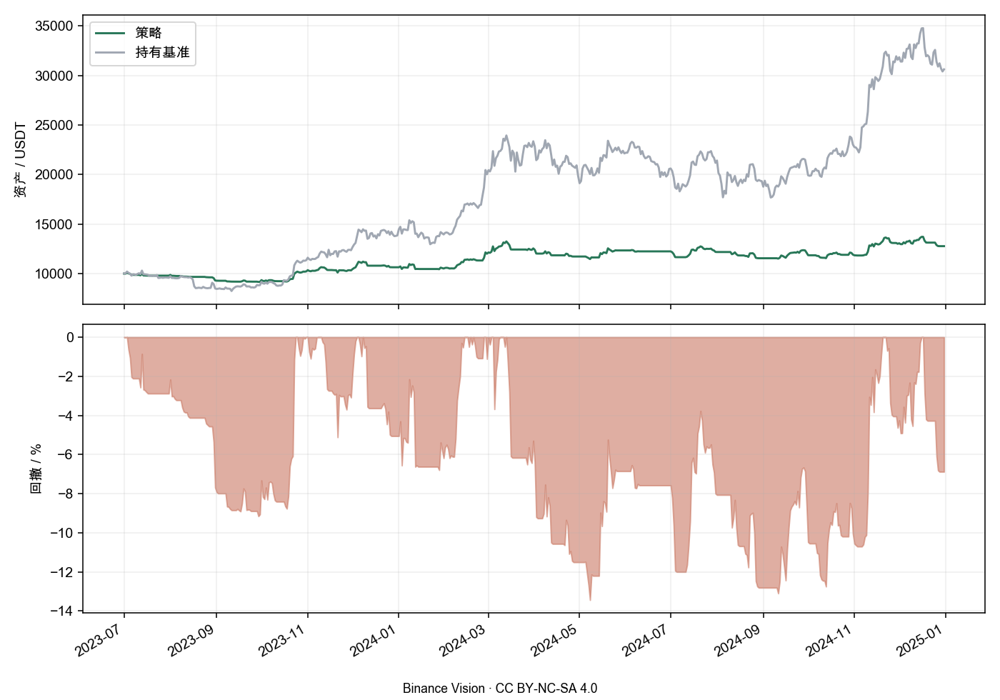

# 固定历史上的均线回测

累计收益 27.72%，最大回撤 13.44%，模拟成交 76 笔，费用与滑点合计 638.48 USDT。得分为收益减去 1.5 倍回撤。



绿色为策略，灰色为同期买入持有；下图为策略回撤。初始资产 10000 USDT，无杠杆、无卖空；每次成交按 10 基点费用加 5 基点滑点计算。信号在前一日收盘形成，次日开盘执行，期末按收盘价平仓并计成本。

这些结果来自同一段固定历史上的反复调参，只用于展示程序和参数迭代。它不是独立样本外回测，不代表未来收益，也不提供投资建议。

数据来源：Binance Vision BTCUSDT 日线。数据、图表及派生分析按 CC BY-NC-SA 4.0 提供，仅用于非商业研究与教学；来源链接及 SHA256 见 source.json。

## 当前策略

```json
{
  "fast_window": 3,
  "slow_window": 8,
  "threshold_bps": 0,
  "allocation": 0.5
}
```

## 模拟成交

| 日期 | 方向 | 成交价 | 数量 | 成本 | 信号日期 |
|---|---|---:|---:|---:|---|
| 2023-07-02 | 买入 | 30585.90 | 0.163229 | 7.49 | 2023-07-01 |
| 2023-07-07 | 卖出 | 29895.42 | 0.163229 | 7.32 | 2023-07-06 |
| 2023-07-12 | 买入 | 30622.10 | 0.160957 | 7.39 | 2023-07-11 |
| 2023-07-17 | 卖出 | 30232.00 | 0.160957 | 7.30 | 2023-07-16 |
| 2023-08-01 | 买入 | 29232.26 | 0.167287 | 7.34 | 2023-07-31 |
| 2023-08-05 | 卖出 | 29114.00 | 0.167287 | 7.31 | 2023-08-04 |
| 2023-08-09 | 买入 | 29770.41 | 0.163685 | 7.31 | 2023-08-08 |
| 2023-08-14 | 卖出 | 29303.85 | 0.163685 | 7.19 | 2023-08-13 |
| 2023-08-25 | 买入 | 26180.05 | 0.184400 | 7.24 | 2023-08-24 |
| 2023-08-27 | 卖出 | 26017.38 | 0.184400 | 7.20 | 2023-08-26 |
| 2023-08-30 | 买入 | 27716.34 | 0.173379 | 7.21 | 2023-08-29 |
| 2023-09-02 | 卖出 | 25805.04 | 0.173379 | 6.71 | 2023-09-01 |
| 2023-09-08 | 买入 | 26255.00 | 0.176463 | 6.95 | 2023-09-07 |
| 2023-09-11 | 卖出 | 25841.60 | 0.176463 | 6.84 | 2023-09-10 |
| 2023-09-15 | 买入 | 26522.73 | 0.173049 | 6.88 | 2023-09-14 |
| 2023-09-24 | 卖出 | 26575.97 | 0.173049 | 6.90 | 2023-09-23 |
| 2023-09-29 | 买入 | 27021.39 | 0.169771 | 6.88 | 2023-09-28 |
| 2023-10-11 | 卖出 | 27390.12 | 0.169771 | 6.98 | 2023-10-10 |
| 2023-10-17 | 买入 | 28500.77 | 0.161813 | 6.92 | 2023-10-16 |
| 2023-11-15 | 卖出 | 35551.20 | 0.161813 | 8.63 | 2023-11-14 |
| 2023-11-18 | 买入 | 36613.91 | 0.141301 | 7.76 | 2023-11-17 |
| 2023-11-19 | 卖出 | 36568.11 | 0.141301 | 7.75 | 2023-11-18 |
| 2023-11-20 | 买入 | 37359.85 | 0.138186 | 7.74 | 2023-11-19 |
| 2023-11-23 | 卖出 | 37408.35 | 0.138186 | 7.75 | 2023-11-22 |
| 2023-11-25 | 买入 | 37713.57 | 0.136774 | 7.74 | 2023-11-24 |
| 2023-12-12 | 卖出 | 41253.41 | 0.136774 | 8.46 | 2023-12-11 |
| 2023-12-21 | 买入 | 43668.92 | 0.123471 | 8.09 | 2023-12-20 |
| 2023-12-27 | 卖出 | 42508.93 | 0.123471 | 7.87 | 2023-12-26 |
| 2024-01-02 | 买入 | 44179.55 | 0.120245 | 7.97 | 2024-01-01 |
| 2024-01-14 | 卖出 | 42847.99 | 0.120245 | 7.73 | 2024-01-13 |
| 2024-01-28 | 买入 | 42120.63 | 0.124039 | 7.84 | 2024-01-27 |
| 2024-02-06 | 卖出 | 42708.70 | 0.124039 | 7.95 | 2024-02-05 |
| 2024-02-08 | 买入 | 44349.60 | 0.118449 | 7.88 | 2024-02-07 |
| 2024-02-23 | 卖出 | 51288.42 | 0.118449 | 9.11 | 2024-02-22 |
| 2024-02-27 | 买入 | 54476.48 | 0.103806 | 8.48 | 2024-02-26 |
| 2024-03-17 | 卖出 | 65300.64 | 0.103806 | 10.17 | 2024-03-16 |
| 2024-03-26 | 买入 | 69880.00 | 0.088819 | 9.31 | 2024-03-25 |
| 2024-04-03 | 卖出 | 65463.99 | 0.088819 | 8.72 | 2024-04-02 |
| 2024-04-07 | 买入 | 68896.00 | 0.087114 | 9.00 | 2024-04-06 |
| 2024-04-13 | 卖出 | 67116.52 | 0.087114 | 8.77 | 2024-04-12 |
| 2024-04-21 | 买入 | 64940.58 | 0.091092 | 8.87 | 2024-04-20 |
| 2024-04-27 | 卖出 | 63770.00 | 0.091092 | 8.71 | 2024-04-26 |
| 2024-05-05 | 买入 | 63892.03 | 0.091616 | 8.78 | 2024-05-04 |
| 2024-05-10 | 卖出 | 63074.00 | 0.091616 | 8.67 | 2024-05-09 |
| 2024-05-15 | 买入 | 61577.49 | 0.094311 | 8.71 | 2024-05-14 |
| 2024-05-26 | 卖出 | 69290.56 | 0.094311 | 9.80 | 2024-05-25 |
| 2024-06-05 | 买入 | 70537.83 | 0.087348 | 9.24 | 2024-06-04 |
| 2024-06-10 | 卖出 | 69648.15 | 0.087348 | 9.13 | 2024-06-09 |
| 2024-07-02 | 买入 | 62900.00 | 0.097192 | 9.17 | 2024-07-01 |
| 2024-07-05 | 卖出 | 57050.02 | 0.097192 | 8.32 | 2024-07-04 |
| 2024-07-12 | 买入 | 57339.89 | 0.101514 | 8.73 | 2024-07-11 |
| 2024-07-26 | 卖出 | 65799.95 | 0.101514 | 10.02 | 2024-07-25 |
| 2024-07-28 | 买入 | 67896.49 | 0.091907 | 9.36 | 2024-07-27 |
| 2024-08-01 | 卖出 | 64628.01 | 0.091907 | 8.91 | 2024-07-31 |
| 2024-08-10 | 买入 | 60837.99 | 0.099956 | 9.12 | 2024-08-09 |
| 2024-08-16 | 卖出 | 57541.05 | 0.099956 | 8.63 | 2024-08-15 |
| 2024-08-20 | 买入 | 59438.50 | 0.099392 | 8.86 | 2024-08-19 |
| 2024-08-21 | 卖出 | 59013.80 | 0.099392 | 8.80 | 2024-08-20 |
| 2024-08-22 | 买入 | 61156.03 | 0.096112 | 8.82 | 2024-08-21 |
| 2024-08-29 | 卖出 | 59034.90 | 0.096112 | 8.51 | 2024-08-28 |
| 2024-09-11 | 买入 | 57635.99 | 0.100066 | 8.65 | 2024-09-10 |
| 2024-10-02 | 卖出 | 60804.92 | 0.100066 | 9.13 | 2024-10-01 |
| 2024-10-07 | 买入 | 62819.91 | 0.094187 | 8.88 | 2024-10-06 |
| 2024-10-11 | 卖出 | 60326.40 | 0.094187 | 8.52 | 2024-10-10 |
| 2024-10-13 | 买入 | 63206.23 | 0.091619 | 8.69 | 2024-10-12 |
| 2024-10-24 | 卖出 | 66668.65 | 0.091619 | 9.16 | 2024-10-23 |
| 2024-10-29 | 买入 | 69962.21 | 0.084908 | 8.91 | 2024-10-28 |
| 2024-11-03 | 卖出 | 69374.74 | 0.084908 | 8.84 | 2024-11-02 |
| 2024-11-07 | 买入 | 75571.99 | 0.078158 | 8.86 | 2024-11-06 |
| 2024-11-27 | 卖出 | 91965.16 | 0.078158 | 10.78 | 2024-11-26 |
| 2024-11-30 | 买入 | 97460.00 | 0.067068 | 9.80 | 2024-11-29 |
| 2024-12-12 | 卖出 | 101125.00 | 0.067068 | 10.17 | 2024-12-11 |
| 2024-12-13 | 买入 | 100004.29 | 0.066489 | 9.97 | 2024-12-12 |
| 2024-12-20 | 卖出 | 97461.86 | 0.066489 | 9.72 | 2024-12-19 |
| 2024-12-26 | 买入 | 99429.61 | 0.065926 | 9.83 | 2024-12-25 |
| 2024-12-28 | 卖出 | 94299.03 | 0.065926 | 9.33 | 2024-12-27 |
