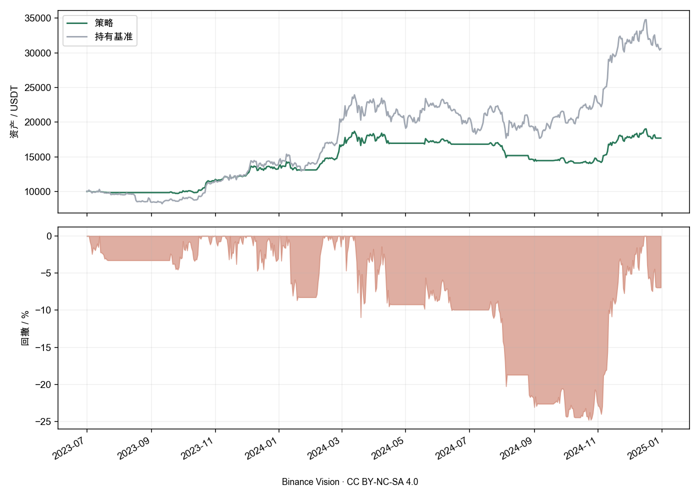

# 固定历史上的均线回测

累计收益 77.05%，最大回撤 24.80%，模拟成交 16 笔，费用与滑点合计 210.50 USDT。得分为收益减去 1.5 倍回撤。



绿色为策略，灰色为同期买入持有；下图为策略回撤。初始资产 10000 USDT，无杠杆、无卖空；每次成交按 10 基点费用加 5 基点滑点计算。信号在前一日收盘形成，次日开盘执行，期末按收盘价平仓并计成本。

这些结果来自同一段固定历史上的反复调参，只用于展示程序和参数迭代。它不是独立样本外回测，不代表未来收益，也不提供投资建议。

数据来源：Binance Vision BTCUSDT 日线。数据、图表及派生分析按 CC BY-NC-SA 4.0 提供，仅用于非商业研究与教学；来源链接及 SHA256 见 source.json。

## 当前策略

```json
{
  "fast_window": 10,
  "slow_window": 30,
  "threshold_bps": 0,
  "allocation": 0.6
}
```

## 模拟成交

| 日期 | 方向 | 成交价 | 数量 | 成本 | 信号日期 |
|---|---|---:|---:|---:|---|
| 2023-07-01 | 买入 | 30471.99 | 0.196607 | 8.99 | 2023-06-30 |
| 2023-07-21 | 卖出 | 29800.00 | 0.196607 | 8.79 | 2023-07-20 |
| 2023-09-19 | 买入 | 26762.50 | 0.220503 | 8.85 | 2023-09-18 |
| 2024-01-20 | 卖出 | 41659.03 | 0.220503 | 13.78 | 2024-01-19 |
| 2024-02-06 | 买入 | 42708.70 | 0.183933 | 11.78 | 2024-02-05 |
| 2024-04-17 | 卖出 | 63793.40 | 0.183933 | 17.60 | 2024-04-16 |
| 2024-05-19 | 买入 | 66915.20 | 0.151854 | 15.24 | 2024-05-18 |
| 2024-06-16 | 卖出 | 66228.25 | 0.151854 | 15.09 | 2024-06-15 |
| 2024-07-20 | 买入 | 66660.01 | 0.151225 | 15.12 | 2024-07-19 |
| 2024-08-07 | 卖出 | 56022.00 | 0.151225 | 12.71 | 2024-08-06 |
| 2024-08-27 | 买入 | 62834.00 | 0.144830 | 13.65 | 2024-08-26 |
| 2024-09-05 | 卖出 | 57970.90 | 0.144830 | 12.59 | 2024-09-04 |
| 2024-09-20 | 买入 | 62948.00 | 0.137614 | 12.99 | 2024-09-19 |
| 2024-10-10 | 卖出 | 60636.01 | 0.137614 | 12.52 | 2024-10-09 |
| 2024-10-16 | 买入 | 67074.14 | 0.126079 | 12.68 | 2024-10-15 |
| 2024-12-27 | 卖出 | 95791.60 | 0.126079 | 18.12 | 2024-12-26 |
